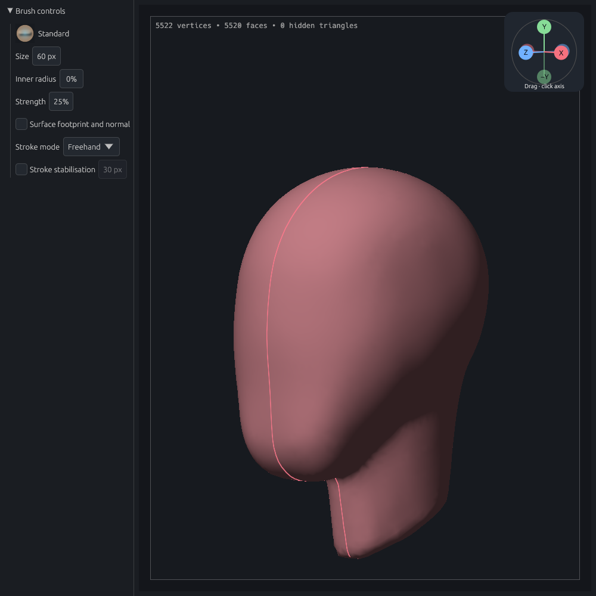

# Clay Form — Alpha 1

Clay Form is a desktop sculpting prototype. Shape a sphere with a mouse or pen, then save your model and return to it later.



*A head study in Clay Form’s sculpting workspace. This is a real app capture.*

Version **0.1.0-alpha.1** is an early testing release.
On startup, a development notice explains the current version and testing
expectations. Choose **Continue to Clay Form** to begin; **Don’t show again for
this version** remembers your choice until the version changes.

**New to Clay Form?** [Download Alpha 1](https://github.com/dustyghost/clay-form/releases/tag/v0.1.0-alpha.1) or [build from source](docs/installation.md), then [make your first sculpt](docs/guide/getting-started.md) in about ten minutes.

Clay Form is free and open source under [GPLv3](LICENSE). Official downloads
are free of charge. **Your creations belong to you:** use, sell, license or
keep your models, textures and other artwork private without crediting Clay
Form or publishing source. Imported third-party material keeps its own terms.
See [licensing and ownership](COPYRIGHT.md).

Alpha 1 downloads are available for Windows, macOS and Linux on x86-64 and ARM64.
The maintainer has tested Arch Linux; other platforms await user testing. See
[release readiness and current limits](docs/open-source-readiness.md).
[Release instructions](.github/RELEASING.md) cover
Windows, macOS, Linux and ARM64 artifacts, corresponding source and checksums.

## Run

To use a packaged build, [download Alpha 1](https://github.com/dustyghost/clay-form/releases/tag/v0.1.0-alpha.1). The instructions below cover running from source.

Windows packages require the [Microsoft Visual C++ v14 runtime](https://learn.microsoft.com/en-us/cpp/windows/latest-supported-vc-redist/)
for their CPU architecture if it is not already installed.

Follow the [installation guide](docs/installation.md) to install the tools, get the source and launch Clay Form. If you already have the source and Rust installed, run this from the repository root:

```sh
cargo run --release
```

The first build downloads dependencies and takes longer than later builds. When it finishes, the Clay Form window should open. Linux needs a Wayland or X11 desktop and a Vulkan-capable GPU and driver; Mesa lavapipe also supports software rendering.

## Documentation

**Start here:** [Make your first sculpt](docs/guide/getting-started.md) — turn the starting sphere into a cratered pocket moon while learning the brushes, navigation, undo and saving.

| Guide | Topics |
| --- | --- |
| [Sculpting and brushes](docs/guide/sculpting.md) | Brushes, alphas, symmetry, stroke modes, adaptive sculpting, undo/redo |
| [Editable 3D paths](docs/guide/paths.md) | Surface and free paths, one-drag rings, live brush guidance, automatic strokes, seam control |
| [Models and mesh tools](docs/guide/modeling.md) | Modelling, face extrusion, tunnels, component selection, submodels, primitives, transforms, remeshing and detail projection |
| [UVs, textures and GIMP](docs/guide/textures.md) | Seam-aware UVs, island editing, image painting and external texture editing |
| [Paint colours and materials](docs/guide/materials.md) | Vertex painting, material swatches, colour palette/sampler, fill and saving |
| [Edge loops and creases](docs/guide/edges.md) | Hole borders, support loops, edge selection, creasing, smooth subdivision, thickness rims |
| [Masks and selection](docs/guide/selection.md) | Mask editing, vertex groups, rectangle/lasso selection, visibility, split hidden |
| [Files and recovery](docs/guide/files.md) | Projects, brush files, OBJ import/export, diagnostic bundles, automatic recovery |
| [Navigation and tablet input](docs/guide/navigation.md) | Orbit, pan, zoom, display options, Huion setup |
| [Reference images](docs/guide/references.md) | Embedded photographs/drawings, placement, opacity, locking, visibility |
| [Workspace and shortcuts](docs/guide/workspace.md) | Pinned menus, collapsible panels, custom shelves, workspaces, key bindings |

The guides include worked examples and app screenshots. Try [comparing view projections](docs/guide/navigation.md#example-compare-orthographic-and-perspective-views), [sculpting a fine fold](docs/guide/sculpting.md#example-cut-a-fine-fold), or [importing the sample pyramid](docs/guide/files.md#example-import-the-sample-pyramid).

## For contributors

Start with the page that matches your change.

| What you’re doing | Read |
| --- | --- |
| Setting up or checking a change | [Development](docs/development.md) |
| Finding the code to change | [Architecture](docs/architecture.md) |
| Changing the viewport or measuring performance | [GPU rendering and profiling](docs/gpu-rendering.md) |
| Adding or changing controls | [UI design rules](docs/ui-design.md) |
| Writing a guide or updating screenshots | [Documentation style](docs/documentation-style.md) |
| Choosing the next feature | [Roadmap](docs/roadmap.md) |

When a feature changes, update its user guide alongside the code.

## Scope

Clay Form supports sculpting, subdivision, voxel remeshing and local adaptive mesh refinement. You can also paint colour, metallic and roughness values on vertices or textures, unwrap UVs and exchange images with GIMP. Quad retopology and sculpt layers are future work.

Meshes are limited to **500,000 vertices** and **1,000,000 triangles**. Large scenes may become slow before reaching those limits. Mesh and alpha file sizes are also bounded when loading.

Meshes retain quad topology where available; triangles are used for rendering and picking. The viewport supports orthographic and perspective views with wgpu rendering. Sculpting, picking and topology operations run on the CPU, which can limit editing speed in large scenes.

For technical details, see the [architecture guide](docs/architecture.md) and [GPU rendering guide](docs/gpu-rendering.md).
