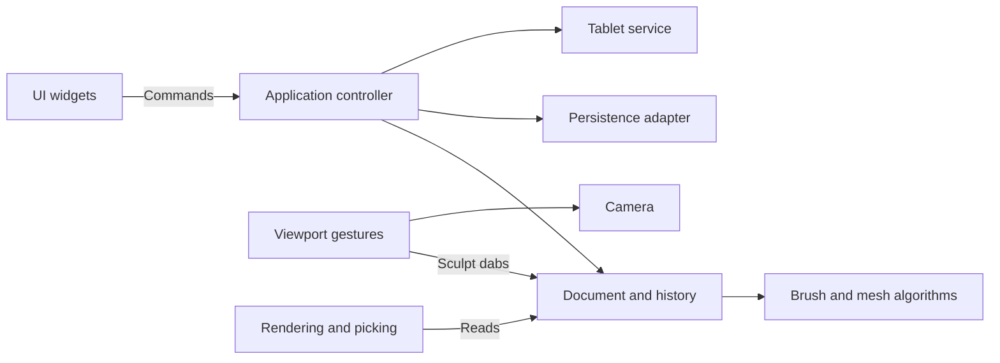

# Architecture

[Documentation home](../README.md#documentation)

Clay Form uses a small application controller, a single document owner, explicit UI commands, and separate desktop adapters. It keeps immediate-mode egui rather than adding an MVC framework, ECS, event bus, or plugin infrastructure.

## Ownership and responsibilities

| Module | Responsibility |
| --- | --- |
| `main.rs` | Create the desktop window and application. |
| `app.rs`, `app/`, `command.rs` | Own the application frame; resolve actions, dispatch commands, coordinate files and background jobs in separate modules. |
| `document.rs`, `document/` | Own persistent state and history; implement scene, mesh, masks, attributes, brushes, strokes, primitives, thickness, and transforms in focused modules. Expose read-only content to views. |
| `history.rs` | Keep geometry snapshots within 24 entries and a 128 MB budget, undo/redo, and invalidate redo on a new mesh edit. |
| `sculpt/` | Geometry math, brush/alpha data, mesh deformation, project schema and validation. No egui, files, or tablet dependencies. |
| `persistence.rs` | Read/write version 1 JSON, import image alphas, and export OBJ. |
| `mesh_job.rs` | Compute subdivision/remesh on a cancellable background worker; deliver results for transactional controller commits. |
| `camera.rs` | Session-only orbit, pan, zoom, projection, field of view and camera basis. |
| `viewport/` | Lock a drag into sculpt/orbit/gizmo mode; translate pointer movement into camera changes or dabs. Rendering/picking, the gizmo, and symmetry surface guides each have their own module. |
| `preferences.rs` | Validate shortcut assignments and tool layout; load/save independent user preferences. |
| `ui/` | Render toolbar, brush controls and confirmation dialog; emit commands without file or mesh operations. |
| `tablet.rs`, `tablet/linux.rs` | Publish normalized pressure and diagnostics; discover/read Linux devices in a worker that stops and joins when dropped. |

The application owns the document, camera, UI state, viewport gesture state and tablet service. Document content stays private. Mesh edits go through document methods; camera changes never dirty the document or create undo entries. Each stroke records one geometry snapshot regardless of its number of dabs. Symmetry belongs to document editing rather than the renderer. `sculpt/symmetry.rs` transforms dabs across mirror planes and radial sectors around an object-space center. The mesh evaluates all copies against one geometry snapshot and blends their displacement directions by influence, normalized to the strongest per-vertex influence. Opposing mirrored motion cancels at the symmetry seam, avoiding sideways drift and folds without multiplying brush strength. Standard blends the direction separately from depth, retaining the strongest pressure/mask-weighted displacement length so diverging normals do not weaken the seam. For soft Standard alphas, `sculpt/overlap.rs` joins closely overlapping footprints along short segments through their influence-weighted centre, bounded by the contributing centres and tapering the correction by footprint spread and contribution. It fills the central falloff valley up to the usual pressure/mask-weighted peak without accumulating depth; coincident and separated copies keep their profiles, and image/hard/square alphas are unchanged. Other tools retain displacement averaging (including intentional cancellation for mirrored Grab motion). Mask opacity retains the strongest influence. The renderer independently intersects those symmetry planes with visible surface triangles for guides.

`viewport/projection.rs` shares projection, depth-aware screen scale, rays, and control placement. Perspective fits the eye distance to the visible scene when changing projection and uses near clipping and a scene-sized far plane; zoom enlarges the projection without moving the eye through the sculpt. Projection/FOV commands preserve visible-model framing by adjusting zoom once, rather than reframing during sculpting. GPU surfaces and wireframe use homogeneous projection; CPU perspective picking intersects rays with the same cached triangles and interpolates world-space normals. The CPU-only test painter omits triangles crossing the near plane; the production GPU renderer clips them, and picking supports them. Perspective path cuts converge at the eye and unfold caps through the same projection.

The viewport is an input adapter. It emits domain `Dab` values to the document, independent of mesh rendering details. The scene renderer reads mesh data and prepares projected triangles for display and surface picking. The OpenGL renderer uses cached GPU geometry; sculpt algorithms remain in the document and geometry modules. CPU projection and picking share the cached surface with the renderer.

UI commands are executed between panels so the viewport sees the latest document. Destructive operations capture their target when requested. An Open confirmation therefore retains its target even if the toolbar path changes. Save-and-continue uses a separate path and refuses to overwrite that target. Failed loads leave content, dirty state and history intact.

## Compatibility and storage

Screen reference images belong to `Document` and the optional project `references` collection, separately from geometry snapshots. `reference.rs` bounds and decodes PNG/JPEG input, applies photo orientation, and shares decoded pixels and embedded PNG bytes through `Arc`. Saving and recovery reuse those bytes; legacy projects omit the empty collection. Reference edits mark the document modified without changing sculpt history or display geometry revisions. `viewport/references.rs` caches egui textures and previews move/resize gestures until release; cancellation leaves the document intact. The shared References menu and action catalog route file access and document updates through the controller.

The version 1 `.clay` and `.brush.json` formats remain compatible. Projects support optional `mesh_settings` (inactive levels and dynamic settings) and `symmetry` fields; defaults are omitted when saving, and old files load at one subdivision level with symmetry disabled. Vector positions remain JSON triples, and image-alpha pixels remain JSON arrays. Pixels are shared immutable `Arc<[f32]>` buffers in memory, making brush copies inexpensive without changing serialization. Mesh history is session-only, as before. The saved project does not include camera or undo state.

`tests/fixtures/v1-project.json` is an explicit version 1 compatibility fixture. Tests cover format preservation, brush/mask behavior, disk persistence, bounded history, stroke undo/redo, failed opens, save/open protection, and navigation gestures.

## Extending the app

Add brush data and algorithms in `sculpt/`, then expose their settings in `ui/`. Add user operations as commands handled by `App`; put their document effects in `Document` methods. Keep device-specific logic under `tablet/`, and keep render or picking changes under `viewport/`. Introduce a trait or a new subsystem when a second implementation needs it; the existing concrete modules are sufficient for the current app.

User preferences use their own versioned JSON file in the user configuration directory. UI edits bindings and layout without touching the document. The controller loads preferences at desktop startup, saves after a debounce and on exit, and translates keyboard actions into existing commands. Viewport options carry the chosen hold modifiers. Tests use explicit temporary paths and do not read or write the user configuration.

## Continuous edit sessions

`document/edit.rs` stores one typed session for primitive parameters, thickness modifier, mask intensity, or mask threshold. The mask-intensity session owns its original peak and masks, so dragging through zero retains the information needed to restore soft values. `Command::edit_kind` identifies which commands can continue a session. The dispatcher closes a session when the command changes kind; commands blocked by modal or background-job guards do not interrupt it. The first changed update records history. Repeated updates reuse that entry; unchanged controls do not create one.

Pointer release and focus loss finish parameter sessions at the application frame boundary. Switching models or applying a discrete document edit also finishes them. `end_primitive_edit` is specific to primitive gestures; it no longer resets unrelated mask or thickness state. Controller tests in `app/parameter_tests.rs` exercise dispatch plus these input boundaries, including switching controls, undo/redo, hidden masks on stored levels, and clearing an already-empty mask.

## Mesh workflows

`Geometry` owns the active `Mesh` and `MeshSettings`: lower levels in ascending order, higher levels in reverse order, and dynamic remesh settings. `sculpt/subdivision.rs` shares edge midpoints and retains original vertex indices. Going down samples that original-vertex prefix; going up interpolates the difference from the saved parent's vertices and adds it to the stored high mesh. This preserves high-level residual detail rather than replacing the level with a fresh subdivision. The approach uses linear triangle refinement, with no Loop smoothing or tangent-frame displacement transport. Mesh-stack topology is validated against deterministic refinement at load and before topology commits.

`sculpt/remesh.rs` rasterizes oriented triangles onto yz scanlines, fills their nonzero winding intervals along x, and extracts the voxel boundary using six consistently arranged tetrahedra per grid cube. A global grid-edge cache shares surface vertices; each triangle is oriented toward the outside. Winding occupancy supplies the sign for a narrow-band distance field measured against the input triangles. Surface crossings interpolate these distances instead of using grid-edge midpoints, avoiding quantized voxel bands. Two mild relaxation passes regularize the triangulation. Subvoxel details and masks are still lost. For background on tetrahedral isosurface extraction, see [Paul Bourke's polygonisation reference](https://www.paulbourke.net/geometry/polygonise/); for multiresolution editing concepts, see [Zorin, Schröder, and Sweldens](https://graphics.stanford.edu/~dzorin/multires/meshed/). The implementation here is a simpler linear refinement and world-space detail scheme.

The controller locks geometry edits while a worker holds its snapshot. New/Open/Quit and explicit cancellation discard the in-flight result. Mode changes, level changes, and worker completions record the entire geometry stack in history. Brush, symmetry, camera, and file actions retain their existing separate responsibilities. Automatic remeshing is triggered by a completed deformation stroke, never a mask-only stroke, and waits for release before sculpting can resume after an in-flight topology change.

History entries pair a geometry snapshot with an action label shared by undo and redo. The document exposes read-only labels and counts for UI feedback. A stroke holds a provisional snapshot until its first actual geometry or mask change, then transfers it into history without another clone; an unchanged stroke discards it and preserves redo. Completed background jobs supply explicit subdivision/remesh labels when the controller commits their results.

## Local adaptive sculpting and Snake

`sculpt/adaptive.rs` provides local conforming edge splits, conservative edge collapses, and quality-improving edge flips. Candidate faces intersect the brush footprint and front-facing dab hemisphere (Snake uses a volumetric tip); masks, pressure, and alpha eligibility restrict work. Every selected edge midpoint is reused across incident faces, and triangles with one, two, or three split edges are triangulated consistently. Collapses require the closed-manifold link condition, nonduplicated faces, similar masks, smooth edge normals, and no nearby triangle flips. Accepted collapses have disjoint affected vertex neighborhoods. Compaction remaps the entire index array while leaving untouched vertex coordinates intact.

`AdaptiveSettings` is an optional, default-omitted mesh-settings field. Its mode is mutually exclusive with subdivision stacks and voxel mode. Density uses a screen-pixel target converted through the world-space dab radius, or a fraction of brush radius. The document applies refinement/simplification before deformation and refinement after it, using all symmetry-transformed dabs together. A shared frame budget caps work at 256 edge splits, one batch of at most 32 collapses, eight refinement scans, and two quality scans with at most 128 edge flips. Heavy density changes therefore converge over later freehand dabs. Drag Rect/Dot additionally refine their undeformed footprint before applying displacement, bounded to 8,192 extra splits and 32 scans of at most 512 splits. Edges crossing a strong alpha transition target half the normal edge length. This lets newly inserted vertices sample the original alpha instead of interpolating an already jagged stamp; preview and commit share this pass. Extremely large stamps or very fine detail may still reach the bound. A provisional stroke snapshot covers topology and deformation together, yielding one undo step. Continuous density-parameter edits do not fill geometry history; entering/leaving the mode records a geometry edit.

The renderer shares its cached geometry snapshot with picking in each frame. Picks and surface guides use the same geometry snapshot as projected coordinates, preventing stale face/vertex indices when a dab changes topology. Guides are painted before mesh edits. `Viewport` seeds Snake's handle from the nearest unmasked surface vertex once, keeps its world-space tip, mask mobility, and starting normal for the duration of a stroke, continues dabs outside the original surface, and advances a continuous handle by the pressure/alpha-weighted motion rather than snapping between vertices. `Kind::Snake` supplies alpha/pressure-weighted drag displacement with a small outward lift; subtract reverses it. Its influence has smooth volumetric support and includes the sides of a bent tip. Soft alpha uses a rigid inner core with falloff applied to the surrounding volume, preventing repeated dabs from pinching every off-center vertex into a needle. Other alphas retain their projected pattern inside that volume. Adaptive Snake also redistributes nearby vertices tangentially with face-inversion checks, and protects the tip core from collapse and redistribution. Drag interpolation limits Snake steps to a tenth of the brush radius. This is a hook-style deformation brush, without a separate tube-generation or curve system.

For the requested behavior, see external software vendor's adaptive sculpting controls. For the manifold safety principle, see [CGAL's edge-collapse reference](https://doc.cgal.org/Manual/3.6.1/doc_html/cgal_manual/Surface_mesh_simplification_ref/Function_Surface_mesh_simplification--edge_collapse.html). Clay Form implements its own bounded CPU routines with no added dependencies.

Adaptive Smooth with simplification enabled skips edge splits and doubles the ordinary collapse ratio, capped at 95% of the target edge length. Smooth collapses also check resulting triangle quality (a 0.2–0.35 quality floor based on the original face). Quality flips remain available. This prevents cleanup strokes from replacing removed vertices with newly split ones, while preserving the shared work budget and conservative manifold/mask checks. Shift smoothing uses the same path.

## Model scenes and transforms

Transforms prepare new vertex coordinates for the active surface and its stored levels without cloning inactive submodels or rebuilding unchanged topology. Every resulting coordinate is checked before any mutation. The first changed update captures a complete scene snapshot for undo; later updates in the same drag retain the existing face, mask, and group buffers. Parametric primitives still regenerate and validate their recipe before commit. Invalid updates leave geometry, dirty state, and history intact.

`Geometry` snapshots contain the active surface and its subdivision stack plus inactive `Submodel` records and `SceneSettings`. Inactive records retain full geometry; display uses the lowest existing level. The active index describes its position among the ordered inactive records, so selection preserves scene order. Per-model metadata owns visibility and group membership; scene settings own group order. Optional default-omitted project fields preserve the legacy single-model JSON fixture. Model organization and transforms use the same bounded scene history as sculpting.

The viewport caches merged visible display surfaces, normals, and triangle ownership by a session-only document display revision. OpenGL draws model geometry with a depth buffer; CPU picking projects the same immutable geometry snapshot. Active faces alone supply symmetry guides. A pick on an inactive foreground surface cannot sculpt the active model behind it; a selection click waits for release before permitting a new sculpt stroke.

`sculpt/transform.rs` provides positive affine scale, translation, directional stretch, and axis-angle rotation around a pivot. Rotation uses `Vec3::rotated`, also shared by radial symmetry. Direction transforms omit translation and keep primitive basis vectors independent of center-coordinate precision. Soft mask mobility scales a rotation angle, so repeated updates preserve the radius and reversing a drag restores soft-weight positions. `Document::apply_transform` applies increments to all stored active levels, optionally weighted by mask mobility, validates before mutation, and records a single history entry per drag. World handles constrain movement/scale to an axis or provide view-plane movement/uniform scale. Action Line stores temporary world-space endpoints in the viewport and reuses its start and direction for scale and rotation. World mode has an optional placed pivot; both modes share the same ring implementation in `viewport/transform/rotation.rs`. Ring drags intersect the projected rotation plane, falling back to a latched screen tangent for edge-on views. Signed incremental angles cross the ±π boundary without jumping; the accumulated angle is shown during a drag. Releasing or losing focus ends the drag. Operation switches preserve pivot/line placement, while document/history resets clear viewport state. Placement is session-only and does not create history or dirty the document. `ui/transform.rs` renders one shared operation row for the floating toolbar and sidebar, using the existing action/command catalog. The renderer and UI retain no ownership of persistent transforms or organization.

## Parametric primitives

`sculpt/primitive.rs` defines bounded, serializable primitive recipes and deterministic welded triangle generators. Cube axis spans share integer lattice keys; UV surfaces share poles and seams; icospheres refine a convex icosahedron and project vertices onto the unit sphere. Cylinder/cone poles avoid duplicate tip vertices. Positive affine placement lets ordinary transform tools move, scale, or rotate a recipe without baking it. The removed Human head primitive has no generator or controls. When loading projects or recovery copies, `MeshSettings` drops only its legacy `HumanHead` recipe and preserves the stored mesh as sculptable geometry. Other primitive recipes still deserialize and validate normally; unknown kinds remain errors.

An optional default-omitted `MeshSettings::primitive` keeps the recipe beside its preview surface, including inactive submodels. Validation regenerates the recipe and requires the stored preview to match, with no subdivision stack, masks, or adaptive/voxel mode. Conversion removes only the recipe; the surface stays exact. Document operations gate brush and topology edits until conversion, and parameter drags record one history entry until release.

The UI captures the active model for a modal replacement warning. The collapsible Primitive section within Submodels emits validated updates; viewport handles edit the same recipe. Shape, resolution, wireframe and conversion share one inline section, rendered only for an active primitive. The former parameter window and floating resolution panel are removed. Sidebar input cannot also manipulate the viewport. Parameter editing and conversion are persistent document operations, while section expansion and handle gestures stay session-only. Legacy projects still omit default primitive fields and retain their original JSON shape.

Brush icons use bounded square RGBA buffers shared through `Arc`, stored as compressed PNG data in optional brush fields. `brush_icon.rs` generates default illustrations and renders an auto-fitted capture of the active mesh using the camera basis, interpolated lighting and a depth buffer. The capture modal previews the snapshot before assigning it; it blocks viewport gestures and shortcuts while open.

Brush IDs persist across edits and file exports. Built-in brushes have stable IDs, duplicates receive new random IDs, and legacy brushes derive deterministic IDs from their contents. `Document::import_brushes` validates a complete batch and merges by identity before committing, so errors leave the library intact and repeated imports do not add copies. `.brushes.json` libraries use a versioned wrapper around the same brush schema.

## GPU viewport

`viewport/gpu.rs` owns OpenGL programs, vertex/index buffers, lazily built wireframe buffers, the brush-alpha texture, and a viewport-sized color/depth framebuffer. `gpu/display.rs` builds camera-independent display geometry and edge adjacency; `gpu/shaders.rs` performs projection, lighting, masking, front-facing edge rejection, and surface alpha/symmetry projection. A glow paint callback draws the scene before egui overlays, resolves color into egui’s framebuffer, and restores framebuffer/viewport state. The framebuffer resizes in physical pixels, preserving high-DPI sizing and egui clipping.

Geometry-changing edits, mask edits, model selection/visibility, undo/redo, topology operations, and New/Open advance the display revision. Brush settings, symmetry settings, and camera changes do not invalidate geometry buffers. The CPU scene retains projected coordinates and front-facing ownership for picking and gizmos, without sorting/shading faces or rasterizing a wireframe depth buffer in the GPU path. The CPU paint path remains available for headless interaction tests.

`App::with_gl` initializes resources with the context current. Gesture cancellation preserves the renderer; `App::on_exit` explicitly deletes its GL objects while the context is valid. GPU alpha uses the same rotation, image interpolation, inner core, and falloff as CPU brush weights. Alpha and symmetry colors apply to active surfaces in the solid shader, so inactive foreground models occlude them. Tangent rings and the normal indicator remain egui controls. See [GPU rendering](gpu-rendering.md) for the offscreen GL checks and load profile.

## Mask edits and cuts

The Mask menu emits explicit invert/delete commands, gated during topology jobs. Inversion complements active and stored-level masks without changing positions. Deletion removes fully masked triangles at the per-submodel selection threshold (50% by default), retains quads only when their complete triangulation survives, and compacts remaining vertices in their original order. Surviving masks, model metadata, and inactive submodels are preserved. A cut resets the active subdivision stack and closed-surface modes; one undo snapshot restores the original geometry and settings. Both edits invalidate the GPU display cache.

Deleting all surface faces leaves an empty active model with no vertices. Mesh/project validation accepts this state; rendering and picking handle it, subdivision/remeshing report that there are no faces, and initializing a primitive places it at the origin. Transform handles are hidden for empty meshes. Empty models remain saveable and undoable.

## Thickness modifier

An optional, default-omitted `ModelMetadata::temporary_thickness` stores a total centered shell thickness per submodel. `sculpt/thickness.rs` verifies oriented manifold edges and boundary loops, offsets front/back layers along source normals, reverses the back-layer winding, and joins boundary edges with quad walls. It preserves masks and polygon topology and observes the ordinary mesh-size limits. This is a normal-offset shell, without self-intersection repair.

The renderer caches a separate shell display mesh when thickness is enabled. The CPU scene still uses the original geometry for picking, guides, and controls, so preview faces never introduce invalid sculpting indices. Render-only shells are rebuilt when the document display revision changes and use the existing GPU pipeline. Subdivision LOD selection remains per model. Invalid/inapplicable preview settings on changed topology fall back to the original display surface; Apply validates before changing the document.

Thickness-value drags share one history entry until release. Apply generates the same shell as the preview, clears the setting, converts primitive recipes, and resets the active subdivision/topology settings in one undoable geometry transaction. Default metadata serialization keeps legacy projects unchanged.

### Weighted groups

`Mesh::vertex_groups` stores named dense vertex-weight arrays (maximum 64); `Mesh::polygroups` stores optional 1-based face categories referencing that registry, with zero for ungrouped. Quad halves share one category. Both fields are default-omitted for legacy project compatibility. Registry names must match across subdivision levels. Mask threshold and thickness grouping options belong to `ModelMetadata`.

Document group edits affect the active mesh and its stored levels transactionally, record one history entry, and invalidate display geometry. Mask intensity drags keep a baseline so a drag through zero can recover its falloff. Group weights remain separate from the transient mask. Midpoint/center subdivision and adaptive edits interpolate weights; cuts compact them alongside geometry. Voxel remeshing uses spatial nearest-neighbor transfer for weights and face centroids for categories. History memory accounting includes the new arrays; saving enforces the same 128 MB cap as loading.

Mask blur and sharpen use the same transactional document path for the active mesh and each stored subdivision level, including hidden faces. Blur deduplicates polygon edges, excludes quad diagonals, and takes a half step toward each vertex's neighbour mean using the unchanged source mask. Isolated vertices and uniform masks remain unchanged. Sharpen applies `clamp(2 * mask - 0.5, 0, 1)`. Neither operation changes geometry, groups, visibility, or inactive submodels. Existing subdivision mask propagation applies when switching levels. No-op edits preserve dirty state and redo; shortcut dispatch cancels viewport input and waits for release before resuming sculpting.

Each vertex group has a default-visible, default-omitted `visible` flag. The display cache removes hidden categorical faces and their quads from both rendering and CPU picking while retaining original vertex indices and normals. Brush edits protect hidden face vertices, including shared boundaries; adaptive collapse and relaxation preserve those boundaries. Visibility edits apply across subdivision levels and use scene history. The default document and New action assign the sphere to a Base group; loading older projects retains their original group data.

`Brush::stroke_mode` defaults to Freehand and omits that default from serialized data, preserving legacy brush identities and JSON. `viewport/stroke.rs` owns pending Line/Drag Rect/Drag Dot gestures: a brush snapshot, screen endpoints, an anchored surface hit and the last down-frame pressure. Drag stamps render a temporary mesh through the CPU/GPU scene path, using the same alpha, symmetry, mask and adaptive operations as the final stamp. Picking stays on the original geometry, and every preview starts from that geometry to prevent buildup. Line retains a guide preview. Neither preview touches Document geometry or history; release applies dabs through the ordinary document/symmetry/history pipeline. Drag Rect's posed radius and rotation are transient, including the radius used for adaptive detail. Relief brushes use a fourfold single-stamp displacement gain; masks and smoothing/flattening/pinching retain their existing weights. Escape, disabled interactions and viewport cancellation discard the pending gesture; the release frame remains blocked so canceled clicks cannot restart a stamp. Camera gestures and Grab/Snake retain their existing behavior. Line sampling is bounded to 257 dabs per gesture.

`viewport/stabilizer.rs` optionally filters Freehand input through a screen-space trailing tip before the existing dab spacing and picking path. The distance is latched at stroke start. Stationary input never catches up, and release discards the trailing state without an endpoint dab. Pressure and temporary modifiers remain live inputs to the existing document pipeline. `Brush::stabilize` and `stabilizer_distance` omit their defaults, retaining legacy brush serialization and identities; Grab, Snake, and patterned modes bypass the filter.

## Slice tools

`sculpt/slice.rs` intersects a view-defined plane with triangle edges, sharing each new intersection across incident faces and interpolating masks and all weighted vertex groups. Distances use double precision and a scale-relative on-plane tolerance. Whole quads survive where their triangles and face categories remain intact. Polygroups splits categories crossing the plane without disconnecting geometry; Trim compacts one half; Separate produces two independently indexed surfaces and inserts the second after the active submodel.

Capped cuts require a closed, oriented source. Directed boundary edges form loops in the cut plane. Positive outer loops and their contained negative holes feed [Earcutr](https://docs.rs/earcutr/0.5.0/earcutr/fn.earcut.html) for planar triangulation. Near-collinear points are simplified for triangulation, then exact original boundary chains are restored, including points omitted by the triangulator, avoiding T junctions. Caps receive a new face/vertex group and closed-manifold validation runs before any commit. Invalid boundaries, group/mesh limits, misses, and cancellation return an error without changing the document.

`viewport/slice.rs` owns the session-only line, side labels, and minimum drag threshold. Preview leaves document geometry intact. Geometry, projection, option changes, modal input, and Escape invalidate the pending line. Release emits the plane and settings for `Operation::Slice`; the existing background worker and document replacement path provide cancellation, display invalidation, and a single undo snapshot. A successful cut resets only active mesh settings; scene metadata and unrelated submodels survive. The project format needs no additional fields.

`sculpt/slice_path.rs` cuts a simple open polyline extruded along the camera depth axis. It rejects intersecting paths (including extended end rays), splits source faces against each segment's supporting plane, then assigns the resulting faces to the nearest oriented path side, using corner bisectors where adjacent segments share their closest endpoint. Supporting planes can add triangulation outside the visible path. Caps are triangulated in unfolded arc-length/depth coordinates, split at every bend, and folded back to world space. Near-bend coordinates are aligned within a scale-relative tolerance to avoid splitting shared boundary edges twice due to floating-point error. Final closed-manifold validation occurs after folding, before committing. Mesh and group limits and worker cancellation apply throughout.

Path drafts store editable points and per-corner quadratic rounding in viewport pixels. The displayed sampled curve is exactly the curve passed to the cutter. Point dragging, segment insertion, deletion, signed turn editing, 15° snapping, and Space translation only modify session state. Selected interior corners expose a diamond rounding handle and linked tangent handles with hit priority over path insertion. Handle drags update the existing rounding value, bounded by adjacent segment lengths; they never move or insert control points. Sharp/Rounded presets and the numeric control use the same value. Apply/Enter emits `Operation::SlicePath`; drafts survive worker failure/cancellation, while successful geometry changes invalidate them. Mode/side/cap options can change without losing a draft; projection or source revision changes invalidate it. Preview and input controls do not persist in project files.

Thickness offsets use angle-weighted vertex normals. Near open boundaries, the offset directions are regularized on short edges with bounded, deterministic passes, retaining unit direction lengths and centered thickness. This prevents the mismatched one-sided normal estimates of sliced sliver triangles from folding the inner shell or twisting the rim. Generated front/back faces must retain their source orientation, and the two triangles of each rim quad must agree in orientation; invalid local folds fail before committing. This remains a normal-offset shell, without general self-intersection repair. Temporary preview and Apply use the same generation path.

## Partial mesh visibility

`Mesh::hidden_faces` stores optional per-triangle hiding independently of masks and categorical polygroups. `face_visible` combines both sources; display geometry filters faces and retains source-face indices for polygroup picking. Sculpting fixes vertices touching any hidden face. Subdivision, adaptive edge operations, thickness, and face extraction carry visibility with their face mappings. Older projects omit the field and remain fully visible apart from existing group visibility.

`viewport/visibility.rs` handles latched rectangle and lasso gestures ahead of zoom and sculpt routing, including Alt, Space and Escape. `SelectionTool` distinguishes visibility rectangles, visibility lassos, and mask lassos; Ctrl+Shift still selects rectangles when no explicit tool is active. Lasso paths retain pointer samples within each frame, close on release, and use an even/odd point-in-polygon test for concave and crossing outlines. A live outline previews the operation without mutating the document. Degenerate paths are ignored, and paths beyond 4,096 samples are cancelled explicitly. Focus/pointer loss, document revision changes, projection changes, tool switches, and Escape discard the draft. Mask lassos use transactional `Document::mask_region` edits on every stored level, protecting hidden faces and boundary vertices via `sculptable_vertices`; geometry, groups, and inactive submodels are unchanged.

Region selection uses projected polygon centers through all depths and selects complete quads. Document visibility edits apply the same region to each stored level, normalize visibility consistently, and avoid history entries for unchanged effective visibility. Split Hidden compacts visible/hidden face sets into two meshes and records the entire scene once, preserving attributes and model order while resetting only the split model's topology settings.

`Mesh::merged_with` concatenates indexed surfaces, offsets face/group references, and extends each independent group's weights with zeroes over the other surface. `Document::merge_down_target` uses the panel's folder order. Merge Down prepares and validates both surfaces before installing the combined model, bakes recipes/thickness, preserves the active identity, and records the scene once for undo.

### Custom interface actions

`ui/menus.rs` shares built-in menu controls between toolbar popups, pinned windows and sidebar sections, using stable `BuiltinMenu` identities. Preferences and named workspaces store optional `PinnedMenu` records; old settings default to no pins. Pinned windows use the saved current position, constrain themselves to the screen, and remain available with the compact toolbar. Closing or unpinning removes only that record. Menu-only close requests leave floating controls open. Their rectangles block viewport gestures, including on the frame a window is closed; moving or pinning controls never edits the document.

`ui/sidebar.rs` renders whole built-in menus as collapsible sections and provides header movement options plus a shared order editor. Preferences and workspaces store `MenuSection` records (menu, side and expansion) and stable `SidebarSection` identities interleaving built-in tools, custom menus and converted menus. Absent ordering preserves legacy custom-first/panel-vector order; reordering swaps adjacent visible sections on the same side, leaving the other sidebar unchanged. Docking a pinned menu removes its floating record, and undocking leaves its controls available from the toolbar. New fields default empty when reading older layouts. The sidebar receives live camera zoom for the shared View controls.

Gizmo gestures latch the axis under the press and reserve a 6-pixel movement tolerance for taps. Ordinary orbiting starts only after crossing that threshold, applying accumulated motion once and then tracking frame deltas. The drag decision stays latched until release, so a drag returning to its start cannot snap accidentally. Modified pan/zoom gestures retain their existing direct movement.

`action.rs` provides persistent action identities shared by key bindings and custom controls. `Command::Action` resolves through `App::execute_action` against the current document, then uses the existing command dispatcher, undo, confirmation, and mesh-job checks. `UiState::action_enabled` also drives custom button availability. Brush-specific selections resolve persistent IDs rather than library indices.

`ui/customization.rs` owns the action catalog, source-button context menus, key capture, and the menu/shelf editor. Preferences store ordered items, separators, labels, placement, floating positions, collapsed menu states, named workspaces, per-workspace appearance, and a monotonically increasing menu ID. The active named workspace synchronizes before switching and saving, so edits survive switches. Workspace snapshots exclude key bindings. `LeftPanel`/`RightPanel` embed custom sections into the built-in sidebars; `Left`/`Right` remain separate edge shelves. Background and header context menus queue edits until the settings pass, preserving source-button hit testing. Custom item removal affects only that menu; deleting a menu keeps global bindings available for other workspaces that contain it. Workspace appearance updates egui visuals and both CPU/GPU viewport backgrounds. Old preferences gain new unbound actions without losing existing bindings, explicit unbindings, or dock layouts. Number-row normalization is shared by shortcut capture and dispatch.

To add a reusable operation, add an `Action`, its label/catalog entry, availability and dispatch mapping, then attach `.customize(action)` to its source response. Append new entries to `Action::ALL`: `Preferences::default` currently assigns the first 19 shortcuts by catalog position, so inserting an action into that prefix shifts existing defaults. New actions are unbound unless a default is deliberately added. Confirmation buttons and per-object numeric editors keep their local context. Run the preference and application tests for key/layout behavior; the optional EGL test `custom_interface_offscreen_preview` renders the editor and key settings. Set `CLAY_CUSTOM_UI_PREVIEW=/tmp/clay-custom-ui` to export PNGs.

## Edge loops, creases, and smooth subdivision

`sculpt/edges.rs` builds polygon incidence from retained quads and remaining triangles. Shared boundary targeting covers open borders, fully masked polygons, visible face categories, and explicit edge selections. `edges/loops.rs` inserts inset quad strips without duplicating the original border, projects new positions onto adjacent source triangles, and interpolates masks and group weights there. Face-orientation checks reject folded local results. Border relaxation fixes junctions, sharp corners, and vertices touching hidden faces.

`Mesh::creases` is a sorted, unique, default-omitted list of hard polygon edges. Topology operations split or reindex tags; voxel/adaptive modes reject creased meshes until the user clears them. Smooth brush protects creased vertices. Shading fans split at crease edges without disconnecting the sculpt topology. Wire rendering colors creases orange; session-only viewport selection uses cyan overlays and invalidates on document revisions. Clicking depth-tests candidates against the active visible surface. Edge-selection modifiers take precedence over primary-button zoom/visibility gestures inside the surface; drags beginning in empty space use the standard orbit/pan/zoom rules and retain navigation when crossing the model. The frame and secondary button also remain available.

`edges/smooth.rs` applies Catmull–Clark face, edge, vertex, boundary and hard-crease rules, blended with unsmoothed positions by Smoothness. This is an explicit baked operation using the active level, distinct from the existing linear multiresolution contract. Rules follow [Pixar's subdivision description](https://graphics.pixar.com/library/GPUSubdivRenderingA/paper.pdf); this implementation uses persistent hard creases rather than fractional sharpness levels. external software vendor's crease reference supplies workflow context for separating crease marks from support-loop geometry.

Edge operations use the cancellable mesh worker and one undo transaction; unchanged results do not dirty the document or clear redo. Thickness modifier retains its legacy serialized field name. New default-omitted rim-loop and rim-crease settings generate deterministic shell geometry shared by preview and Apply. Mesh and project size validation applies to the generated loops and smooth subdivisions.

## Pen modeling

`sculpt/modeling.rs` builds extrusion and loop-cut results without changing the input mesh. Polygon indices come from the shared quad-aware polygon view. Extrusion duplicates the selected flat region, adds walls only on its boundary, and optionally replaces a single translated cap with an opposite-wound boundary match. At a matching-face join, `sculpt/modeling/join.rs` follows connected coplanar side patches and verifies full, reversed perimeter coverage before cancelling coincident walls. It reuses the patch boundary vertices, interpolates additional depth vertices on free wall paths, and connects unequal boundary spacing with triangles when necessary. Adjacent holes therefore merge, and boundary cuts open notches without leaving overlapping side strips or T junctions. `sculpt/modeling/loops.rs` propagates oriented opposite edges through quads and shares interpolated vertices for 1–16 evenly spaced cuts. The seed direction sets the slide parameter consistently around a closed ring. Both preserve interpolated masks/group weights, face labels, hidden state, and surviving creases.

`viewport/modeling.rs` owns revision-bound component selection, extrusion drafts, and loop-cut drafts. A loop press latches the seed edge; ray/axis projection maps drag travel onto its parameter. Taps stay centered, wheel input adjusts the count, and preview segments are drawn over the unchanged surface until release. `viewport/modeling/selection.rs` keeps selection strokes in a private draft, samples coalesced pen paths, and latches Replace/Add/Remove at pen-down. Release commits only selection state; cancellation discards the draft. Loop targeting uses the nearest edge of a face for direction. `sculpt/modeling/selection.rs` follows opposite edges through visible quads for face loops and parallel edge rings, stopping at hidden/non-quad faces and non-manifold branches. Picking uses the active visible surface; vertex/edge targets use screen-space tolerance. The renderer shows a draft mesh while picking remains bound to the original surface. `document/modeling.rs` checks the captured revision and commits one geometry snapshot on release; no preview touches document history. Component group assignment reuses existing whole-quad group labeling with a temporary mask on a private geometry copy.

`sculpt/modeling/dissolve.rs` validates complete nonbranching quad loops, merges incident face patches, removes their redundant vertices, and reconnects boundary crease paths. Partial, crossing, hidden, border, or face-label-conflicting selections fail before commit. `sculpt/modeling/symmetry.rs` constructs bijective vertex/polygon maps for the enabled mirror and radial transforms using a scale-relative spatial tolerance and cyclic winding checks. The viewport caches correspondence by display revision and symmetry settings. Selections expand through these maps; extrusion partitions coplanar regions, loop cuts combine oriented parameters before building a shared quad grid, and dissolve unions corresponding edge sets. Result correspondence is validated before committing symmetric topology changes. A mismatch cancels the whole operation, never just one symmetry side.
