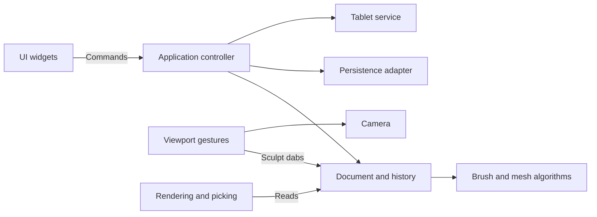

# Architecture

Clay Form uses a small application controller, a single document owner, explicit UI commands, and separate desktop adapters. It keeps immediate-mode egui rather than adding an MVC framework, ECS, event bus, or plugin infrastructure.

## Ownership and responsibilities

| Module | Responsibility |
| --- | --- |
| `main.rs` | Create the desktop window and application. |
| `app.rs`, `command.rs` | Execute UI intent, coordinate files and document changes, and handle unsaved-change decisions. |
| `document.rs` | Own mesh, brushes, dirty state, current saved path, stroke boundaries, and edit operations. Expose read-only content to views. |
| `history.rs` | Keep geometry snapshots within 24 entries and a 128 MB budget, undo/redo, and invalidate redo on a new mesh edit. |
| `sculpt/` | Geometry math, brush/alpha data, mesh deformation, project schema and validation. No egui, files, or tablet dependencies. |
| `persistence.rs` | Read/write version 1 JSON, import image alphas, and export OBJ. |
| `mesh_job.rs` | Compute subdivision/remesh on a cancellable background worker; deliver results for transactional controller commits. |
| `camera.rs` | Session-only orbit, pan, zoom and camera basis. |
| `viewport/` | Lock a drag into sculpt/orbit/gizmo mode; translate pointer movement into camera changes or dabs. Rendering/picking, the gizmo, and symmetry surface guides each have their own module. |
| `preferences.rs` | Validate shortcut assignments and tool layout; load/save independent user preferences. |
| `ui.rs` | Render toolbar, brush controls and confirmation dialog; emit commands without file or mesh operations. |
| `tablet.rs`, `tablet/linux.rs` | Publish normalized pressure and diagnostics; discover/read Linux devices in a worker that stops and joins when dropped. |

The application owns the document, camera, UI state, viewport gesture state and tablet service. Document content stays private. Mesh edits go through document methods; camera changes never dirty the document or create undo entries. Each stroke records one geometry snapshot regardless of its number of dabs. Symmetry belongs to document editing rather than the renderer. `sculpt/symmetry.rs` transforms dabs across mirror planes and radial sectors around an object-space center. The mesh evaluates all copies against one geometry snapshot and applies the strongest per-vertex influence, avoiding multiplied strength where copies overlap. The renderer independently intersects those symmetry planes with visible surface triangles for guides.

The viewport is an input adapter. It emits domain `Dab` values to the document, independent of mesh rendering details. The scene renderer reads mesh data and prepares projected triangles for display and surface picking. A future GPU renderer can replace this adapter without moving sculpt algorithms into UI code.

UI commands are executed between panels so the viewport sees the latest document. Destructive operations capture their target when requested. An Open confirmation therefore retains its target even if the toolbar path changes. Save-and-continue uses a separate path and refuses to overwrite that target. Failed loads leave content, dirty state and history intact.

## Compatibility and storage

The version 1 `.clay` and `.brush.json` formats remain compatible. Projects support optional `mesh_settings` (inactive levels and dynamic settings) and `symmetry` fields; defaults are omitted when saving, and old files load at one subdivision level with symmetry disabled. Vector positions remain JSON triples, and image-alpha pixels remain JSON arrays. Pixels are shared immutable `Arc<[f32]>` buffers in memory, making brush copies inexpensive without changing serialization. Mesh history is session-only, as before. The saved project does not include camera or undo state.

`tests/fixtures/v1-project.json` is an explicit version 1 compatibility fixture. Tests cover format preservation, brush/mask behavior, disk persistence, bounded history, stroke undo/redo, failed opens, save/open protection, and navigation gestures.

## Extending the app

Add brush data and algorithms in `sculpt/`, then expose their settings in `ui.rs`. Add user operations as commands handled by `App`; put their document effects in `Document` methods. Keep device-specific logic under `tablet/`, and keep render or picking changes under `viewport/`. Introduce a trait or a new subsystem when a second implementation needs it; the existing concrete modules are sufficient for the current app.

User preferences use their own versioned JSON file in the user configuration directory. UI edits bindings and layout without touching the document. The controller loads preferences at desktop startup, saves after a debounce and on exit, and translates keyboard actions into existing commands. Viewport options carry the chosen hold modifiers. Tests use explicit temporary paths and do not read or write the user configuration.

## Mesh workflows

`Geometry` owns the active `Mesh` and `MeshSettings`: lower levels in ascending order, higher levels in reverse order, and dynamic remesh settings. `sculpt/subdivision.rs` shares edge midpoints and retains original vertex indices. Going down samples that original-vertex prefix; going up interpolates the difference from the saved parent's vertices and adds it to the stored high mesh. This preserves high-level residual detail rather than replacing the level with a fresh subdivision. The approach uses linear triangle refinement, with no Loop smoothing or tangent-frame displacement transport. Mesh-stack topology is validated against deterministic refinement at load and before commits.

`sculpt/remesh.rs` rasterizes oriented triangles onto yz scanlines, fills their nonzero winding intervals along x, and extracts the voxel boundary using six consistently arranged tetrahedra per grid cube. A global grid-edge cache shares surface vertices; each triangle is oriented toward the outside. Two mild relaxation passes reduce voxel steps. This is a binary solid reconstruction: subvoxel details and masks are lost. For background on tetrahedral isosurface extraction, see [Paul Bourke's polygonisation reference](https://www.paulbourke.net/geometry/polygonise/); for multiresolution editing concepts, see [Zorin, Schröder, and Sweldens](https://graphics.stanford.edu/~dzorin/multires/meshed/). The implementation here is a simpler linear refinement and world-space detail scheme.

The controller locks geometry edits while a worker holds its snapshot. New/Open/Quit and explicit cancellation discard the in-flight result. Mode changes, level changes, and worker completions record the entire geometry stack in history. Brush, symmetry, camera, and file actions retain their existing separate responsibilities. Automatic remeshing is triggered by a completed deformation stroke, never a mask-only stroke, and waits for release before sculpting can resume after an in-flight topology change.

History entries pair a geometry snapshot with an action label shared by undo and redo. The document exposes read-only labels and counts for UI feedback. A stroke holds a provisional snapshot until its first actual geometry or mask change, then transfers it into history without another clone; an unchanged stroke discards it and preserves redo. Completed background jobs supply explicit subdivision/remesh labels when the controller commits their results.
