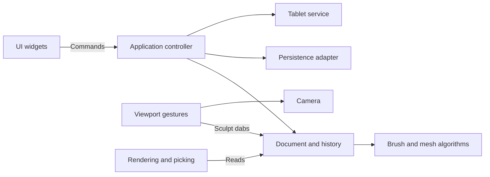

# Architecture

Clay Form uses a small application controller, a single document owner, explicit UI commands, and separate desktop adapters. It keeps immediate-mode egui rather than adding an MVC framework, ECS, event bus, or plugin infrastructure.

## Ownership and responsibilities

| Module | Responsibility |
| --- | --- |
| `main.rs` | Create the desktop window and application. |
| `app.rs`, `command.rs` | Execute UI intent, coordinate files and document changes, and handle unsaved-change decisions. |
| `document.rs` | Own mesh, brushes, dirty state, current saved path, stroke boundaries, and edit operations. Expose read-only content to views. |
| `history.rs` | Keep up to 24 mesh snapshots, undo/redo, and invalidate redo on a new mesh edit. |
| `sculpt/` | Geometry math, brush/alpha data, mesh deformation, project schema and validation. No egui, files, or tablet dependencies. |
| `persistence.rs` | Read/write version 1 JSON, import image alphas, and export OBJ. |
| `camera.rs` | Session-only orbit, pan, zoom and camera basis. |
| `viewport/` | Lock a drag into sculpt/orbit/gizmo mode; translate pointer movement into camera changes or dabs. Rendering/picking and the gizmo each have their own module. |
| `ui.rs` | Render toolbar, brush controls and confirmation dialog; emit commands without file or mesh operations. |
| `tablet.rs`, `tablet/linux.rs` | Publish normalized pressure and diagnostics; discover/read Linux devices in a worker that stops and joins when dropped. |

The application owns the document, camera, UI state, viewport gesture state and tablet service. Document content stays private. Mesh edits go through document methods; camera changes never dirty the document or create undo entries. Each stroke records one mesh snapshot regardless of its number of dabs. Symmetry belongs to document editing rather than the renderer.

The viewport is an input adapter. It emits domain `Dab` values to the document, independent of mesh rendering details. The scene renderer reads mesh data and prepares projected triangles for display and surface picking. A future GPU renderer can replace this adapter without moving sculpt algorithms into UI code.

UI commands are executed between panels so the viewport sees the latest document. Destructive operations capture their target when requested. An Open confirmation therefore retains its target even if the toolbar path changes. Save-and-continue uses a separate path and refuses to overwrite that target. Failed loads leave content, dirty state and history intact.

## Compatibility and storage

The version 1 `.clay` and `.brush.json` data shapes are unchanged. Vector positions remain JSON triples, and image-alpha pixels remain JSON arrays. Pixels are shared immutable `Arc<[f32]>` buffers in memory, making brush copies inexpensive without changing serialization. Mesh history is session-only, as before. The saved project does not include camera or undo state.

`tests/fixtures/v1-project.json` is an explicit version 1 compatibility fixture. Tests cover format preservation, brush/mask behavior, disk persistence, bounded history, stroke undo/redo, failed opens, save/open protection, and navigation gestures.

## Extending the app

Add brush data and algorithms in `sculpt/`, then expose their settings in `ui.rs`. Add user operations as commands handled by `App`; put their document effects in `Document` methods. Keep device-specific logic under `tablet/`, and keep render or picking changes under `viewport/`. Introduce a trait or a new subsystem when a second implementation needs it; the existing concrete modules are sufficient for the current app.
