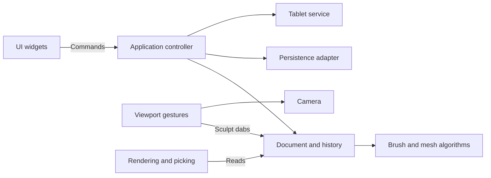

# Architecture

Clay Form uses a small application controller, a single document owner, explicit UI commands, and separate desktop adapters. It keeps immediate-mode egui rather than adding an MVC framework, ECS, event bus, or plugin infrastructure.

## Ownership and responsibilities

| Module | Responsibility |
| --- | --- |
| `main.rs` | Create the desktop window and application. |
| `app.rs`, `command.rs` | Execute UI intent, coordinate files and document changes, and handle unsaved-change decisions. |
| `document.rs` | Own mesh, brushes, dirty state, current saved path, stroke boundaries, and edit operations. Expose read-only content to views. |
| `history.rs` | Keep geometry snapshots within 24 entries and a 128 MB budget, undo/redo, and invalidate redo on a new mesh edit. |
| `sculpt/` | Geometry math, brush/alpha data, mesh deformation, project schema and validation. No egui, files, or tablet dependencies. |
| `persistence.rs` | Read/write version 1 JSON, import image alphas, and export OBJ. |
| `mesh_job.rs` | Compute subdivision/remesh on a cancellable background worker; deliver results for transactional controller commits. |
| `camera.rs` | Session-only orbit, pan, zoom and camera basis. |
| `viewport/` | Lock a drag into sculpt/orbit/gizmo mode; translate pointer movement into camera changes or dabs. Rendering/picking, the gizmo, and symmetry surface guides each have their own module. |
| `preferences.rs` | Validate shortcut assignments and tool layout; load/save independent user preferences. |
| `ui.rs` | Render toolbar, brush controls and confirmation dialog; emit commands without file or mesh operations. |
| `tablet.rs`, `tablet/linux.rs` | Publish normalized pressure and diagnostics; discover/read Linux devices in a worker that stops and joins when dropped. |

The application owns the document, camera, UI state, viewport gesture state and tablet service. Document content stays private. Mesh edits go through document methods; camera changes never dirty the document or create undo entries. Each stroke records one geometry snapshot regardless of its number of dabs. Symmetry belongs to document editing rather than the renderer. `sculpt/symmetry.rs` transforms dabs across mirror planes and radial sectors around an object-space center. The mesh evaluates all copies against one geometry snapshot and applies the strongest per-vertex influence, avoiding multiplied strength where copies overlap. The renderer independently intersects those symmetry planes with visible surface triangles for guides.

The viewport is an input adapter. It emits domain `Dab` values to the document, independent of mesh rendering details. The scene renderer reads mesh data and prepares projected triangles for display and surface picking. A future GPU renderer can replace this adapter without moving sculpt algorithms into UI code.

UI commands are executed between panels so the viewport sees the latest document. Destructive operations capture their target when requested. An Open confirmation therefore retains its target even if the toolbar path changes. Save-and-continue uses a separate path and refuses to overwrite that target. Failed loads leave content, dirty state and history intact.

## Compatibility and storage

The version 1 `.clay` and `.brush.json` formats remain compatible. Projects support optional `mesh_settings` (inactive levels and dynamic settings) and `symmetry` fields; defaults are omitted when saving, and old files load at one subdivision level with symmetry disabled. Vector positions remain JSON triples, and image-alpha pixels remain JSON arrays. Pixels are shared immutable `Arc<[f32]>` buffers in memory, making brush copies inexpensive without changing serialization. Mesh history is session-only, as before. The saved project does not include camera or undo state.

`tests/fixtures/v1-project.json` is an explicit version 1 compatibility fixture. Tests cover format preservation, brush/mask behavior, disk persistence, bounded history, stroke undo/redo, failed opens, save/open protection, and navigation gestures.

## Extending the app

Add brush data and algorithms in `sculpt/`, then expose their settings in `ui.rs`. Add user operations as commands handled by `App`; put their document effects in `Document` methods. Keep device-specific logic under `tablet/`, and keep render or picking changes under `viewport/`. Introduce a trait or a new subsystem when a second implementation needs it; the existing concrete modules are sufficient for the current app.

User preferences use their own versioned JSON file in the user configuration directory. UI edits bindings and layout without touching the document. The controller loads preferences at desktop startup, saves after a debounce and on exit, and translates keyboard actions into existing commands. Viewport options carry the chosen hold modifiers. Tests use explicit temporary paths and do not read or write the user configuration.

## Mesh workflows

`Geometry` owns the active `Mesh` and `MeshSettings`: lower levels in ascending order, higher levels in reverse order, and dynamic remesh settings. `sculpt/subdivision.rs` shares edge midpoints and retains original vertex indices. Going down samples that original-vertex prefix; going up interpolates the difference from the saved parent's vertices and adds it to the stored high mesh. This preserves high-level residual detail rather than replacing the level with a fresh subdivision. The approach uses linear triangle refinement, with no Loop smoothing or tangent-frame displacement transport. Mesh-stack topology is validated against deterministic refinement at load and before commits.

`sculpt/remesh.rs` rasterizes oriented triangles onto yz scanlines, fills their nonzero winding intervals along x, and extracts the voxel boundary using six consistently arranged tetrahedra per grid cube. A global grid-edge cache shares surface vertices; each triangle is oriented toward the outside. Winding occupancy supplies the sign for a narrow-band distance field measured against the input triangles. Surface crossings interpolate these distances instead of using grid-edge midpoints, avoiding quantized voxel bands. Two mild relaxation passes regularize the triangulation. Subvoxel details and masks are still lost. For background on tetrahedral isosurface extraction, see [Paul Bourke's polygonisation reference](https://www.paulbourke.net/geometry/polygonise/); for multiresolution editing concepts, see [Zorin, Schröder, and Sweldens](https://graphics.stanford.edu/~dzorin/multires/meshed/). The implementation here is a simpler linear refinement and world-space detail scheme.

The controller locks geometry edits while a worker holds its snapshot. New/Open/Quit and explicit cancellation discard the in-flight result. Mode changes, level changes, and worker completions record the entire geometry stack in history. Brush, symmetry, camera, and file actions retain their existing separate responsibilities. Automatic remeshing is triggered by a completed deformation stroke, never a mask-only stroke, and waits for release before sculpting can resume after an in-flight topology change.

History entries pair a geometry snapshot with an action label shared by undo and redo. The document exposes read-only labels and counts for UI feedback. A stroke holds a provisional snapshot until its first actual geometry or mask change, then transfers it into history without another clone; an unchanged stroke discards it and preserves redo. Completed background jobs supply explicit subdivision/remesh labels when the controller commits their results.

## Local adaptive sculpting and Snake

`sculpt/adaptive.rs` provides local conforming edge splits, conservative edge collapses, and quality-improving edge flips. Candidate faces intersect the brush footprint and front-facing dab hemisphere (Snake uses a volumetric tip); masks, pressure, and alpha eligibility restrict work. Every selected edge midpoint is reused across incident faces, and triangles with one, two, or three split edges are triangulated consistently. Collapses require the closed-manifold link condition, nonduplicated faces, similar masks, smooth edge normals, and no nearby triangle flips. Accepted collapses have disjoint affected vertex neighborhoods. Compaction remaps the entire index array while leaving untouched vertex coordinates intact.

`AdaptiveSettings` is an optional, default-omitted mesh-settings field. Its mode is mutually exclusive with subdivision stacks and voxel mode. Density uses a screen-pixel target converted through the world-space dab radius, or a fraction of brush radius. The document applies refinement/simplification before deformation and refinement after it, using all symmetry-transformed dabs together. A shared frame budget caps work at 256 edge splits, one batch of at most 32 collapses, eight refinement scans, and two quality scans with at most 128 edge flips. Heavy density changes therefore converge over later dabs. A provisional stroke snapshot covers topology and deformation together, yielding one undo step. Continuous density-parameter edits do not fill geometry history; entering/leaving the mode records a geometry edit.

The renderer shares its cached geometry snapshot with picking in each frame. Picks and surface guides use the same geometry snapshot as projected coordinates, preventing stale face/vertex indices when a dab changes topology. Guides are painted before mesh edits. `Viewport` seeds Snake's handle from the nearest unmasked surface vertex once, keeps its world-space tip, mask mobility, and starting normal for the duration of a stroke, continues dabs outside the original surface, and advances a continuous handle by the pressure/alpha-weighted motion rather than snapping between vertices. `Kind::Snake` supplies alpha/pressure-weighted drag displacement with a small outward lift; subtract reverses it. Its influence has smooth volumetric support and includes the sides of a bent tip. Soft alpha uses a rigid inner core with falloff applied to the surrounding volume, preventing repeated dabs from pinching every off-center vertex into a needle. Other alphas retain their projected pattern inside that volume. Adaptive Snake also redistributes nearby vertices tangentially with face-inversion checks, and protects the tip core from collapse and redistribution. Drag interpolation limits Snake steps to a tenth of the brush radius. This is a hook-style deformation brush, without a separate tube-generation or curve system.

For the requested behavior, see external software vendor's adaptive sculpting controls. For the manifold safety principle, see [CGAL's edge-collapse reference](https://doc.cgal.org/Manual/3.6.1/doc_html/cgal_manual/Surface_mesh_simplification_ref/Function_Surface_mesh_simplification--edge_collapse.html). Clay Form implements its own bounded CPU routines with no added dependencies.

Adaptive Smooth with simplification enabled skips edge splits and doubles the ordinary collapse ratio, capped at 95% of the target edge length. Smooth collapses also check resulting triangle quality (a 0.2–0.35 quality floor based on the original face). Quality flips remain available. This prevents cleanup strokes from replacing removed vertices with newly split ones, while preserving the shared work budget and conservative manifold/mask checks. Shift smoothing uses the same path.

## Model scenes and transforms

`Geometry` snapshots contain the active surface and its subdivision stack plus inactive `Submodel` records and `SceneSettings`. Inactive records retain full geometry; display uses the lowest existing level. The active index describes its position among the ordered inactive records, so selection preserves scene order. Per-model metadata owns visibility and group membership; scene settings own group order. Optional default-omitted project fields preserve the legacy single-model JSON fixture. Model organization and transforms use the same bounded scene history as sculpting.

The viewport caches merged visible display surfaces, normals, and triangle ownership by a session-only document display revision. OpenGL draws model geometry with a depth buffer; CPU picking projects the same immutable geometry snapshot. Active faces alone supply symmetry guides. A pick on an inactive foreground surface cannot sculpt the active model behind it; a selection click waits for release before permitting a new sculpt stroke.

`sculpt/transform.rs` provides positive affine scale, translation, and directional stretch around a pivot. `Document::apply_transform` applies increments to all stored active levels, optionally weighted by mask mobility, validates before mutation, and records a single history entry per drag. World handles constrain movement/scale to an axis or provide view-plane movement/uniform scale. Action Line stores temporary world-space endpoints in the viewport and supplies an explicit pivot and stretch direction. The renderer and UI retain no ownership of persistent transforms or organization.

## Parametric primitives

`sculpt/primitive.rs` defines bounded, serializable primitive recipes and deterministic welded triangle generators. Cube axis spans share integer lattice keys; UV surfaces share poles and seams; icospheres refine a convex icosahedron and project vertices onto the unit sphere. Cylinder/cone poles avoid duplicate tip vertices. The human head deforms a symmetric UV surface with jaw, nose, eyelid, ear and mouth cavity fields, then appends closed eye, tooth and tongue shells before affine placement. New head fields use serde defaults for existing recipes. `HeadOptions::anatomy_version` selects the previous generator for saved heads without this field; version 1 heads also retain their previous generator. New/reset version 2 heads use a smooth cross-section profile and denser face sampling, with eyelid fitting restricted to the front hemisphere. The mouth lining is carved after jaw posing so it cannot cover the lower arch and tongue. The optional neck removes a fixed band of lower skin and stitches its perimeter to a capped, tapered neck with SCM and throat fields; cut selection uses the undeformed sampling lattice to retain topology during posing. Ears use separate pinna shells instead of deforming the scalp. Eyelids fit the eye surface and carve an almond aperture; independent closure controls cover the fixed globes. The jaw pose moves lower skin, the lower dental arch and tongue around a hinge while keeping the upper arch fixed. Positive affine placement lets ordinary transform tools move/stretch a recipe without baking it.

An optional default-omitted `MeshSettings::primitive` keeps the recipe beside its preview surface, including inactive submodels. Validation regenerates the recipe and requires the stored preview to match, with no subdivision stack, masks, or adaptive/voxel mode. Conversion removes only the recipe; the surface stays exact. Document operations gate brush and topology edits until conversion, and parameter drags record one history entry until release.

The UI captures the active model for a modal replacement warning. The parameter window emits validated updates; the viewport's teal handles edit the same recipe. Popup and viewport resolution panel input cannot also manipulate the viewport. Parameter editing and conversion are persistent document operations, while editor visibility and handle gestures stay session-only. Legacy projects still omit default primitive fields and retain their original JSON shape.

Brush icons use bounded square RGBA buffers shared through `Arc`, stored as compressed PNG data in optional brush fields. `brush_icon.rs` generates default illustrations and renders an auto-fitted capture of the active mesh using the camera basis, interpolated lighting and a depth buffer. The capture modal previews the snapshot before assigning it; it blocks viewport gestures and shortcuts while open.

Brush IDs persist across edits and file exports. Built-in brushes have stable IDs, duplicates receive new random IDs, and legacy brushes derive deterministic IDs from their contents. `Document::import_brushes` validates a complete batch and merges by identity before committing, so errors leave the library intact and repeated imports do not add copies. `.brushes.json` libraries use a versioned wrapper around the same brush schema.

## GPU viewport

`viewport/gpu.rs` owns OpenGL programs, vertex/index buffers, lazily built wireframe buffers, the brush-alpha texture, and a viewport-sized color/depth framebuffer. `gpu/display.rs` builds camera-independent display geometry and edge adjacency; `gpu/shaders.rs` performs projection, lighting, masking, front-facing edge rejection, and surface alpha/symmetry projection. A glow paint callback draws the scene before egui overlays, resolves color into egui’s framebuffer, and restores framebuffer/viewport state. The framebuffer resizes in physical pixels, preserving high-DPI sizing and egui clipping.

Geometry-changing edits, mask edits, model selection/visibility, undo/redo, topology operations, and New/Open advance the display revision. Brush settings, symmetry settings, and camera changes do not invalidate geometry buffers. The CPU scene retains projected coordinates and front-facing ownership for picking and gizmos, without sorting/shading faces or rasterizing a wireframe depth buffer in the GPU path. The CPU paint path remains available for headless interaction tests.

`App::with_gl` initializes resources with the context current. Gesture cancellation preserves the renderer; `App::on_exit` explicitly deletes its GL objects while the context is valid. GPU alpha uses the same rotation, image interpolation, inner core, and falloff as CPU brush weights. Alpha and symmetry colors apply to active surfaces in the solid shader, so inactive foreground models occlude them. Tangent rings and the normal indicator remain egui controls. See [GPU rendering](gpu-rendering.md) for the offscreen GL checks and load profile.

## Mask edits and cuts

The Mask menu emits explicit invert/delete commands, gated during topology jobs. Inversion complements active and stored-level masks without changing positions. Deletion removes fully masked triangles at the 50% threshold, retains quads only when their complete triangulation survives, and compacts remaining vertices in their original order. Surviving masks, model metadata, and inactive submodels are preserved. A cut resets the active subdivision stack and closed-surface modes; one undo snapshot restores the original geometry and settings. Both edits invalidate the GPU display cache.

Deleting all surface faces leaves an empty active model with no vertices. Mesh/project validation accepts this state; rendering and picking handle it, subdivision/remeshing report that there are no faces, and initializing a primitive places it at the origin. Transform handles are hidden for empty meshes. Empty models remain saveable and undoable.

## Temporary thickness

An optional, default-omitted `ModelMetadata::temporary_thickness` stores a total centered shell thickness per submodel. `sculpt/thickness.rs` verifies oriented manifold edges and boundary loops, offsets front/back layers along source normals, reverses the back-layer winding, and joins boundary edges with quad walls. It preserves masks and polygon topology and observes the ordinary mesh-size limits. This is a normal-offset shell, without self-intersection repair.

The renderer caches a separate shell display mesh when thickness is enabled. The CPU scene still uses the original geometry for picking, guides, and controls, so preview faces never introduce invalid sculpting indices. Render-only shells are rebuilt when the document display revision changes and use the existing GPU pipeline. Subdivision LOD selection remains per model. Invalid/inapplicable preview settings on changed topology fall back to the original display surface; Apply validates before changing the document.

Thickness-value drags share one history entry until release. Apply generates the same shell as the preview, clears the setting, converts primitive recipes, and resets the active subdivision/topology settings in one undoable geometry transaction. Default metadata serialization keeps legacy projects unchanged.
