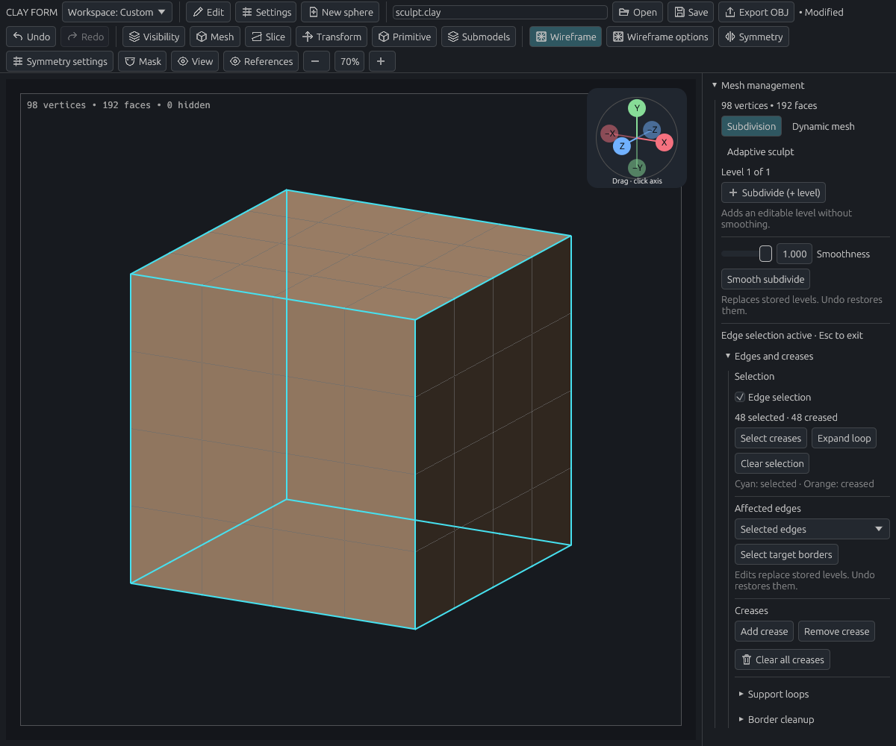
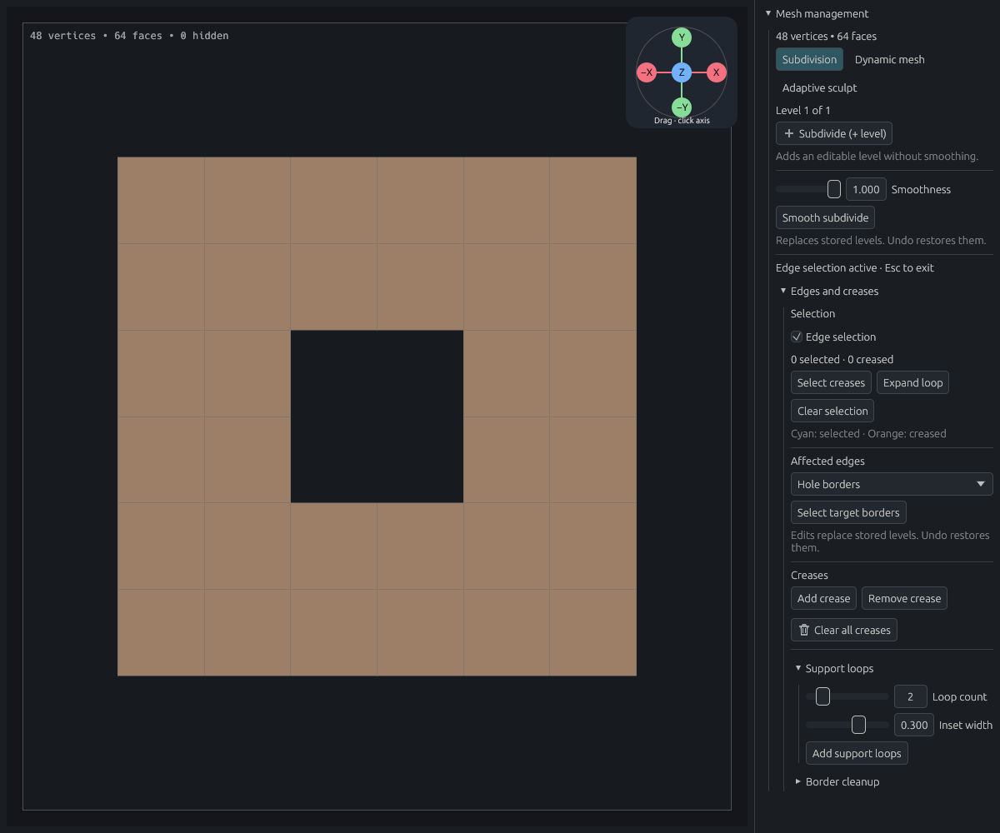
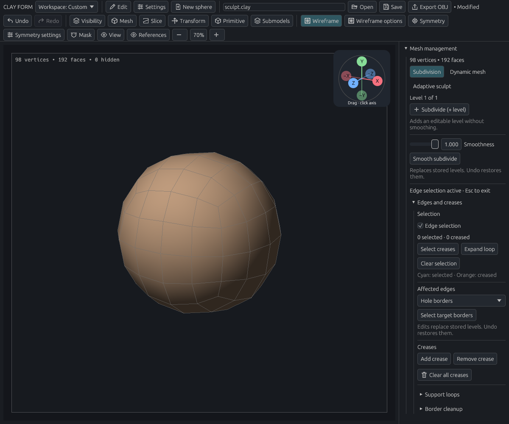
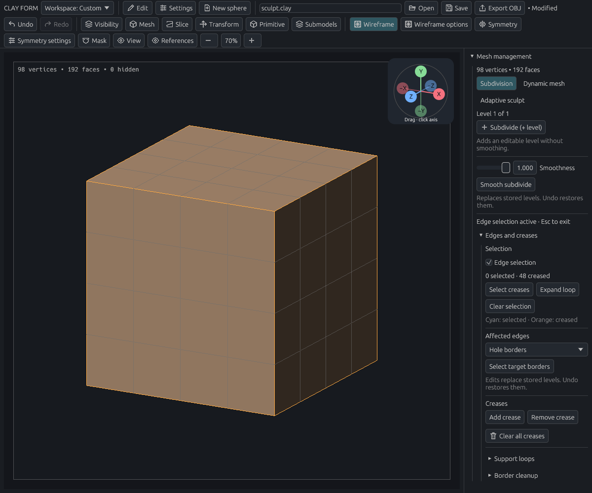
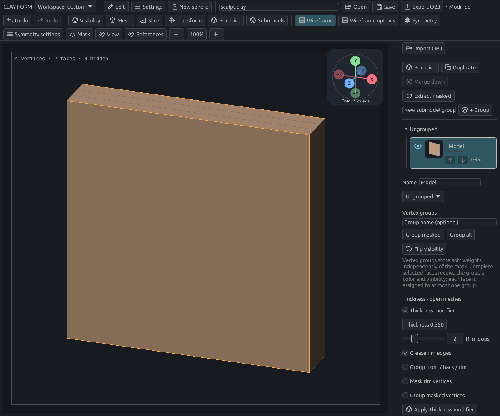

# Edge loops and creases

[Documentation home](../../README.md#documentation)

Open **Mesh → Edges and creases**. Convert parametric primitives before editing their edges. Hover over a control or focus it with Tab for help and any assigned shortcut. Disabled actions explain what to do before using them.

- [Choose a target](#choose-a-target)
- [Select edges and loops](#select-edges-and-loops)
- [Add support loops around a hole](#add-support-loops-around-a-hole)
- [Clean up an uneven border](#clean-up-an-uneven-border)
- [Crease and uncrease](#crease-and-uncrease)
- [Control subdivision smoothness](#control-subdivision-smoothness)
- [Add loops and creases to thickness](#add-loops-and-creases-to-thickness)

## Choose a target

| Target | Affected edges |
| --- | --- |
| Hole borders | Actual open mesh boundaries, including outer outlines |
| Masked region borders | Borders of complete masked polygons, using the submodel's selection threshold |
| Visible polygroup borders | Boundaries between visible groups, around isolated visible regions, and open borders |
| Selected edges | The current edge selection |

For these tools, a mask chooses the region to work on. **Select target borders** highlights its edges and changes the target to **Selected edges**. This is useful for checking the scope before applying an edit.

## Select edges and loops

1. Enable **Edge selection**. Wireframe turns on.
2. Click a visible edge. Hold **Shift** to add or **Ctrl** to remove an edge.
3. Choose **Expand loop** to extend along a crease/border chain or an unambiguous quad loop. Expansion stops at junctions.
4. Press **Escape** to return to sculpting.

**Select creases** selects existing visible crease edges and enters Edge selection mode. **Select target borders** and **Expand loop** also enter this mode, so the next click adjusts the selection. **Clear selection** clears the highlight without removing creases. Orange wire edges are creased; cyan overlays are selected. Selected overlays can be seen through the model, while clicking picks the visible surface.

Drag empty space to orbit while selecting, using the same pan and zoom modifiers as usual. A drag that starts on the model stays in edge selection. Right-drag and the navigation frame also orbit. Selection is session-only and clears when mesh data changes, avoiding stale edge indices.

## Add support loops around a hole

1. Set **Affected edges → Hole borders**.
2. Open **Support loops** and choose **Loop count**, from 1 to 8.
3. Set **Inset width**. Start around **0.15**; this is a fraction of nearby border-edge length.
4. Choose **Add support loops**.

*Before: the inner hole and outer outline are both open borders.*

*After: two support loops at width 0.30. The hole remains open and its original outline stays in place.*

Use **Masked region borders** or **Visible polygroup borders** for the same operation around those regions. Selected edges must form closed, nonbranching borders that separate a region. A random edge selection cannot be inset. Narrow or folded regions may require a smaller width; an invalid result leaves the original mesh intact.

## Clean up an uneven border

Choose the affected edges, open **Border cleanup**, set **Relax amount**, then choose **Relax borders**. This evens out positions along the existing border while keeping corners, junctions, and vertices touching hidden faces fixed. It does not fill holes, dissolve loops, or rebuild the whole mesh.

## Crease and uncrease

Choose **Add crease** to mark the targeted edges as permanently sharp during smooth subdivision. This adds no vertices. Smooth brushing also protects vertices on crease edges; other sculpt brushes can still reshape them.

To remove creases:

- **Remove crease** removes marks only from the current target.
- **Select creases**, then **Remove crease**, removes the selected visible creases.
- **Clear all creases** removes every crease on the active submodel, including hidden ones.

Removing a crease does not undo previous subdivision or restore an earlier shape. The next smoothing operation can round that edge.

## Control subdivision smoothness

Open **Mesh → Subdivision**. Both **Subdivide (+ level)** and **Smooth subdivide** are grouped here. Set **Smoothness**, then choose **Smooth subdivide**. These controls are visible even when **Edges and creases** is collapsed:

| Value | Result |
| --- | --- |
| 0 | Refine into quads without rounding the shape |
| 0–1 | Blend between the original shape and subdivision smoothing |
| 1 | Full smoothing of uncreased areas; hard creases remain sharp |

*Uncreased: two smooth subdivisions round the cube.*

*Creased: the same settings keep the marked cube edges sharp.*

**Smooth subdivide bakes the current level into a new mesh; it does not add an editable subdivision level.** The existing **Subdivide (+ level)** command still provides linear subdivision and its level stack. Show all faces before smooth subdivision.

## Add loops and creases to thickness

The former “Temporary thickness” controls are now **Thickness modifier**, under **Submodels → Thickness · open meshes**.

1. Enable the modifier and choose a thickness.
2. Set **Rim loops** to add up to eight loops through the wall thickness.
3. Enable **Crease rim edges** to keep the front/rim and back/rim joins sharp.
4. Choose **Apply Thickness modifier** when ready to edit or smoothly subdivide the resulting shell.

Changes update the preview. Set Rim loops to zero or turn off Crease rim edges to remove them before applying. After applying, use edge selection and Remove crease normally.

## Undo, saving, and limits

Each changed edge operation is one undo step. It keeps the active mesh level, discards stored levels, and disables adaptive/dynamic modes; **Undo restores the complete previous state**. Other submodels are unchanged. No-op crease edits do not add history entries.

Projects save crease marks and modifier settings. Creases survive linear/smooth subdivision, mirroring, slicing, extraction, and merging. OBJ does not store crease marks. Clear creases before enabling adaptive sculpt or voxel remeshing, which rebuild topology.

Loop insertion and smooth subdivision use the existing mesh-size limits and cancellable worker. These tools do not provide automatic retopology or general self-intersection repair.
