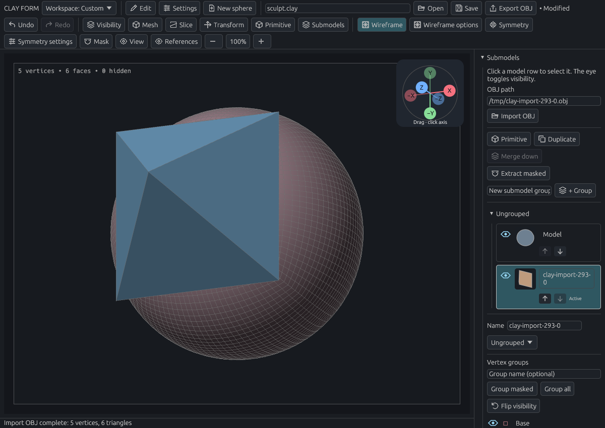
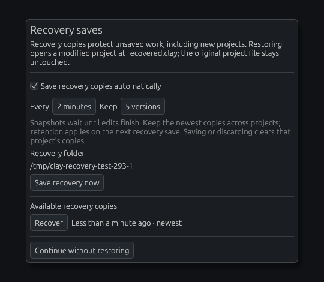

# Files, OBJ import, and recovery

[Documentation home](../../README.md#documentation)

Keep an editable `.clay` project, export a mesh for another app, or recover work after an interruption. **Save** is the way to keep a version you choose; recovery keeps recent backup copies.

- [Save and open projects](#projects-and-brush-files)
- [Import a mesh](#obj-import)
- [Export a mesh](#export-an-obj)
- [Export session evidence](#diagnostic-bundles)
- [Recover recent work](#recovery-saves)

## Projects and brush files

### Save or open a project

Choose **Open** (**Ctrl+O**) to browse for a project. Double-click folders to enter them, select a file, then choose **Open project**. **Home**, **Up**, and the folder field help you navigate.

The first **Save** (**Ctrl+S**) opens a file chooser. Choose a folder and file name; `.clay` is added when you omit the extension. Later saves update that project's established file directly. Use **Save as…** (**Ctrl+Shift+S**) to choose another destination. The toolbar path seeds the chooser; changing it also makes Save ask for a destination.

Save As asks before replacing an existing file. Cancel leaves the document and files unchanged. The parent folder must exist. New, Open, and Quit still prompt when work is unsaved; Save and continue opens the chooser when a destination is needed.

| Format | Contains |
| --- | --- |
| `.clay` | Geometry, submodels, masks, groups, levels, primitive recipes, brushes, symmetry, and reference images |
| `.brush.json` | One brush preset |
| `.brushes.json` | A brush library |
| `.obj` | An exported mesh, including supported quad faces and face groups |

Older projects containing the removed Human head primitive open with their saved geometry as ordinary sculpting meshes.

Camera position and undo history are session-only. [Workspace preferences](workspace.md#where-preferences-are-stored) save separately.

## Diagnostic bundles

Choose **Settings → Export diagnostic bundle…**, or the same action beside **Export OBJ** in the file toolbar. Finish any active edit or mesh operation, enter a **new folder path** whose parent exists, and choose **Export locally**. The dialog lists the included content and lets you configure saved history retention limits.

The folder contains:

| File | Purpose |
| --- | --- |
| `README.txt` | Environment, current history position, labeled transitions, settings highlights, missing evidence and restore instructions |
| `manifest.json` | Schema version, chronological stage indices, stable edit IDs, retention/eviction counts, current settings and settings captured at each edit boundary |
| `stage-NNN.clay` | Each retained geometry stage, ordered oldest to newest, including the current stage and available redo stages |

Open `README.txt` first. To inspect or restore a stage, use **Open** on its `.clay` file, then **Save as…** to a new filename. Opening a stage resets live history; this is not a session replay/import. The current stage is the complete current project. Other stages preserve geometry, masks, visibility, groups, submodels, primitive recipes and subdivision levels. They use the brush library and symmetry captured at the indicated edit boundary; their earlier reference images are unavailable.

`transitions[i]` describes the edit from stage `i` to `i + 1`. Its settings include brush/preset/alpha, pressure configuration, stroke mode, symmetry and topology/remesh policy. Sculpt strokes additionally record the effective brush and first effective dab's pressure/invert state. View/input state is recorded when available from the UI; background mesh operations retain the settings at launch. `current_settings` is separate from this historical evidence. Undo/redo moves geometry only and does not restore brush or view settings.

Brush, symmetry and view changes are outside geometry history. Their intermediate changes and changes during a continuous edit are not reconstructed. The manifest explicitly distinguishes unavailable settings from defaults used to open a legacy stage. The retained branch is ordered by edits, not by undo/redo button clicks. It contains no full input sample stream, replay timestamps, evicted steps or discarded redo branches. New/Open clears live history; increasing retention cannot recover earlier evictions.

Export borrows the document without marking it saved or consuming undo/redo. Existing files or folders are refused. A failed export removes the new incomplete folder. Output is limited to **128 MiB per file** and **512 MiB total**; exceeding a limit fails with an explanation. Normal `.clay` projects remain unchanged and do not contain history.

Export is local and user initiated. It includes embedded reference images in the current project and user-authored names, so review those before sharing. It includes app version/source build identity, OS family/architecture, available renderer/backend/GPU/driver information and an input-device category. It excludes project paths, device paths, credentials and environment variables. Up to 32 recent application-command/mesh-job warning categories and the current recovery-error category are available; detailed error text and a full log are not collected.

For tooling, `clay_form::diagnostics::load_manifest` checks the schema version, indices, transition ordering and stage filenames. Load individual stage files with the normal validated project loader. Consumers must reject unsupported manifest versions.

## OBJ import

### Example: import the sample pyramid

1. Download [pyramid.obj](../examples/pyramid.obj), or use `docs/examples/pyramid.obj` from a checkout.
2. Open **Submodels → Import OBJ…**, browse to the model, and choose **Import OBJ**. You can also enter its path in **OBJ path** before opening the picker.
3. Wait for the new submodel to appear. Use the original sphere's eye icon to hide it when inspecting the pyramid.
4. Save a `.clay` project to keep both models, or undo the import.

*The sphere is hidden, not removed. The imported pyramid has a quad base and four triangular sides.*

### What import preserves

| Preserved | Not imported |
| --- | --- |
| Coordinates, scale, winding, shared vertices | UVs, materials, supplied normals, vertex colors |
| Triangles and quads | Points, lines, free-form geometry |
| OBJ face groups | External material files |

Import does not center, resize, or weld the mesh. Multiple OBJ objects combine into one submodel, named from the filename. The current project path and existing models stay unchanged. Import is cancellable and creates one undo step.

### Polygon and group support

Simple planar polygons with up to **256 corners** are triangulated, including concave shapes. Triangulate non-planar, self-intersecting, or degenerate polygons in your source app; errors identify the line.

Positive/negative indices, UV/normal index forms, comments, line continuations, and UTF-8 names are accepted. Normals are regenerated. OBJ `g` names become full-weight vertex groups; if a face has several groups, the first supplies its color. Long names receive unique shortened versions.

### Import limits

Maximum **128 MB**, **500,000 vertices**, **1,000,000 triangles** after triangulation, **64 groups**, and **64 scene submodels**. Errors and cancellation leave the original scene intact.

## Export an OBJ

Select the submodel, then choose **Export OBJ**. The file is written beside the project path with an `.obj` extension.

Export uses the active subdivision level. Apply the Thickness modifier first if you want the shell included. Use `.clay` to retain the full editable project.

## Recovery saves

### Example: make a recovery checkpoint

1. Make a small sculpt edit and release the pointer.
2. Open **Settings → Recovery saves**.
3. Click **Save recovery now** and wait for the copy to appear.

*Recovery protects unsaved edits without changing your normal save path.*

### Choose the schedule

| Setting | Default | Range |
| --- | --- | --- |
| Automatic recovery | Enabled | On / off |
| Interval | 2 minutes | 1–60 minutes |
| Retained copies across projects | 5 | 1–20 |

Copies include the full project, including never-saved work and references. Saving waits for strokes, drags, transforms, and background mesh operations to finish. Unchanged content does not consume another version.

### Restore a copy

Startup offers retained copies after an interrupted session. You can also open them from Recovery saves.

1. Choose **Recover** beside a copy.
2. Handle any Save/Discard/Cancel prompt for your current work.
3. Choose a new filename and save. The restored project's initial path is `recovered.clay`.

**Continue without restoring** leaves the copies available. Saving a project successfully, or deliberately discarding it on New/Open/Quit, clears that session's copies.

### Find recovery files

Copies live in `~/.config/clay-form/recovery/`, or `$XDG_CONFIG_HOME/clay-form/recovery/` when set. Recovery preferences are global, independent of workspaces.

If a recovery save fails, earlier copies remain available and an error stays visible. The app retries at your chosen interval. Save your project normally to a working destination before continuing.

## Related guides

[Submodels](modeling.md#submodels) · [Brush presets](sculpting.md#save-presets-and-brush-icons) · [Workspace](workspace.md)

### Painted materials and OBJ

Save painted meshes as `.clay` to retain vertex colour, roughness and metallic. OBJ import accepts conventional sRGB vertex colours, with opaque alpha only; material libraries are not imported. OBJ export reports a limitation for painted meshes because it cannot preserve all material channels. See [Paint colours and materials](materials.md).

## UV and texture exchange

[UVs / Textures](textures.md) retains seam-aware UV coordinates through OBJ import/export and exports texture images as 16-bit PNG. Native `.clay` version 3 saves embed images and retain UVs, channels and external-edit associations. Older version 1 and 2 projects remain readable. External exchange paths are omitted from diagnostic bundles.
