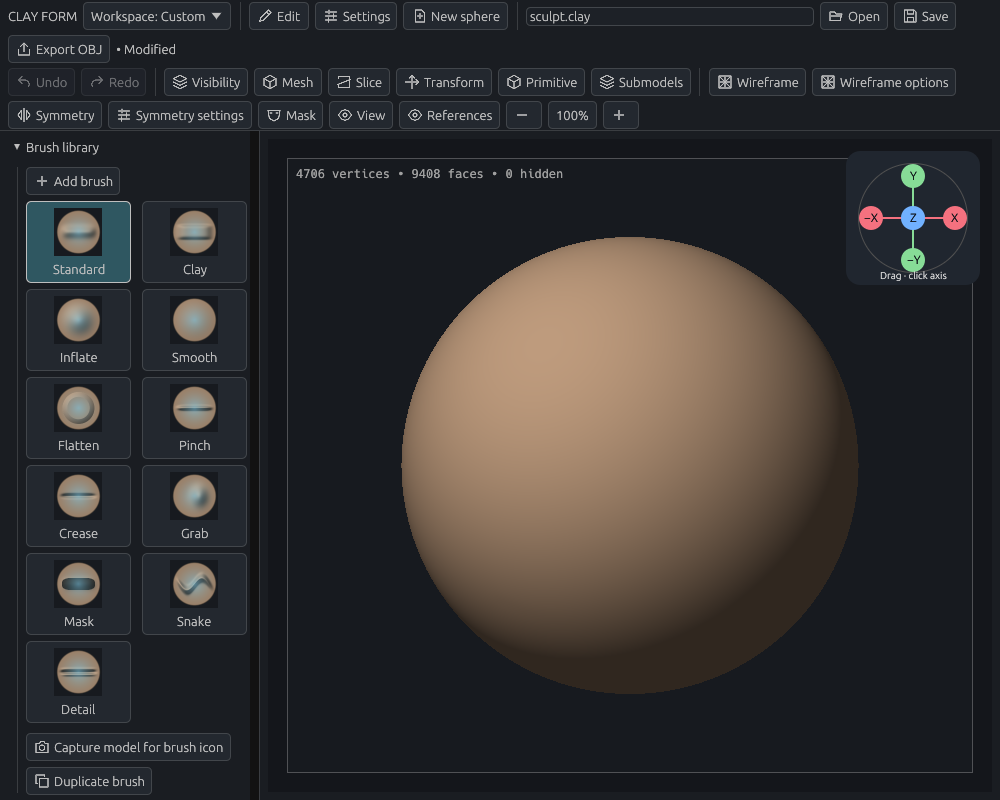
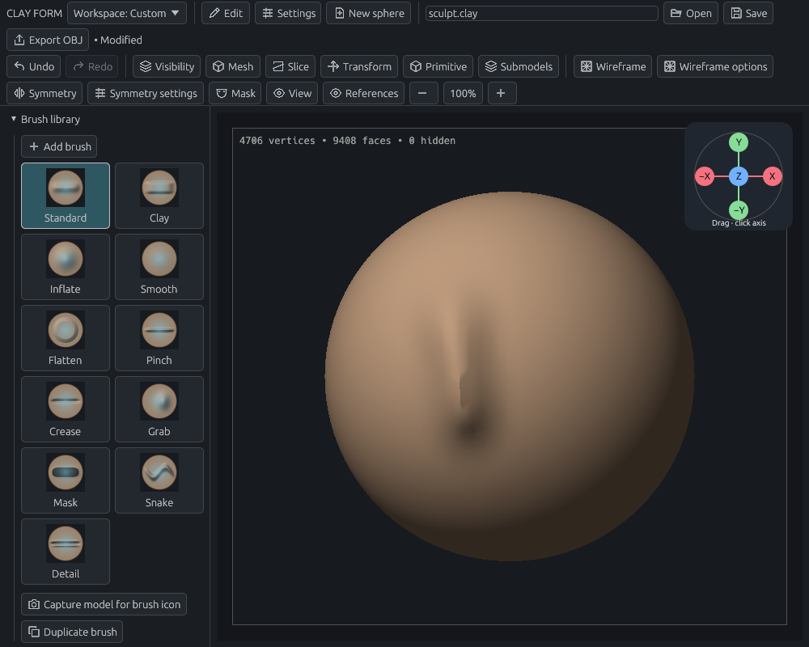

# Make your first sculpt

[Documentation home](../../README.md#documentation)

Make a raised mark, smooth it, undo it, and save a project. A mouse is enough; a pen works too.

## 1. Start with a sphere

Choose **New sphere**. If you have unsaved work, save it or cancel the prompt before continuing.

Select **Standard** in **Brush library**. In Brush settings, use **Radius 60** and **Strength 0.50**. For the clay color shown here, turn off **View → Show vertex group colors**. Your panel arrangement may differ.

*The brush library selects the tool; the center is your working surface.*

## 2. Make a mark

Press on the front of the sphere, drag downward, and release. A raised stroke follows the pointer.

*One completed stroke is one undo step.*

Hold **Shift** and brush lightly over the mark to smooth it. Release Shift to return to Standard. Hold **Alt** while using Standard to push inward instead of raising clay.

## 3. Inspect the shape

| To… | Use… |
| --- | --- |
| Orbit | Right drag, or left/pen drag starting in empty space |
| Zoom | Mouse wheel, or Ctrl + drag |
| Pan | Middle drag, or Alt + drag starting in empty space |
| Return to the default view | F |

If the model fills the screen, start a navigation drag in the thin border strip. See [Navigation](navigation.md) for pen gestures and perspective.

## 4. Undo and compare

Press **Ctrl+Z** to undo the smoothing stroke. Press it again to remove the raised stroke. **Ctrl+Shift+Z** redoes an edit.

Open **Edit** to see the action names and your configured shortcuts.

## 5. Save your work

Enter a path such as `first-sculpt.clay` in the toolbar and choose **Save**. Use an existing folder. Reopen with **Open** or **Ctrl+O**.

`.clay` keeps the editable project. **Export OBJ** saves the active mesh for other applications. See [Files and recovery](files.md).

## Try next

| I want to… | Guide |
| --- | --- |
| Sculpt a crisp crease | [Detail brush](sculpting.md#detail-brush) |
| Protect part of the model | [Mask lasso](selection.md#example-protect-a-region-with-a-lasso) |
| Start from a primitive | [Primitives](modeling.md#parametric-primitives) |
| Cut away part of the form | [Slice](modeling.md#slice) |
| Work beside a drawing | [Reference images](references.md) |
| Keep favorite tools visible | [Workspace](workspace.md) |
