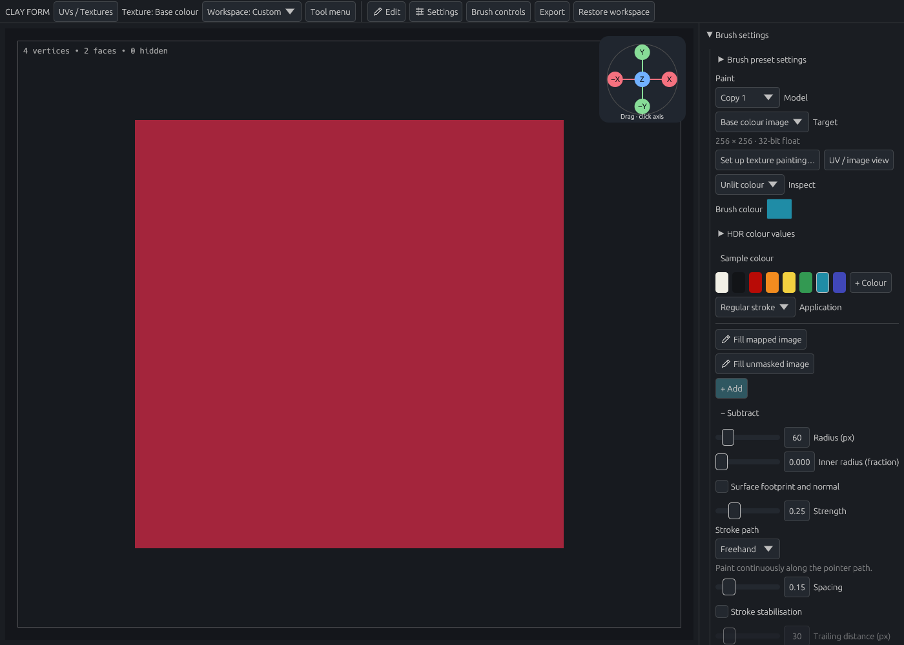
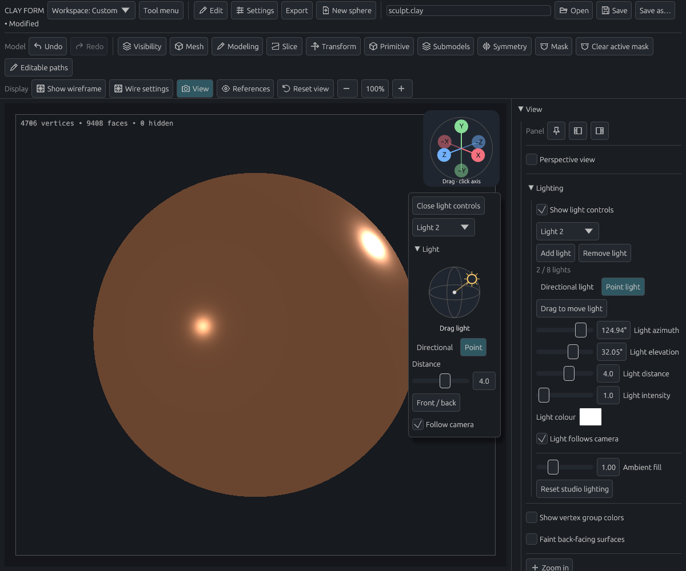

# Paint colours and materials

[Documentation home](../../README.md#documentation) · [Brush controls](sculpting.md)

Paint colours, roughness and metallic effects onto the model, then adjust shared materials or lighting to inspect the result.

- [Understand paint detail and saving](#detail-topology-and-saving)
- [Adjust the lighting](#shading)
- [Combine shared surfaces and layers](#shared-surfaces-and-layers)
- [Export painted models](#exporting-paint)

To begin:

1. Convert a parametric primitive to a sculpt mesh if needed.
2. Open **Materials** or **Colours** in the toolbar; you can keep your sculpting brush selected. The **Paint input preset** names the preset whose future strokes you are configuring.
3. Select a material, then use **Assign material to model** only when you want to replace the active model’s vertex appearance. Or choose **Paint with these inputs** to make a local stroke.

The stroke changes the surface appearance without moving the geometry. Use Undo to remove it.

Choose **Focus Paint workspace** to keep one painting sidebar and give the model more screen space. **Restore workspace** in the top toolbar returns your previous layout, including after restarting the app. The model selector switches the active model directly from this workspace.

In **Brush settings**, the Paint target shows the active model and whether strokes update **Vertices** or an image. Image targets show their dimensions and precision, including **32-bit float**, independently of export format. **Set up texture painting…** creates an image workflow; **UV / image view** opens the linked UV editor. Switching to a model without the selected image returns the target to Vertices.

The persistent appearance strip shows the selected stroke material’s preview and name, even with the menus closed or another sculpting brush selected. Click it to open Materials. The expanded UV editor keeps these controls in its sidebar.

**Primary** is the colour used for strokes; **Secondary** holds a standby colour. Both have their own picker in the strip and Colours menu. **Swap colours** exchanges them, including any sampled HDR values. In Colours, click a slot’s label to target the palette, **+ Colour** and **Sample colour** at that slot. These controls do not recolour existing paint or edit a shared material. Image painting currently exposes base colour only; roughness and metallic remain available as vertex material properties. With Vertices selected, **Paint channels** offers **Whole material**, **Colour only**, **Roughness only** or **Metallic only**.

Open **Materials** to choose a rendered material swatch. Drag **Drag to resize materials** to change the swatch area; larger libraries scroll within it. Choosing a material affects future strokes. Open **Edit shared project material** deliberately when you want to update existing painted uses; it shows how many models and vertices share that definition.

**Materials**, **Colours** and **Textures** have their own toolbar menus. Materials and Colours can be pinned or docked into a workspace. Their open actions, and **Texture library…** / **UV layout…**, are available in custom menus and shortcut settings.

**Default material** in Materials selects the initial teal sculpt material (roughness 0.53, metallic 0). **Default colour** in Colours selects its teal colour for the highlighted slot. **Reset colours** restores teal Primary and white Secondary while retaining the material’s other properties. These choices remain available independently of your personal library and palette; they change future stroke inputs. Use **Assign material to model** to apply the chosen material to an existing model. **Default material**, **Swap colours** and **Reset colours** are also available as custom actions and shortcuts.

There is one set of stroke inputs per Paint preset. The independent menus edit that preset directly; the Paint panel displays the same values. Switching Paint presets deliberately recalls that preset’s own material, Primary and Secondary colours, HDR values and channel settings. Older presets keep their existing primary inputs and start with white Secondary. Choosing an ordinary colour detaches that preset’s material link without changing any shared project definition. No extra global override is applied to old presets.

**New project material** creates a named definition. **Assign material to model** applies the whole selected material to all vertices and stored subdivision levels of the named active model, even when the current paint destination is an image. It preserves texture pixels and UVs; an opaque assigned image can still cover the material’s base colour. This is distinct from Paint’s target-dependent Fill commands.

### Try the complete workflow

1. Keep a sculpting brush active. Open **Materials**, choose Copper or create a **New project material**, and explicitly **Assign material to model**.
2. Open **Colours**, select a palette colour, and check that the model has not changed. Choose **Paint with these inputs**, select **Vertices**, and make a stroke. Undo restores that stroke.
3. Open **Textures → Open texture library**. Create/import a colour image, generate UVs if prompted, **Assign selected to model**, then **Paint assigned image**. The Paint panel names the image receiving pixels.
4. Reopen Materials, choose the material used on the model, and expand **Edit shared project material**. Read the model/vertex usage count before changing shared settings. Undo restores the definition and all its painted uses. Changing a shared material does not repaint texture pixels.
5. Save `.clay`, reopen it, and inspect the project material, library images and model assignment. The personal palette remains in preferences; project appearance and image edits use project Undo.

New models start with a teal sculpting material (roughness 0.53, metallic 0). The warm Matte clay preset remains available in the material library. **View → Show vertex group colors** starts off so the material is visible; enable it when you want to inspect group colours.

| Example | Appearance | Roughness | Metallic |
| --- | --- | --- | --- |
| Matte clay | Warm, broad shading | 0.85 | 0 |
| Glazed ceramic | Teal with a sharp highlight | 0.18 | 0 |
| Rubber | Dark, matte surface | 0.92 | 0 |
| Satin aluminium | Pale metal with a broad highlight | 0.38 | 1 |
| Copper | Warm metal | 0.24 | 1 |
| Red plastic | Red with a glossy highlight | 0.30 | 0 |
| Cool clay | Cool grey, broad matte shading | 0.90 | 0 |
| Beeswax | Warm amber wax with soft scattering | 0.38 | 0 |
| Ivory wax | Pale wax with stronger scattering | 0.32 | 0 |
| Warm skin | Warm skin with a subtle surface sheen | 0.62 | 0 |
| Deep skin | Deep brown skin with a subtle surface sheen | 0.58 | 0 |

These are editable starting values. Ceramic uses a simple glossy dielectric; satin aluminium uses isotropic roughness, without directional brush marks or a separate coating layer. Inside **Edit shared project material**, edit **Shared colour**, **Roughness**, **Metallic** or **Material name** to update the named project material and its painted uses. Shared slider changes apply when you release the pointer; Escape cancels a drag. **Copy material** creates an independent project definition for future strokes, leaving earlier paint linked to its original material.

Project material edits, copies and resets stay in the `.clay` project and support Undo. **Save to personal library** explicitly publishes the current settings for future projects. Personal library saves and palette changes persist in preferences independently of project Undo.

**Reset material** restores a built-in material's original settings, or a custom material's saved starting settings. It keeps the name and updates painted uses. **Remove from project** removes the definition and detaches its painted uses while preserving their appearance; Undo restores it. Personal presets remain available. **Hide personal library preset** hides/removes the preset for future projects without changing current project paint. **Restore built-in materials** makes hidden built-ins available again.

Click a palette swatch to set the highlighted Primary or Secondary slot. **+ Colour** opens a picker: choose a colour, then **Add colour** to save it to your personal palette and select it for that slot. **Cancel** discards the choice. Right-click a swatch to remove it. **Sample colour** picks the visible surface's colour, including image paint, without lighting, mask shading or vertex-group tint. It samples once; **Escape** cancels.

**Application** chooses Regular stroke, Airbrush or Spray dots, while **Stroke path** controls Freehand, Line or stamps. Continuous **Flow / second** is available for Freehand; hold the pen still to build up paint. Spray offers density and dot size as a percentage of brush radius. Use **Inspect** to switch between Lit material, Unlit colour and UV checker without editing paint.

**Strength**, pressure, radius, falloff, alpha, stencil and symmetry work with painting. Repeated strokes approach the chosen values. Mirrored copies do not double the strength where their footprints overlap. **Subtract**, or the configured reverse modifier, blends the selected channels toward default clay. **Escape** cancels an active stroke; release records one Undo step.

**Fill all vertices** applies the selected channels at full strength to every vertex of the active model, including masked and hidden vertices. It uses the chosen material even when Subtract is selected, updates every stored subdivision level, and creates one Undo step. Other submodels are unchanged.

**Fill unmasked vertices** applies the selected channels to the active model at the current Strength. Set Strength to 1 for the exact material values. The fill respects partial masks and hidden faces and updates stored subdivision levels in one undoable operation. The fill action can also be added to a custom menu or assigned a shortcut.

Painting never moves vertices or changes topology, including when Adaptive sculpt or Dynamic mesh is enabled. Masks protect paint independently of vertex groups. Selecting Paint turns off the vertex-group colour overlay so strokes are visible. **P** toggles vertex-group colours for inspection; it never changes the paint. Existing custom P bindings are preserved, and the toggle can be reassigned in keyboard settings.

## Detail, topology and saving

Paint is stored on vertices, so the mesh resolution determines the finest colour boundary you can draw. Subdivide before painting fine details. For image detail independent of mesh density, use [UVs and texture painting](textures.md). Vertex painting and texture images are separate targets.

Subdivision and newly created modeling vertices interpolate the painted channels. Slicing, extraction, mirroring, thickness and merging carry the values to their corresponding vertices. Adaptive edge splits interpolate endpoints; edge collapse averages them. Coarse topology can soften small painted features. Voxel remeshing samples the nearest original triangle and interpolates its values; close or overlapping sheets can sample the other surface, so inspect the result and Undo if needed. Detail projection keeps the target's paint while changing its shape.

Changing subdivision levels retains higher-level paint detail and propagates edits to the lower-level samples. A coarse-level edit can change the interpolation underneath finer detail; channel values remain within their supported ranges.

Save as **`.clay`** to preserve paint, brush settings, masks, groups and subdivision levels. Undo/Redo includes material edits. OBJ import recognizes conventional `v x y z r g b [a]` vertex colours as sRGB, with opaque alpha only. OBJ material libraries and shader graphs are not imported. OBJ export reports a limitation for painted meshes instead of silently losing roughness and metallic values; keep the `.clay` project. Blender import and round-trip editing remain separate work.

## Shading

Lighting changes how you see the model; it does not paint or move it. To position a light directly in the viewport:

1. Enable **View → Lighting → Show light controls**. These controls start hidden each time you open the app.
2. Choose a light in the **Light** widget beneath the viewport axes.
3. Drag its gold marker around the model. A hollow marker means the light is behind the model. Escape cancels a drag.
4. Use **Front / back** to flip sides, or choose **Directional** or **Point**. Point lights also have a **Distance** slider.

**Follow camera** controls whether the light moves with the view. Collapse the **Light** header to reduce the widget, or use **Close light controls** to hide it completely. You can also disable **Show light controls** in the Lighting panel.

Open **View → Lighting** to manage up to eight lights. Select a light from the list before adjusting it.

| Control | Effect |
| --- | --- |
| **Add light / Remove light** | Changes the light count; removing the last leaves ambient fill and material emission |
| **Directional light / Point light** | Chooses a direction-only light or a positioned light with distance falloff |
| **Drag to move light**, azimuth and elevation | Repositions the selected light |
| Distance | Adjusts point-light distance |
| Colour and intensity | Changes the selected light |
| **Ambient fill** | Changes illumination across the whole scene |
| **Light follows camera** | Turn off to keep the light fixed in world space |
| **Reset studio lighting** | Restores one studio light and neutral fill |

Lights are saved in preferences.

Lighting controls do not edit paint or geometry.

The default viewport lighting uses a three-point studio rig: a neutral key, a weaker slightly cool fill, and a rear rim light, with restrained ambient fill. All three follow the camera. Use **Reset studio lighting** to apply this rig to an existing setup. Roughness changes highlight width; metallic changes the diffuse/specular balance and tints metal reflections. The same material appearance is used for the active and inactive painted models. Unpainted inactive models retain their blue-grey selection tint.

The initial surface is opaque. UV image painting currently exposes base colour only. Existing roughness and metallic images remain preserved and rendered; their authoring controls are deferred in [#70](https://github.com/dustyghost/clay-form/issues/70). Normal maps, height/displacement maps, anisotropy and arbitrary shader graphs are not editable material channels yet. The viewport does not simulate scene reflections, cast shadows or indirect lighting. See the [material channel contract](../materials.md) for Blender mapping and validation.

## Shared surfaces and layers

Editing a named material now updates surfaces painted with it, in proportion to each stroke's contribution. **Copy material** creates an independent version before you experiment. Rename it with **Material name**. These definitions travel with the project, and Undo restores changes to both the definition and painted surfaces.

Use **Surface options** to adjust IOR (index of refraction), specular level, emission colour and emission strength. **Material layers** combines up to three additional surfaces over the base.

1. Choose **Add layer**, then use **Start from** to choose a surface preset.
2. Adjust its surface controls and weight.
3. Choose **Mix** or **Add**, then inspect the painted surface. Mix at full weight replaces the earlier surface; Add accumulates another contribution.
4. Use **Move up** to change the order. **Remove layer**, at the top of an expanded layer, deletes it and closes the gap; Undo restores the layer and its effect on painted surfaces.

Empty slots stay hidden. A layer with zero weight remains available for editing. Transmission is not available; manage image paint through the Paint target and UV / image view.

Open **Subsurface scattering** for weight, RGB scattering radius and scale. Beeswax, Ivory wax, Warm skin and Deep skin include starting settings and a subtle specular layer; all colours and controls remain editable. The viewport uses a fast soft-diffuse approximation, while Blender export uses full Principled scattering. The approximation does not account for actual model thickness, so check final translucency in Blender.

## Exporting paint

Choose **Export → PLY…** for geometry and base vertex colours, or **Export → Blender…** for the full painted material stack and editable named definitions. Blender export needs Blender 4.0 or newer installed on `PATH`. Export runs in the background and can be cancelled. Choose a destination in the file dialog; replacing a file requires confirmation.

**Export → Blender… → Include viewport lights** optionally exports your current lights and ambient fill. It starts unchecked; leaving it off keeps the neutral preview light used by Blender export. Directional lights become Sun lights and point lights retain their positions, colours and distance falloff. Camera-relative lights are frozen at their current world positions. Blender’s shadows, reflections and material shading can make the final appearance differ. OBJ and PLY do not export this light setup.

Both formats export the active model at its current mesh level, including hidden faces. PLY does not contain roughness, metallic, emission or layers. Keep a `.clay` project for the full scene and subdivision levels. In Blender, edit the labelled values inside the node group named after your material. Changes coming back from Blender are part of the later exchange flow.
