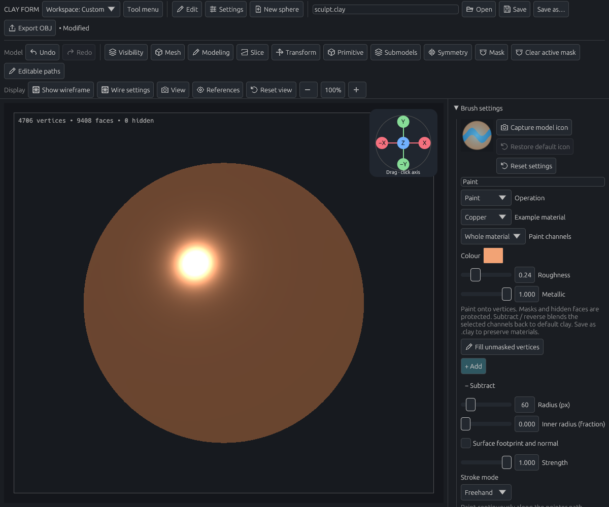
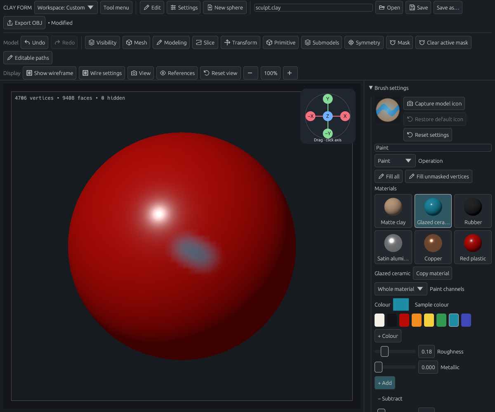
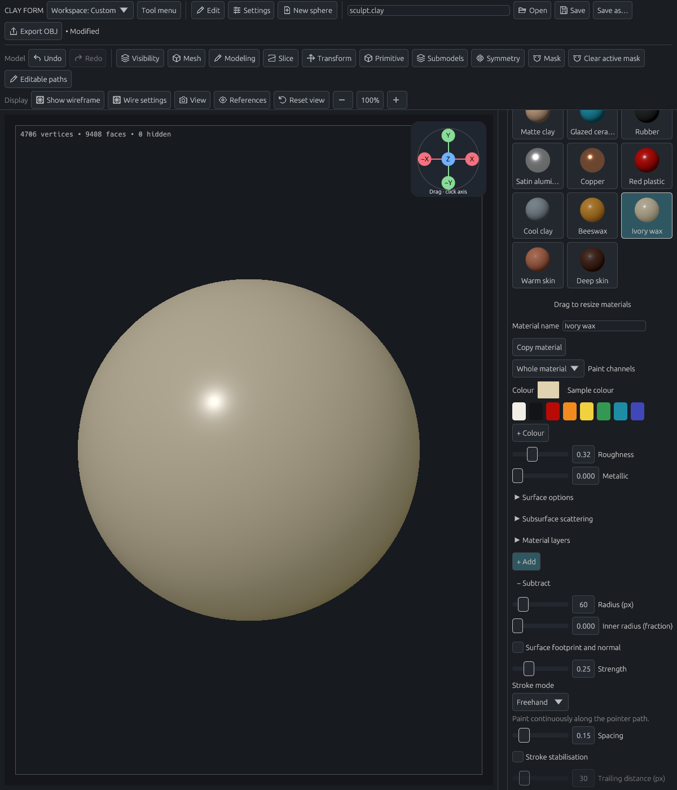
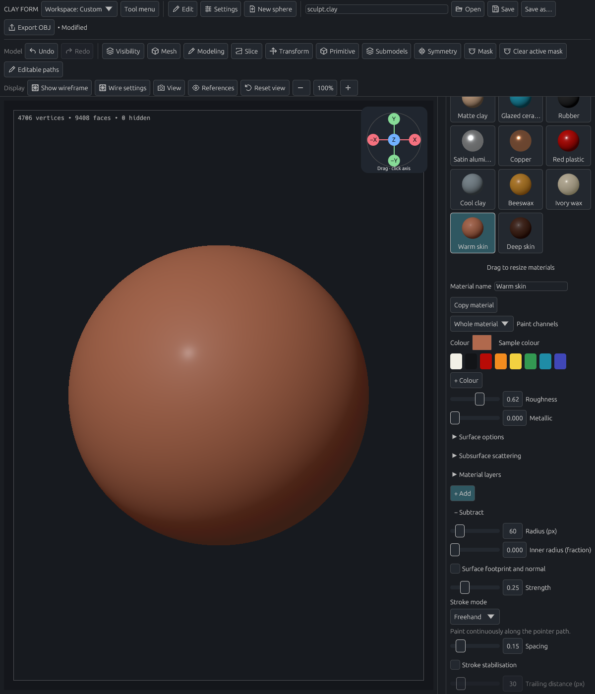

# Paint colours and materials

[Documentation home](../../README.md#documentation) · [Brush controls](sculpting.md)

Choose **Paint** in the brush library, or **Add brush → Paint** in the brush library when opening an older project that has no Paint preset. Convert a parametric primitive to a sculpt mesh first.

In **Brush settings**, select a rendered sphere in **Materials**, then paint on the model. Drag **Drag to resize materials** up or down to set its height; larger libraries scroll within that area. **Whole material** paints all surface controls and layers together. Choose **Colour only**, **Roughness only** or **Metallic only** to change one property without replacing the others.

| Example | Appearance | Roughness | Metallic |
| --- | --- | --- | --- |
| Matte clay | Warm, broad shading | 0.85 | 0 |
| Glazed ceramic | Teal with a sharp highlight | 0.18 | 0 |
| Rubber | Dark, matte surface | 0.92 | 0 |
| Satin aluminium | Pale metal with a broad highlight | 0.38 | 1 |
| Copper | Warm metal | 0.24 | 1 |
| Red plastic | Red with a glossy highlight | 0.30 | 0 |
| Cool clay | Cool grey, broad matte shading | 0.90 | 0 |
| Beeswax | Warm amber wax with soft scattering | 0.38 | 0 |
| Ivory wax | Pale wax with stronger scattering | 0.32 | 0 |
| Warm skin | Warm skin with a subtle surface sheen | 0.62 | 0 |
| Deep skin | Deep brown skin with a subtle surface sheen | 0.58 | 0 |

These are editable starting values. Ceramic uses a simple glossy dielectric; satin aluminium uses isotropic roughness, without directional brush marks or a separate coating layer. Edit **Colour**, **Roughness** and **Metallic** to make a custom material. Edit **Material name** to rename the selected swatch, including a built-in material. Use **Copy material** to save a separate editable copy, then adjust its channels. Copies and the colour palette are saved in your preferences and available across projects.

Click a palette swatch to select its colour. **+ Colour** saves the current colour; right-click a swatch to remove it. **Sample colour** lets you click a visible surface to pick its underlying paint colour without lighting, mask shading or vertex-group tint. It samples once; **Escape** cancels.

**Strength**, pressure, radius, falloff, alpha, stencil and symmetry work with painting. Repeated strokes approach the chosen values. Mirrored copies do not double the strength where their footprints overlap. **Subtract**, or the configured reverse modifier, blends the selected channels toward default clay. **Escape** cancels an active stroke; release records one Undo step.

**Fill all** applies the selected channels at full strength to every vertex of the active model, including masked and hidden vertices. It uses the chosen material even when Subtract is selected, updates every stored subdivision level, and creates one Undo step. Other submodels are unchanged.

**Fill unmasked vertices** applies the selected channels to the active model at the current Strength. Set Strength to 1 for the exact material values. The fill respects partial masks and hidden faces and updates stored subdivision levels in one undoable operation. The fill action can also be added to a custom menu or assigned a shortcut.

Painting never moves vertices or changes topology, including when Adaptive sculpt or automatic voxel remeshing is enabled. Masks protect paint independently of vertex groups. Selecting Paint turns off the vertex-group colour overlay so strokes are visible. **P** toggles vertex-group colours for inspection; it never changes the paint. Existing custom P bindings are preserved, and the toggle can be reassigned in keyboard settings.

## Detail, topology and saving

Paint is stored on vertices, so the mesh resolution determines the finest colour boundary you can draw. Subdivide before painting fine details. This is vertex painting; it does not create a UV map or texture image.

Subdivision and newly created modeling vertices interpolate the painted channels. Slicing, extraction, mirroring, thickness and merging carry the values to their corresponding vertices. Adaptive edge splits interpolate endpoints; edge collapse averages them. Coarse topology can soften small painted features. Voxel remeshing samples the nearest original triangle and interpolates its values; close or overlapping sheets can sample the other surface, so inspect the result and Undo if needed. Detail projection keeps the target's paint while changing its shape.

Changing subdivision levels retains higher-level paint detail and propagates edits to the lower-level samples. A coarse-level edit can change the interpolation underneath finer detail; channel values remain within their supported ranges.

Save as **`.clay`** to preserve paint, brush settings, masks, groups and subdivision levels. Undo/Redo includes material edits. OBJ import recognizes conventional `v x y z r g b [a]` vertex colours as sRGB, with opaque alpha only. OBJ material libraries and shader graphs are not imported. OBJ export reports a limitation for painted meshes instead of silently losing roughness and metallic values; keep the `.clay` project. Blender import and round-trip editing remain separate work.

## Shading

Open **View → Lighting** to choose a **Directional light** or **Point light**. Use **Drag to move light**, or the azimuth and elevation sliders, to reposition it. Point lights also have a distance control and distance falloff. Change light colour, intensity and ambient fill; turn off **Light follows camera** to keep the light fixed in world space. **Reset studio lighting** restores the original appearance. Lighting is saved in your preferences and does not edit paint or geometry.

The default viewport lighting uses a studio light and neutral fill. Roughness changes highlight width; metallic changes the diffuse/specular balance and tints metal reflections. The same material appearance is used for the active and inactive painted models. Unpainted inactive models retain their blue-grey selection tint.

The initial surface is opaque. Transparency, normal maps, height/displacement maps, UV textures, anisotropy and arbitrary shader graphs are not editable material channels yet. The viewport does not simulate scene reflections, cast shadows or indirect lighting. See the [material channel contract](../materials.md) for Blender mapping and validation.

## Shared surfaces and layers

Editing a named material now updates surfaces painted with it, in proportion to each stroke's contribution. **Copy material** creates an independent version before you experiment. Rename it with **Material name**. These definitions travel with the project, and Undo restores changes to both the definition and painted surfaces.

Open **Surface options** for IOR, specular level, emission colour and emission strength. Open **Material layers** to combine up to three additional surfaces over the base. Each layer has the same surface controls, a weight and **Mix** or **Add** blending. **Start from** supplies a surface preset; **Move up** changes the order and **Clear layer** resets it. Mix at full weight replaces the earlier surface; Add accumulates another contribution. Transmission and texture maps are not available yet.

Open **Subsurface scattering** for weight, RGB scattering radius and scale. Beeswax, Ivory wax, Warm skin and Deep skin include starting settings and a subtle specular layer; all colours and controls remain editable. The viewport uses a fast soft-diffuse approximation, while Blender export uses full Principled scattering. The approximation does not account for actual model thickness, so check final translucency in Blender.

## Exporting paint

Choose **More exports… → Export PLY** for geometry and base vertex colours, or **Export Blender** for the full painted material stack and editable named definitions. Blender export needs Blender 4.0 or newer installed on `PATH`. Export runs in the background and can be cancelled. Choose a destination in the file dialog; replacing a file requires confirmation.

Both formats export the active model at its current mesh level, including hidden faces. PLY does not contain roughness, metallic, emission or layers. Keep a `.clay` project for the full scene and subdivision levels. In Blender, edit the labelled values inside the node group named after your material. Changes coming back from Blender are part of the later exchange flow.
