# Models and mesh tools

[Documentation home](../../README.md#documentation)

Build a base shape, position it, and choose how to add detail.

- [Manage submodels](#submodels)
- [Create a primitive](#parametric-primitives)
- [Move, scale, and rotate](#model-transforms)
- [Mirror one side onto the other](#mirror-one-side)
- [Model with a pen](#pen-modeling)
- [Edge loops and creases](edges.md)
- [Add mesh detail](#mesh-management)
- [Thicken an open surface](#thickness-modifier)
- [Cut the model](#slice)
- [Combine submodels](#merge-down)

## Pen modeling

Open **Mesh → Pen modeling** after converting a primitive to a sculpting mesh. Start with a low-resolution cube or grid. Choose the active submodel in **Submodels** before selecting components.

### Select faces, edges, or vertices

1. Choose **Face**, **Edge**, or **Vertex**, then **Select**.
2. Hover to see the gold target; tap or **hold and drag across components** to select them in cyan. Fast strokes collect components between pen samples. Individual selection picks the visible surface, including in perspective view.
3. Choose **Replace**, **Add**, or **Remove** to build the selection without a keyboard. Replace clears the previous selection once when the stroke begins, then collects everything crossed. Shift at pen-down adds; Ctrl removes. Release keeps the selection; Escape cancels the whole stroke and restores the previous selection.
4. Use **Clear selection** to start over. In Edge mode, **Select loop** follows an unambiguous edge loop or border.

Choose the selection pattern below Replace/Add/Remove:

- **Individual:** paint faces, edges, or vertices under the pen.
- **Loop** in Face mode: selects a strip of quads. Hover near a face edge to choose the direction across that edge; the full strip previews in gold. Move near a perpendicular edge to choose the other direction.
- **Loop** in Edge mode: follows connected edges along an unambiguous loop, crease, or border chain.
- **Parallel edges** in Edge mode: selects an edge ring by following opposite edges across connected quads. It follows topology, including around curved surfaces.

Loop selections can wrap around the model, including its far side. Face loops and edge rings stop at hidden faces, triangles, open boundaries, or non-manifold branches. Add/Remove and drag selection also work with these patterns. Each crossed component is visited once per stroke, so retracing does not toggle it.

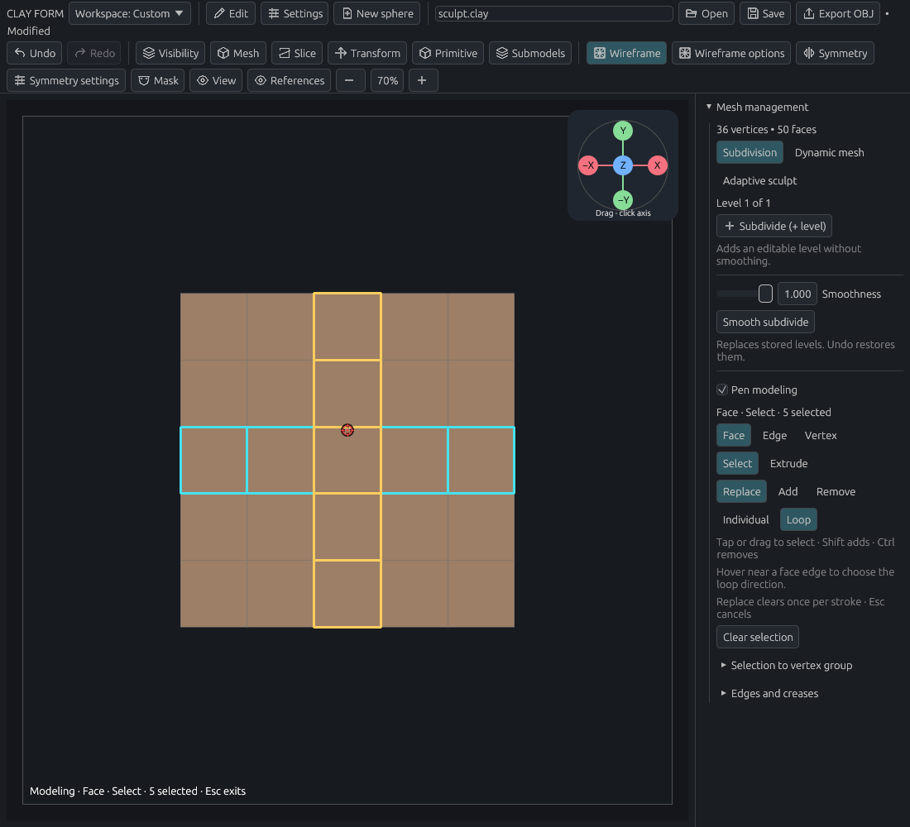

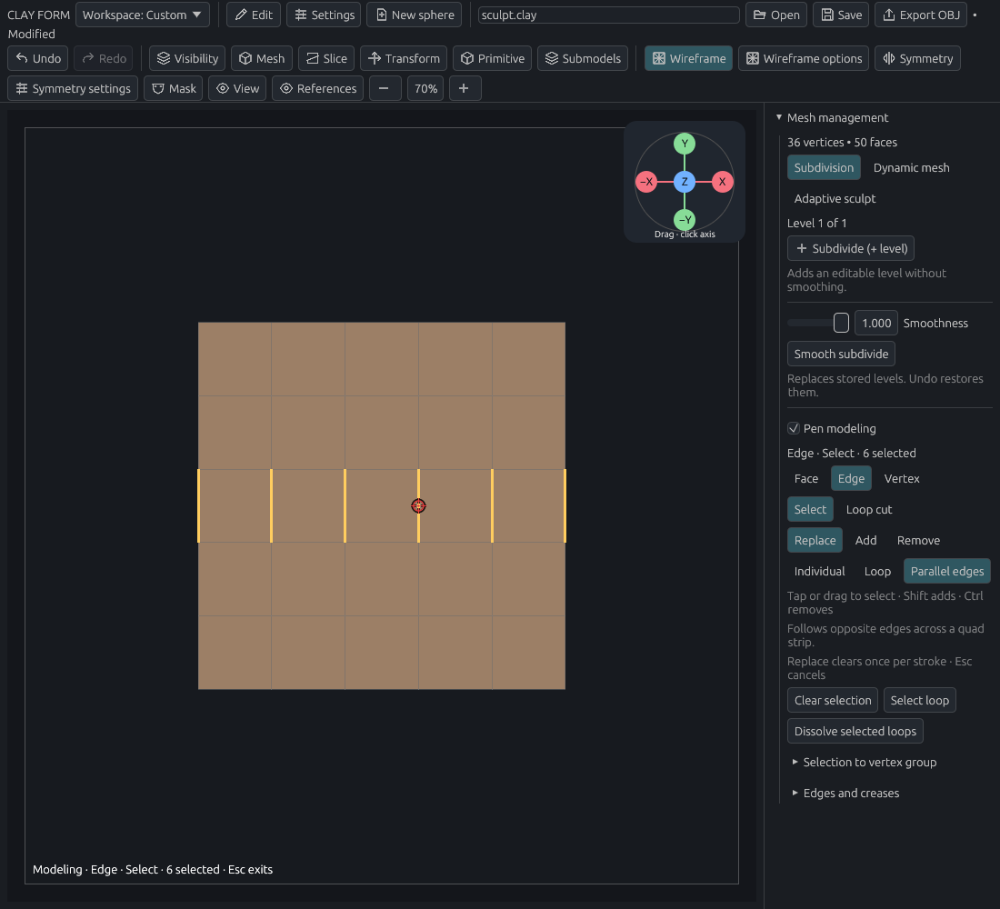

Faces select entire quads rather than their rendering triangles. Selections belong to the active mesh and clear after topology, visibility, or model changes. Navigation does not clear them. Drag the navigation frame or empty space to orbit; secondary-button navigation also works. Escape exits modeling when no preview is active.

### Extrude a face or flat region

1. Choose **Face → Extrude**.
2. Press a face and drag **up to extrude outward** or **down to push inward**. Pressing an already-selected face extrudes the selected flat region together; pressing another face extrudes that face alone.
3. Inspect the live preview and distance displayed at the bottom of the viewport.
4. Release to apply, or press Escape to discard the preview and stay in modeling mode.

Pressure does not change extrusion distance. Each completed drag is one Undo step. Selected faces must lie on the same plane and point in the same direction. Topology edits replace stored subdivision levels and turn off adaptive/dynamic topology; Undo restores the previous mesh settings and levels. Apply or disable temporary Thickness before modeling. Modeling uses the enabled symmetry axes when all sides have matching geometry and topology. Sculpt masks do not protect modeling edits.

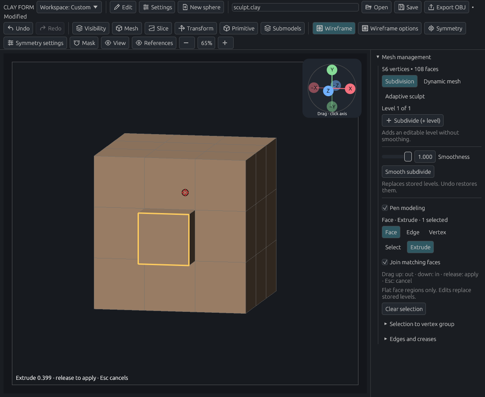

The highlighted rim stays on the dragged face even as the pen moves across other faces.

### Push through to make a tunnel

1. Create a cube with **3 spans on each axis**, then convert it to a sculpting mesh.
2. In **Face → Extrude**, leave **Join matching faces** enabled.
3. Press the middle face of one side and drag downward until it reaches the opposing face.
4. Look for **Tunnel snapped**, then release. The two caps disappear and the boundaries join, leaving a through-hole.

Joining beside an existing hole removes the shared wall to make one wider opening. At an outside edge or corner, it removes the coincident side surface to leave an open notch, including side surfaces split by depth loops. The remaining walls reconnect to those loops; regular spacing stays in quads, while differing spacing may introduce triangles. Hidden adjoining faces must be shown before joining.

Tunnel joining currently works on one face at a time. Opposing faces must have matching, aligned boundaries and opposite normals; equal area alone is insufficient. The drag snaps near the first matching face and stops there even if you overshoot. It rejects joins that collapse faces or create duplicate topology. This is a matching-face join, not a general intersection or Boolean tool; mismatched surfaces do not automatically cut each other.

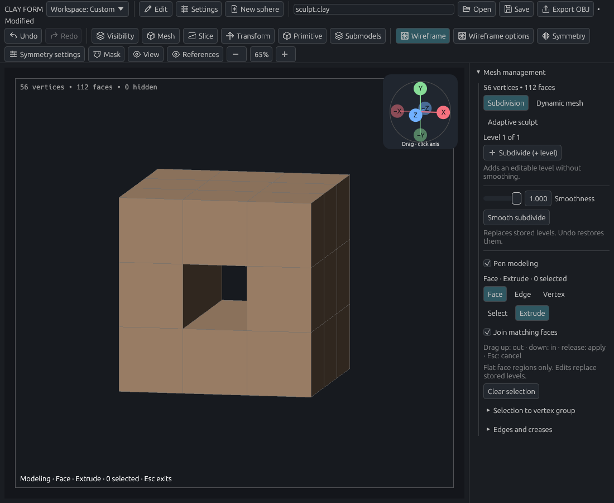

A slight turn exposes the tunnel walls and the opening at the far end.

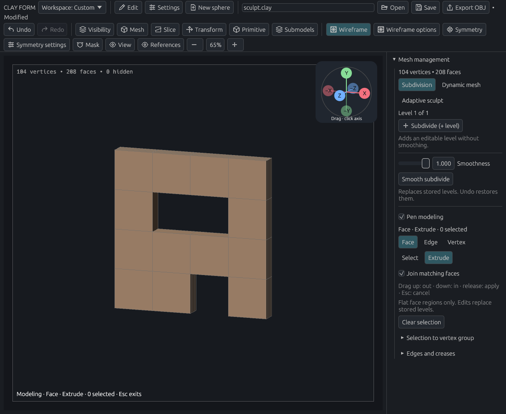

The exterior depth loops remain connected to the newly exposed walls.

### Insert a loop cut

Choose **Edge → Loop cut**. Hover an edge to preview the cut across its quad strip. A tap inserts a centered cut; press, hold, and drag along the edge to slide the preview before releasing. The original edge stays targeted throughout the drag. Escape cancels.

Use **Loops** or the **− / +** buttons to choose 1–16 evenly spaced cuts. While holding a cut, scroll the wheel up/down to increase/decrease the count. Dragging moves the set together, stopping before the outer cuts reach an existing edge. Release commits the whole set as one Undo step.

The cuts share vertices across faces and preserve masks, group weights, and creases. It follows a closed quad ring or ends at an open boundary. Triangles, hidden faces, and self-crossing strips produce an explanation instead of a partial cut.

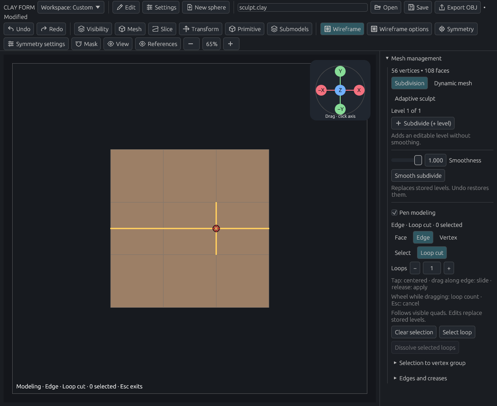

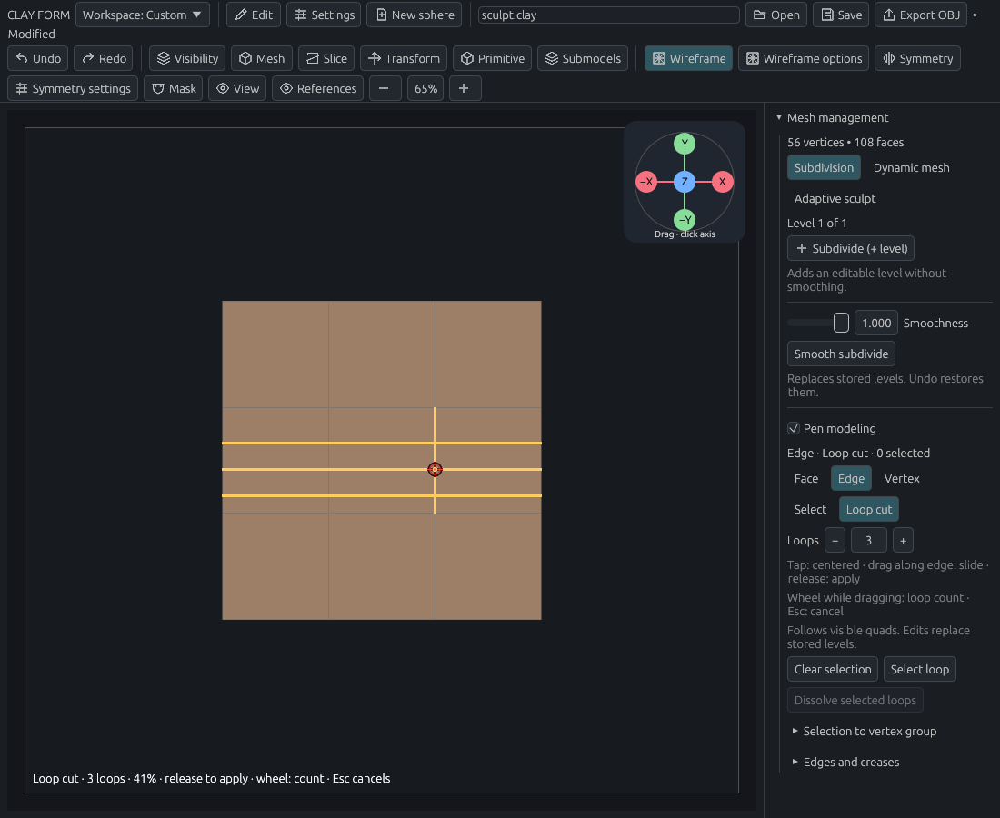

For loops around a hole or selected region, use the existing [support-loop controls](edges.md).

### Dissolve selected loops

1. Choose **Edge → Select → Loop**, then select the loop to remove. Use **Add** to select several separate loops.
2. Click **Dissolve selected loops**. The loop edges and redundant vertices disappear; the surrounding faces merge into quads without opening holes.
3. Use **Undo** to restore the entire operation, including stored subdivision levels.

This requires complete, noncrossing interior quad loops. An open loop must end at the mesh border. Partial loops, selected border edges, hidden adjoining faces, and intersections are rejected without changing the mesh. Merging across different face-group labels is also rejected. Remaining vertex masks/group weights and boundary creases are preserved. Removing a curved loop can simplify the shape.

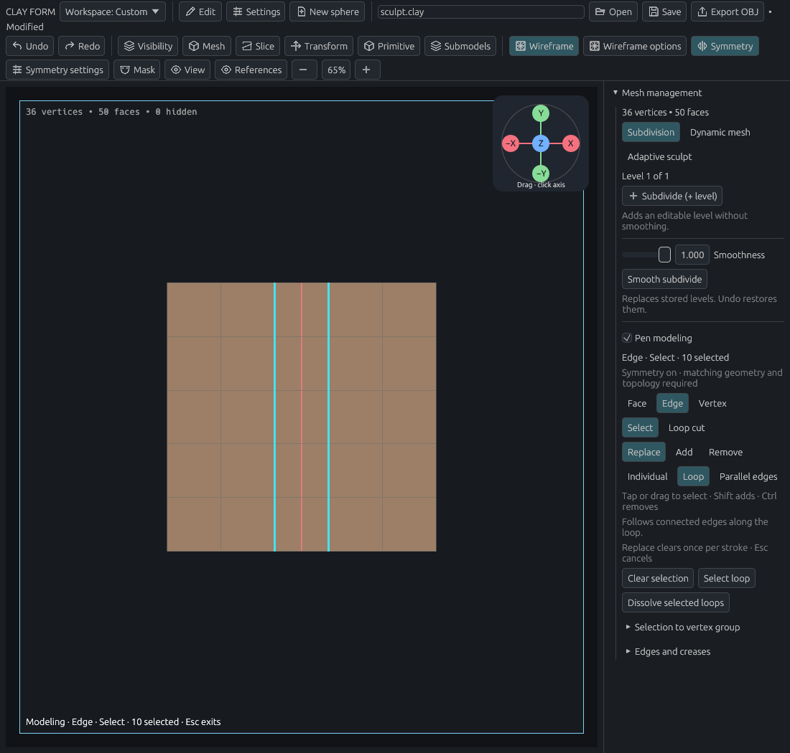

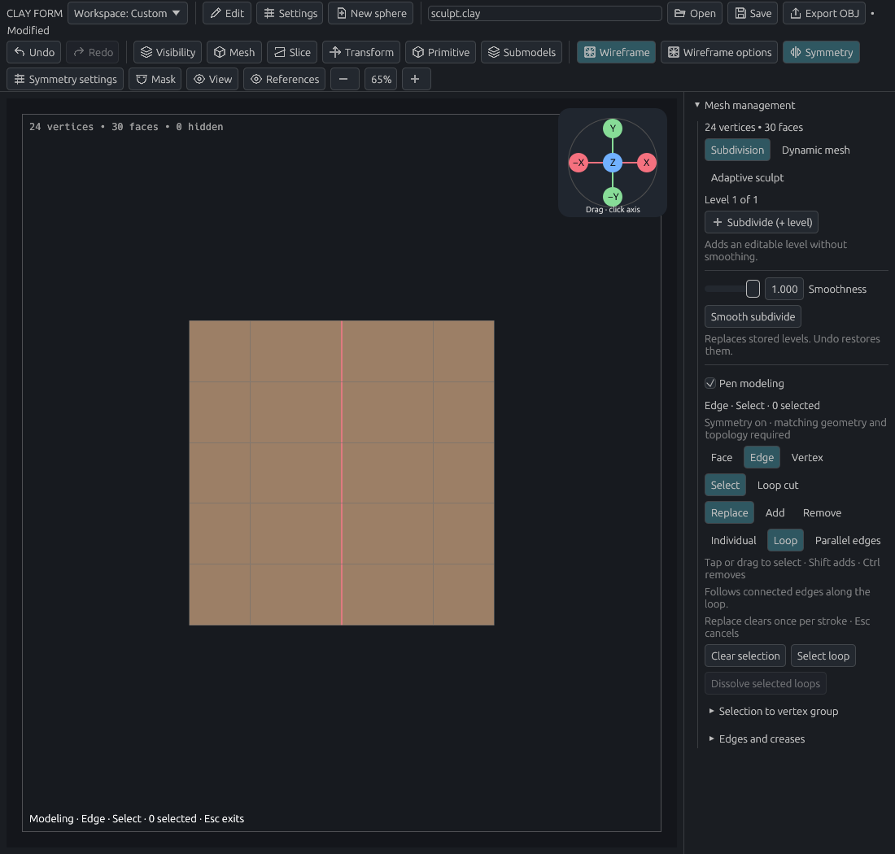

### Model with symmetry

Enable the existing **Symmetry** toggle and choose mirror axes or radial settings in **Symmetry settings**. Pen modeling uses the same center and axes for component selection, loop/ring selection, group assignment, extrusion/tunnels, loop cuts, and dissolve.

Every enabled copy must match the active mesh's vertex positions, polygon connectivity, winding, and face visibility. A small automatic tolerance accommodates floating-point rounding; it does not approximate asymmetric shapes or remesh mismatched sides. If correspondence fails, the tool displays an explanation and leaves geometry unchanged. Disable symmetry to work on unmatched geometry.

Selection previews show the matching components. Symmetry copies of an edit commit together as one Undo step. Shared center-plane cuts are deduplicated; sliding a cut off center creates its reflected counterpart. Intersecting symmetric cuts form a quad grid. Adjacent coplanar extrusion copies share walls, while copies meeting at an ambiguous corner are rejected. Changing symmetry settings cancels an active preview.

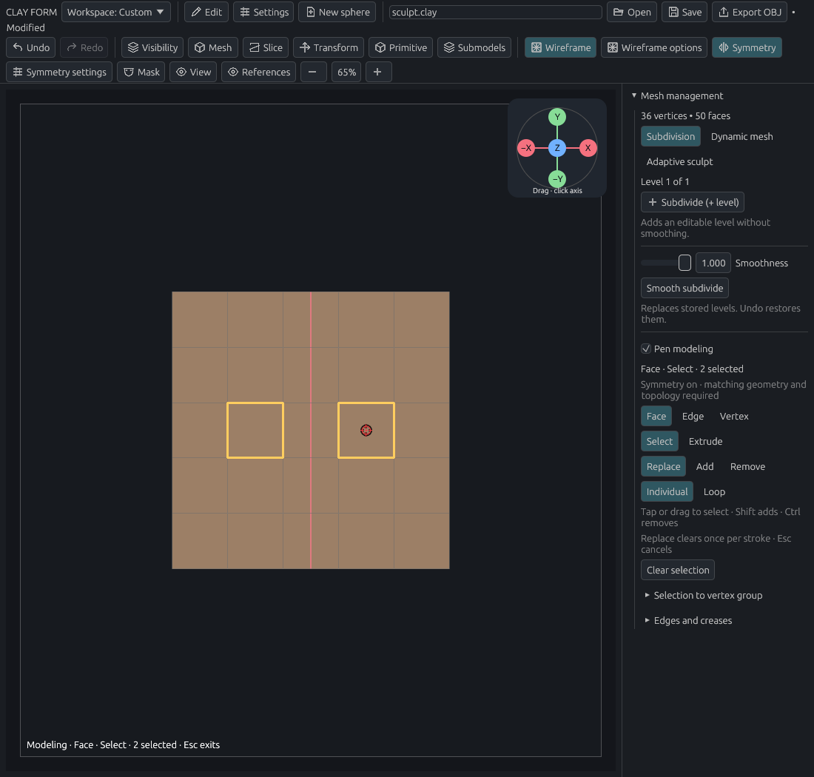

### Save a component selection as a vertex group

Choose **Select**, build a face, edge, or vertex selection, then expand **Selection to vertex group**. Enter a name and choose **Create group from selection**, or choose an existing group and use **Add to group** / **Remove from group**. Faces include all corners; edges include both endpoints. Sculpt masks stay unchanged. Use a single subdivision level for component-to-group assignment.

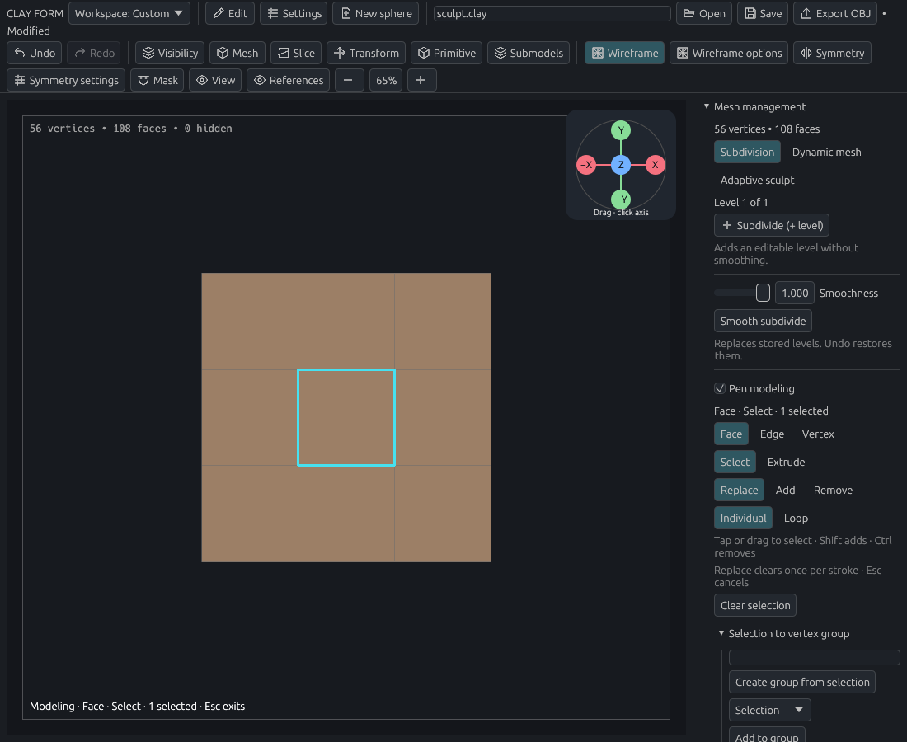

Right-click a modeling button and choose **Add to custom menu / shelf…** or **Assign shortcut…**. Component modes, Select/Extrude/Loop cut, selection modes and patterns, join toggle, loop-count buttons, selection clearing/loop expansion, dissolve, and group actions are available in the action catalog. Extrude and Loop cut on a custom shelf automatically enter the appropriate modeling mode. Group actions use the name and group currently chosen in the Mesh panel. This first modeling pass does not yet include bevel, inset, sliding existing edges, component transforms, or arbitrary face bridging.

## Submodels

### Select and organize parts

Open **Submodels**. Click a row or click an inactive surface in Sculpt mode to select it; sculpting starts on the next drag.

| Control | Result |
| --- | --- |
| Eye | Hide/show a model |
| Up / down | Reorder models |
| Duplicate | Copy the active surface, mask, and subdivision levels |
| Extract masked | Copy fully selected faces into a new unmasked model |
| Group selector | Assign the model to an organizational group |
| Ungroup | Remove the folder while keeping its models |

The active model is clay-colored and inactive models blue-gray unless vertex-group colors override them. Hidden models cannot be sculpted or transformed. Inactive models display their lowest stored level without losing higher detail.

Extracted boundaries stay open and use a fresh subdivision stack. The selection threshold defaults to 50%. Add an existing mesh through [OBJ import](files.md#obj-import).

## Parametric primitives

### Create a base shape

1. Choose **Primitive → Create primitive…**.
2. Confirm replacement of the active submodel's geometry, masks, and levels. **Undo** can restore them.
3. Choose a shape and adjust its controls.
4. Choose **Convert to sculpting mesh** when ready to use brushes or mesh operations.

Available shapes: Plane, Cube, Circle, UV sphere, Icosphere, Cylinder, Cone, Torus, and Grid.

### Adjust dimensions and resolution

Use the **Primitive** menu or **Submodels → Primitive**. Pin/dock the menu to keep its controls visible.

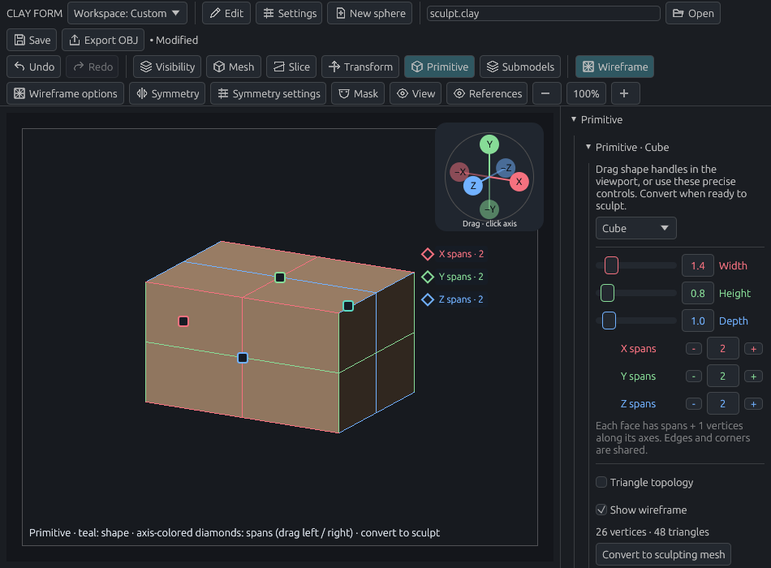

*Dimensions change the shape; spans change its resolution. This cube has two spans on each axis.*

| Handle | Controls |
| --- | --- |
| Axis-colored square | Size along X (red), Y (green), or Z (blue) |
| Teal circle | Radius |
| Diamond | Resolution; drag left/right |
| White hover ring | The highlighted handle |

Hover for a label, or type precise values in the panel. Wireframe shows the axis-colored span lines. Plane/Grid and Circle lie in XY; cylinders, cones, and tori use Y as their main axis.

The recipe saves with the model and survives duplication, transforms, and reopening. Converting removes it but keeps the surface; Undo restores it. An unfilled Circle must be filled before conversion. Open surfaces need closing before adaptive sculpting or voxel remeshing.

## Model transforms

Open **Transform** and select **World axes**.

| Operation | Gesture |
| --- | --- |
| Move | Drag an axis, or the center for view-plane movement |
| Scale | Drag an axis, or the center for uniform scale |
| Rotate | Drag a colored ring; watch the signed angle |
| Place pivot | Click the active surface, then drag to adjust |
| Reset pivot | Return to the model's bounding-box center |

Orbit to expose an axis facing the camera. Edge-on rotation rings accept a straight drag along the projected ring. Drag outside handles to orbit; choose **Done** to sculpt again.

### Example: rotate a cube and keep its recipe

1. Create the cube shown above: **1.4 × 0.8 × 1.0**, with **2** spans per axis.
2. Choose **Transform → Rotate** and drag the blue Z ring.
3. Release, choose **Done**, then change a cube dimension.

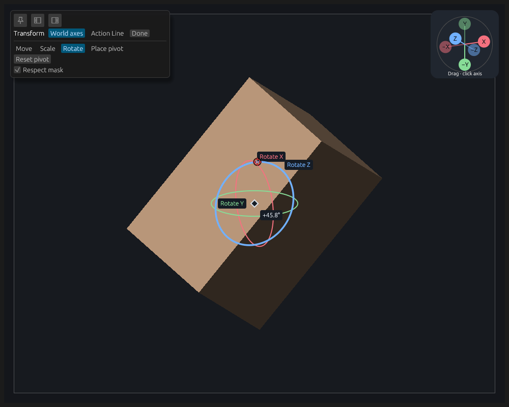

*Changing a primitive's dimensions keeps its rotated placement. Each changed drag is one undo step.*

### Use an Action Line

Choose **Action Line → Set line** and drag. The start is the pivot; the line supplies the axis.

Move with the middle handle. Scale with the end for axial stretch or the middle for uniform scaling. Rotate with the amber ring. **Reset pivot** recenters the start while keeping direction and length. Extend a zero-length line before rotating.

### Protect a masked region

Enable **Respect mask**. Full masks stay fixed; soft masks reduce the transformation. All stored subdivision levels follow.

Pivot/line placement does not change geometry or consume undo. These controls are session-only and reset after actions such as changing models, opening projects, and undo/redo.

## Mirror one side

### Replace the opposite half

1. Open **Symmetry settings → Mirror one side**.
2. Choose **X**, **Y**, or **Z**. The displayed plane uses that axis of the symmetry center below.
3. Choose the source direction: **-X to +X**, for example, keeps the negative-X half and replaces the positive-X half.

This works with brush symmetry turned off. Directions use object coordinates; rotating the camera does not change them.

The active submodel becomes symmetric across the plane. Source masks, vertex-group weights, and face colors are copied too; masks do **not** protect the destination. Crossing faces are cut and joined at a shared center seam. Open surfaces can remain open.

### Example: repeat an existing sculpted fold

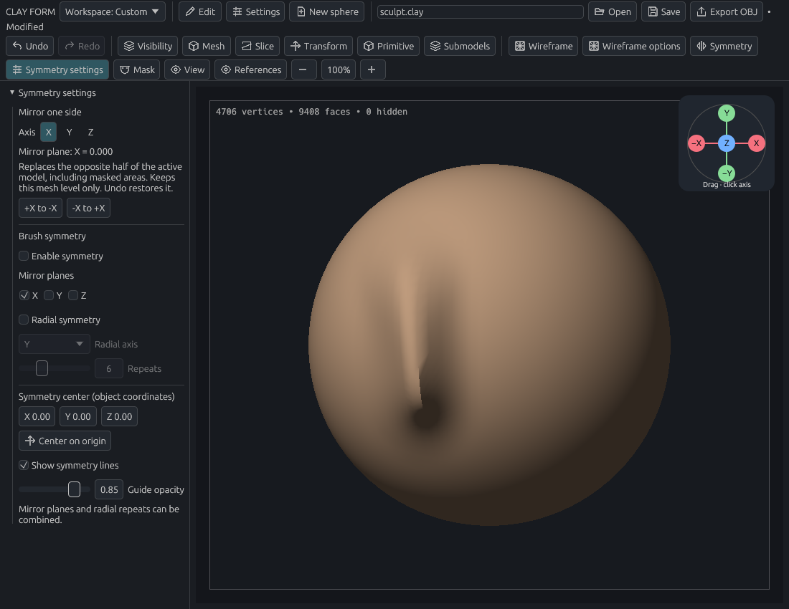

*Before: the left half contains the fold we want to keep.*

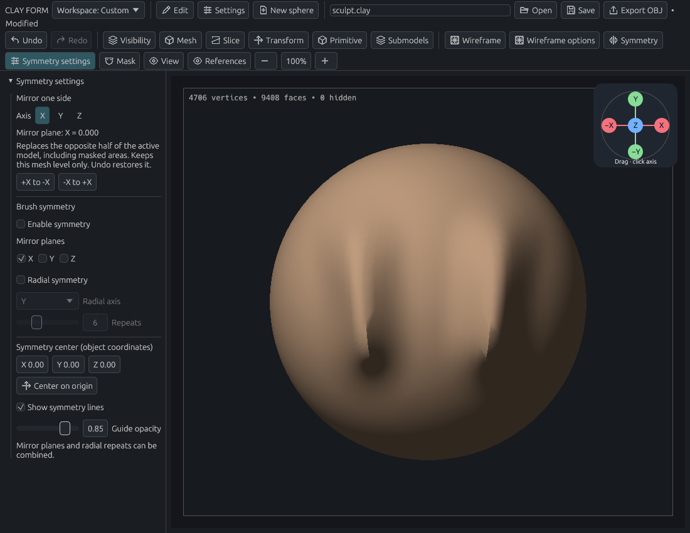

*After **-X to +X**: the opposite half matches, including the fold. The camera has not moved.*

### Mesh levels and undo

Mirror keeps the current mesh level and discards its other subdivision levels. It also turns off dynamic/adaptive mesh modes. Other submodels are unchanged. **Undo** restores the previous geometry, masks, groups, and levels in one step.

Convert parametric primitives first, show all faces of the active model, and apply or remove thickness modifier. A source half with no surface produces an error and leaves the model unchanged. Large operations can be cancelled from the status controls.

## Mesh management

Choose the method that fits your work:

| Method | Best for | Changes topology |
| --- | --- | --- |
| [Smooth subdivision](edges.md#control-subdivision-smoothness) | Rounding shapes while preserving creased edges | Bakes the current level into refined quads |
| Subdivision | Keeping several editable detail levels | Adds resolution to the whole surface |
| [Adaptive sculpt](sculpting.md#snake-brush-and-adaptive-sculpting) | Detail near the brush | Refines/simplifies locally |
| Dynamic mesh / voxel remesh | Redistributing geometry or fusing overlapping closed parts | Rebuilds the whole surface |

### Add subdivision levels

Choose **Mesh → Subdivide** from the highest level. Use **Lower / Higher** or the level slider to switch levels.

Lower-level edits carry upward while retaining finer detail. Subdivision is linear: it adds resolution without automatically smoothing the shape. Masks interpolate between levels. For controlled rounding, use the separate [Smoothness slider and Smooth subdivide](edges.md#control-subdivision-smoothness) controls.

**Delete lower** removes levels below the current one; **Delete higher** removes those above it. Both are undoable. Projects store all levels; OBJ exports only the active one.

### Remesh a whole surface

1. Switch to **Dynamic mesh**. This keeps the active surface and discards stored levels.
2. Choose a resolution, **16–96 voxels** along the longest bounding-box axis.
3. Select **Remesh now**, or enable **Remesh after each stroke**.

**Remeshing clears masks and can lose details thinner than a voxel.** Use moderate resolution first. It requires closed, consistently oriented surfaces and can fuse overlapping outward-facing shells; separate volumes remain separate.

Mesh operations run in the background. Cancel keeps the original surface; Undo restores prior geometry and settings. A failed automatic remesh disables the automatic option so you can adjust it.

## Thickness modifier

### Preview a shell

In **Submodels → Thickness · open meshes**, enable **Thickness modifier** and set its total thickness in model units. Half is added to each side; walls close boundary loops.

Use **Rim loops** to add wall segments and **Crease rim edges** to preserve the joins during later smooth subdivision. See the [illustrated thickness example](edges.md#add-loops-and-creases-to-thickness).

Orbit to inspect tight folds for intersections. The original surface, masks, levels, and picking remain unchanged. OBJ export uses the original surface while the shell is temporary.

### Apply the shell

Choose **Apply Thickness modifier** to make the preview real geometry. This converts primitives, preserves masks/quads, and resets levels and topology modes. Undo restores the original surface and settings.

Thickness requires consistently oriented open surfaces with nonbranching boundaries. Closed meshes and outlines without faces are not eligible. Front/back/rim groups and masks can be generated in the same controls.

## Slice

### Trim away one side

Before slicing, convert primitives, apply/remove thickness modifier, and show all faces of the active model.

1. Open **Slice**, select **Line**, and choose **Trim**.
2. Leave **Cap cuts** on for a closed result.
3. Drag across the model and inspect **Keep / Remove**. Use **Flip kept side** if needed.
4. Release to apply, then choose **Done slicing** and orbit to inspect the cap.

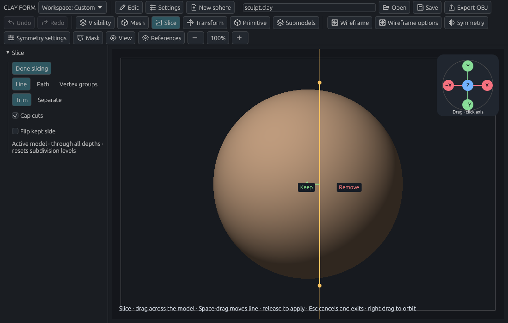

*Before release: check which side will remain.*

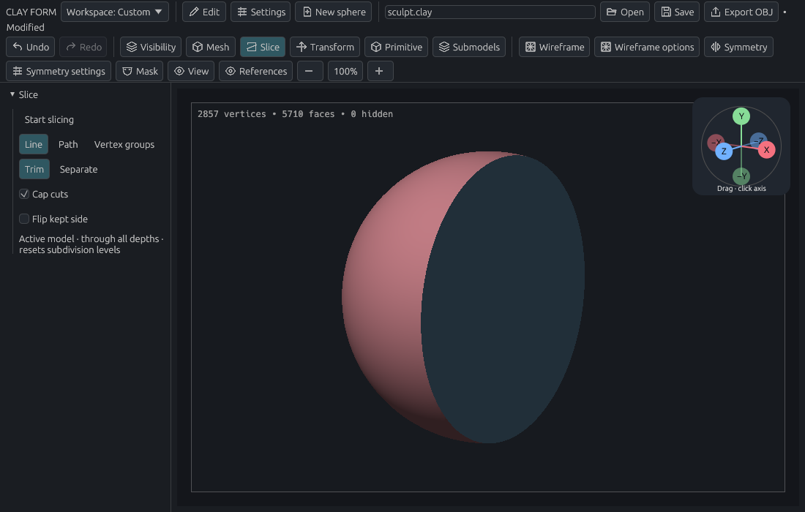

*After release and orbit: the cut is closed with a flat cap in a new Cut vertex group.*

### Choose a cut result

| Result | What remains |
| --- | --- |
| Vertex groups | One connected surface, divided into face groups |
| Trim | The chosen side only |
| Separate | Both sides as separate submodels, initially in place |

Cuts extend through all depths of the active model. Masks and symmetry do not restrict them. Hold **Space** during a line drag to move it; **Esc** cancels and exits Slice. Right-drag orbits between cuts.

### Make a bent or rounded path

Choose **Path**. Click to add up to **24 points**, click an edge to insert one, and drag points to reshape the cut.

| Control | Action |
| --- | --- |
| Interior point's blue diamond | Drag away to round, toward the point to sharpen |
| Tangent handles | Adjust the rounding |
| Sharp / Rounded | Set corner style |
| Turn / Round (px) | Set precise corner values |
| Shift-drag | Snap to 15° |
| Space-drag | Move the entire path |
| Delete point / Delete / Backspace | Remove the selected point |
| Apply cut / Enter | Commit |
| Clear / Esc | Discard; Esc also exits Slice |

The camera stays fixed while editing a path. Clear/apply it before orbiting. Paths and their extensions must not cross; failed cuts retain the draft for correction.

### Caps, projection, and undo

Caps require closed, consistently oriented input. Turn **Cap cuts** off for open surfaces, or apply thickness first.

Cuts follow the [view projection](navigation.md#perspective-view): parallel planes in orthographic, planes converging at the eye in perspective. Changing projection/FOV discards the draft. A perspective path through geometry crossing the eye is rejected; use orthographic and redraw it.

A cut uses the active level and resets that model's subdivision and adaptive/voxel settings. Uncut quads remain; intersections and caps use triangles. Other submodels stay intact. Each completed cut is one undo step; cancellation keeps the original surface.

## Merge down

Choose **Submodels → Merge down** to combine the active model with the next one in grouped order. The tooltip names the target.

The active model keeps its name/folder. Masks, groups, visibility, and quads survive. Hidden models contribute hidden faces; duplicate group names receive suffixes.

Merge bakes primitives and thickness modifier, uses current mesh levels, and resets the result's level/topology settings. Fill unfilled Circles first. It combines surfaces **without welding or boolean union**; use voxel remeshing for fusion. Undo restores both models.

## Related guides

[Brushes and adaptive detail](sculpting.md) · [Masks and selection](selection.md) · [Import/export](files.md)
