# Models and mesh tools

[Documentation home](../../README.md#documentation)

Build a base shape, move its parts, and add the detail your sculpt needs.

Start with [a primitive](#parametric-primitives) for a brush sculpt, or try [a square tunnel](#push-through-to-make-a-tunnel) to learn modeling with a visible result.

- [Manage submodels](#submodels)
- [Create a primitive](#parametric-primitives)
- [Move, scale, and rotate](#model-transforms)
- [Mirror one side onto the other](#mirror-one-side)
- [Model with a pen](#pen-modeling)
- [Edge loops and creases](edges.md)
- [Add mesh detail](#mesh-management)
- [Redistribute stretched polygons](#relax-stretched-polygons)
- [Thicken an open surface](#thickness-modifier)
- [Cut the model](#slice)
- [Combine submodels](#merge-down)
- [Join meshes locally](#join-meshes-locally)

## Check the next action

The persistent operation strip names the active tool and its target, even with the tool panels collapsed or in Zen mode. Modeling includes the component type and selection count. Slice includes its operation and whether it uses a line or a path.

- Read the short instruction before starting a gesture. Previewed edits explain how to apply or cancel them.
- Choose **Return to sculpt** to leave Modeling, Slice, selection or transform mode through the normal tool switch.
- An unavailable action explains its prerequisite in Search. Quick menus also have **Why are actions unavailable?**, which you can open with a pen. Keyboard selection shows the same explanation above the choices.

## Submodels

### Select and organize parts

Open **Submodels**. Click a row or click an inactive surface in Sculpt mode to select it; sculpting starts on the next drag.

| Control | Result |
| --- | --- |
| Eye | Hide/show a model |
| Up / down | Reorder models |
| Duplicate | Copy the active surface, mask, and subdivision levels |
| Delete submodel | Confirm the named model to remove it, including hidden geometry and stored levels. Undo restores it |
| Extract masked | Copy fully selected faces into a new unmasked model |
| Group selector | Assign the model to an organizational group |
| Ungroup | Remove the folder while keeping its models |

The active model is clay-colored and inactive models blue-gray unless vertex-group colors override them. Hidden models cannot be sculpted or transformed. Inactive models display their lowest stored level without losing higher detail.

Extracted boundaries stay open and use a fresh subdivision stack. The selection threshold defaults to 50%. Add an existing mesh through [OBJ import](files.md#obj-import).

### Cut and combine solids with a Boolean stack

1. Put the parts in the same Submodels group. The **Ungrouped** section also works as a group.
2. Each submodel row has a role selector. Set the bottom solid to **Add**. Moving upward, use **Add** to fuse a solid, **Subtract** to cut it away, or **Intersect** to keep the volume shared with the accumulated shape. **Regular** keeps a part separate. The eye bypasses a hidden operand.
3. Toggle **Boolean result** in Submodels or the View toolbar row to see the evaluated group in the main viewport. Change roles directly on any row or use the row arrows to change the order. Moving an Add above a cutter can fill the cut back in. Select a source row and use the transform handles to move the operand. Toggle the result off to see and sculpt the source surfaces.
4. In **Boolean method**, choose how to build the result. **Voxel** is the default. Its resolution controls how finely it samples the shape. A finer grid can recover narrow cuts. **Preserve surfaces** clips the source faces at each intersection and keeps intact quads, UVs, vertex paint, groups and creases away from the cut. Both methods support all three roles.
5. Choose **Bake result** to create a sculptable submodel and hide its sources. A voxel bake uses plain clay. A surface bake carries the surviving source attributes. Undo restores the editable stack in one step. To revise a saved bake, hide the baked part and show its source operands again.

The preview uses the current mesh level of each operand. Use closed, consistently wound solids and apply temporary thickness first. For **Voxel**, show all faces and clear masks. **Preserve surfaces** also checks for self-intersections and stops if a cut would change protected faces. Textured operands need a shared atlas. Bake a linked array or path assembly into submodels to use its copies as operands. The project saves the method along with the roles, order, visibility and voxel resolution.

### Delete a submodel

1. Open **Submodels** and select the row you want to remove. Hidden models can be selected from the list too.
2. Click **Delete submodel**. Check the model name in the dialog and choose **Confirm delete**, or **Cancel** to keep it.
3. Use **Undo** if you need to restore it. Save the project to keep the removal after reopening.

Deletion removes the whole model, including masks, subdivision levels, primitive settings and modifiers. The next model in the panel becomes active, or the previous one if you removed the last row. Other models retain their geometry and visibility.

Deleting the final submodel leaves a visible **Empty model** slot. You can create a primitive there or import another model; Undo restores the deleted model. Deleting an already empty, reset slot does nothing. Reference images and brush presets stay in the project.

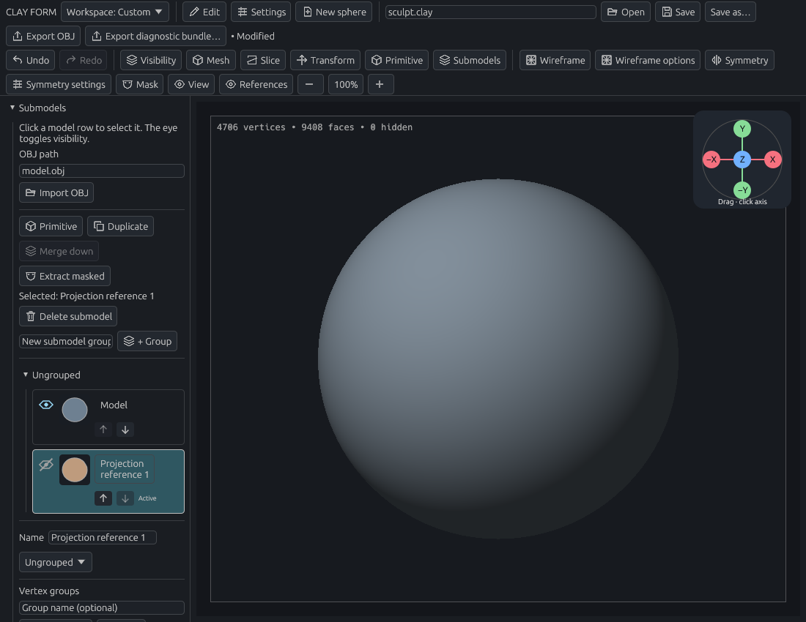

The eye only hides a model; **Delete submodel** removes it from the project. After projecting detail, use this control to remove an unwanted reference copy. Deletion is unavailable during mesh jobs and projection previews; finish or cancel those first. You can also right-click **Delete submodel** to assign a shortcut or add it to a custom menu.

## Parametric primitives

### Create a base shape

1. Choose **Primitive → Create primitive…**.
2. Confirm replacement of the active submodel's geometry, masks, and levels. **Undo** can restore them.
3. Choose a shape and adjust its controls.
4. Choose **Convert to sculpting mesh** when ready to use brushes or mesh operations.

Available shapes: Plane, Cube, Circle, UV sphere, Icosphere, Cylinder, Cone, Torus, and Grid.

### Adjust dimensions and resolution

Use the **Primitive** menu or **Submodels → Primitive**. Pin/dock the menu to keep its controls visible.

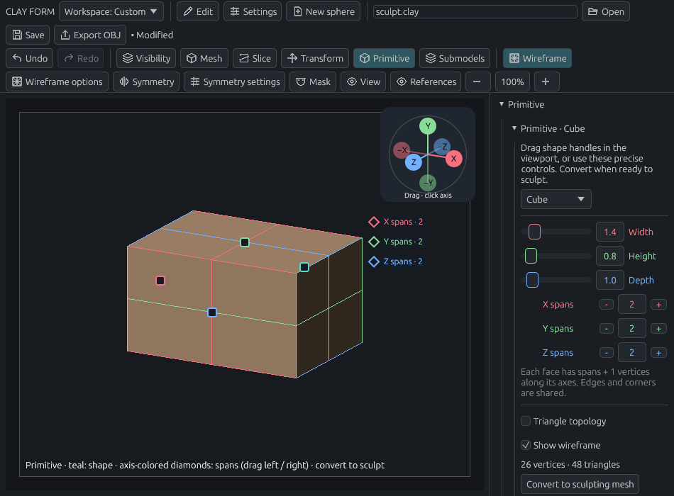

*Dimensions change the shape; spans change its resolution. This cube has two spans on each axis.*

| Handle | Controls |
| --- | --- |
| Axis-colored square | Size along X (red), Y (green), or Z (blue) |
| Teal circle | Radius |
| Diamond | Resolution; drag left/right |
| White hover ring | The highlighted handle |

Hover for a label, or type precise values in the panel. Wireframe shows the axis-colored span lines. Plane/Grid and Circle lie in XY; cylinders, cones, and tori use Y as their main axis.

The recipe saves with the model and survives duplication, transforms, and reopening. Converting removes it but keeps the surface; Undo restores it. An unfilled Circle must be filled before conversion. Open surfaces need closing before adaptive sculpting or voxel remeshing.

## Model transforms

Open **Transform** and select **World axes**.

| Operation | Gesture |
| --- | --- |
| Move | Drag an axis, or the center for view-plane movement |
| Scale | Drag an axis, or the center for uniform scale |
| Rotate | Drag a colored ring; watch the signed angle |
| Place pivot | Click the active surface, then drag to adjust |
| Reset pivot | Return to the model's bounding-box center |

Orbit to expose an axis facing the camera. Edge-on rotation rings accept a straight drag along the projected ring. Drag outside handles to orbit; choose **Done** to sculpt again.

### Deform a model with a frame

Select a sculptable submodel and choose **Submodels → Deformation frame**. Convert a parametric primitive to a sculpting mesh first. Drag a teal corner in the view plane to pull or push the nearby surface. Orbit to pull in a different direction. Overlapping corner handles have short leader lines in face-on views.

Choose **X**, **Y** or **Z** in the transform controls. Drag **B** sideways to bend the model along that axis, or **T** to twist it. Deformation increases toward the positive end of the axis. The viewport shows the signed angle as you drag. Release to commit once, or press **Esc** to discard the preview.

**Respect mask** reduces each vertex’s displacement by its mask weight. Hidden faces and all stored subdivision levels follow the frame. The frame works independently of brush symmetry. Each commit refits the frame to the new bounds. Toggle **Deformation frame** again to hide it. Projects store the resulting geometry, and linked instances follow edits to their source.

### Example: rotate a cube and keep its recipe

1. Create the cube shown above: **1.4 × 0.8 × 1.0**, with **2** spans per axis.
2. Choose **Transform → Rotate** and drag the blue Z ring.
3. Release, choose **Done**, then change a cube dimension.

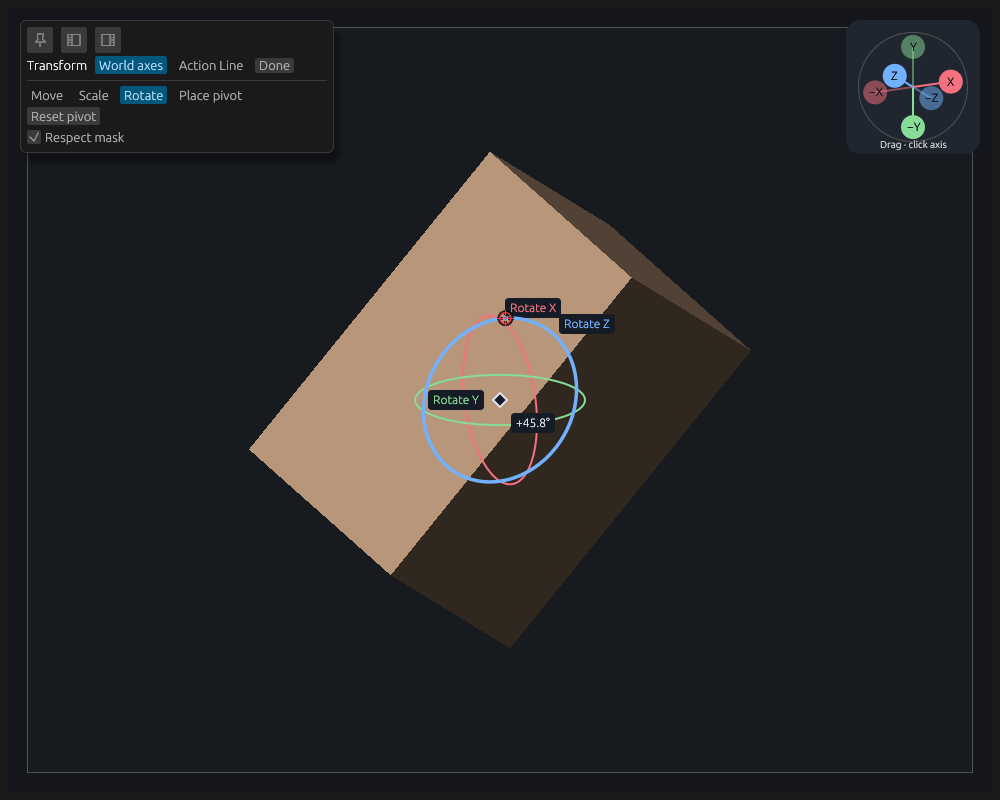

*Changing a primitive's dimensions keeps its rotated placement. Each changed drag is one undo step.*

### Use an Action Line

Choose **Action Line → Set line** and drag. The start is the pivot; the line supplies the axis.

Move with the middle handle. Scale with the end for axial stretch or the middle for uniform scaling. Rotate with the amber ring. **Reset pivot** recenters the start while keeping direction and length. Extend a zero-length line before rotating.

### Protect a masked region

Enable **Respect mask**. Full masks stay fixed; soft masks reduce the transformation. All stored subdivision levels follow.

Pivot/line placement does not change geometry or consume undo. These controls are session-only and reset after actions such as changing models, opening projects, and undo/redo.

## Mirror one side

### Replace the opposite half

1. Open **Symmetry → Mirror one side**.
2. Choose **X**, **Y**, or **Z**. The displayed plane uses that axis of the symmetry center below.
3. Choose the source direction: **-X to +X**, for example, keeps the negative-X half and replaces the positive-X half.

This works with brush symmetry turned off. Directions use object coordinates; rotating the camera does not change them.

Enable **Bridge with quads (experimental)** on an untextured, closed all-quad mesh to try an all-quad join across the plane. **Add centreline** divides the bridge into quad rows on either side.

The active submodel becomes symmetric across the plane. Source masks, vertex-group weights, and face colors are copied too; masks do **not** protect the destination. Crossing faces are cut and joined at a shared center seam. Open surfaces can remain open.

### Example: repeat an existing sculpted fold

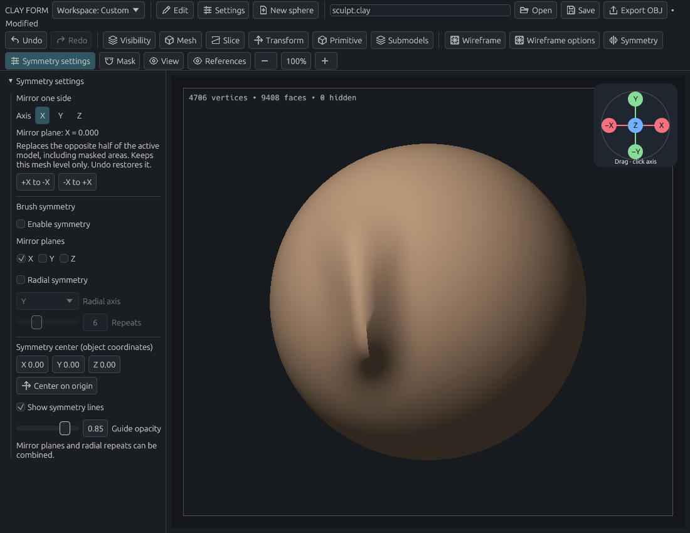

*Before: the left half contains the fold we want to keep.*

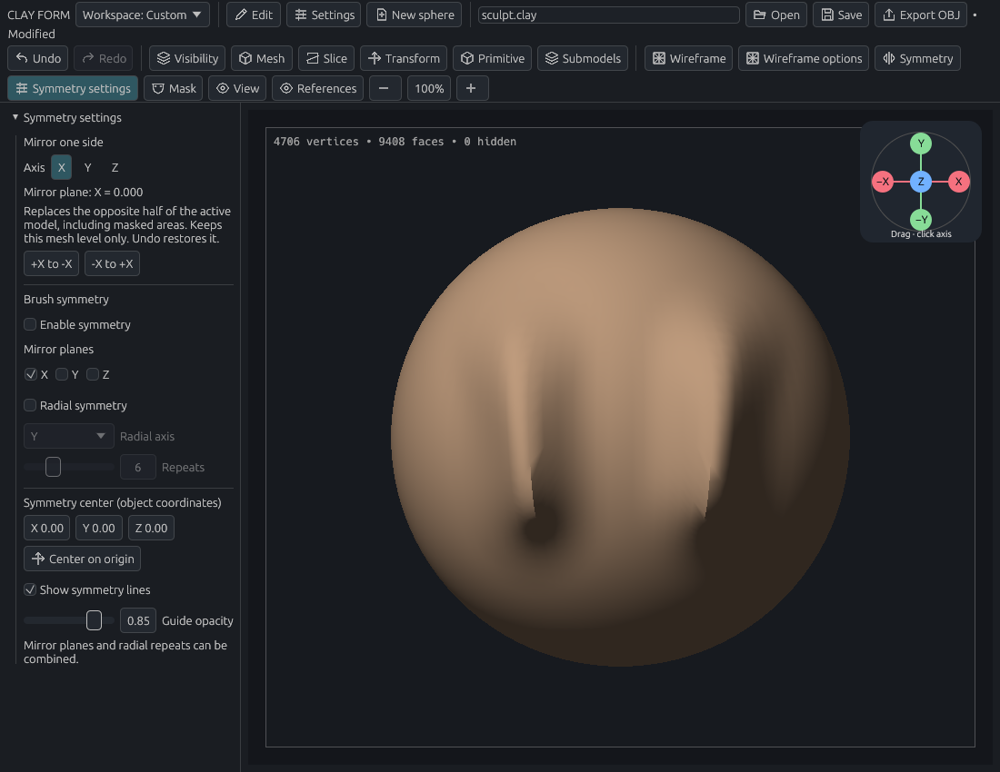

*After **-X to +X**: the opposite half matches, including the fold. The camera has not moved.*

### Mesh levels and undo

Mirror keeps the current mesh level and discards its other subdivision levels. It also turns off dynamic/adaptive mesh modes. Other submodels are unchanged. **Undo** restores the previous geometry, masks, groups, and levels in one step.

Convert parametric primitives first, show all faces of the active model, and apply or remove thickness modifier. A source half with no surface produces an error and leaves the model unchanged. Large operations can be cancelled from the status controls.

## Modeling

Use modeling to build deliberate forms: a raised panel, a tube, or a hole through a block. You edit faces (surface patches), edges (their borders), and vertices (their corner points).

1. Choose the active part in **Submodels**.
2. Open **Mesh → Modeling**.
3. For a fresh start, click **New mesh…**. Keep the cube's **3 spans per axis**, or adjust X/Y/Z spans.
4. Choose **Replace and start modeling**. The cube opens in Face selection mode.

**This replaces the active part.** Cancel keeps it unchanged; one Undo after replacement restores its geometry, masks, subdivision levels, and temporary Thickness. Other submodels stay intact.

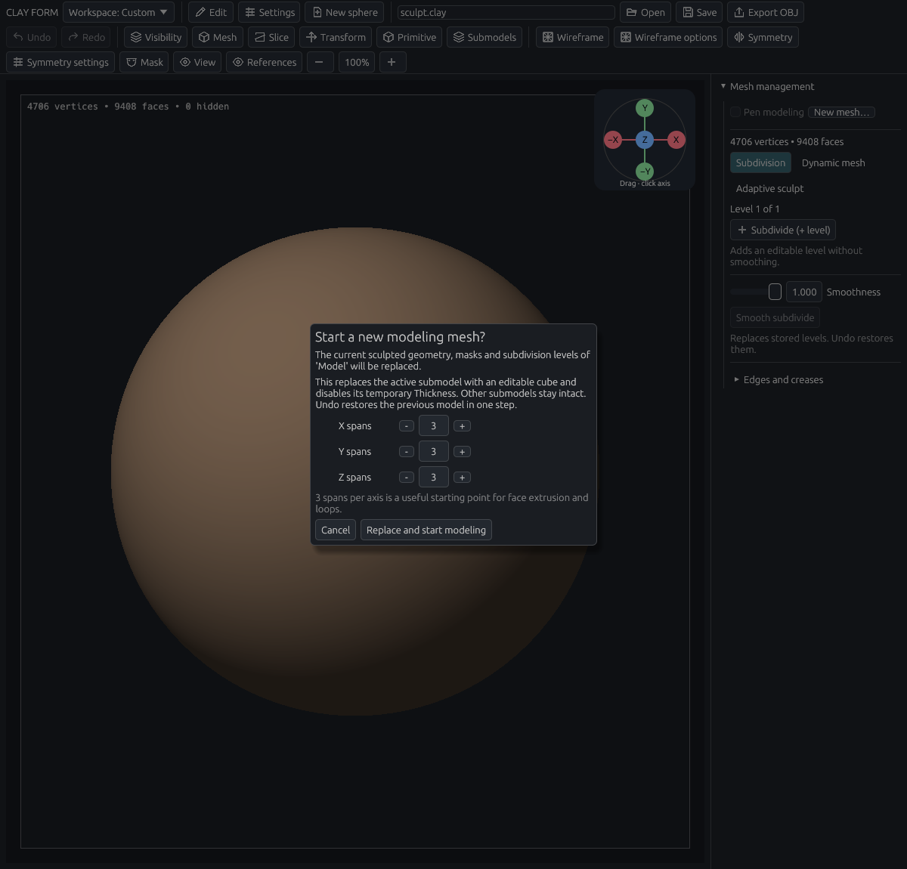

To start from a different shape, create it through **Primitive**, adjust its controls, and convert it to a sculpting mesh before enabling Modeling.

### Select faces, edges, or vertices

1. Choose **Face**, **Edge**, or **Vertex**, then **Select**.
2. Choose **Replace**, **Add**, or **Remove**. Replace starts a fresh selection; Add and Remove adjust it. Hold Shift at pen-down to add, or Ctrl to remove.
3. Hover for a gold preview, then tap or **drag across components** to select them in cyan. Release to keep the selection; Escape cancels the whole stroke and restores the previous selection.
4. Use **Clear selection** to start over. In Edge mode, **Select loop** follows an unambiguous edge loop or border.

Fast strokes collect components between pen samples. Replace clears the old selection only once, at the start of the stroke. Individual selection picks the visible surface, including in perspective view.

Choose the selection pattern below Replace/Add/Remove:

- **Individual:** paint faces, edges, or vertices under the pen.
- **Loop** in Face mode: selects a strip of quads. Hover near a face edge to choose the direction across that edge; the full strip previews in gold. Move near a perpendicular edge to choose the other direction.
- **Loop** in Edge mode: follows connected edges along an unambiguous loop, crease, or border chain.
- **Loop** in Vertex mode: selects the vertices along that loop. Hover slightly toward an incident edge to choose its direction.
- **Parallel edges** in Edge mode: selects an edge ring by following opposite edges across connected quads. It follows topology, including around curved surfaces.

Loop selections can wrap around the model, including its far side. Face loops and edge rings stop at hidden faces, triangles, open boundaries, or non-manifold branches. Add/Remove and drag selection also work with these patterns. Each crossed component is visited once per stroke, so retracing does not toggle it.

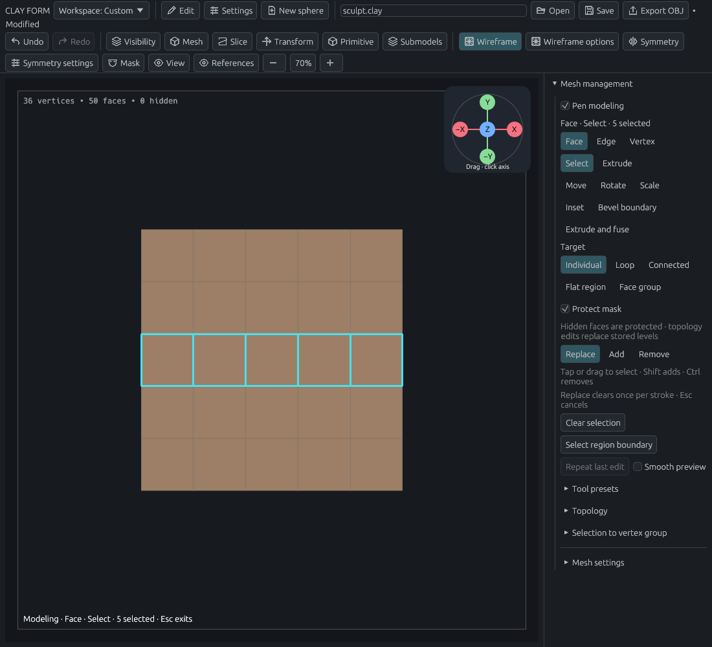

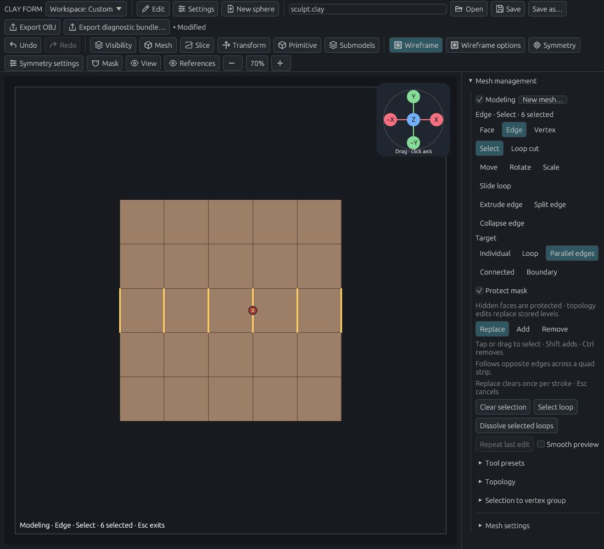

**Switching component modes:** faces select entire quads, including their corners and edges. Returning to Face selects only faces whose corners are all selected. **Select region boundary** keeps only the outer edges of the chosen faces.

**Keeping a selection:** navigation keeps it; topology, visibility, or model changes clear it. Drag the navigation frame or empty space to orbit, or use secondary-button navigation. Escape exits modeling when no preview is active.

### Select many components with a region

While Modeling is enabled, press **Z** and choose **Select**. Choose **Replace**, **Add** or **Remove**, then **Visible only** or **Through mesh**, and a **Rectangle**, **Lasso** or **Line** shape.

Hold **Ctrl+Shift** while drawing in the viewport, then release the pen to keep the selection. Release Ctrl+Shift to restore the previous Modeling function and options. Releasing the hold before the pen, pressing Escape or losing focus cancels an unfinished region. **Alt** temporarily removes components (or adds when Remove is selected).

**Visible only** selects the surface you can see. **Through mesh** also selects occluded and rear-facing components. A region tests vertex positions, edge midpoints or face centres. Explicitly hidden geometry and its boundary vertices remain excluded; **Protect mask** also excludes masked components. Exact symmetry adds matching components when the whole matching set is unprotected.

The Select tab remembers its shape, operation and depth choice. It is available only in Modeling. **Undo selection change** and **Redo selection change** in Z restore region selections without changing geometry or consuming sculpt Undo/Redo.

### Grow and shrink a component selection

Select a face, edge, or vertex, then use **Grow selection** or **Shrink selection** in Modeling. Both actions are also in Search and can be assigned to a shelf or shortcut. They preserve the current component mode and tool.

Each click takes one step through the mesh's logical polygons. Faces cross shared edges, vertices follow real polygon edges, and edges reach other edges sharing an endpoint. Rendering diagonals inside quads do not count. Disconnected islands stay separate. Shrink removes the outer layer at open borders as well as beside unselected components; a fully selected closed island stays selected.

Hidden faces block growth through their vertices. With **Protect mask** enabled, any nonzero mask blocks growth through that vertex too. Grow retains existing protected selections without expanding through them; Shrink removes protected components. Exact symmetry applies to whole matching sets, including when protection blocks one side. Hidden faces no longer make the whole mesh fail symmetry matching. Protected matching sets stay fixed while other sets can change.

**Undo selection change** and **Redo selection change** restore growth and region-selection steps without consuming sculpt Undo/Redo. The selection history belongs to the current mesh and selection; changing geometry or choosing a different selection invalidates it. It is temporary and is not saved with a project. Geometry changes made afterwards keep their usual single Undo step.

### Shared targets and component transforms

Hover before pressing to check what the edit will affect. Pressing an already-selected component uses the current selection; pressing elsewhere uses the hovered **Target**.

| Target | What it includes |
| --- | --- |
| Connected | Connected visible faces |
| Flat island | Connected faces within **Island angle** of the starting face |
| Face group | Visible polygons with the same face label |
| Boundary | An open boundary, in Edge mode |

Loop and parallel-edge targets remain available where applicable.

**Island angle** ranges from 0° (flat faces) to 180°. Each face is compared with the original face normal, so a chain of small bends cannot gradually wrap the selection around a curved surface.

Hidden faces stop the flood; disconnected surfaces are excluded. Hover previews the result as you adjust the slider. The angle applies to the next selection or edit target and is saved in tool presets.

Choose **Move**, **Rotate**, or **Scale** in any component mode, then choose an interaction:

| Interaction | Move | Rotate | Scale |
| --- | --- | --- | --- |
| **Free** (default) | Drag a target with the pen in the view plane; works in orthographic and perspective views | Drag with a virtual trackball around the selection center | Drag up/down for uniform scaling |
| **Gizmo** | Drag colored X/Y/Z arrows, XY/YZ/XZ plane squares, or the center for free movement | Drag a colored axis ring, or the center for trackball rotation | Drag an axis box to stretch, or the center up/down to scale uniformly |
| **Axis / amount** | Choose X/Y/Z or Normal, then drag up/down or enter Distance | Choose the axis and enter degrees or drag up/down | Choose an axis or Uniform, then enter the factor or drag up/down |

In Gizmo mode, select components first, or tap a target to make it the selection. Merely tapping a gizmo handle never applies an edit; drag to begin.

Axis handles pointing almost directly into the screen are hidden because their direction cannot be dragged reliably; orbit the view or use Axis / amount for that axis. Edge-on rotation rings use a stable tangent drag.

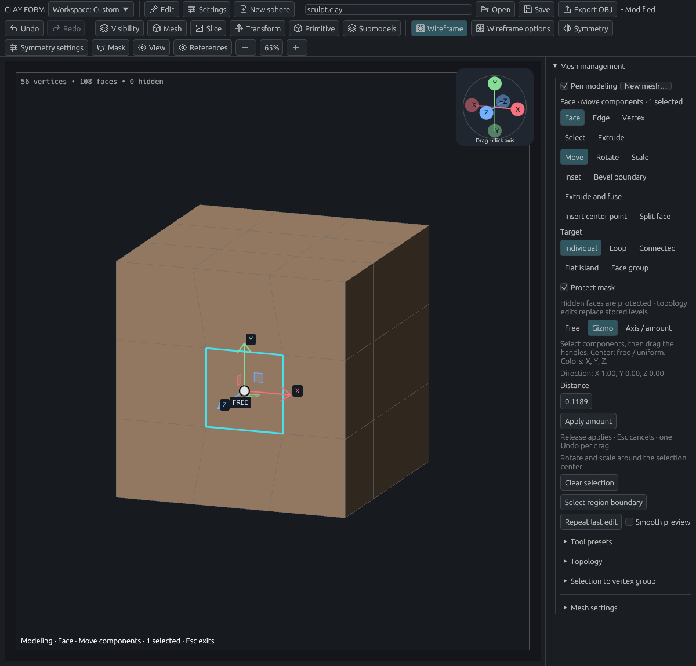

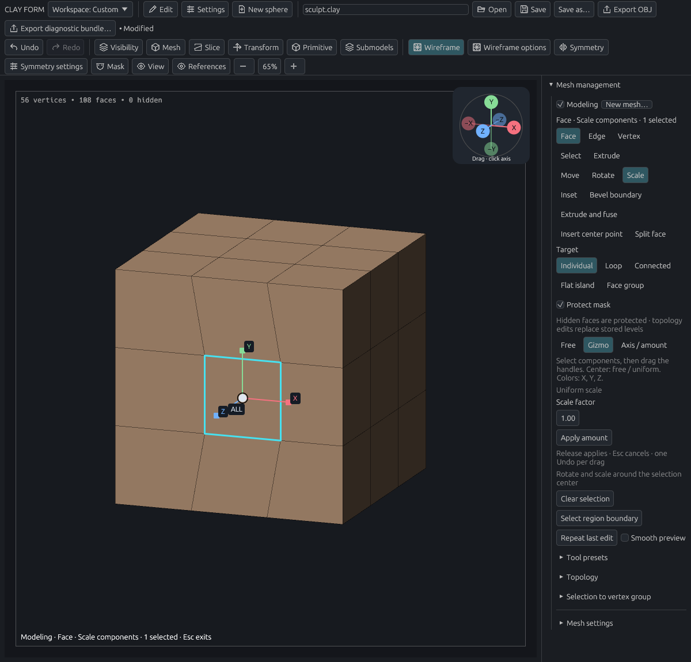

Release to apply, or Escape to cancel. Each completed drag is one Undo step and keeps the selection. Rotate and scale use the selection center; with symmetry, the gizmo uses the reference-side center and the other copies follow the same edit. Symmetry keeps shared seam vertices on their planes. Hidden faces and, by default, masked vertices are protected.

These edits replace stored subdivision levels; Undo restores them.

A free or gizmo drag remembers its direction and amount. **Apply amount** reuses that direction with the displayed value; move and rotation need an initial drag to establish a direction. **Repeat last edit** also retains it. Free scaling stays uniform. Free mode supports **Tap to repeat** after establishing the edit; Gizmo mode reserves taps for selecting targets and handles.

Transform modes, directions and amounts save in presets; older presets retain Axis / amount behavior. Right-click Free, Gizmo or Axis / amount to add it to a custom menu or shelf, or assign a shortcut.

### Snap components to a precise target

1. Select the components to transform and choose **Move**, **Rotate**, or **Scale**.
2. In **Align without welding**, choose **Vertex**, **Edge**, or **Surface**. Set the pick radius in screen pixels for vertex/edge targets; Surface picks the point directly under the pointer.
3. Click **Pick snap source**, then click a visible vertex belonging to your selection. Click a visible target on the active mesh. The highlighted candidate shows which point will be used.
4. Inspect the preview while orbiting or zooming. **Pick another target** retains the source; **Pick snap source** starts again. **Apply snap** commits one geometry Undo step. **Cancel snap** or Escape leaves the mesh and history intact.

| Operation | Result |
| --- | --- |
| Move | Aligns the source vertex to the target. With an axis constraint, only the displacement along that axis is used. |
| Rotate | Aims the source's direction from the selection centre toward the target. The source's radius stays fixed. With an axis constraint, both directions are projected into its rotation plane. |
| Scale | Matches the source's distance from the selection centre to the target distance. With an axis constraint, it matches their signed axis distances. Direction stays fixed; zero, negative and excessive scales are rejected. |

**Free** and **Gizmo** use unrestricted click snapping. **Axis / amount** uses the selected X/Y/Z or region-normal axis; Uniform scales uniformly. For rotation and scale, a target is a direction or distance reference: it need not coincide with the resulting source point. The source/target markers and connecting line show any remaining separation. **Apply amount** always uses the numeric value without snapping and discards the click preview.

Targets are visible, unselected geometry on the active mesh. Selected vertices, their symmetry copies and incident target geometry are excluded; back or occluded surfaces are not picked through. Masks can be used as stationary references, while Protect mask still prevents moving masked source vertices. Snapping changes positions, preserves polygon connectivity and attributes, and does not weld coincident vertices. Exact symmetry can constrain a source on a mirror seam.

Use a single subdivision level and an editable mesh. Convert primitives or arrays explicitly and apply or disable temporary Thickness first. Changing the target mesh, selection, symmetry or snap settings cancels a stale preview. Switching to a sculpt brush offers Apply, Discard or Keep editing. Save the project after applying to preserve the geometry; unfinished snap previews are not saved.

### Cut a one-cell notch

Choose **Cut one cell** in Face or Edge mode. Press a component to preview the full cut. Release to apply it in one Undo step, or press **Esc** while holding to cancel. For a preselected face or edge, use **Apply to selection**. Symmetry cuts matching cells together.

- **Face.** Press a rectangular grid square. Its floor moves inward by one grid layer. A middle square makes a four-walled recess. At an edge or corner, the recess opens onto the adjacent sides.
- **Edge.** On a **3 × 3 × 3** cube, press the middle segment of the top-front ridge. The cut exposes a floor, a back wall and two side walls.

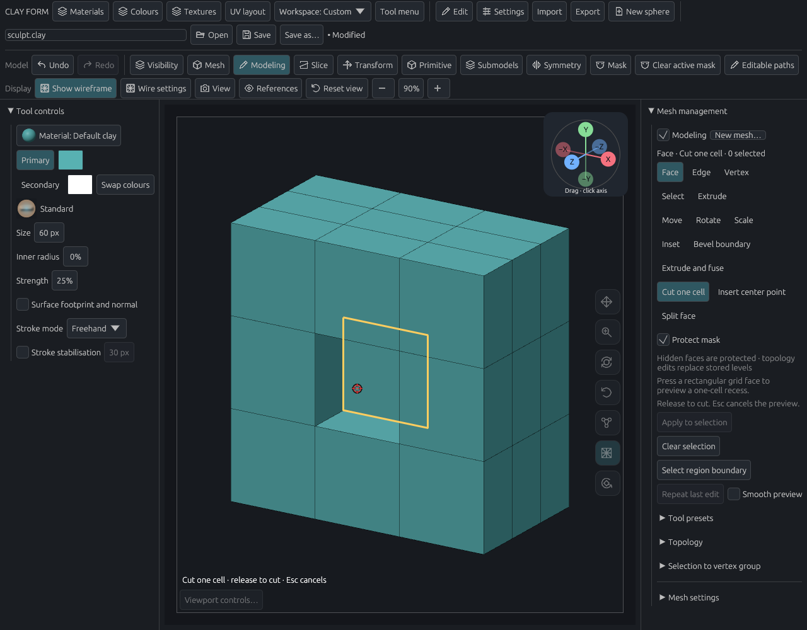

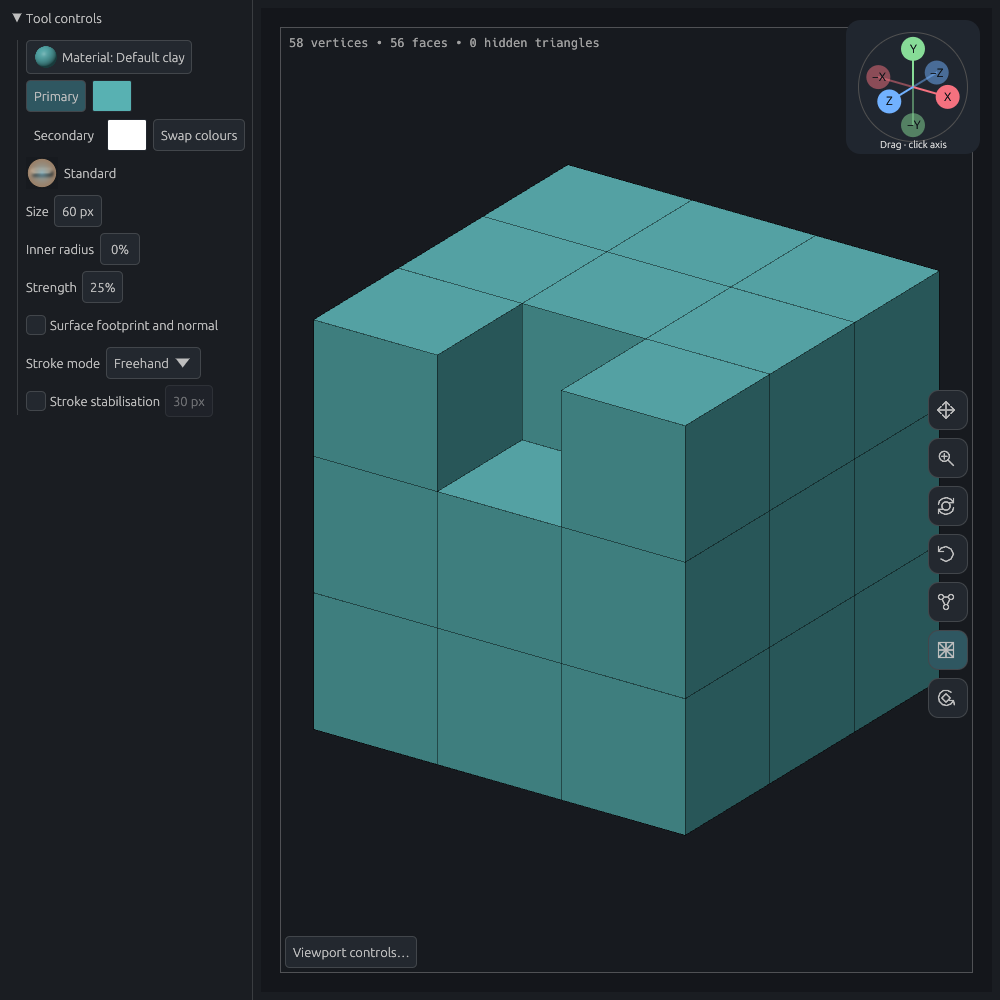

**Move** translates the selected components freely. Use **Extrude and fuse** to reach a matching loop or face at a distance.

### Extrude a face or flat region

1. Choose **Face → Extrude**.
2. Press a face and drag **up to extrude outward** or **down to push inward**. Pressing an already-selected face extrudes the selected flat region together; pressing another face extrudes that face alone.
3. Inspect the live preview and distance displayed at the bottom of the viewport.
4. Release to apply, or press Escape to discard the preview and stay in modeling mode.

Pressure does not change the distance. Each completed drag is one Undo step. For a flat-region extrusion, selected faces must share a plane and face the same way; see [region construction](#construct-a-region) for nonplanar regions.

Before editing:

- Apply or disable temporary **Thickness**.
- Keep **Protect mask** on to leave masked vertices fixed during Move, Rotate, Scale and Slide. Hidden faces and their vertices stay fixed too. Other topology tools still reject unsafe changes; loop cuts and loop removal stop before protected areas.
- Use symmetry when the sides have matching geometry and topology.

Topology edits replace stored subdivision levels and turn off adaptive/dynamic topology. Undo restores the previous mesh settings and levels.

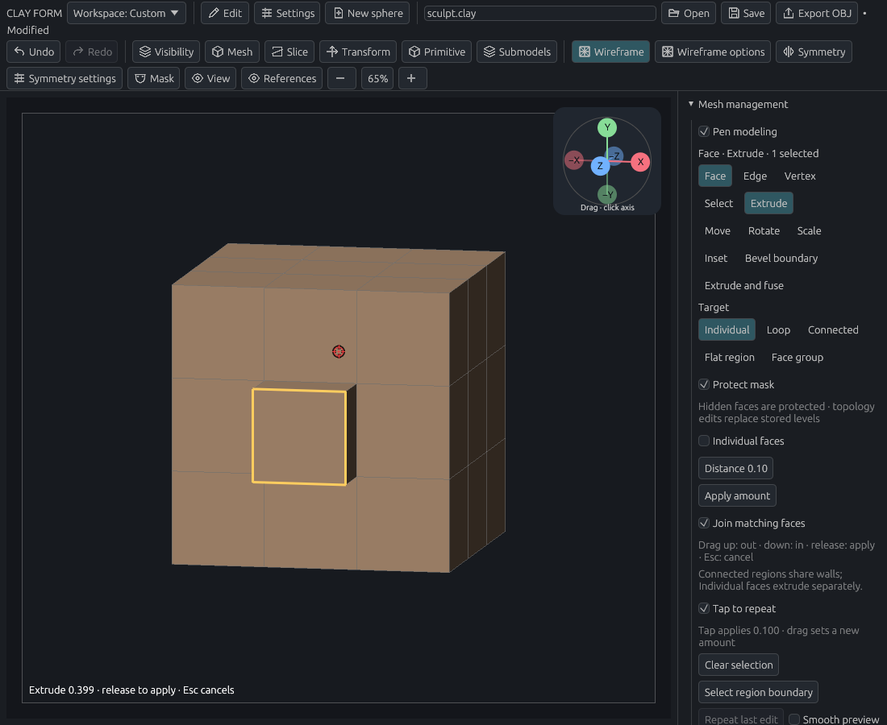

The highlighted rim stays on the dragged face even as the pen moves across other faces.

### Construct a region

**Extrude** supports connected regions with shared side walls. Nonplanar regions move along averaged vertex normals; **Individual faces** makes separate extrusions. Distance is available numerically through **Apply amount**, as well as by pen drag. Matching-face tunnel joins remain available for aligned caps.

**Inset** adds a border of the chosen Width inside a flat region. **Individual faces** insets each face separately. **Bevel boundary** trims a flat region's exterior corners, creating a single chamfer band; each corner must have one exterior edge descending away from the region. Use the Edge and Vertex chamfer/bevel tools below for individual components and rounded cuts. Widths that collapse narrow faces are rejected.

Inset and bevel retain the cap selection for the next operation. New faces inherit their source region's face label; surviving weights and creases are retained.

**Extrude and fuse** pushes selected flat face regions inward. Select nonadjacent faces with **Add** (or Shift); adjacent faces stay together as one region, and separate regions move independently. Each region stops at its first compatible intermediate loop, removes the swept exterior strips and retains the moved cap. Internal edges between selected faces do not create walls. **Join matching faces** separately permits opening a tunnel when the opposite cap has the same face layout. Dragging farther keeps the preview at the first compatible contact; release or **Apply amount** commits the same result in one Undo step.

Drag to preview a fuse, or select faces, enter **Distance**, and click **Preview**. Gold outlines the target face or edge loop. Coral shows the side walls that will be removed. Check the preview before releasing the drag or choosing **Apply amount**. **Esc** dismisses the preview. After changing the distance or join settings, click **Preview** again.

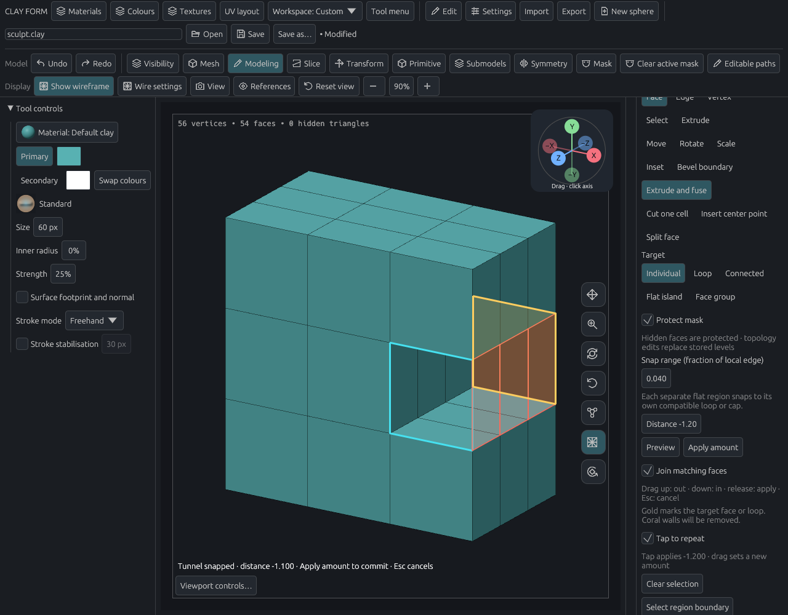

**Snap range** is a fraction of the local edge length, independent of sculpt brush size. Compatibility requires aligned corners and complete adjoining side strips; this does not cut arbitrary intersecting surfaces. Before a compatible contact is reached, the tool extrudes freely and reports that no fusion occurred. Unmatched or differently tessellated targets are not fused.

Each region must be flat and separate regions must not share vertices. **Individual faces** applies to ordinary Extrude, not Extrude and fuse. Regions can snap at different depths; in that case Distance retains the requested travel. If only some regions find contact, the tool reports that the others are still extruding freely. Every region and symmetry copy commits together in one Undo step. A mask, hidden face, or interfering edit that prevents any region from completing cancels the whole operation; Escape cancels its preview.

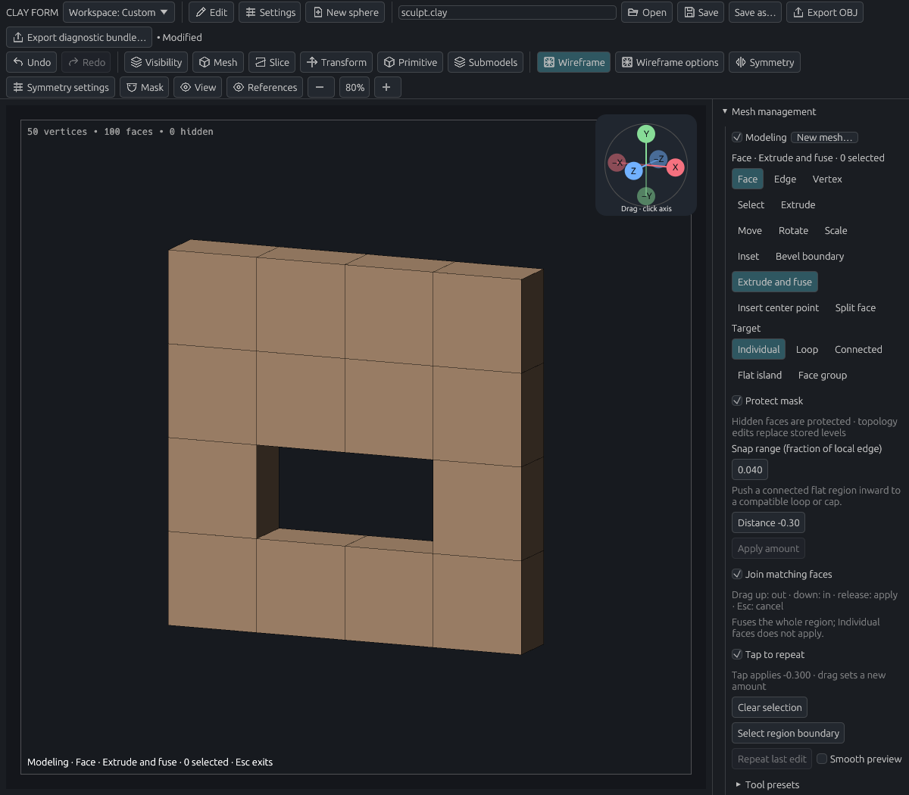

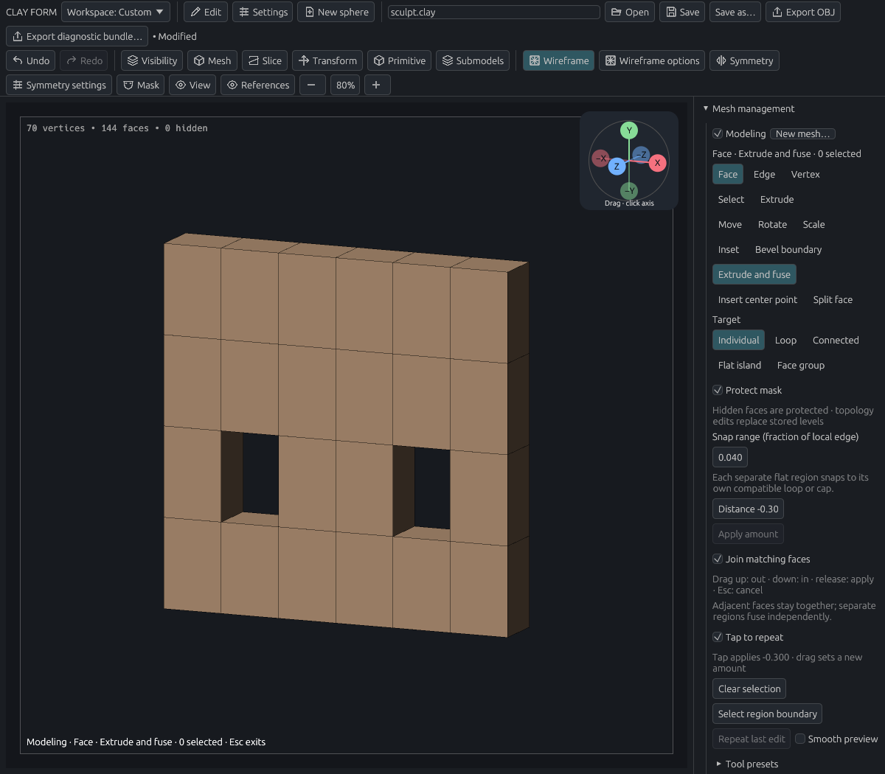

### Snap and weld while moving

Choose **Move → Snap and weld on move**:

- **Off** keeps the normal free move.
- **Vertex** attracts a moved vertex to a nearby visible vertex and welds there on release. The target stays in place; edges that become duplicates combine into one.
- **Edge** also welds a moved edge onto another nearly parallel edge when both corresponding endpoints are within the pixel radius. A nearby midpoint alone does not qualify. Vertex welding remains available in Vertex mode.

Use a free drag or the gizmo center. Hold **Shift** during the drag to bypass welding, and release Shift to restore it. A gold **Weld vertex** or **Weld edge** marker identifies the target before release. Moving away restores the free move; Escape cancels. Each completed weld is one Undo/Redo step, retains the welded target selection, and clears measured Repeat last edit.

Separate surface patches cannot join at only one vertex. Use **Edge** mode to weld compatible borders along a shared edge. An invalid weld candidate is skipped without a gold marker; releasing can still commit the ordinary unwelded move. Vertex welding remains available for loose edges and valid surface joins.

This uses one vertex or edge and its exact symmetry copies on the active mesh. Independent multiple selections, face selections, axis/plane gizmo handles and numeric moves keep their ordinary behaviour. Hidden, occluded or protected targets are skipped. Duplicate faces, collapsed geometry and obstructed joins are rejected. Existing UV corners remain attached to their surviving triangles; creases and hard edges follow the weld. A vertex does not split or attach to the middle of an edge.

The setting defaults to Off and saves in Modeling presets. The separate **Align without welding** source/target picker continues to align geometry without welding.

### Ctrl-extrude: detached copies

Hold **Ctrl at any time during the drag** with **Extrude** in Face mode or **Extrude point** in Vertex mode. Release Ctrl before releasing the pen to return to attached extrusion; the preview updates immediately. The originals stay in place and a detached copy moves away. Face copies follow the normal extrusion direction, retain the selected region's connections and have no side walls. **Individual faces** gives each face its own copy. Vertex copies follow the screen plane and have no connecting edges.

Release to apply, or press **Escape** to cancel. Ctrl-clicking without dragging makes no copy. The new components stay selected; one Undo restores the original mesh. Detached point copying bypasses snap-and-join so a nearby target cannot accidentally reconnect the copy. Isolated points can be selected, moved, extruded, welded, joined into a face or deleted. Save them in `.clay` or OBJ; surface-only exports and reconstruction tools cannot preserve isolated points.

### A new vertex group for each edit

Enable **New vertex group after each edit** in Modeling to group the affected surviving geometry after every successful edit. The group takes the operation's name, with a number for repeated names. It is created in the same Undo step as the geometry. The option is off by default and is stored in Modeling presets.

Transforms group only the moved vertices. Topology changes include the corner vertices of new or changed faces. Deletion groups the surviving boundary when there is one; it never creates an empty group. Selection, cancellation, failed edits and unchanged geometry do not add groups. Existing groups and masks remain available.

### Chamfer and rounded bevel

Choose **Chamfer edges** or **Bevel edges** in Edge mode, and **Chamfer vertices** or **Bevel vertices** in Vertex mode. All four are in **Q**, the Modeling menu and the Mesh panel. Chamfer cuts a flat surface across the selected edge or corner. Bevel rounds the cut; **Segments** controls its resolution from 2 to 8.

With multiple edges selected, both edge tools follow the selected chain or loop and join the cuts where those edges meet. Bevel uses a rounded profile along that same path. **Bevel vertices** rounds the selected corners; selecting a vertex loop does not automatically bevel the edges between those vertices. Use Edge mode for a continuous edge bevel.

Drag upward on the selected component to increase **Width**, then release to apply. Escape cancels. Alternatively, enter a width and choose **Apply amount**. Q also exposes the width and segments for the active tool. Each cut is one Undo step and supports the optional new vertex group.

Use closed surface fans with convex face corners. Open borders, loose edges, disconnected corner fans and cuts that overlap are rejected; reduce the width or selection when needed. Masks and hidden geometry remain protected. Untouched UVs remain intact; edited faces need unwrapping before texture painting. The existing face-mode **Bevel boundary** remains available for its original region operation.

### Construct from edges, points and face centers

Choose a component mode to reveal its construction tools. Measured tools support numeric amounts, pen previews, Escape to cancel, tap repeat and one Undo per completed edit.

| Mode | Tool | Controls and result |
| --- | --- | --- |
| Edge | Extrude edge | Drag up/down or set Distance. An open border extends into a quad strip. A surface edge creates a ridge with new side faces; hover near the desired adjacent face, or enable **Other adjacent side**, then press to lock that side. |
| Edge | Split edge | Drag along the edge to place a new vertex. **Position** runs from 0 to 1, starting at the circled endpoint nearest the initial press; insertion stays just inside the endpoints. |
| Edge | Collapse edge | Drag along the edge or choose **Marked end**, **Midpoint**, or **Other end**. This merges both endpoints at the chosen position. |
| Vertex | Split point | Set Radius or drag up/down to replace a vertex with a ring and center patch. **Double ring sides (4 to 8)** adds one corner inside each adjacent face. **Circularize ring**, **Triangulate center**, and **Crease ring** control the patch. |
| Vertex | Extrude point | Drag to add one vertex joined to the original by one edge. The new endpoint follows the cursor in the screen plane at the original vertex’s depth. Existing faces stay intact. Distance and tap-to-repeat reuse the last drag direction. |
| Face | Insert center point | Tap a face to insert its center and connect it to every corner with triangles. |
| Face | Split face | Tap to connect a new center to shared edge midpoints, producing quads inside each selected face. |

**Insert center point** and **Split face** act on a tap even when Tap to repeat is disabled. Both also offer **Apply to selection**. **Extrude point** keeps its new endpoints selected for the next extrusion or move. A snap join keeps its target selected; other construction tools clear the component selection after committing; hover or select the new geometry for the next operation. Their buttons can be added to custom menus, shelves and shortcuts, and their settings save in tool presets.

Point extrusion works on surface borders as well as interior vertices. It has no base radius or ring settings. Use **Select**, **Move**, **Delete vertices**, or the Z region tools on the new endpoint; each extrusion is one Undo/Redo step. Each new drag sets a fresh direction, including when extending a loose endpoint. Orbiting changes the drawing plane; perspective and camera roll are respected. Drag once before using Apply amount.

Loose edges save in `.clay` projects and OBJ line records. Surface-only operations such as remeshing, slicing and solidifying require those edges to be removed first. Other exchange formats currently require faces only. Use **Create face** to fill three or four selected vertices or the endpoints of selected edges, including a loose-edge outline. Edges that become part of the face are reused.

**Snap and join** is on by default for point and edge extrusion. Drag a point near a visible vertex on the active mesh, or an open edge near a compatible open edge. A gold marker shows **Join vertex** or **Join edge** before release. Release connects to the existing target without duplicating its vertices. Hold **Shift** at any time during the drag for free extrusion; releasing Shift restores snapping. Move away from the target to continue freely, or press Escape to cancel.

The pixel radius controls how near the target must be. Snapping uses one source component and its exact symmetry copies. Independent multiple selections extrude normally. Hidden, obstructed, or protected targets are skipped. Edge joins require separate endpoints and a valid connecting face. Each join is one Undo/Redo step and clears the measured repeat to avoid replaying the connection. Numeric Apply and tap repeat remain ordinary extrusion.

To make an eight-sided patch at a four-quad junction:

1. In the **Modeling** menu, choose **Vertex → Split point**, scroll to **Split point settings**, and enable **Double ring sides (4 to 8)**.
2. Enter **Radius** in model units, measured from the original vertex to the ring.
3. Press the vertex to preview that radius. Drag up to enlarge it or down to shrink it; the viewport shows the live amount. Release applies the patch; **Escape** cancels.
4. With **Tap to repeat** enabled, tap another compatible vertex to use the same radius and ring options. Switching tools and returning keeps the radius. Use a modeling preset to save the setup across sessions.

The ring has twice the original point's edge count, so a four-edge junction becomes eight-sided. Its center uses triangles. Radius must fit the neighborhood: oversized patches produce an error instead of silently changing size. Hidden faces and **Protect mask** still protect the surface, and each split is one Undo step.

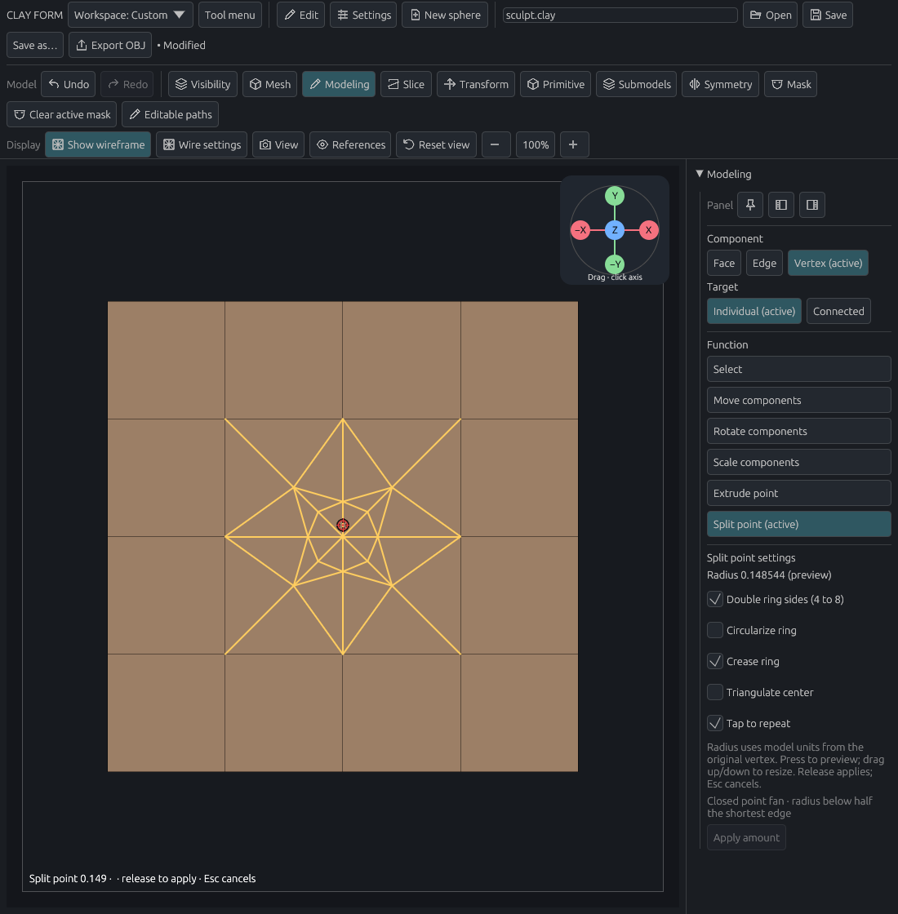

To turn a point into a tube base, use **Vertex → Split point**, then switch to **Face → Extrude** and drag the center patch outward. A three- or four-sided patch remains one selectable polygon unless Triangulate center is enabled; larger patches use center triangles, which can be selected together for region extrusion.

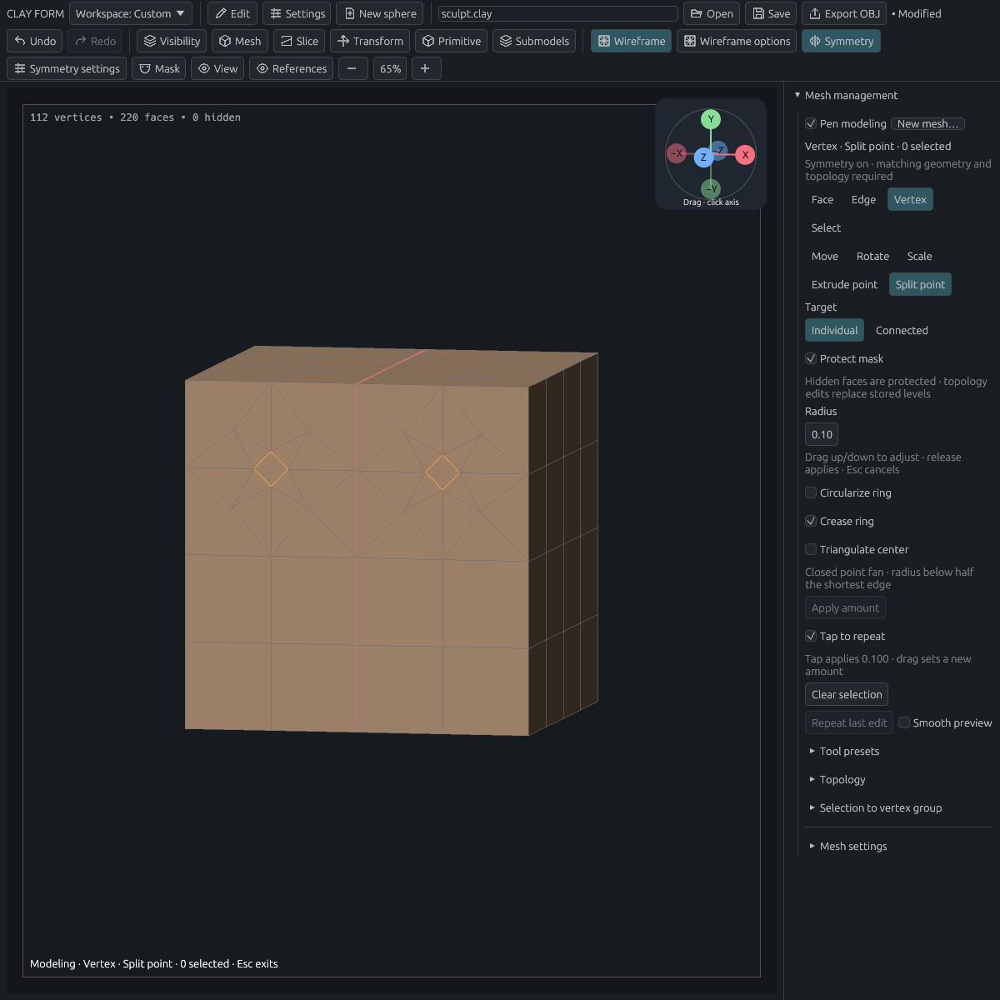

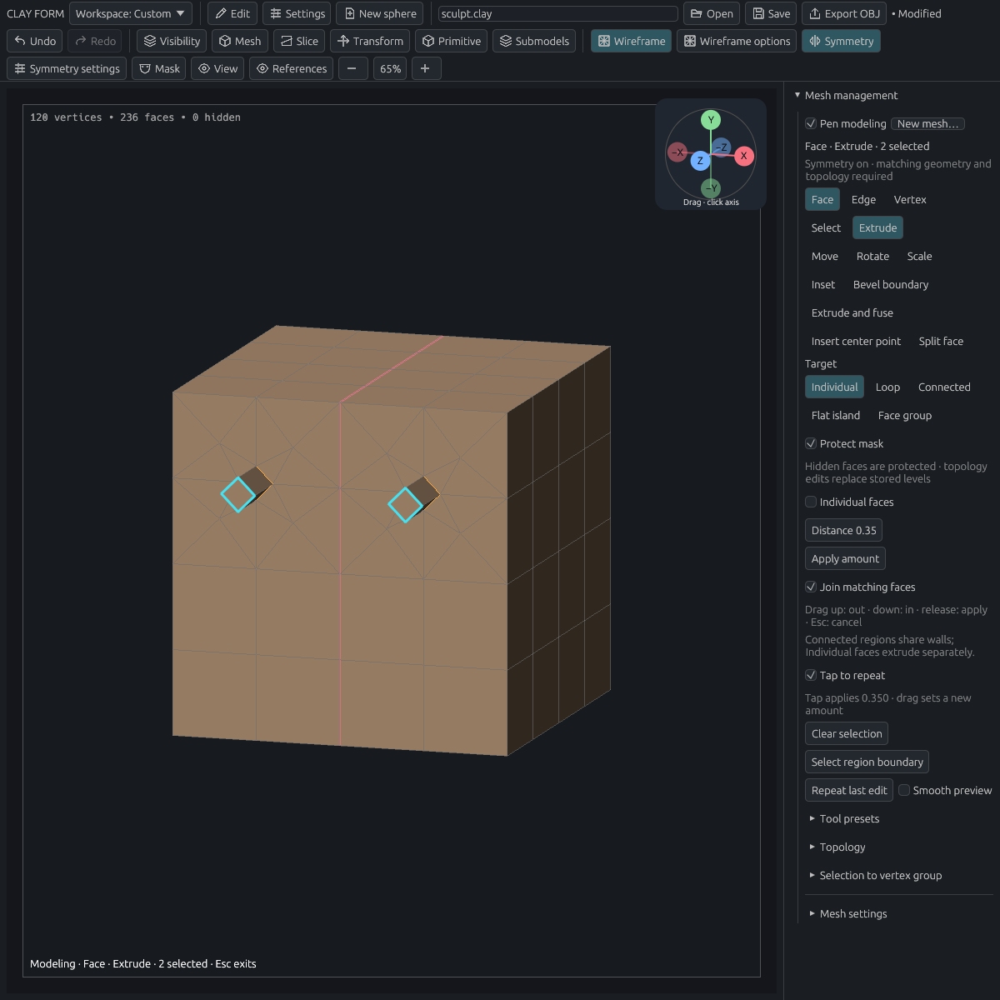

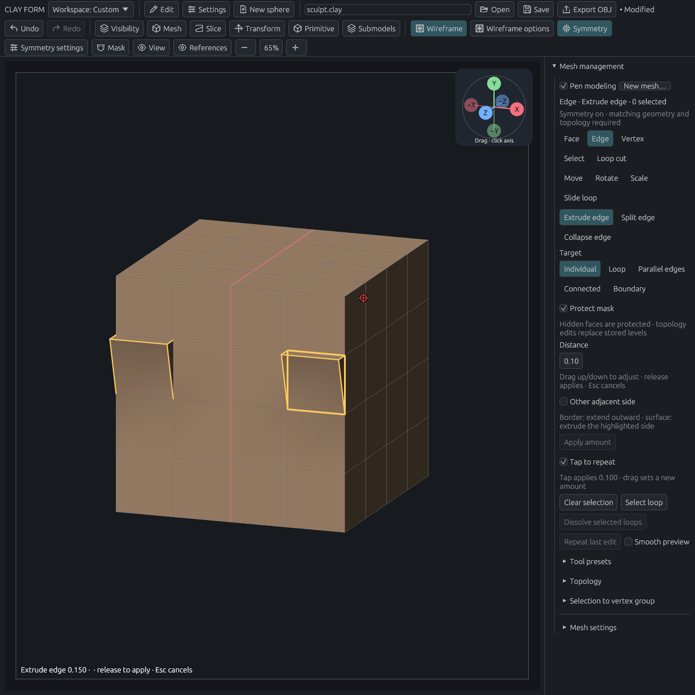

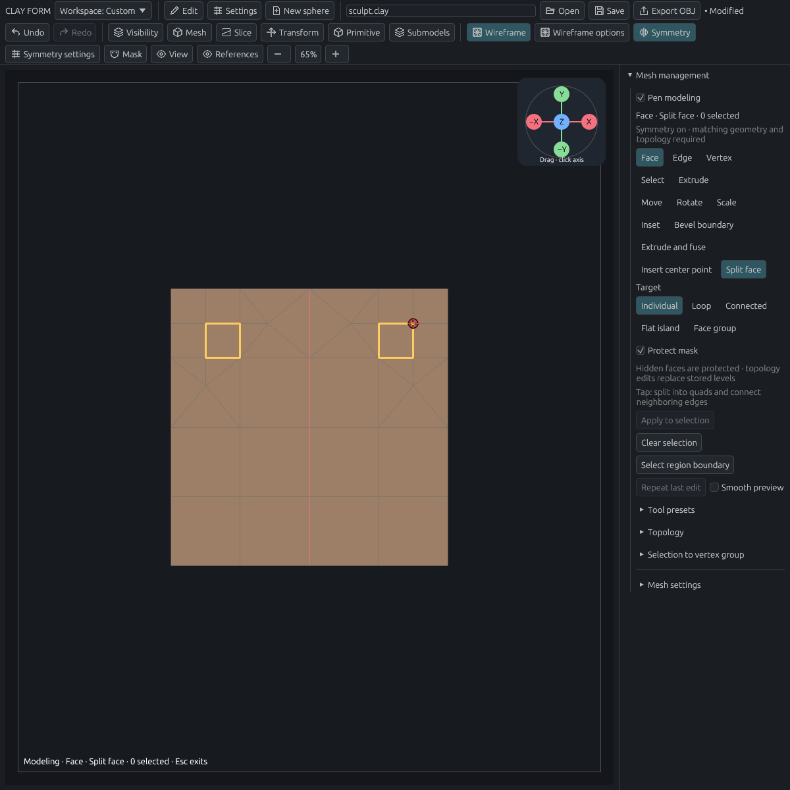

Point construction requires closed, visible vertex neighborhoods. Selected points must not share a face, and the radius must be less than half the shortest incident edge.

Surface-edge extrusion requires separate edge neighborhoods; open border chains can share endpoints. Interactive Collapse edge requires edges with separate endpoints; the **Topology → Collapse edges** command remains available for collapsing connected sets to their average position. Symmetry rejects conflicting endpoint or adjacent-side choices instead of applying only part of an edit.

New edge points propagate to neighboring faces to keep the surface connected without cracks. Polygons with more than four corners are represented by triangles; neighboring faces can therefore become triangulated.

Source masks, group weights, face labels and surviving creases are retained. Hidden faces and protected masks reject the complete operation. Component extrusion creates geometry but does not automatically fuse intersecting surfaces.

### Push through to make a tunnel

Turn a plain cube into a small architectural block with a square window. This is a useful first exercise: you get an opening with real interior walls.

1. Create a cube with **3 spans on each axis**, then convert it to a sculpting mesh.
2. In **Face → Extrude**, leave **Join matching faces** enabled.
3. Press the middle face of one side and drag downward until it reaches the opposing face.
4. Look for **Tunnel snapped**, then release. The two caps disappear and the boundaries join, leaving a through-hole.

Joining beside an existing hole removes the shared wall to make one wider opening. At an outside edge or corner, it removes the coincident side surface to leave an open notch, including side surfaces split by depth loops. The remaining walls reconnect to those loops; regular spacing stays in quads, while differing spacing may introduce triangles. Hidden adjoining faces must be shown before joining.

Tunnel joining currently works on one face at a time. Opposing faces must have matching, aligned boundaries and opposite normals; equal area alone is insufficient.

The drag snaps near the first matching face and stops there even if you overshoot. It rejects joins that collapse faces or create duplicate topology. This is a matching-face join, not a general intersection or Boolean tool; mismatched surfaces do not automatically cut each other.

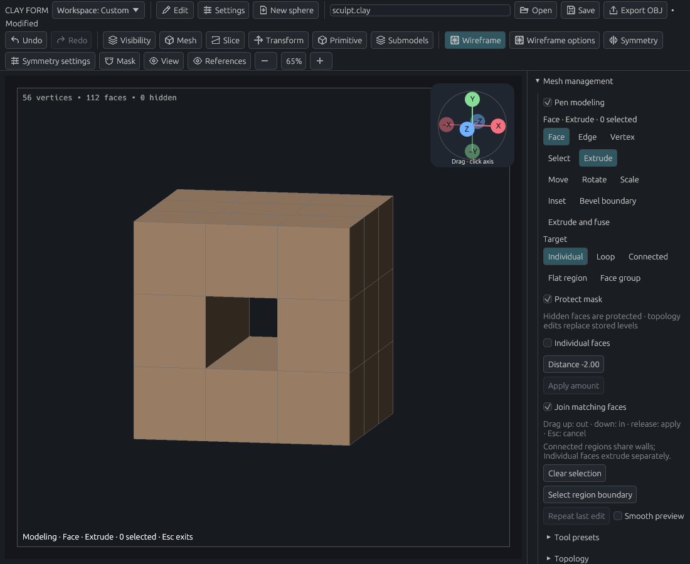

A slight turn exposes the tunnel walls and the opening at the far end.

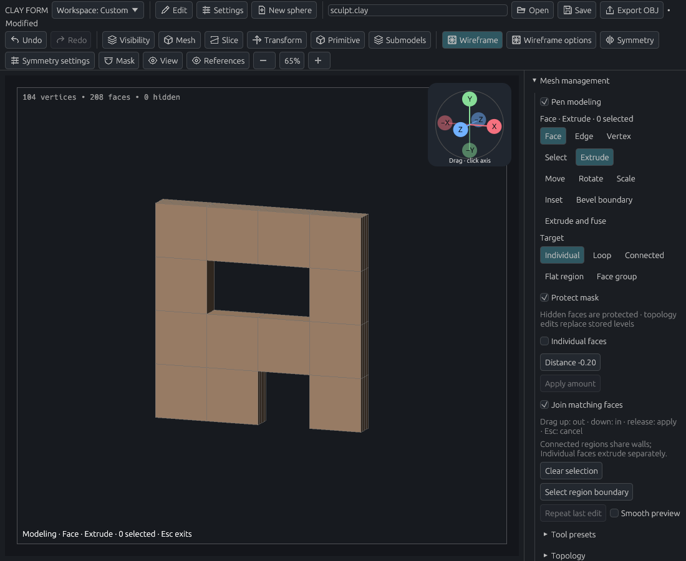

The exterior depth loops remain connected to the newly exposed walls.

### Insert a loop cut

Choose **Edge → Loop cut**. Hover an edge to preview the cut across its quad strip. A tap inserts a centered cut; press, hold, and drag along the edge to slide the preview before releasing. The original edge stays targeted throughout the drag. Escape cancels.

Use **Loops** or the **− / +** buttons to choose 1–16 evenly spaced cuts. While holding a cut, scroll the wheel up/down to increase/decrease the count. Dragging moves the set together, stopping before the outer cuts reach an existing edge. Release commits the whole set as one Undo step.

The cuts share vertices across faces and preserve masks, group weights, and creases. It follows a closed quad ring or ends at an open boundary. Triangles, hidden faces, and self-crossing strips produce an explanation instead of a partial cut.

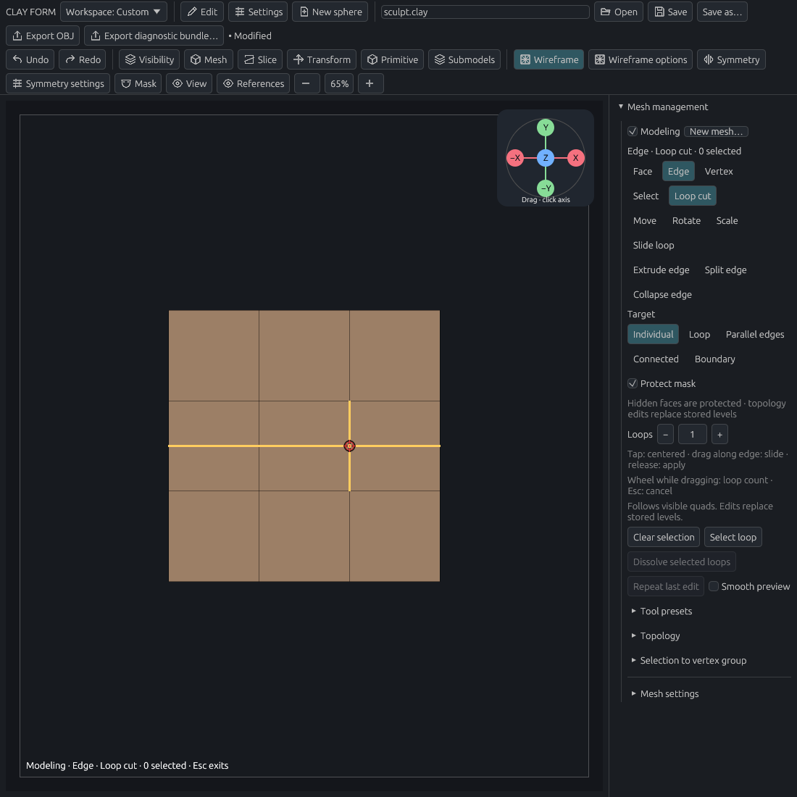

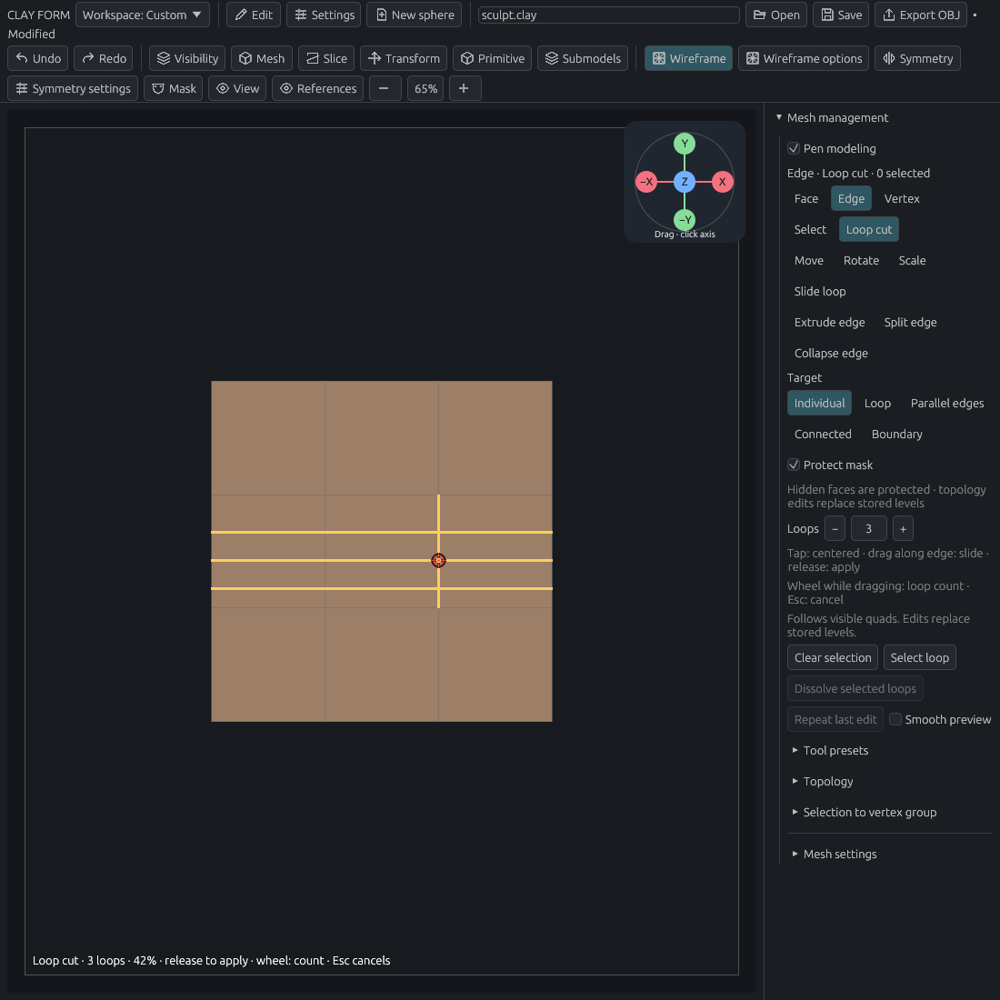

For loops around a hole or selected region, use the existing [support-loop controls](edges.md).

### Click to delete

Choose **Delete components** in Q or Mesh → Modeling, then choose Face, Edge or Vertex and the desired Target. Click the target to remove it directly. **Keep unused vertices** retains vertices left behind by face or edge deletion; turn it off to remove them. Deleting an edge also removes its attached faces. Protected components and their symmetry partners are skipped. Each click is one Undo step. The immediate Topology delete actions remain available for an existing selection.

### Delete loops

Choose **Edge → Select → Loop**, then select the complete loop to remove. Use **Add** for several separate loops. Open **Q → Topology**, the toolbar **Modeling** menu, or **Mesh → Modeling → Topology** and choose:

| Option | Result |
| --- | --- |
| **Delete loop (keep surface)** | Dissolves the selected edges and redundant vertices, joining surrounding faces into quads without opening holes |
| **Delete loop (leave gap)** | Deletes the adjoining face strip on both sides of the selected edges, leaving an opening |

Both apply immediately as one normal **Undo/Redo** step. **Protect mask**, hidden-face protection and exact symmetry apply to both. Use Undo to restore the operation, including stored subdivision levels.

Both require noncrossing interior quad loops. They stop before masked or hidden areas, retaining the boundary vertices needed to keep the untouched surface connected. Keep surface uses triangles at a protected stopping point. Unprotected partial loops, selected boundary edges and intersections are rejected without changing the mesh. Keep surface also rejects merging different face-group labels. Remaining vertex masks/group weights and boundary creases are preserved. Removing a curved loop with Keep surface can simplify the shape.

| Keep surface | Leave gap |
| --- | --- |
|  |  |

### Connect vertices and create faces

**Modeling → Topology** provides three construction actions:

| Action | Selection | Result |
| --- | --- | --- |
| **Connect vertices** | In Vertex mode, select opposite corners of one quad | Split the quad along the chosen diagonal; existing edges are never duplicated |
| **Create face** | Select three or four vertices, or edges with three or four distinct endpoints; for larger openings select the complete boundary | Create a triangle, quad or triangulated patch, reusing existing vertices |
| **Fill boundary** | In Edge mode, choose Boundary and select a complete opening | Fill the selected loop; other holes remain open |

Choose an action to apply it immediately. Each successful action creates one Undo step and clears the old component selection; Modeling returns to **Select** ready for the next edit. **Delete faces** also applies immediately as one Undo step. Undo restores the previous geometry and subdivision levels; Redo restores the result. Save the project to keep the edits.

Invalid selections or protected geometry leave the mesh and history unchanged. Hidden and masked boundary vertices remain protected; **Protect mask** can be turned off deliberately before running an action. Switching to a sculpt brush after construction needs no additional confirmation.

For example, select four vertices around an opening or a loose outline and choose **Q → Create face**. You can also select two opposite edges to use their four endpoints. A convex rim produces one quad. A triangular rim produces one triangle; concave four-sided and larger rims produce a triangulated patch with visible internal edges. Only the selected boundary is welded. The tool does not add loose edges or vertices. To extend an open surface instead, use **Extrude edge**.

Existing edges determine the new face order, and adjoining faces determine its winding. A standalone outline uses a consistent orientation. Crossed, branched, collapsed, obstructed or highly nonplanar openings are rejected without changing the mesh. Basic filling supports up to 1,024 vertices per loop and mild nonplanarity within 5% of the rim span; it does not optimise quad flow or patch density. Advanced hole caps are tracked in [#125](https://github.com/dustyghost/clay-form/issues/125).

Existing masks, materials, groups, creases and unaffected UV corners remain intact. New caps have no face group and start unmapped; unwrap them before texture painting. Connecting a quad preserves compatible corner UVs and UV masks. A seam or a mixture of mapped/unmapped triangles across its internal diagonal needs repair before connecting.

### Bridge two partial boundary chains

Use this to fill the gap between two open edge runs on the active model.

1. Enable **Modeling**, choose **Edge → Select → Individual**, and use **Add** to select the edges in two separate chains. Each chain needs two endpoints and the same number of edges. Leave the rest of each opening unselected.
2. Expand **Topology** and set **Bridge segments** (1–16). This divides the distance across the gap; it does not add edges along either source chain.
3. Choose **Bridge partial chains** to apply the quad strip immediately. Orbit to inspect it; Undo restores the original opening in one step.

Endpoints pair in opposite boundary directions so the strip shares the neighbouring winding. There is no twist offset for an open chain: reversing one pair would twist the strip or break its orientation. To change alignment after applying, Undo and select different endpoints. Unequal counts need an explicit edge split or a revised selection. Crossings, folded strips, obstructions, shared endpoints and branching chains are rejected.

Existing vertex attributes and face UVs stay intact. New vertices interpolate masks, materials and group weights between paired endpoints; new faces have no face group and are unmapped until unwrapped. Exact mirror/radial copies must form an unambiguous set of pairs. An edit accepts at most 2,048 selected edges including symmetry copies and respects mesh capacity.

Use **Bridge boundaries** for complete equal-count loops. [Join meshes locally](#join-meshes-locally) owns full open ends on separate submodels. Partial-chain bridging does not select face regions, fuse solids or remesh the source.

### Flip or dissolve face regions

In **Modeling → Face → Select**, choose the region and expand **Topology**. Both actions apply immediately with one-step Undo/Redo. They are also available in **Q** for Face mode.

| Action | How to select | What changes |
| --- | --- | --- |
| **Flip face orientation** | Use **Connected** to select every face of an open or closed shell | Reverse its winding and normals, keeping corner UVs attached to the same vertices |
| **Dissolve face region** | Use **Add** or **Flat island** to select at least two adjoining flat faces | Remove their internal boundaries and redundant interior vertices, retaining the outer outline |

Flipping only part of an attached surface is rejected because it would make its shared edges disagree. After a flip, orbit to the opposite side to inspect a sheet that previously faced the camera. Flipping twice restores the original orientation.

Dissolve preserves the surface rather than deleting a hole. A convex four-corner outline becomes one quad; concave and larger outlines are tessellated into triangles, so some internal edges remain. Separate selected islands are handled independently. Holes, branches and curvature are rejected. If a boundary cannot be tessellated while retaining every corner, select a smaller region.

Dissolve rejects face-group boundaries, internal creases, hard shading edges and UV seams. Masks, painted materials and vertex-group weights must be uniform within each region; this prevents the new triangulation from changing painted detail. Mapped UVs and UV masks must form one continuous affine map across the flat region. Unmapped regions remain unmapped. Unrelated faces and their attributes are preserved.

All three operations respect hidden geometry, **Protect mask** and exact symmetry. Each face-region edit supports up to 4,096 selected faces including symmetry copies and 1,024 corners per outline. Each successful edit replaces stored subdivision levels; Undo restores them. Failed edits preserve the selection and history. The actions are also available in Q, Search, shelves and configurable shortcuts, and support **New vertex group after each edit**.

### Slide and repair topology

Choose **Slide components** to drag individual faces, edges or vertices along their original neighbouring surface. A numeric distance and axis are also available. The movement stops at the local surface boundary and rejects collapsed or flipped faces. Masked and hidden vertices remain fixed. One release is one Undo step.

Use **Edge → Select → Loop**, then **Slide loop**. Drag to preview, or enter a fraction between -1 and 1 and choose **Apply amount**. The chosen axis determines the positive rail on the reference side; symmetry mirrors that movement. Sliding keeps the same topology and selection. It requires a complete interior quad loop with unambiguous rails; selected loops must not share a face.

Expand **Topology** for operations on the current selection:

| Mode | Action | Result and limits |
| --- | --- | --- |
| Face | Delete faces | Removes the selected faces and opens holes |
| Face | Flip face orientation | Reverses winding on complete connected shells |
| Face | Dissolve face region | Removes redundant internal topology from flat patches |
| Vertex | Delete vertices | Removes the selected vertices and all attached faces, leaving an opening |
| Edge | Delete loop (keep surface) | Dissolves complete interior quad loops and joins the surrounding faces |
| Edge | Delete loop (leave gap) | Removes the faces touching complete interior quad loops and leaves an opening |
| Edge | Fill boundary | Immediately fills complete planar or mildly nonplanar boundaries; concave outlines are triangulated |
| Edge | Bridge boundaries | Connects two equal-count open boundaries and their symmetry copies with a strip of quads |
| Edge | Bridge partial chains | Connects equal-count open edge runs with 1–16 segments across the gap |
| Edge | Split edges | Adds midpoint vertices; adjoining polygons may become triangles |
| Edge | Collapse edges | Merges each connected set of selected edge endpoints at their average position |
| Vertex | Connect vertices | Immediately splits a quad between two opposite corners |
| Vertex or Edge | Create face | Immediately fills three or four vertices or edge endpoints; larger selections require a complete opening |
| Vertex | Weld vertices | Merges two vertices at their midpoint, including corresponding symmetry pairs |

Use **Target → Boundary** to select a complete hole. For two boundaries or vertices, use **Add** to select the second. These edits preserve surviving weights and creases, respect **Protect mask**, and reject invalid or ambiguous results as a whole. Complete-loop Bridge boundaries does not detect arbitrary intersections with other surfaces; Bridge partial chains checks its new strip for crossings. Delete and collapse change the surface; **Delete loop (keep surface)** removes redundant loops while keeping it connected; **Delete loop (leave gap)** removes their adjoining face strips. Each completed edit is one Undo step.

To remove selected components, choose **Vertex → Q → Topology → Delete vertices** or **Face → Q → Topology → Delete faces**. Vertex deletion also removes every attached face; face deletion removes only the selected faces. Both apply immediately with normal Undo/Redo, preserve protected geometry, and include matching symmetry components. Use the Z selection tools with Ctrl+Shift to select many components before deleting.

### Model with symmetry

Open **Symmetry**, check **Enable symmetry**, and choose mirror axes or radial settings. Modeling uses the same center and axes for component selection, loop/ring selection, group assignment, extrusion/tunnels, loop cuts, and dissolve.

Every enabled copy must match the active mesh's vertex positions, polygon connectivity, winding, and face visibility. A small automatic tolerance accommodates floating-point rounding; it does not approximate asymmetric shapes or remesh mismatched sides. If correspondence fails, the tool displays an explanation and leaves geometry unchanged. Disable symmetry to work on unmatched geometry.

**Check the preview:** it shows the matching components. Symmetry copies of an edit commit together as one Undo step.

Shared center-plane cuts are deduplicated; sliding a cut off center creates its reflected counterpart. Intersecting symmetric cuts form a quad grid. Adjacent coplanar extrusion copies share walls, while copies meeting at an ambiguous corner are rejected. Changing symmetry settings cancels an active preview.

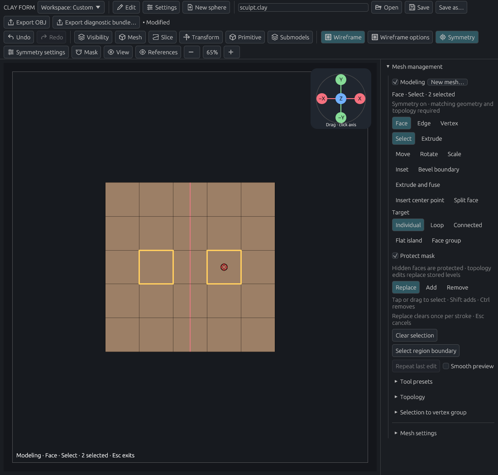

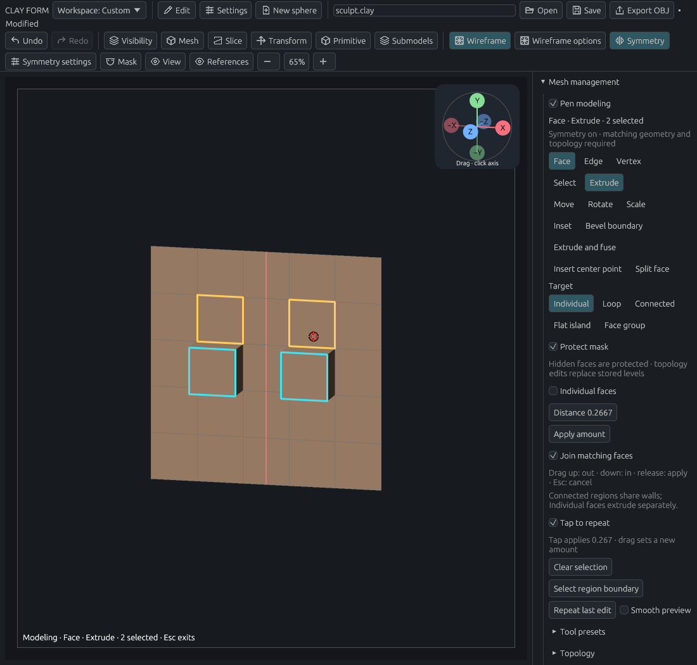

### Keep useful tool setups and inspect the smooth result

Save a setup you use often, such as a small inset for panels:

1. Set the tool and its options.
2. Expand **Tool presets**, enter a name, and choose **Save tool preset**.
3. Choose **Use …** to restore it later without changing geometry.

Presets include component mode, action, target, transform interaction/direction, axis, amount, loop count, flat-island angle, construction/contact options, and protection/preview settings. They save in application preferences, independently of the project. Right-click a preset to add it to a menu or shelf, or assign a shortcut. Deleting a preset leaves its old shelf entry unavailable; a new preset will not take its place.

#### Repeat an edit across several targets

1. Drag to establish the amount, or enter it numerically. Free move and rotation need an initial drag to set their direction.
2. Tap another target to apply the displayed amount and current options.
3. Tap a selected component to edit the selection, or tap elsewhere to use the hovered target.

**Tap to repeat** is on by default for Extrude, Extrude and fuse, Inset, Bevel boundary, Move, Rotate, Scale, Slide loop, and measured edge/point tools. Each remembers its amount during the session, even when you switch tools. Gizmo transforms use drag handles instead.

Each completed tap is one Undo step; Escape cancels. Pen movement within three screen pixels counts as a tap. Once you drag farther, returning to the starting point does not trigger repeat.

Turn **Tap to repeat** off for drag-only editing. The toggle saves in presets and can go on a menu, shelf, or shortcut. Select keeps its tap/paint behavior, and a Loop cut tap stays centered.

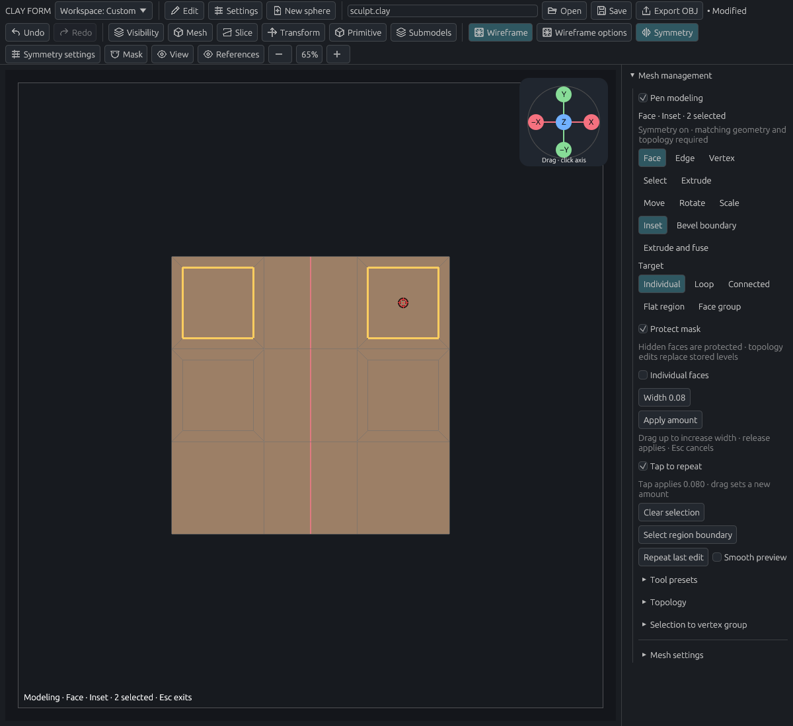

**Repeat last edit** explicitly applies the previous measured operation to the current selection; its tooltip names the operation and amount. It uses the current mask-protection setting and current document symmetry. Tap selection remains selection. After tunnel/fusion snapping, the remembered distance is the snapped distance. Topology buttons such as Delete and Weld are direct commands and are not recorded as measured repeats.

#### Check the rounded shape

**Smooth preview** shows one Catmull–Clark level over the editable cage, respecting creases. It changes neither geometry, history nor saved subdivision levels. Picking and the faint cage overlay refer to the original mesh.

During a drag the operation preview takes priority; the smooth result returns on release. Show all faces first; this interactive preview supports cages up to 20,000 triangles. Turn it off to inspect the unsmoothed geometry.

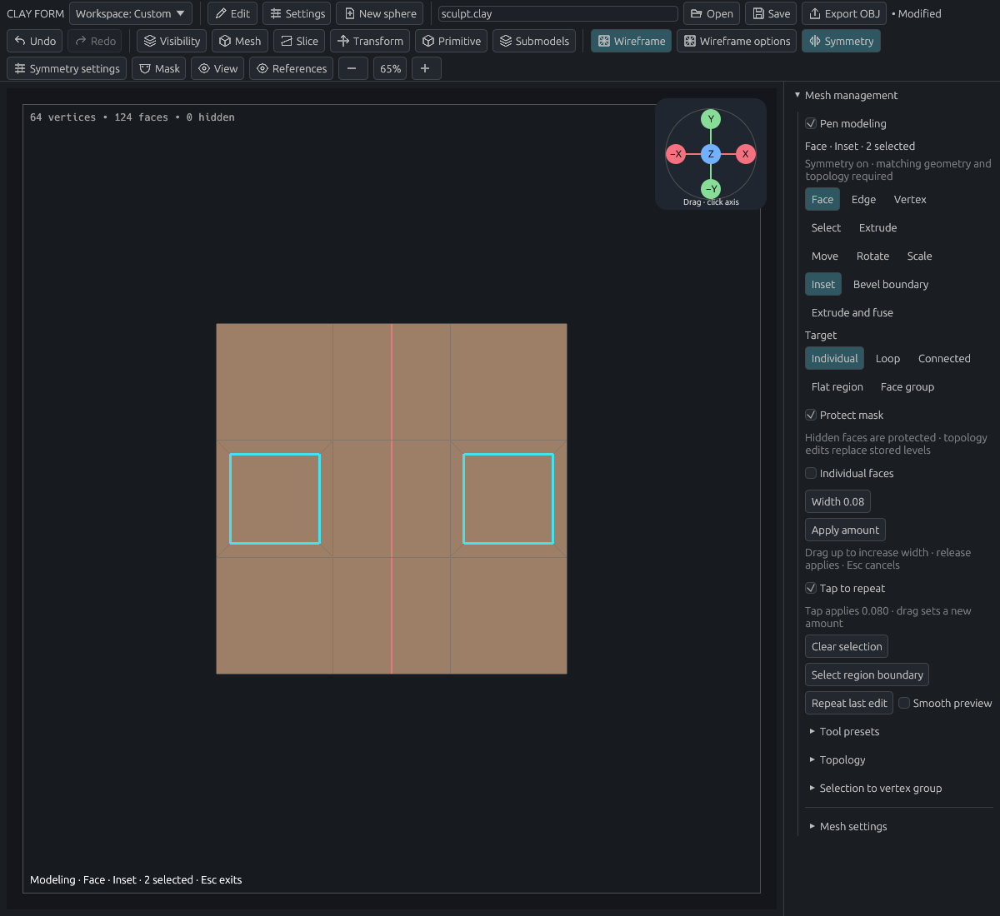

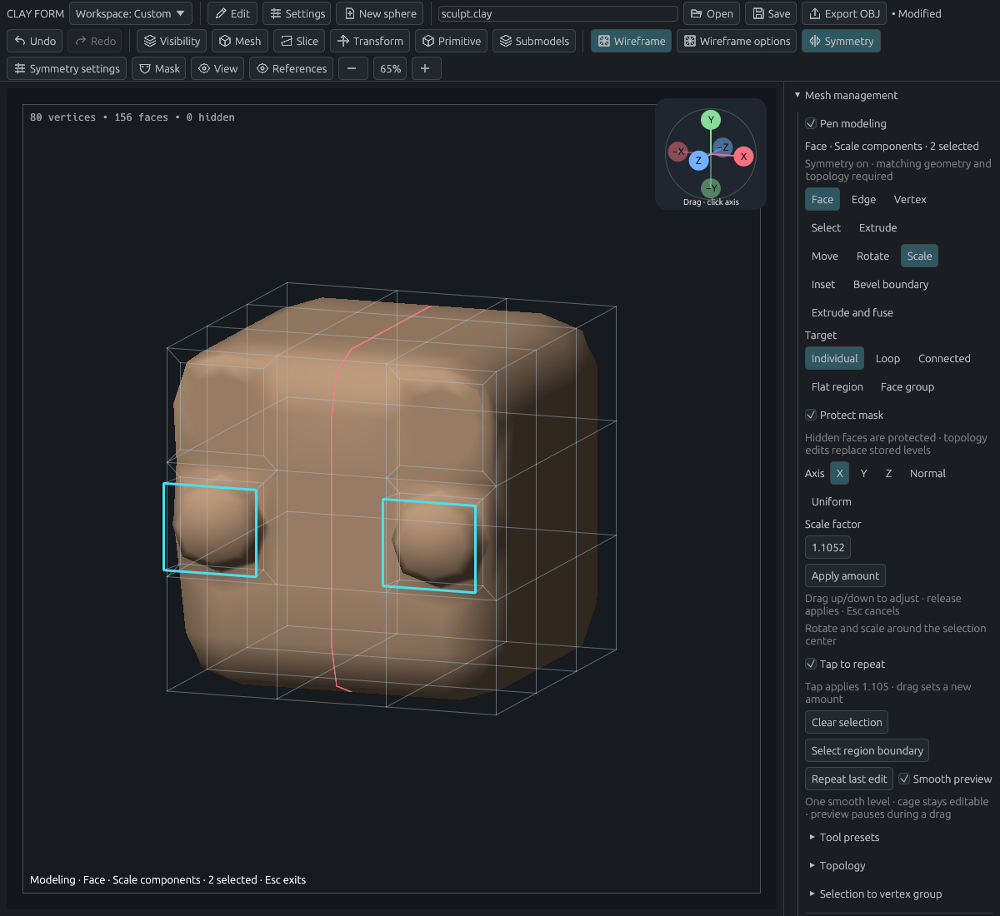

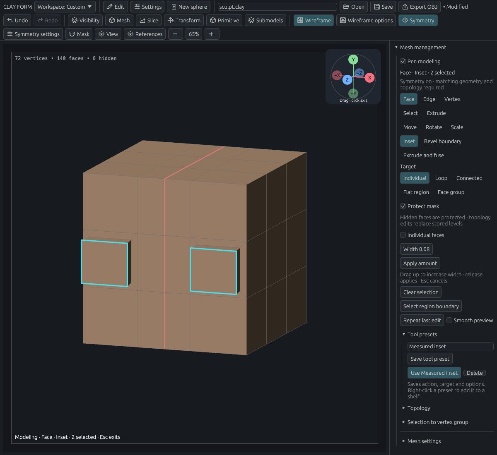

### Save a component selection as a vertex group

Save a region you want to target again—for example, the panels around a window.

1. Use a single subdivision level for component-to-group assignment.
2. Choose **Select** and build a face, edge, or vertex selection.
3. Expand **Selection to vertex group**.
4. Enter a name and choose **Create group from selection**, or pick an existing group and choose **Add to group** / **Remove from group**.

Face selections assign colors and face-group targets to exactly those faces, including symmetry copies. Gaps and neighboring faces keep their labels, even if they share every corner with selected faces. This applies to creating, adding, and removing. Vertex weights include all selected face corners; edge selections include both endpoints.

Creating or adding replaces previous membership in the selected region. Any remainder stays in the old group; full replacement removes that group. Shared boundary corners remain available to adjacent face groups. Removing the last membership removes the empty group.

These changes undo together and leave sculpt masks unchanged.

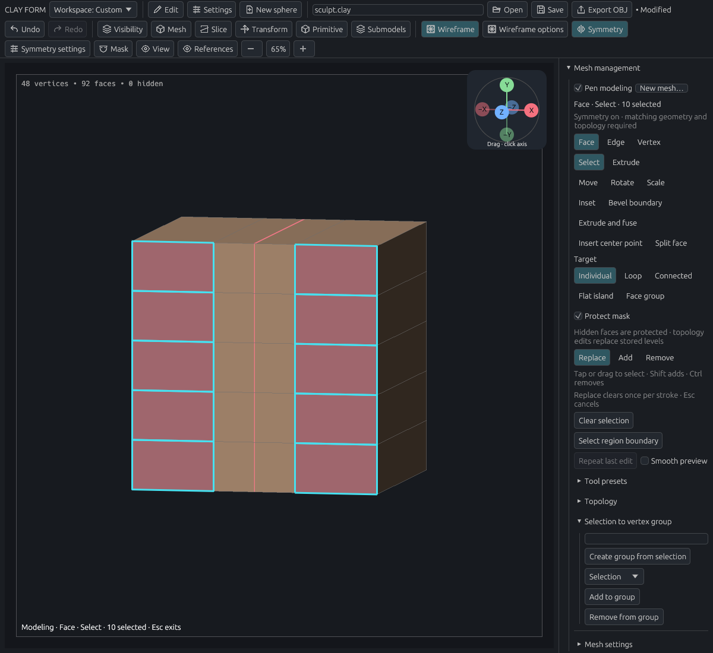

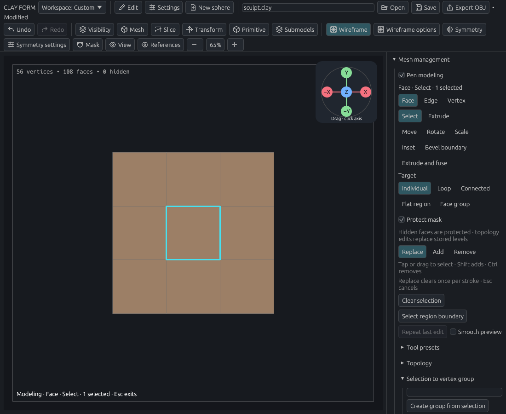

#### Put frequent actions within reach

Right-click a modeling button and choose **Add to custom menu / shelf…** or **Assign shortcut…**. Component modes, Select/Extrude/Loop cut, selection modes and patterns, join toggle, loop-count buttons, selection clearing/loop expansion, dissolve, and group actions are available in the action catalog.

Extrude and Loop cut on a custom shelf automatically enter the appropriate modeling mode. Group actions use the name and group currently chosen in the Mesh panel. For solid fusion, use the ordered Boolean stack in Submodels. Intersecting-face bridging remains outside the component tools.

## Mesh management

Choose the method that fits your work:

| Method | Best for | Changes topology |
| --- | --- | --- |
| [Smooth subdivision](edges.md#control-subdivision-smoothness) | Rounding shapes while preserving creased edges | Bakes the current level into refined quads |
| Subdivision | Keeping several editable detail levels | Adds resolution to the whole surface |
| [Adaptive sculpt](sculpting.md#snake-brush-and-adaptive-sculpting) | Detail near the brush | Refines/simplifies locally |
| Dynamic mesh / voxel remesh | Redistributing geometry or fusing overlapping closed parts | Rebuilds the whole surface |

### Relax stretched polygons

1. Mask the parts you want to keep fixed. Leave the area with stretched polygons unmasked; soft masks reduce movement gradually.
2. Open **Mesh → Relax mesh…** and adjust **Strength** and **Iterations**. The default is 30 iterations.
3. Set **Surface tolerance** in model units. Start small for fine detail; a larger value allows more redistribution and more surface deviation.
4. Choose **Preview relaxation**. Compare the wireframe, shaded surface, groove depth and silhouette; orbit and zoom while the preview is open.
5. Choose **Apply relaxation** for one Undo step, or **Cancel / Escape** to keep the original. Save the project to retain the result.

If the effect is subtle, increase iterations and strength first. Once the surface tolerance is reached, stronger settings cannot move those vertices further. Increase tolerance cautiously and preview again: this permits more shape deviation, so check the shaded surface as well as the wireframe.

Relaxation can tidy uneven spacing after an aggressive Inflate stroke. It preserves the inflated form and existing surface bumps; use Smooth/Polish when you also want to soften those bumps. Polygon count stays fixed, so relaxation redistributes crowded vertices rather than deleting them.

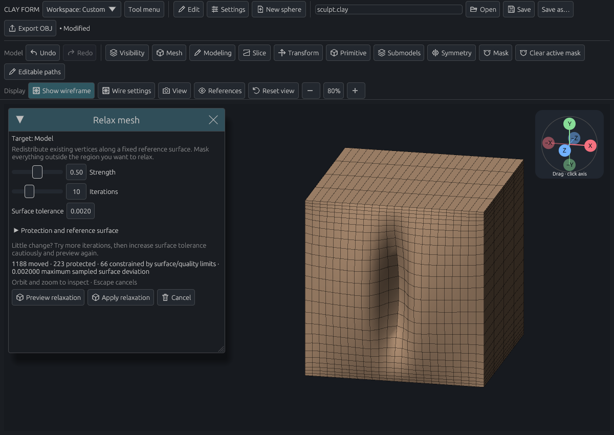

Relaxation moves existing vertices along a reference surface without changing polygon counts or connectivity. Boundaries, creases, corners sharper than 35°, hidden faces and fully masked vertices stay fixed. It works on the active submodel and subdivision level; other levels remain stored. Existing mesh and mask symmetry is followed, rather than adding mirrored copies.

Consecutive applications share the original reference until another edit, Undo, or reopening the project. This prevents each pass from treating its own small shape changes as a new target. The displayed deviation samples face centers and edge midpoints; it is not an exact bound at every point. Tight or crowded regions may remain unchanged. If the work limit is reached, reduce iterations or mask more of the model.

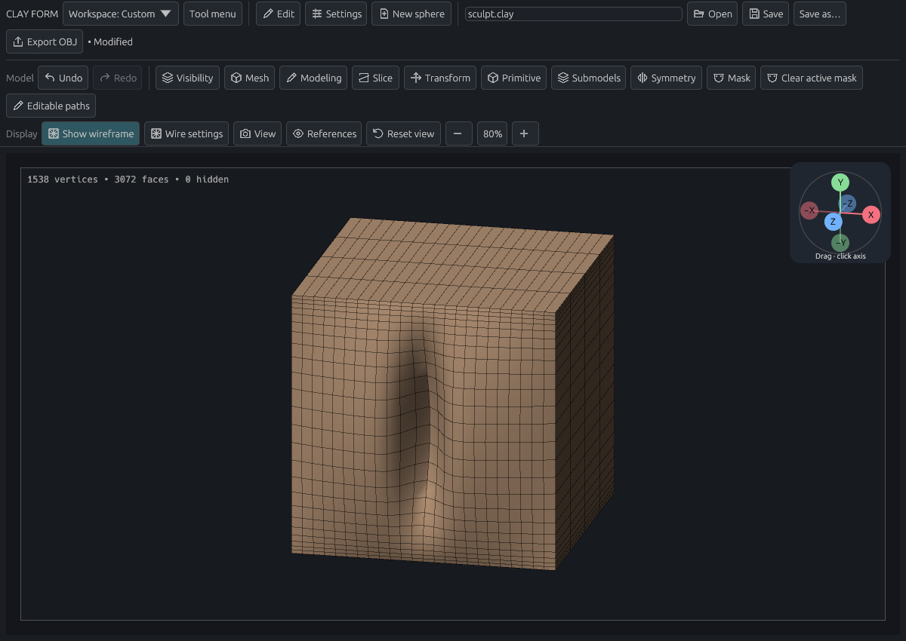

*Spacing becomes more even while the recessed groove and outer form are retained.*

### Add subdivision levels

Choose **Mesh → Subdivide** from the highest level. Use **Lower / Higher** or the level slider to switch levels.

Lower-level edits carry upward while retaining finer detail. Subdivision is linear: it adds resolution without automatically smoothing the shape. Masks interpolate between levels. For controlled rounding, use the separate [Smoothness slider and Smooth subdivide](edges.md#control-subdivision-smoothness) controls.

**Delete lower** removes levels below the current one; **Delete higher** removes those above it. Both are undoable. Projects store all levels; OBJ exports only the active one.

### Remesh a whole surface

Dynamic mesh rebuilds the whole surface. Use it to redistribute geometry or fuse overlapping closed parts; use [Adaptive sculpt](sculpting.md#add-detail-where-you-sculpt) for local changes near the brush.

1. Switch to **Dynamic mesh**. This keeps the active surface and discards stored subdivision levels.
2. Choose **Quads** or **Triangles** under **Remesh topology**. New models default to Quads; older projects retain triangle remeshing until you change it.
3. For Quads, choose a method from the table below.
4. Set **Resolution** to **16–96 voxels** along the model's longest bounding-box axis. A voxel is one cell in the grid used to rebuild the surface; higher resolution captures smaller details.
5. Choose **Remesh now**, then inspect the silhouette, small details and wireframe. Use Undo to restore the previous mesh if needed.

Remeshing happens only when requested. Finishing a sculpt stroke keeps the sculpted surface.

| Quad method | Use it for | What to expect |
| --- | --- | --- |
| **Fast quads** (default) | A quick rebuild fitted to your sculpt | Grid-based quads; grid junctions remain, and sharp or under-resolved areas may only partly fit the sculpt |
| **Optimized quads** | Improving connections and reducing crowded junctions | Takes longer, changes connectivity and may slightly change face count; small features can soften |

Older Surface nets, Relaxed quads and Voxel skin settings migrate to Fast quads. Loading a project does not alter its saved mesh.

**Remeshing clears masks and can lose details thinner than a voxel.** Use moderate resolution first. It requires closed, consistently oriented surfaces and can fuse overlapping outward-facing shells; separate volumes remain separate.

Quads are editable four-sided faces, visible in wireframe and Modeling face selection. Neither method provides guided retopology or animation-ready edge flow.

Fast quads always fits its result back to the pre-remesh sculpt. This fitting cannot recover detail that the grid resolution failed to capture.

Both quad methods require valid closed output. If the result has unresolved crossings or folded faces, Clay Form reports an error and keeps the original model. Increase **Resolution** or explicitly choose **Triangles**; there is no automatic triangle fallback.

All remesh algorithms preserve supported vertex colours/materials and transfer vertex groups. Each quad face receives a single group assignment.

Optimized quads rebuilds and redistributes a coarse layout before refining and fitting it to the reconstructed surface. If that layout produces severely uneven quads, it tries a less aggressive layout and accepts it only when spacing improves and the same shape checks pass.

The method adapts [Practical Quad Mesh Simplification](https://vcg.isti.cnr.it/publication/2010/TPCPP10/). See the [modelling architecture](../architecture/modeling.md) for developer context.

Optimized quads checks each disconnected part separately and requires closed quad topology. Surface samples are checked in both directions against a **0.4-voxel** limit relative to its internal Surface nets reconstruction. **This is a sampled bound, not a guarantee at every point.**

If simplification, shape checks or the work limit prevent completion, the operation reports a failure and keeps the original model. Increase Resolution or select another algorithm.

Dynamic mesh and Adaptive sculpt save their topology choices independently. To refine a quad remesh locally, switch to **Adaptive sculpt → Quads**.

Enable **Adapt only unmasked areas** there to protect masked topology during local sculpting. **This does not make whole-surface remeshing local or preserve its masks.**

Mesh operations run in the background. Cancel keeps the original surface; Undo restores prior geometry and settings. A failed remesh keeps the original model so you can adjust the settings and try again.

## Guide a retopology preview

Use **Mesh → Guided retopology…** to reconstruct a fresh quad layout from a sculpt's surface. This experimental Rust solver accepts open or closed manifold meshes. Convert parametric primitives first, show hidden faces and use a source without UVs or textures.

1. Open **Guided retopology…**, set **Target quads** (large models start at 10,000), and try **Preview layout** without guides or paint first. **Input triangle limit** defaults to 200,000; raise it to at least the displayed source count for larger tests. Preparation and reconstruction run in the background, with progress and cancellation. The count is a target, not an exact promise.
2. To direct edges, draw and save **Surface** paths in **Editable paths**, then choose guides individually or use **Select all** under **Edge direction**. **Path strength** controls their influence. **Mirror paths** reflects them across world X = 0. Open curves and closed loops steer nearby edges; a closed guide does not guarantee a continuous edge loop.
3. Under **Polygon density**, **Shape adaptation** ranges from uniform spacing at zero to more quads around bends at higher values. Choose **More detail** (orange) or **Less detail** (blue) and paint directly on the model. **Automatic / erase** removes that request; grey regions use automatic spacing. Paint has its own radius and strength, supports Undo, and saves with the model independently of the sculpt mask. **Density strength** scales its effect on reconstruction. Right-drag to orbit while painting; choose **Inspect** to return to ordinary preview navigation.
4. Choose **Preview layout** again after changing controls or painting. Orbit the wireframe and inspect fingers, folds, underarms and other narrow regions. **Hide path overlay** reveals edges beneath guides. A rejected solve leaves the original intact and reports the failure; it does not publish a broken draft. **Cancel** discards the draft. Density strokes are document edits and can be undone separately.
5. Choose **Apply as new model**. The editable result receives interpolated vertex paint, sculpt mask, density paint and selection weights. Face-group borders may move. The hidden source below it keeps its original topology, paths and subdivision levels. **Undo** reverses the application as one edit.
6. To recover finer sculpted detail, subdivide the result if needed, then use **Project details…** with the model below as the reference. Reduce the result's sculpt mask where vertices should move. Save the project to keep both models.

**Protect sharp bends** uses a configurable threshold from 1° to 180°, initially 45°. The path thumbnails show where each guide sits on the source model.

**Layout symmetry (experimental)** is available for closed meshes. Select X, Y or Z to generate mirrored connectivity with quads that cross the sculpt symmetry plane. Guided retopology starts with the enabled sculpt mirror axis when exactly one is active. **Add centreline** divides the bridge into quad rows on either side. **Keep sculpt shape** fits both sides to the source when it is nearly symmetric. If the preview reports asymmetry, choose **Keep + and mirror** or **Keep − and mirror** to mirror that side in the result, or choose **Off**. With symmetry enabled, guides steer the mirrored layout. When mirroring the sculpt, guides on the retained side drive the layout. Density on the reconstructed half influences both sides.

The solver does not identify body parts. Coarse fingers and uneven poles remain limitations; inspect the output before applying it. Guides and paint refine automatic reconstruction rather than preserving the source triangulation.

[Feasibility decision, matched wireframes and measurements](../validation/guided-retopology/README.md)

## Recover detail after remeshing

Keep an unchanged reference before rebuilding topology, then move the remeshed vertices back toward that surface.

1. In **Mesh → Detail projection**, select **Keep reference copy**. This adds a hidden reference submodel immediately below the active model and saves it with the project.
2. Remesh or adaptively sculpt the active target. The reference keeps its original surface and subdivision levels. Add resolution if the target is too coarse to represent the details you want back.
3. Open **Mesh → Detail projection → Project details…**. Choose the reference, or select **Use model below**. The dialog names the reference and the active target; only the target moves.
4. Set **Maximum distance** in model units. Start small near thin walls or nearby parts. Use **Strength** below 1 for a partial blend; target masks reduce movement further.
5. Select **Preview projection**. Drag the viewport to orbit and scroll to zoom. Read the counts of moved, protected, out-of-range, opposing, ambiguous and safety-limited vertices.
6. Select **Apply projection** to commit one undoable edit. **Cancel**, closing the window or **Escape** discards the preview. Changing reference or settings requires another preview.

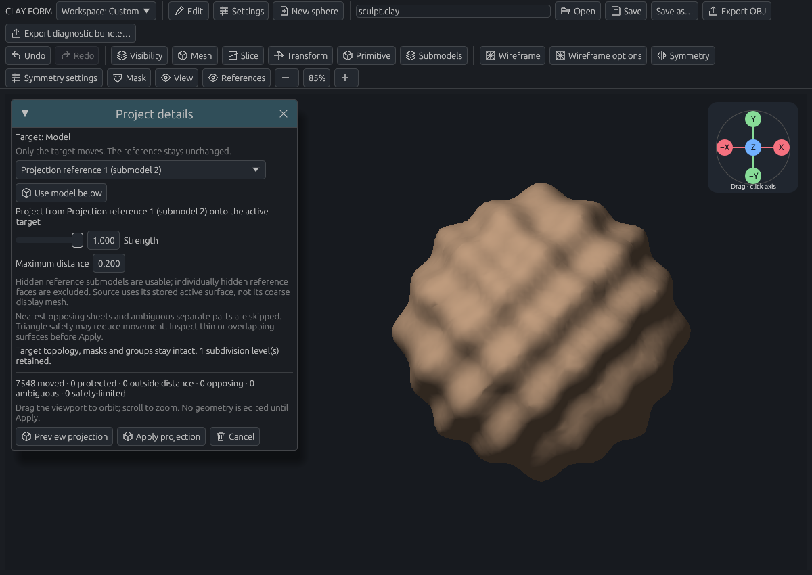

The hidden reference stays unchanged while the active model previews the recovered surface.

You can select any other submodel as a reference, including one lower in the Submodels panel. **Use model below** follows the panel's grouped order. To project a lower submodel *from* an upper one, cancel, activate the lower target, reopen Project details, and choose the upper reference. Submodels are the supported “layers” in this workflow; sculpt layers are separate future work.

The reference uses its stored active surface, even when inactive models display a coarser level. A different stored subdivision level of the target is also available as a reference. Projection preserves target topology and its existing compatible level stack; switching levels uses the normal detail-preserving level behavior. Incompatible stacks are rejected. Reference and target must already line up in space. Convert a target primitive and apply or remove temporary Thickness modifiers before projecting.

Whole-model hiding keeps a reference out of the way without disabling it. Individually hidden reference faces are excluded. Hidden target faces and their boundary vertices remain fixed; fully masked vertices stay fixed too. Target masks, groups, creases and quads are retained.

Projection follows locally averaged surface directions to keep neighbouring vertices from bunching around steep rims. It does not smooth the target's positions. Vertices with no reference hit within the distance stay in place. The closest opposing sheet is skipped rather than searching through it; near-equal matches on disconnected parts are skipped as ambiguous. Triangle safety can reduce movement to prevent neighbouring faces folding back against each other. Very sharp details may need a denser target mesh. These checks cannot infer which overlapping surface you intended, so inspect folds and thin walls before applying. Projection moves existing vertices; it cannot restore detail finer than the target topology can represent.

### When symmetry cannot match

A fresh, centred 3×3×3 cube supports ordinary X mirror symmetry after conversion to an editable mesh. Exact symmetry still needs matching positions and topology. If it cannot match, Q and the Modeling panel show the reason and a **Turn symmetry off** button. Select remains available so you can inspect the mesh. Check mirror axes, radial settings and centre before trying the edit again.

## Thickness modifier

### Preview a shell

In **Submodels → Thickness · open meshes**, enable **Thickness modifier** and set its total thickness in model units. Choose **Inward**, **Outward** or **Both** under Direction. Inward follows the opposite of the face normals, Outward follows them, and Both adds half to each side. Walls close boundary loops. The direction is saved with the project and restored by Undo.

Use **Rim loops** to add wall segments and **Crease rim edges** to preserve the joins during later smooth subdivision. See the [illustrated thickness example](edges.md#add-loops-and-creases-to-thickness).

Orbit to inspect tight folds for intersections. The original surface, masks, levels, and picking remain unchanged. OBJ export uses the original surface while the shell is temporary.

### Apply the shell

Choose **Apply Thickness modifier** to make the preview real geometry. This converts primitives, preserves masks/quads, and resets levels and topology modes. Undo restores the original surface and settings.

Thickness requires consistently oriented open surfaces with nonbranching boundaries. Closed meshes and outlines without faces are not eligible. Front/back/rim groups and masks can be generated in the same controls.

## Slice

For temporary slicing, press **Z**, choose **Slice**, then hold **Ctrl+Shift**. Choose the cut options in that same menu. Release the hold to restore your previous tool; an unfinished cut is discarded. See [Slice with the shared hold](selection.md#slice-with-the-shared-hold).

For a non-destructive selection, choose **Mask through · Line** in the Slice controls. It switches to [through-depth line masking](selection.md#protect-one-side-through-the-model), with Add/Erase and Flip side controls. This changes mask weights only and retains subdivision levels. The cutting results below remain separate.

### Trim away one side

Before slicing, convert primitives, apply/remove thickness modifier, and show all faces of the active model.

1. Open **Slice**, select **Line**, and choose **Trim**.
2. Leave **Cap cuts** on for a closed result.
3. Drag across the model and inspect **Keep / Remove**. Use **Flip kept side** if needed.
4. Release to apply, then choose **Done slicing** and orbit to inspect the cap.

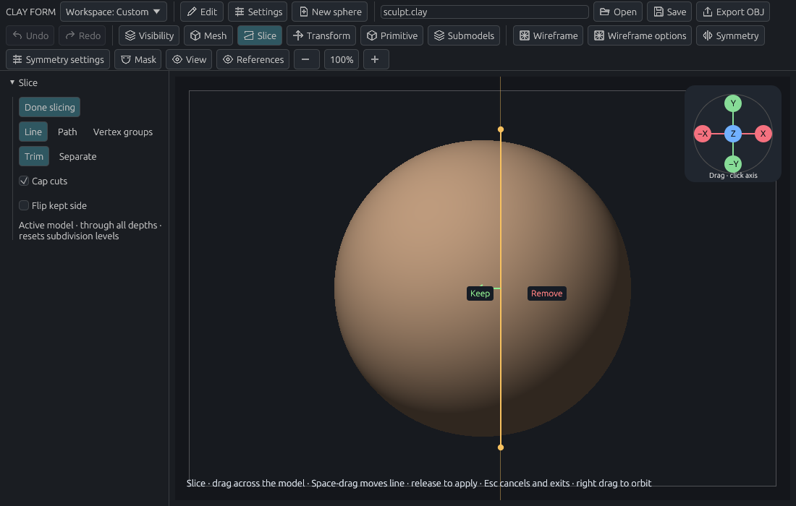

*Before release: check which side will remain.*

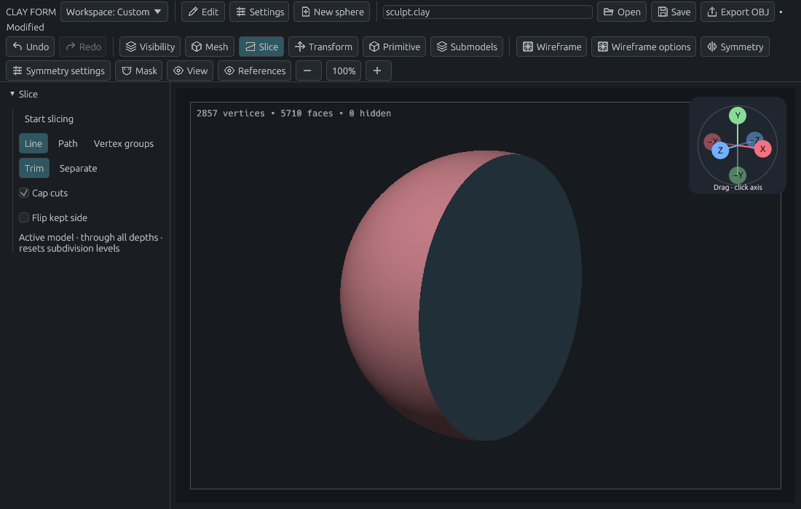

*After release and orbit: the cut is closed with a flat cap in a new Cut vertex group.*

### Choose a cut result

| Result | What remains |
| --- | --- |
| Vertex groups | One connected surface, divided into face groups |
| Trim | The chosen side only |
| Separate | Both sides as separate submodels, initially in place |

Cuts extend through all depths of the active model. Masks and symmetry do not restrict them. Hold **Space** during a line drag to move it; **Esc** cancels and exits Slice. Right-drag orbits between cuts.

### Make a bent or rounded path

Choose **Path**. Click to add up to **24 points**, click an edge to insert one, and drag points to reshape the cut.

| Control | Action |
| --- | --- |
| Interior point's blue diamond | Drag away to round, toward the point to sharpen |
| Tangent handles | Adjust the rounding |
| Sharp / Rounded | Set corner style |
| Turn / Round (px) | Set precise corner values |
| Shift-drag | Snap to 15° |
| Space-drag | Move the entire path |
| Delete point / Delete / Backspace | Remove the selected point |
| Apply cut / Enter | Commit |
| Clear / Esc | Discard; Esc also exits Slice |

The camera stays fixed while editing a path. Clear/apply it before orbiting. Paths and their extensions must not cross; failed cuts retain the draft for correction.

### Caps, projection, and undo

Caps require closed, consistently oriented input. Turn **Cap cuts** off for open surfaces, or apply thickness first.

Cuts follow the [view projection](navigation.md#perspective-view): parallel planes in orthographic, planes converging at the eye in perspective. Changing projection/FOV discards the draft. A perspective path through geometry crossing the eye is rejected; use orthographic and redraw it.

A cut uses the active level and resets that model's subdivision and adaptive/voxel settings. Uncut quads remain; intersections and caps use triangles. Other submodels stay intact. Each completed cut is one undo step; cancellation keeps the original surface.

## Join meshes locally

Open **Mesh → Join meshes…**. Choose two visible sculpt meshes, or choose the same model twice to connect two of its holes. The result becomes a new active **Joined** submodel; Apply hides the sources and retains their original geometry and subdivision levels. Undo restores the whole scene in one step.

### Connect open ends across a gap

1. Choose **Open ends**, then the first and second source models.
2. Select **First source** and click its highlighted rim, or choose its numbered hole from the list. Repeat for **Second source**. Hole labels refer to the selected sources, so other nearby holes are not automatically substituted.
3. Choose **Preview join**. Inspect the purple connector in shaded and wireframe views. Orbit to inspect obscured edges; the colored overlays also show through surfaces.
4. Adjust **Connector segments**, **Alignment offset**, or **Curvature**, then preview again. Choose **Apply join** to keep it, or **Cancel join** / **Escape** to discard it.

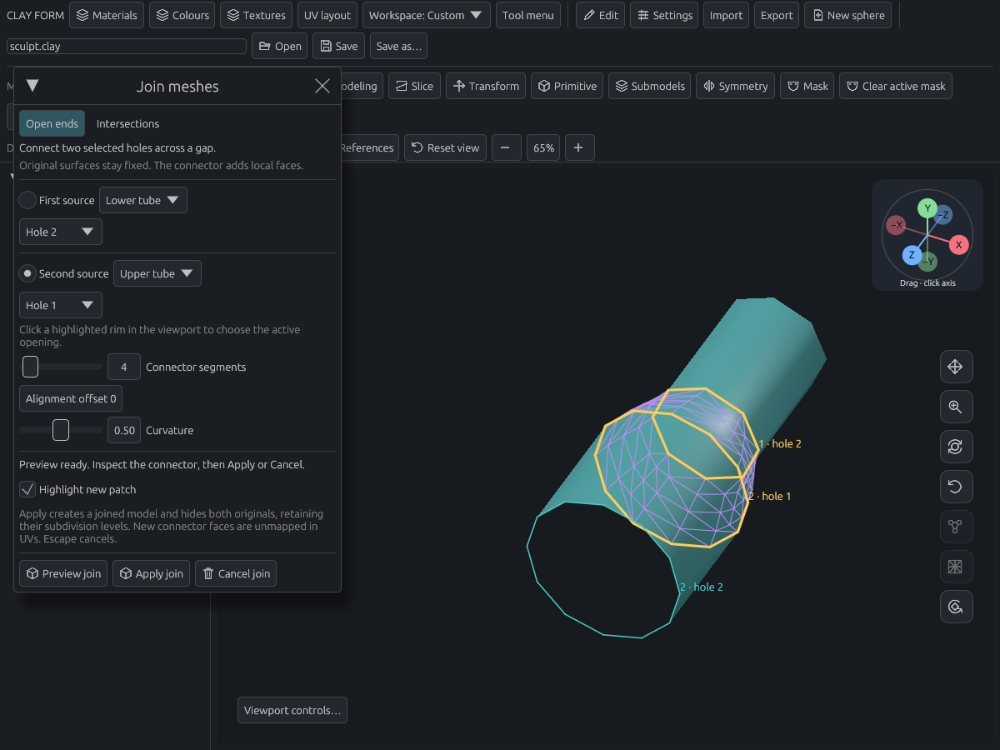

The connector shares the original rim vertices. If other holes remain open, the tool keeps every source polygon. Closing the last holes also runs the enclosed-shell cleanup described below. Unequal vertex counts use a mixture of triangles and quads; aligned spans use quads. Curvature bends only the new connector toward the adjoining surfaces. It does not smooth the sources. Segment count controls divisions along the gap; the combined spacing of both rims determines intermediate ring resolution. Alignment offset changes the circular correspondence by one vertex on the second rim.

**Modeling → Topology → Bridge boundaries** remains available for the existing equal-count, active-mesh workflow and its symmetry copies.

### Fuse intersecting solids

Choose **Intersections** for two overlapping, closed, outward-facing solids. Preview removes crossing and buried source polygons, extends the cut by **Extra collar rings**, and connects the resulting rims. Purple highlights the newly constructed patch; **Show removed source faces** overlays the deleted source edges in red. Several separate intersections can join together when their rim partners are unambiguous.

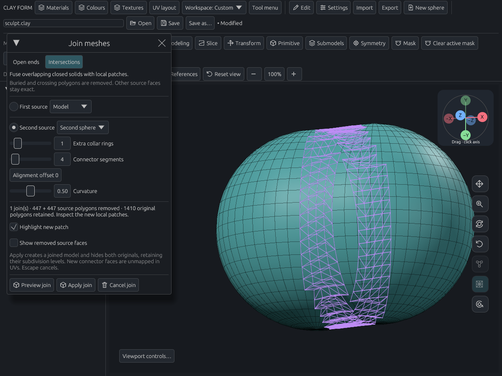

This is a polygon-boundary reconstruction: its outline follows the source tessellation. Increasing collar rings broadens the local cut; it does not guarantee a smoother result. All retained vertices, triangles and quads remain exact. Buried faces are removed even beyond the narrow patch. The tool rejects a connector that folds into another surface; try different collar rings, alignment or source overlap. Always inspect the silhouette before applying.

### Remove enclosed geometry from a closed join

When the result closes, the preview removes separate shells fully enclosed by its outer surface. This includes sealed cavity walls and loose parts trapped inside a new connector. The preview reports how many enclosed polygons it culled. **Show removed source faces** highlights their edges, and Apply commits the preview. A surface seen through a tunnel or behind another part stays on the model if it borders the outside. Masks and face visibility protections apply to the cleanup.

### Attributes and supported sources

Untouched masks, vertex materials, group weights, creases and compatible face-corner UVs survive. Separate source groups remain separate, with duplicate names renamed. New vertices interpolate materials and group weights from both rims; new faces have no polygroup and are unmapped in UVs. New edges are not creased. Unwrap the connector afterwards. Sources with different texture images must first share an atlas; stale UV mappings must be restored or cleared.

Convert parametric primitives and apply or remove Thickness before joining. Disable symmetry: this tool operates on the explicitly chosen pair. It uses each source's current stored mesh level and gives the joined result a fresh subdivision stack. Higher and lower levels remain on the hidden originals. Path bindings remain attached to those originals; the joined result is an independent sculpt mesh.

Masked or hidden geometry needed by the join must be exposed and unmasked first. Invalid borders, non-manifold surfaces, collapsed faces, crossed connectors, ambiguous intersections and resource-limit failures leave the scene unchanged. Intersection mode requires a crossing seam and outward-facing exterior shells. Tangencies, coincident faces and containment alone are unsupported. It does not route a connector around obstacles. At most 4,096 vertices per rim, 64 connector segments and 16 intersection pairs are supported, subject to the application's mesh and model limits.

## Merge down

Choose **Submodels → Merge down** to combine the active model with the next one in grouped order. The tooltip names the target.

The active model keeps its name/folder. Masks, groups, visibility, and quads survive. Hidden models contribute hidden faces; duplicate group names receive suffixes.

Merge bakes primitives and thickness modifier, uses current mesh levels, and resets the result's level/topology settings. Fill unfilled Circles first. It combines surfaces **without welding or boolean union**. Use an additive Boolean stack or voxel remeshing for fusion. Undo restores both models.

## Related guides

[Brushes and adaptive detail](sculpting.md) · [Masks and selection](selection.md) · [Import/export](files.md)

### Switch functions beside the model

Open **Modeling** in the toolbar, or press **Q** over the viewport for its quick popup. Choose **Face**, **Edge** or **Vertex** under **Component**, then choose a **Target** such as Individual, Loop, Connected or Flat island. Targets follow the current component mode, just like the Modeling panel. Component changes convert the selection; target changes keep the current tool and selection. These controls leave the menu open so you can then choose a function.

The same controls are also in **Model → Modeling** on the top bar. Use its Panel controls to pin a movable window or dock a collapsible section on the left or right. These placements are saved with your workspace. Pinned and docked controls stay open when you choose a function. Q also has **Keep open**: enable it to use the viewport while the menu stays visible, and drag its title to reposition it. Opening or moving the menu alone does not edit the model.

The Q menu shows functions and **Topology** actions for the current component mode and marks the active choices. Vertex mode includes **Delete vertices**, **Create face**, **Connect vertices** and **Weld vertices**; Edge mode includes **Create face**, both **Delete loop** options, **Fill boundary**, **Bridge boundaries**, **Split edges** and **Collapse edges**; Face mode includes **Delete faces**. Topology actions apply immediately with normal Undo/Redo. The Mesh panel also places Topology beside the Modeling functions. Choose with the mouse/pen or use Up/Down and Enter. Picking a function closes the menu unless **Keep open** is enabled. An outside click closes an unpinned menu and immediately starts the chosen viewport action, so selection needs only one click. Escape or focus loss dismisses the menu. Q shares the panel’s tool options and **Tool presets** section; scroll down to reach them. Finish the current drag before opening it.

Change or clear **Modeling quick menu** in **Settings → Key settings**. Its displayed tooltip follows the assigned shortcut; the default Q does not replace right-drag orbit or middle-drag pan. Existing custom bindings remain intact when preferences upgrade; if Q is already assigned, the new menu starts unbound.

**Q** always opens Modeling. **Z** opens the Select / Mask / Visibility / Slice chooser. **Select** is available while Modeling is enabled; the selected tab decides whether Ctrl+Shift selects components, masks, changes visibility or slices. The shared hold and all three quick-menu bindings can be changed, cleared and reset in Key settings. Hold shortcuts support modifier-only and key-plus-modifier chords. Release the hold to restore the previous tool; unfinished gestures are cancelled. **Alt** temporarily reverses Add/Erase masking or Hide/Isolate visibility, or removes components in Select (adds when Remove is chosen).

**E** opens transform options. In Modeling it offers Move/Rotate/Scale, Free/Gizmo/Axis interaction and applicable axis choices. Otherwise it offers object transforms, World axes/Action Line, pivot controls and Respect mask. Opening the menu makes no geometry edit; choose options and then an operation to begin using it.

### Universal transform gizmo

Press **T** to show the universal gizmo for the active object. All handles are available together: colored arrows move along X/Y/Z, colored squares scale along an axis, and colored rings rotate around an axis. The white circle moves freely in the view plane; the white square scales uniformly.

Drag the **centre diamond** to move the pivot in the view plane without moving the mesh or adding an Undo step. Rotation and scaling then use that pivot. **Reset pivot** returns it to the model centre; **Place pivot** remains available for clicking a point on the surface. Pivot placement is session-only. The existing Respect mask setting applies to geometry transforms.

Press **T** again to return to sculpting. T also returns to sculpting from the other object transform modes. Each geometry drag remains one Undo step. The shortcut can be rebound or cleared in Key settings; an existing custom T binding is preserved.
