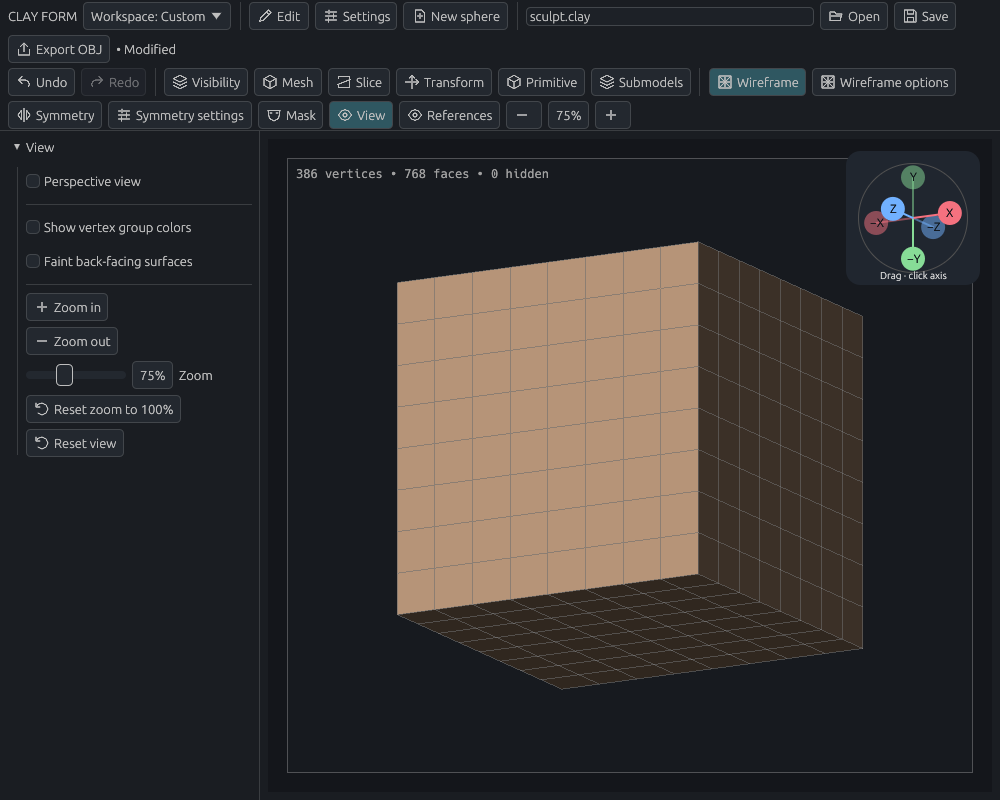
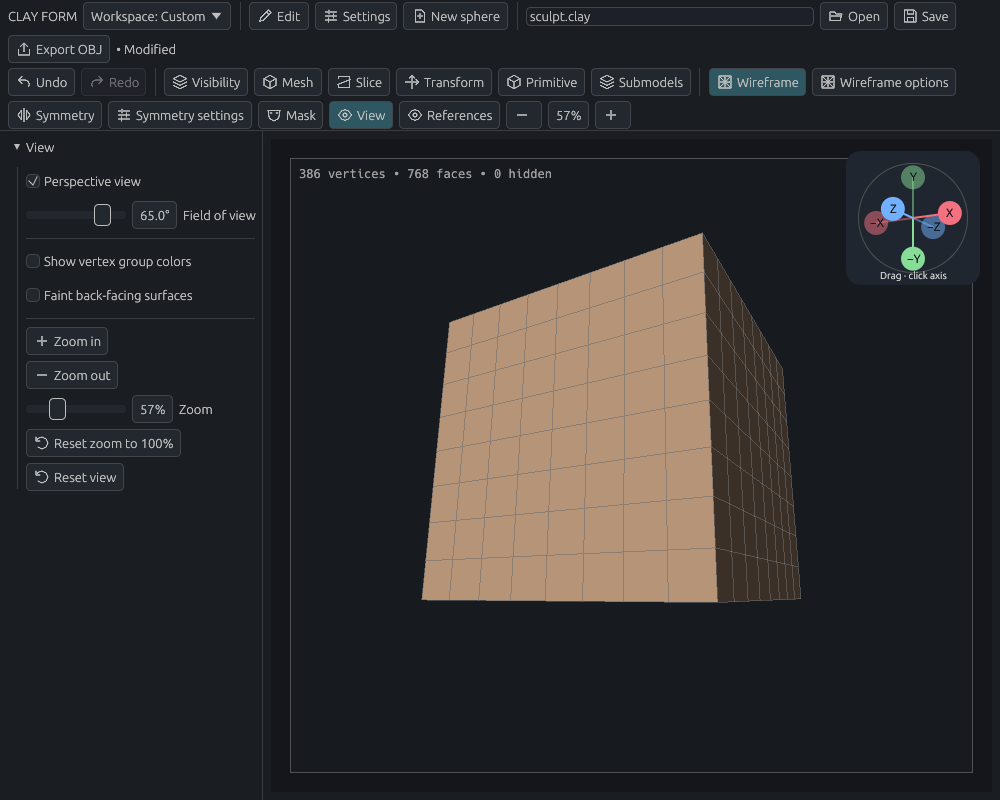

# Navigation and tablet input

[Documentation home](../../README.md#documentation)

Get a clear look at the shape you are making. Start a sculpt stroke on clay; start a left/pen navigation drag in empty space. If you lose your bearings, press **F** to reset the view.

- [Orbit and pan](#orbit-and-pan)
- [Zoom](#zoom)
- [Touch and trackpad gestures](#touch-and-trackpad-gestures)
- [Viewport buttons](#viewport-buttons)
- [Perspective view](#perspective-view)
- [Surface display](#surface-display)
- [Huion tablets](#huion-tablets)

## Orbit and pan

### Mouse and pen gestures

| Action | Gesture |
| --- | --- |
| Sculpt | Left/pen drag starting on clay |
| Orbit | Right drag, or left/pen drag starting in empty space |
| Pan | Middle drag, Alt + right drag, or Alt + left/pen drag starting off the model |
| Zoom | Wheel, or Ctrl + drag |
| Smooth temporarily | Hold Shift while sculpting |
| Reverse the brush | Hold Alt while sculpting |

A drag keeps the role it started with. An orbit drag stays navigation when it crosses clay. Alt-drag starting **on** clay reverses the brush instead of panning.

### Navigate when the model fills the view

The thin inset frame reserves a **20-pixel navigation strip**. Start a pen/left drag there to orbit, add **Ctrl** to zoom, or **Alt** to pan. Border taps do not sculpt, select, or cut.

### Snap to an axis

Tap X, Y, or Z on the top-right orientation gizmo. Dimmed axes face away from you. Drag the gizmo to orbit; vertical orbit can continue over the poles. Horizontal dragging keeps the same screen direction when the view is upside down, in both sculpting and modeling.

## Zoom

Use the wheel, toolbar **− / +**, or **View → Zoom in / Zoom out**. Default keys are **− / =**. Zoom goes up to **800%** and can go below **20%** to accommodate large imported models.

| Reset | What changes |
| --- | --- |
| Click the toolbar percentage, or **Reset zoom** | Zoom returns to 100%; rotation and pan stay |
| **Reset view** or **F** | Return to the front orthographic view, center the visible models and zoom out as needed to fit them with a margin |

For pen zoom, hold **Ctrl** and drag up to enlarge or down to shrink. This also works during an orbit or gizmo drag.

Change the zoom/pan modifiers in **Settings → Key settings**. Zoom takes priority if both use the same modifier; Ctrl+Shift selection retains priority inside the navigation frame.

## Touch and trackpad gestures

Open **Settings → Key settings → Touch and trackpad gestures**, or the same section in **Viewport controls…**. Settings save automatically and apply across workspaces.

| Gesture | Default action |
| --- | --- |
| One-finger drag on the touchscreen | Rotate view |
| Two-finger drag | Pan view |
| Pinch apart / together | Zoom in / out |
| Twist two fingers around each other | Roll the view in screen space |
| Two-finger tap | Undo |
| Three-finger tap | Redo |

With touch gestures enabled, fingers navigate and the pen or mouse sculpts. The first finger cannot leave a sculpt mark while you place the second. Gestures must begin in the drawing area, away from floating controls. Taps complete when all fingers lift; a drag, long hold, cancelled contact, or fourth finger prevents a tap action. Adding or removing a finger does not jump the camera. After lifting any finger, lift the remaining fingers before starting another navigation gesture.

Choose a different navigation action or **Disabled** for each drag, and any action from the action catalog (or **Disabled**) for each tap. Pinch and twist can each be disabled or reversed, with separate sensitivity settings. Drag sensitivity, maximum tap time, and tap movement tolerance are also adjustable. **Restore default touch gestures** resets just these controls. Turning off **Enable touch gestures** restores the previous pointer and wheel behavior.

To roll, place two fingers apart and circle them around each other, like turning a sheet of paper. The image follows clockwise or counterclockwise motion while the viewing direction stays the same. Twist works together with two-finger pan and pinch. Keep the fingers separated; rotation pauses when they become too close to give a stable angle. **Reset view** and axis-gizmo snaps clear the roll. This is camera navigation and adds no model edit or undo step. Trackpad twist works when the desktop delivers native rotation events.

Trackpads normally send scroll events instead of individual contacts. **Pan pixel scroll; zoom wheel** pans smooth trackpad scrolling while keeping a stepped mouse wheel for zoom. If your desktop sends trackpad scrolling as wheel steps, choose **Pan all scrolling**; this also makes the mouse wheel pan. The two-finger drag mapping and sensitivity apply to trackpad panning too.

For a trackpad configured by the OS to send two-finger taps as right-click and three-finger taps as middle-click, enable **Use right / middle clicks as two / three-finger taps**. This also maps short physical mouse right/middle clicks to the selected tap actions. Right/middle drags retain their usual navigation behavior. Alternatively, map the trackpad taps to Clay Form's configured Undo/Redo keyboard shortcuts in your desktop settings.

Native trackpad pinch requires the OS to deliver pinch events. The current windowing backend exposes these on macOS, but not Linux or Windows ([winit platform support](https://docs.rs/winit/0.30.13/winit/event/enum.WindowEvent.html#variant.PinchGesture)). On those desktops, a gesture mapper can send **Ctrl+wheel** or Clay Form's Zoom in/out shortcuts instead. Ctrl+wheel uses the pinch sensitivity and direction settings. Touchscreen pinch uses the individual contacts and does not need that trackpad support. OS-reserved gestures must be reassigned in desktop settings before Clay Form can receive them.

## Viewport buttons

The default drawing area includes **Pan view**, **Zoom view**, **Rotate view**, **Roll view**, **Reset view**, **Vertex groups**, and **Toggle wireframe** controls.

- Hold the left mouse button on **Pan view** and drag in any direction.
- Drag **Zoom view** up to zoom in or down to zoom out.
- Drag **Rotate view** to orbit the camera.
- Drag **Roll view** right for clockwise screen-space rotation, or left for counterclockwise rotation. Existing saved layouts can add **Roll view** from **Viewport controls…**; it uses the same movable, configurable button styles as the other controls.
- Click **Reset view** to face front and fit the visible models. Hidden submodels and hidden faces do not affect the fit. **Vertex groups** toggles group colours; **Toggle wireframe** toggles mesh edges.

Open **Viewport controls…** in the drawing area to search the action catalog, add controls, rename them, or remove them. The catalog includes brush sliders, brush presets, menus, and editing actions. You can also right-click an existing customizable action and choose **Add to viewport**.

Choose **Icon only**, **Icon + text**, or **Text** when adding a control. Each existing control has its own style and icon picker. **Automatic** chooses a symbol for the action; you can choose another symbol from the picker. Icon buttons show their name and shortcut on hover, and toggles retain a selected highlight. Click an icon for a brush value to open its editable control.

The defaults are 40-pixel icon buttons in a compact vertical stack with 8-pixel gaps. **Align right** lines up the controls vertically; **Align bottom** makes a horizontal row. Set **Spacing** before aligning to choose the gap. Alignment keeps pixel spacing consistent when the viewport resizes. To update an existing layout, choose **Icon only**, click **Apply style to all**, then **Align right**.

Choose **Place controls**, drag each button to its desired position, then click **Done placing controls**. While placing controls, dragging moves the buttons. Right-click any viewport button for style, placement and removal options. **Restore default controls** restores the seven default buttons.

Positions save automatically with your workspace and adjust to the viewport when the window or sidebars resize. Camera movement and layout changes do not change the sculpt or add undo steps.

## Perspective view

Enable **View → Perspective view** for depth and foreshortening. Leave it off for parallel projection when comparing against drawings.

**Field of view** ranges from **20–75°**, initially **45°**. Wider angles emphasize depth; narrower angles flatten proportions. Switching modes or angles adjusts framing approximately, within the zoom limits.

### Example: compare orthographic and perspective views

1. In a practice project, create a **Cube** primitive.
2. Enable **Wireframe** and orbit until three faces are visible.
3. Dock **View** on the left using its sidebar icon.
4. Toggle **Perspective view**, then set **Field of view** to **65°**.



*Orthographic: parallel edges stay parallel.*



*Perspective: nearer faces look larger. Geometry and orientation are unchanged.*

### What the view settings affect

Picking, brush size, selections, transforms, guides, and cuts follow the displayed projection. Zoom enlarges the image without moving the camera eye through the model.

View settings are session-only and do not add undo steps. Changing projection or field of view ends the current drag and cancels unapplied selections, stamps, and cuts. **Reset view** returns to orthographic.

Assign **Toggle perspective view** in Key settings or add it to a custom menu; it has no default shortcut. Geometry behind the camera is clipped. A path cut through geometry crossing the eye reports an error; switch to orthographic and redraw it.

## Surface display

### Choose a wireframe mode

Open **Wire settings** beside **Show wireframe**.

| Mode | Shows |
| --- | --- |
| Visible surfaces | Edges not hidden by another surface |
| Front-facing edges | Front-facing topology |
| Transparent | The whole frame, including the back |

Enable triangle diagonals separately. Primitives use quads where possible; adaptive and voxel remeshing produce triangles.

### Inspect open surfaces

Enable **View → Faint back-facing surfaces** to see the back of an open surface. Set **Back-face opacity**, initially **15%**, to control translucency. Backs behind opaque foreground clay stay hidden. This changes display only, not normals or picking.

## Huion tablets

### Check input

First check that your desktop tablet driver moves the cursor and registers the pen tip. Then open **Tablet & navigation** and press lightly and firmly: the live pressure value should change.

Clay Form accepts native pen/touch pressure where available and retains it between input events until contact ends. On Linux it observes all accessible pressure-capable pen endpoints from `/dev/input/event*`, using `/sys/class/input` capabilities rather than a vendor name. This includes physical Huion devices and OpenTabletDriver virtual artist tablets. Without pressure input, strokes use full pressure.

The **Tablet & navigation** panel shows live pressure and connection errors. Tilt, eraser detection, and express-key configuration are not implemented. Physical Huion pressure has not yet been verified.

### Allow pressure input on a GS1331

For the `256c:006d` device, run from the repository or extracted release folder:

```sh
sudo install -m 0644 packaging/linux/72-clay-form-huion.rules /etc/udev/rules.d/72-clay-form-huion.rules
sudo udevadm control --reload-rules
```

Reconnect the tablet and restart Clay Form. The rule grants the active desktop user access to this device through [systemd uaccess](https://cgit.freedesktop.org/systemd/systemd/tree/src/login/70-uaccess.rules).

For OpenTabletDriver's virtual artist tablet, install `packaging/linux/72-clay-form-opentabletdriver.rules` into `/etc/udev/rules.d/` using the same command pattern, reload the rules, then restart OpenTabletDriver to recreate the virtual device. This rule grants access only to the artist tablet, not its virtual keyboard. Physical and virtual pen endpoints are monitored together, so an idle endpoint cannot hide pressure from the one in use.

Other devices may need their own narrowly scoped permission rule. If pressure reports permission denied, grant your normal user device-specific access; do not run the app as root. In **Brush settings**, enable **Pressure → strength**; **Pressure → radius** can stay off. The default curve of 1 is linear: 25% pressure produces one quarter of the full-pressure strength.

## Related guides

[Brushes](sculpting.md) · [Shortcuts](workspace.md#shortcuts) · [GPU rendering](../gpu-rendering.md)

