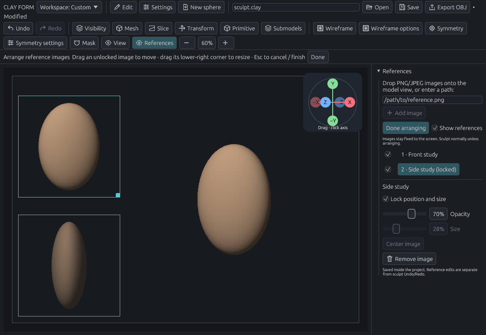

# Reference images

[Documentation home](../../README.md#documentation)

Keep drawings or photographs beside the sculpt. Images stay fixed on screen while you orbit the model.

- [Add an image](#add-a-reference)
- [Place two studies](#example-keep-two-studies-beside-the-sculpt)
- [Lock, fade, or hide images](#sculpt-with-references)
- [Save and customize](#save-and-customize)

## Add a reference

Drop a PNG/JPEG onto the viewport, or enter its path under **References** and choose **Add image**.

Adding enters **Arrange images**. The file is embedded in the project, so moving/deleting its source later will not break it. PNG transparency and JPEG orientation metadata are supported.

## Example: keep two studies beside the sculpt

1. Add a front and a side study. Try the supplied [front](../examples/front-study.png) and [side](../examples/side-study.png) images of a simple ellipsoid.
2. In **Arrange images**, drag them to the upper-left and lower-left corners. Resize with each image's lower-right handle.
3. Select the side image, set **Opacity** to **70%**, and enable **Lock position and size**.
4. Choose **Done**. Orbit the model; the images stay in place.

*The supplied images show two views of the same ellipsoid, made by scaling a UV sphere. Replace them with your own drawings or photos for a project.*

## Sculpt with references

### Move and resize

Choose **Arrange images** to edit placements. Primary drags move images; they do not sculpt. Right-drag orbit, middle-drag pan, and wheel zoom still work.

**Done** returns to sculpting. **Escape** cancels an unfinished placement and exits Arrange mode. Completed placements stay. Focus loss, tool changes, or viewport resizing cancel an unfinished drag.

### Lock, fade, or hide

| References control | Use |
| --- | --- |
| Image row | Select that image's controls |
| Opacity | Fade it to reveal clay underneath |
| Size | Set width as a proportion of the viewport |
| Center image | Move it to the viewport center |
| Lock position and size | Prevent accidental movement while arranging |
| Row visibility checkbox | Hide/show one image |
| Show references | Temporarily hide/show the collection |
| Remove image | Remove it from the project |

Outside Arrange mode, images do not intercept sculpting or navigation. Later images appear on top; use the list to select overlapping ones.

## Save and customize

Images, placements, individual visibility, opacity, and locks save in `.clay` projects and recovery copies. Positions/widths are relative to the viewport, so images fit when the window changes size.

**Reference edits are outside sculpt Undo/Redo.** Escape cancels an unfinished drag; after release, reposition the image to change it. Arrange mode and the overall Show references toggle are session-only.

Pin/dock the References menu like other menus. Reference controls and actions can be added to custom menus or shortcuts; they have no default keys.

### Image limits

- Up to **8 images** per project.
- Up to **2048 × 2048** and **16 MB** per source image.
- Up to **8 megapixels** and **16 MB** of embedded PNG data combined.

Invalid/oversized images report an error without being added. These are screen overlays; attaching images to 3D front/side planes is not implemented.

## Related guides

[Navigation](navigation.md) · [Workspace](workspace.md) · [Files and recovery](files.md)
