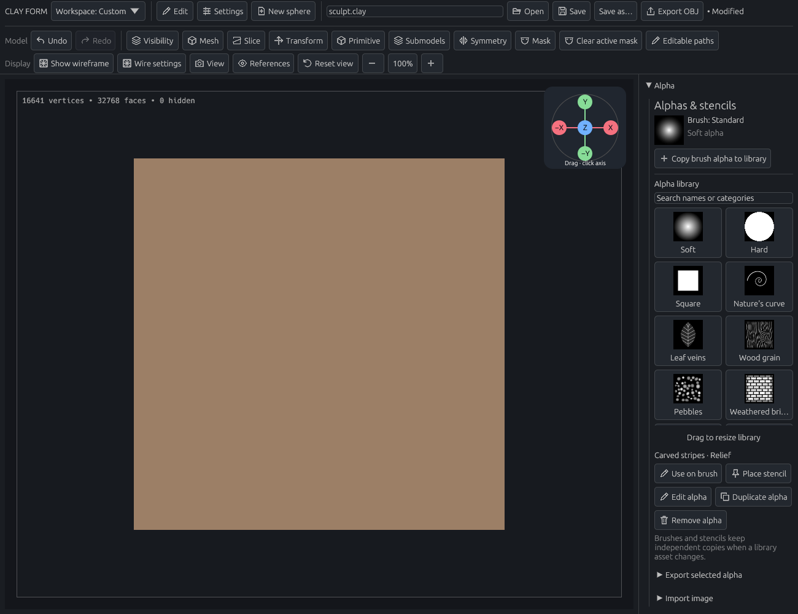
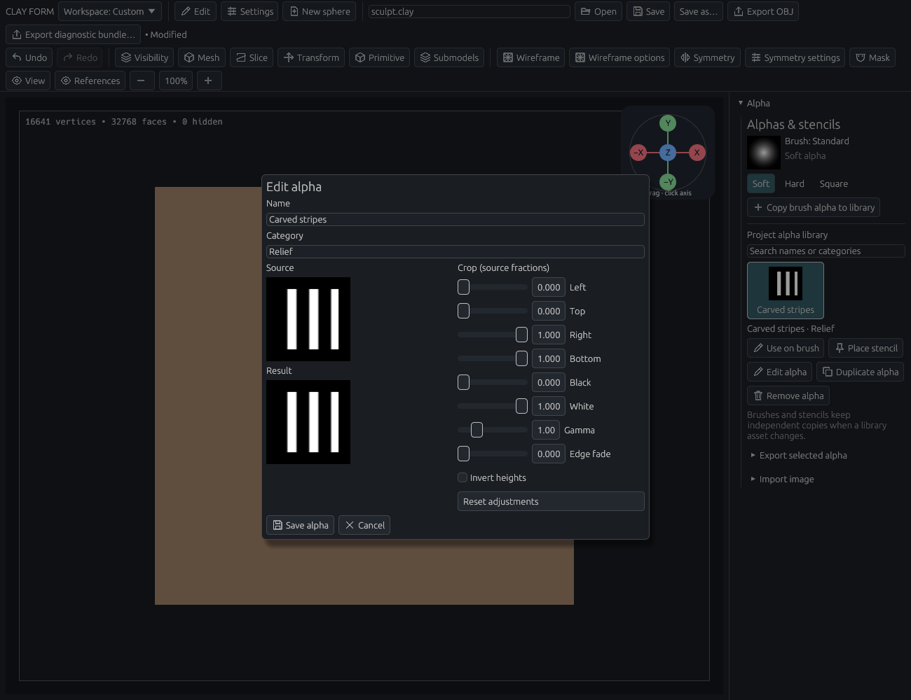
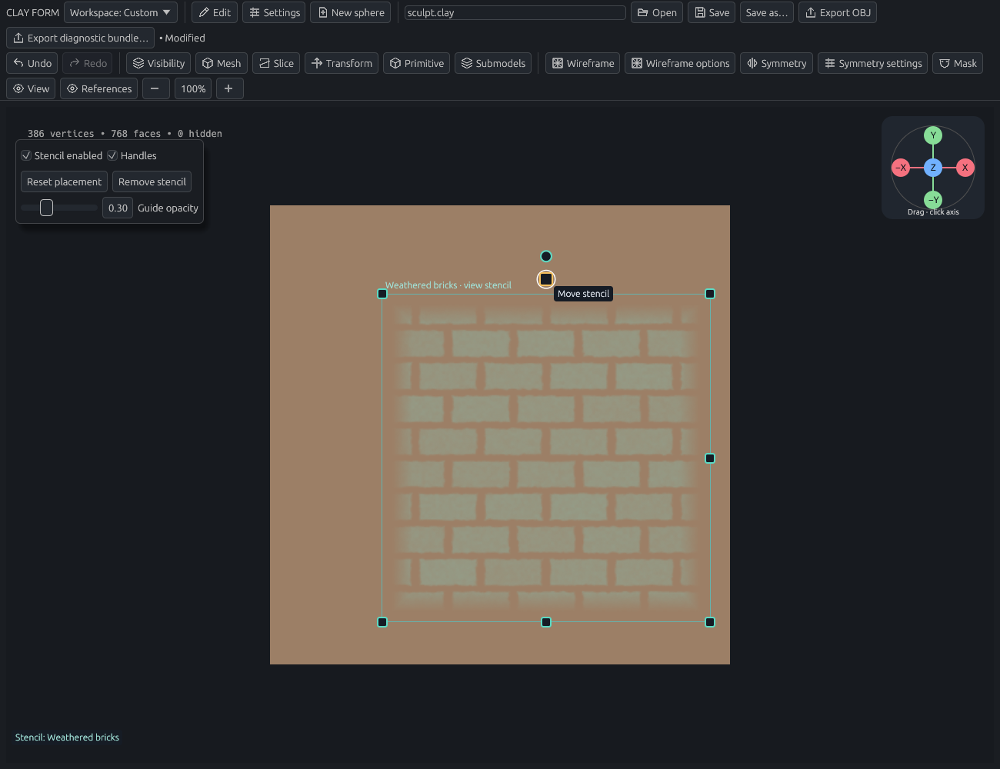
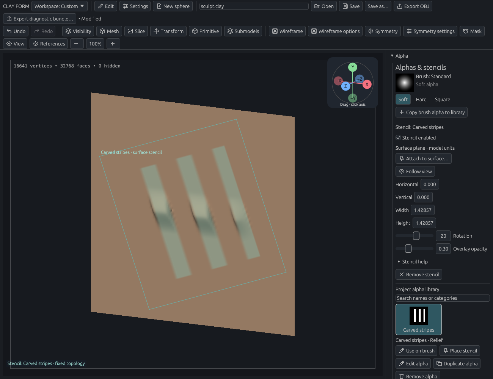
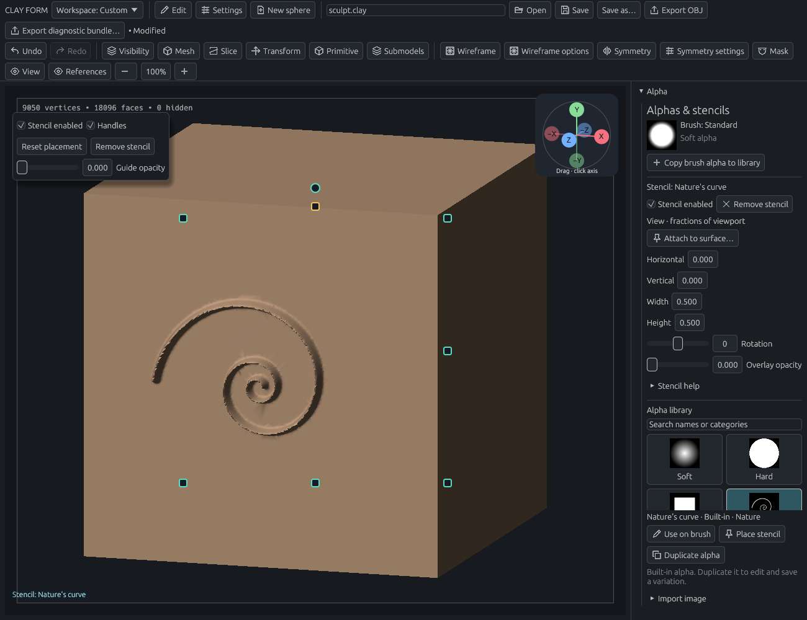
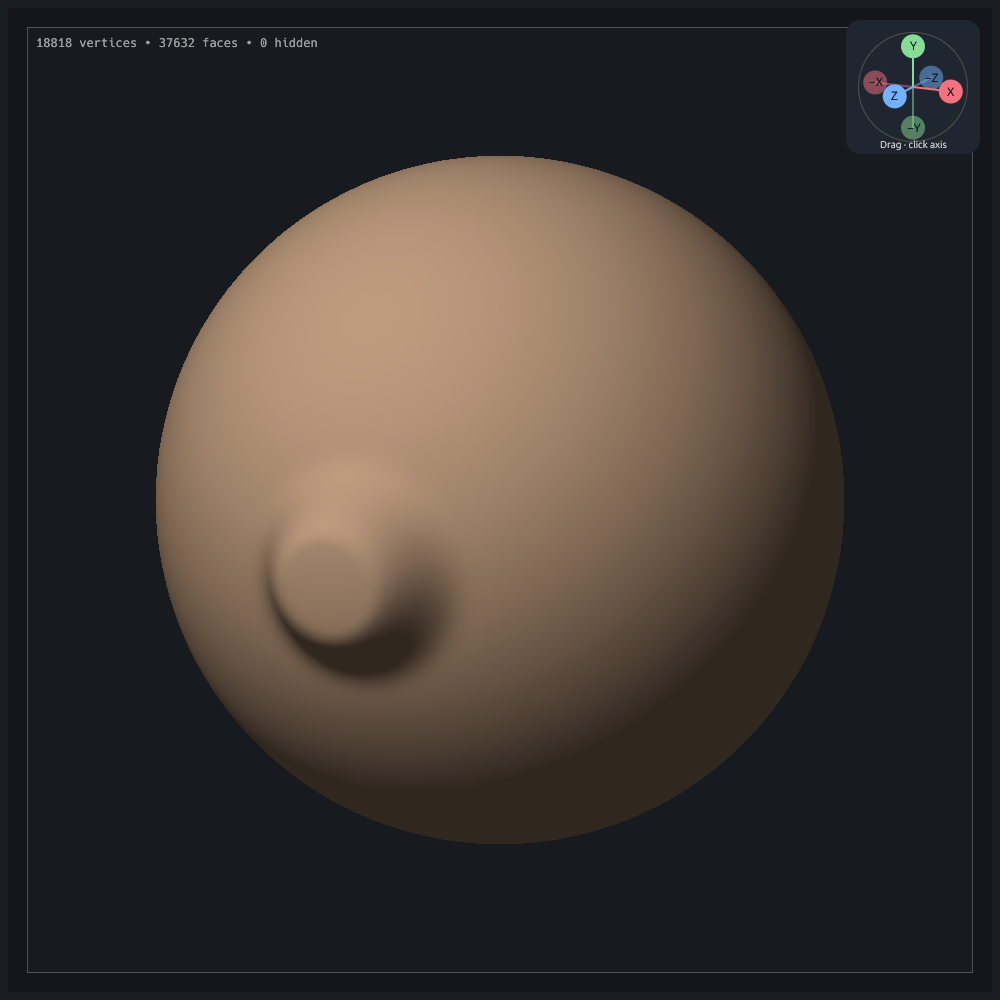
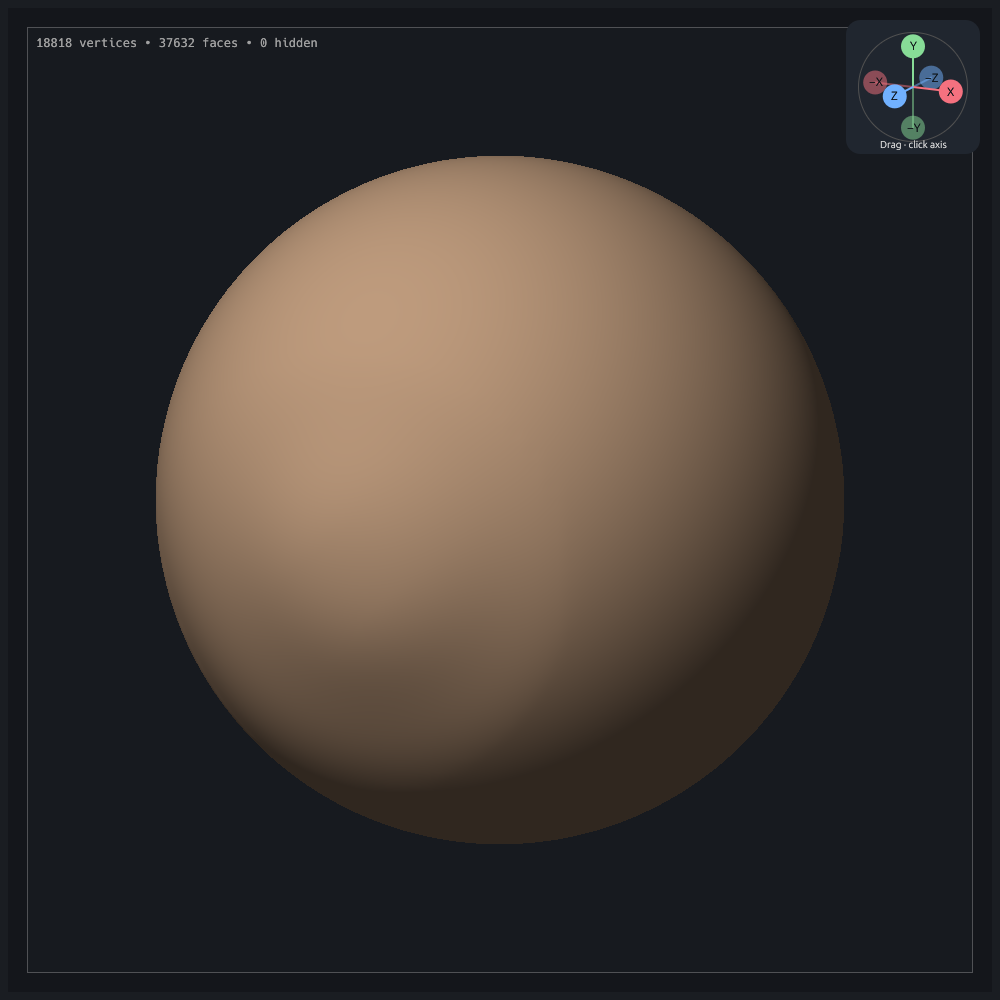

# Sculpting and brushes

[Documentation home](../../README.md#documentation) · New here? [Make your first sculpt](getting-started.md).

Build a rounded form, cut a fold, or pull out a horn: choose the brush for the shape you want, then tune it with a short trial stroke. **Ctrl+Z** lets you try again. Start here:

- [Choose and adjust a brush](#brushes-alphas-and-symmetry)
- [Reset a brush](#example-reset-an-experimental-brush)
- [Cut a fine fold](#detail-brush)
- [Choose a stroke mode](#stroke-modes)
- [Guide a live brush stroke with an editable 3D path](paths.md#sculpt-along-a-saved-guide)
- [Mirror a stroke](#symmetry)
- [Add local detail](#snake-brush-and-adaptive-sculpting)
- [Undo an edit](#undo-and-redo)

## Brushes, alphas, and symmetry

### Choose a brush

| Goal | Brushes to try |
| --- | --- |
| Build up or remove clay | Standard, Clay, Inflate |
| Even out a surface | Smooth, Flatten |
| Reduce surplus triangles | Decimate (Adaptive sculpt) |
| Polish bumps into cleaner planes while holding sharp corners | Polish |
| Tighten a fold | Pinch, Crease, Detail |
| Move or pull a form | Grab, Snake |
| Protect part of a surface | Mask |

For broad, clean planes, try **Polish** with a large radius and light pressure. It flattens local bumps while holding sharp corners and marked creases. Masks, hidden surfaces, pressure, alphas, and symmetry still apply. Reversing Polish exaggerates relief, as with Flatten.

Select a tile in **Brush library**. Use **Add brush** if a brush is missing from an older project.

**Clay** builds a layer against the average surface beneath the brush. It fills hollows faster than raised spots, helping overlapping dabs form a cohesive mass. **Standard** adds depth along the picked normal and retains more of the existing small surface variations. Clay samples the surrounding patch to keep small bumps from steering each dab; repeated passes still add volume. Subtract removes a similarly controlled layer.

Try Clay on a sphere with the default Soft alpha: draw one broad stroke, then pass over it again to build up the form. Increase **Inner radius** for a wider full-strength core, or lower **Spacing** if you can see individual dabs. Subdivide or enable adaptive sculpting when the mesh is too coarse to carry the shape. Clay's drag stamps stop at their target layer even at full strength.

**Shift** temporarily uses your most recently selected Smooth preset, including its size and stroke settings. Release Shift to return to your previous brush. **Alt** reverses the operation by default; you can also choose **Add / Subtract** in Brush settings.

### Adjust the feel

Make one short stroke before changing several settings at once:

- Too strong? Lower **Strength** and build up with several passes.
- Too broad? Reduce **Radius**. Radius is measured on screen, so zoom changes how much of the model it covers.
- A dotted trail? Reduce **Spacing** for closer dabs.
- A shaky line? Try [Stroke stabilisation](#steady-a-freehand-stroke).

| Brush setting | Effect |
| --- | --- |
| Radius | Size of the affected area, in screen pixels |
| Inner radius | Full-strength core, as a fraction of the radius |
| Strength | Amount applied by each dab |
| Spacing | Distance between dabs in a continuous stroke |
| Falloff | How quickly influence fades toward the edge |
| Pressure strength / radius | Whether pen pressure controls strength or size |
| Pressure curve | Response to lighter and heavier pressure |
| Surface footprint and normal | Preview the alpha on the clay, with a tangent ring and normal indicator |

Grab follows pointer movement; spacing does not affect it. Subtracting Smooth sharpens, subtracting Flatten exaggerates relief, and subtracting Mask erases protection.

### Alpha Drag preset

New documents include **Alpha Drag**: Standard behavior with **Drag Rect** and **Wood grain** already selected. Drag to size and rotate one stamp, then release to commit it. In an existing project, use **Brushes → Alpha Drag** to add the preset. The regular Standard preset stays available for freehand work.

### Choose an alpha

An alpha shapes each dab. Open the **Alpha** panel, select **Soft**, **Hard**, or **Square** in the **Alpha library**, then choose **Use on brush**. The library includes **39 built-ins**, with **Nature’s curve** (a flowing spiral), **Leaf veins**, **Wood grain**, and **Pebbles** alongside the following collections. These built-ins are always available, including in older projects. You can also **Place stencil** with them or **Duplicate alpha** to edit a variation. Built-ins cannot be removed; saved copies can. Search by name or category to find a pattern. The library starts four rows tall; hold and drag **Drag to resize library** up or down to change its height. Clicking the handle alone does not resize it. The library keeps its chosen height even below other open panels; use the outer sidebar scrollbar to bring it into view. This centered handle stays clear of the sidebar scrollbar.

| Category | Examples |
| --- | --- |
| Masonry | Weathered and broken bricks, cobbles, stone blocks, flagstones, cracked plaster |
| Circuits | Traces, circuit hub, microchip, data grid, cables, riveted plate |
| Sci-fi | Hull panels, hex armor, vent grille, reactor rings, alien glyphs, mech seams |
| Skin | Fine wrinkles, deep folds, crow’s feet, pores, fingerprint, scar tissue |
| Organic | Tree bark, rock strata, cracked earth, scales, fur |
| Materials | Woven cloth, leather grain, hammered metal |

Use **Subtract** for recessed wrinkles, pores, branching plaster cracks, and engraved details. Crow’s feet and other creases taper in width and depth at their ends. Cobbles use rounded stones, flagstones use broad slabs, and cracked earth has curled fracture edges. **Duplicate alpha** lets you invert a copy or adjust its contrast.

Saved brushes and project alphas embed their height images. To use a revised built-in in an existing brush, select it in the Alpha library and choose **Use on brush** again. See the [alpha library audit](../validation/alpha-library-audit/README.md) for before/after comparisons.

### Create and reuse an image alpha

1. Open **Alpha → Import image**, enter a PNG/JPEG path, and choose **Preview image**. Images can be up to **2048 × 2048** and **32 MB**.
2. Name the alpha and give it a category such as *Stone*. Compare **Source** with **Result** while adjusting the crop, black/white levels, gamma, inversion, and **Edge fade**.
3. Choose **Save alpha**. Select its thumbnail in the project library, then choose **Use on brush**. Switch brushes and choose **Use on brush** again to reuse the same image.
4. Search by name or category. Use **Edit alpha** to adjust an asset, **Duplicate alpha** for a variation, or **Export selected alpha → Export PNG** to share a 16-bit height image. Import that PNG to use it in another project.

*Adjust the image privately, then save it to the project alpha library.*

White affects the surface; black protects it. Imported transparency reduces influence. Image inversion happens after transparency is combined with brightness. **Alpha rotation** turns each dab; brush falloff and inner radius soften its circular footprint. **Spacing** controls freehand and Line dab spacing, and strength and pressure control depth. Drag Rect adds its drag angle to the brush rotation; Drag Dot keeps the preset's angle.

**Copy brush alpha to library** brings an existing embedded alpha into the editor. Cancel leaves the library and brush unchanged. Brushes and stencils keep independent copies: editing or removing a library asset does not change existing strokes, brush presets, or a placed stencil. Use **Use on brush** again to adopt an edited image.

The project saves the library, categories, brush images, and stencil settings. Library edits are outside sculpt Undo/Redo, like brush settings. Exported PNGs contain the adjusted heights; names and categories stay in the project. The project library holds up to 64 saved assets and 16 million pixels in total, in addition to the built-ins.

### Brush through a placed stencil

1. Select an alpha thumbnail and choose **Place stencil**. A translucent guide appears over the model. Start with **Standard**, a **Soft** brush alpha, and either adaptive sculpting or a finely subdivided mesh.
2. Drag the amber square above the stencil to **move** it, a corner to **resize** proportionally, or the round handle above it to **rotate**. Hold **Shift** while rotating to snap to 15°; hold Shift on a corner to stretch freely. The right and bottom edge handles resize width and height separately. **Escape** cancels the current drag. For precise values, use **Horizontal**, **Vertical**, **Width**, **Height**, and **Rotation** under **Alpha → Stencil placement**. View-attached positions and sizes use fractions of the viewport's shorter side. Positive vertical moves up; positive rotation turns counterclockwise.
3. Brush back and forth through the guide. White areas permit the brush, black areas and everything outside the rectangle protect the surface. Brush alpha, falloff, pressure, strength, existing masks, and hidden geometry still apply.
4. Choose **Attach to surface…**, then click the model. Orbit to inspect it: the stencil now stays on that surface plane. Its position and size controls use model units. **Follow view** returns to a centered view stencil. Escape cancels attachment without painting.
5. Use the floating viewport controls to adjust **Guide opacity**, hide **Handles**, or **Reset placement**. Set opacity to zero to inspect the sculpt while continuing to stencil. Disable **Stencil enabled** to sculpt freely, or choose **Remove stencil** to close it. These controls remain available with the Alpha panel closed. Removing the stencil keeps the library alpha and existing sculpted strokes.

Placement changes save on release and stay outside sculpt Undo/Redo.

*The guide follows the surface plane; brush strokes only affect its bright regions.*

A view stencil stays in the viewport while you orbit, pan, or zoom. A surface stencil is a fixed planar projection in model coordinates: it follows camera changes but does not track later mesh transforms, deformations, or remeshing. Reattach it after moving the model. It projects through curved surfaces rather than wrapping along them.

Freehand, Line, Drag Rect, and Drag Dot work through the placed stencil. Dragging a stamp changes the brush footprint; the stencil stays placed. Stamp previews are private, release creates one undoable edit, and Escape cancels. Completed freehand strokes use the usual one-step Undo. Symmetry mirrors or rotates the stencil with each brush copy.

Adaptive sculpting works through stencils on closed meshes: refinement samples the projected pattern, and simplification stays inside fully white regions to protect dark gaps and edges. Lower adaptive **Edge size** for finer patterns. Stamp preview and release use the same refinement. Automatic remeshing stays paused while a stencil is enabled because it would rebuild the whole surface. **Grab**, **Snake**, and **Detail** require the stencil to be disabled. The viewport explains this restriction. Toggle, attachment, and removal actions can be assigned in **Settings → Key settings** or added to custom controls.

*Nature’s curve applied through a stencil with adaptive sculpting enabled; the overlay is hidden to show the relief.*

### Example: reset an experimental brush

1. Select **Standard**, choose **Duplicate brush**, and name it **Fold study**.
2. Change **Radius** to **95**, **Strength** to **0.65**, **Spacing** to **0.30**, and enable **Stroke stabilisation**.
3. Choose **Reset settings**. The operation's defaults return; your name and icon stay.

| Before reset | After reset |
| --- | --- |
|  |  |

*Reset affects the selected preset. While Shift is held, it affects the temporary Smooth preset.*

Resetting brush settings does not undo a sculpt stroke. Use **Undo** for geometry changes.

### Save presets and brush icons

In **Presets**, export/import a single brush or the whole library. Imports update brushes with matching IDs; **Duplicate brush** creates an independent variation. Importing an unchanged library does not modify the project.

Choose **Capture model icon** in Brush settings or the library to preview the active model as a thumbnail. Select **Use as brush icon**, optionally **Save PNG**, or cancel. **Restore default icon** brings back the built-in illustration. Icons are embedded in projects and exported presets.

## Detail brush

Detail cuts a narrow groove with raised shoulders. Use Subtract for a sharp ridge. It supports alpha, pressure, masking, and symmetry.

### Example: cut a fine fold

1. Start with a fresh sphere and select **Detail**.
2. Enable **Mesh → Adaptive sculpt**. Use default Detail settings, **Freehand**, and stabilisation off.
3. Draw one slow, slightly curved stroke down the front.
4. Zoom in to inspect the fold. Use **Ctrl+Z** to undo and **Ctrl+Shift+Z** to restore it.

*One stroke at 200% zoom. Pressure, speed, and radius change its depth and width.*

Use subdivision or adaptive sculpting if a fine crease looks faceted. Detail's adaptive refinement concentrates resolution around the groove and shoulders.

## Stroke modes

Choose **Brush settings → Stroke mode**. Each preset remembers its own mode.

For a reusable surface guide, open **Mesh → Editable paths**, draw the route, and choose **Save & sculpt**. With **Guide brush strokes with paths** enabled, start a stroke near the saved guide and draw along it: only the section you traverse is sculpted. Pressure, masks, symmetry, and the active brush still apply, including Detail, Grab, and Snake with their usual stencil restrictions. The captured guide reattaches after its own stroke; unrelated surface edits require reprojection. Enable **Only start strokes on paths** to ignore off-guide starts, or use **Stroke entire path** to apply the brush automatically. **New ring** creates a complete level or shortest-surface loop with one pen drag. See [editable 3D paths](paths.md) for editing and application settings.

| Mode | Gesture | Useful for |
| --- | --- | --- |
| Freehand | Drag a continuous stroke | Building and smoothing forms |
| Line | Drag a guide; release to apply spaced dabs | Straight creases or repeated marks |
| Drag Rect | Drag from an anchor to size and rotate one stamp | Placing a relief at a chosen scale |
| Drag Dot | Drag a fixed-size stamp into place | Repositioning a detail before release |

**Esc** cancels an unapplied line or stamp. Holding a drag stamp still does not deepen it; the preview is rebuilt from the original surface. Grab and Snake always use continuous Freehand movement.

### Steady a freehand stroke

Enable **Stroke stabilisation** and adjust **Trailing distance (px)**, from 1–200. The brush tip trails your pointer; a line shows the gap. Larger distances filter more hand movement.

The stroke ends at the trailing tip when you release. Stabilisation does not affect Grab, Snake, or the other stroke modes. Changes take effect on the next stroke.

### Stroke limits

Lines are limited to 257 dabs; drag stamps are limited to a 500-pixel radius. Relief stamps use four times one freehand dab's depth. Adaptive stamp refinement can reach its work limit at very fine detail settings.

Each completed stroke is one undo step. Switching tool or view cancels an unapplied preview; already applied dabs stay in history.

## Symmetry

To copy an existing half and replace the other, use [Mirror one side](modeling.md#mirror-one-side). The controls below repeat new brush strokes.

1. Open **Symmetry** in the Model toolbar row and check **Enable symmetry**.
2. Choose X, Y, or Z mirror planes.
3. Draw on one side of the model. The stroke repeats across the selected planes.

*One input stroke produces two marks across the X mirror plane.*

Enable **Radial symmetry** for 2–16 repeats around an axis. Mirrors and radial repeats can be combined. Set the center in object coordinates or reset it to the origin.

Guides show X in red, Y in green, Z in blue, and other radial boundaries in gold. Adjust guide visibility/opacity in the same controls. Symmetry saves with the project; overlapping copies do not multiply stroke strength at the seam.

## Snake brush and adaptive sculpting

### Pull a tapered form

Select **Snake**, start on the clay, and drag outward. The tip continues to follow you after leaving the original surface. Use **Shift** to smooth the result. Enable adaptive sculpting for stretched forms that need more geometry.

Smooth can gradually soften a pulled-out bump back into the surrounding surface. Use several passes and a brush wide enough to cover its base. For a long protrusion you want to cut off cleanly, use [Slice → Trim](modeling.md#trim-away-one-side) with **Cap cuts** enabled. Trim cuts through the active model; check **Keep / Remove** before releasing.

| Short Snake pull | After smoothing |
| --- | --- |
|  |  |

*Smooth changes the shape while keeping the same triangles. Decimate afterward if the area no longer needs its extra density.*

### Add detail where you sculpt

Enable **Mesh → Adaptive sculpt**. It adds or removes local triangles as you brush, keeping separate parts separate and preserving masks.

*Edge size controls local density; smaller values add detail.*

| Setting | Use |
| --- | --- |
| Edge size | Target edge length in screen pixels |
| Detail relative to brush size | Interpret size as a percentage of brush radius |
| Refine | Split long edges near the brush |
| Simplify while sculpting | Automatically collapse short edges during deformation strokes; Smooth keeps topology fixed |
| Simplify ratio | Threshold for collapsing edges relative to the target |

**Enabling adaptive sculpt discards stored subdivision levels.** Undo restores them. It requires a closed, consistently oriented surface; Mask strokes do not change topology.

### Smooth first, then reduce triangles

1. Use **Smooth**, or hold **Shift**, to remove noise or soften the shape. Smooth keeps the same vertices and triangles, including in Adaptive sculpt mode.
2. In **Mesh → Adaptive sculpt**, choose **Decimate brush**, then paint over the smoothed region. This selects your existing Decimate preset or adds one to older projects.
3. Increase **Edge size** or **Simplify ratio** for more reduction. Brush strength, pen pressure and falloff control the local reduction threshold. The status bar reports removed vertices and faces.
4. Inspect the surface with wireframe on and off. Each stroke has its own Undo step, so you can undo decimation while keeping the smoothing.

Decimate works even when **Simplify while sculpting** is off. It removes short edges without applying a smoothing pass or adding vertices. Masks, hidden faces, sharp features and local shape checks can limit reduction. It does not have a reverse operation; use Undo to restore removed triangles.

Adaptive sculpting does not fuse overlapping parts. Use [voxel remeshing](modeling.md#mesh-management) for fusion.

## Undo and redo

Use **Edit → Undo / Redo** or **Ctrl+Z / Ctrl+Shift+Z**. Tooltips and the Edit menu name the next action and show available steps.

| Recorded in geometry history | Outside geometry history |
| --- | --- |
| Sculpt/mask strokes, transforms, cuts, topology edits | Brush settings, symmetry settings, camera navigation, workspace preferences |
| Completed parameter drags as one step | Reference-image placement and settings |

History defaults to **24 edits** within an estimated **128 MiB**, shared by undo and redo. Use **Export diagnostic bundle…** in the file toolbar to configure **1–256 edits** and **16–1024 MiB**. Older undo steps are evicted first, then the most distant redo steps; a single snapshot larger than the budget cannot be retained. The estimate covers geometry and captured settings, excluding the live project and allocator overhead. Lowering limits may evict steps immediately. New/Open clears it; it is not saved in projects. A new geometry edit clears redo. Cancelled or unchanged operations preserve it. [Diagnostic bundles](files.md#diagnostic-bundles) can preserve the retained stages for inspection.

## Related guides

[Navigation](navigation.md) · [Masks and selection](selection.md) · [Mesh management](modeling.md#mesh-management) · [Files and presets](files.md)
