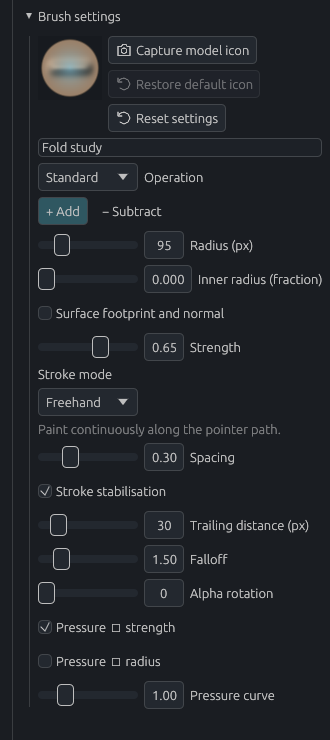
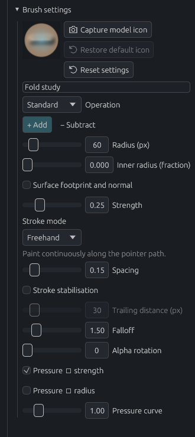
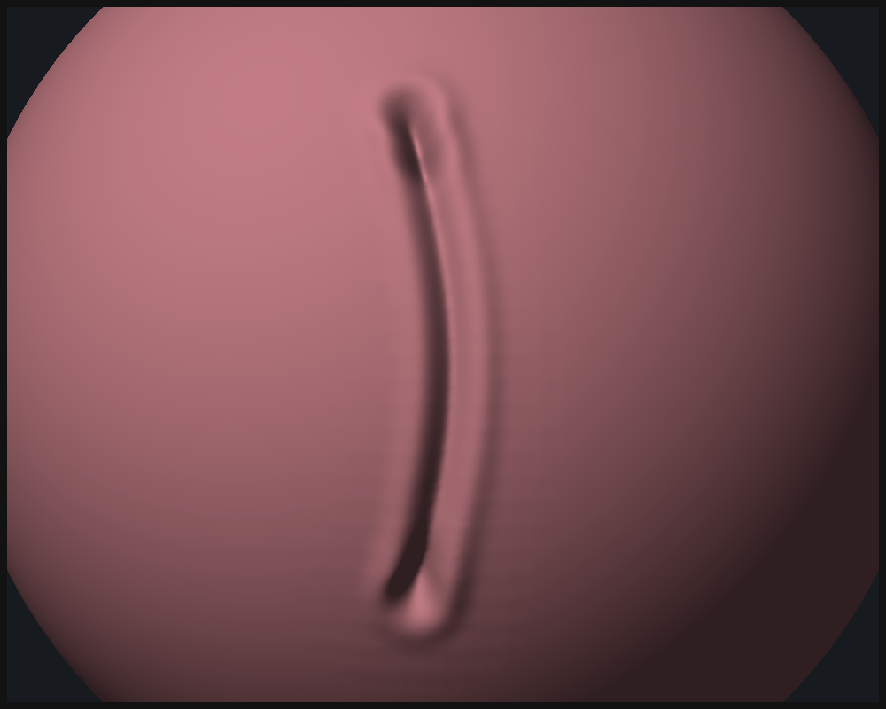
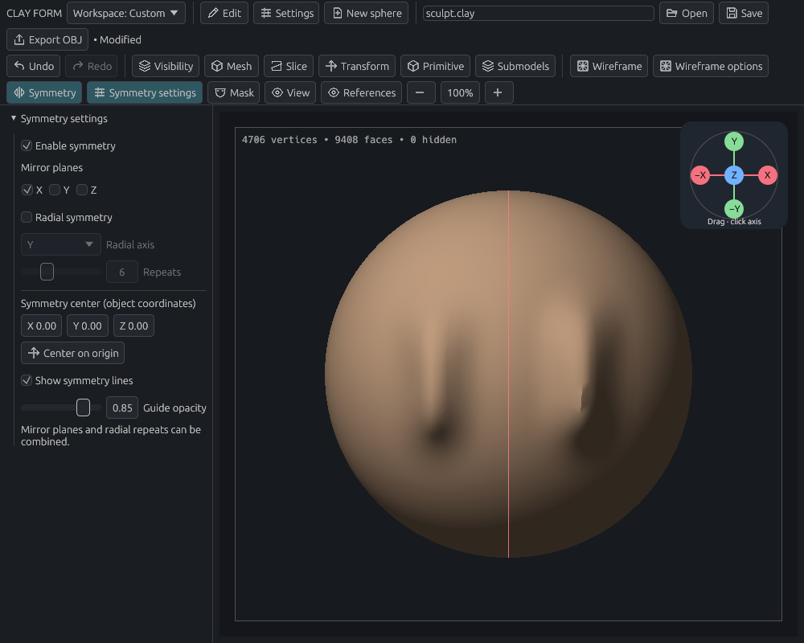
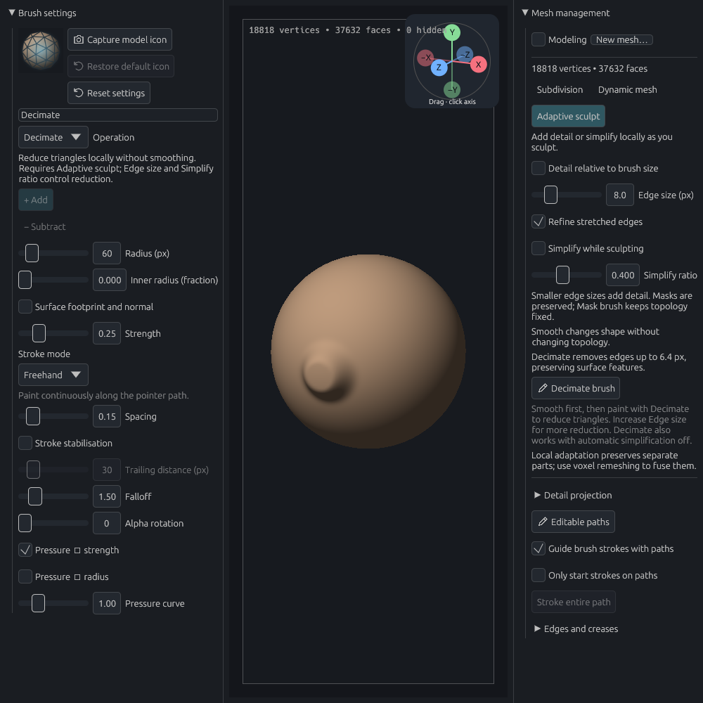

# Sculpting and brushes

[Documentation home](../../README.md#documentation) · New here? [Make your first sculpt](getting-started.md).

Build a rounded form, cut a fold, or pull out a horn: choose the brush for the shape you want, then tune it with a short trial stroke. **Ctrl+Z** lets you try again. Start here:

- [Choose and adjust a brush](#brushes-alphas-and-symmetry)
- [Reset a brush](#example-reset-an-experimental-brush)
- [Cut a fine fold](#detail-brush)
- [Choose a stroke mode](#stroke-modes)
- [Mirror a stroke](#symmetry)
- [Add local detail](#snake-brush-and-adaptive-sculpting)
- [Undo an edit](#undo-and-redo)

## Brushes, alphas, and symmetry

### Choose a brush

| Goal | Brushes to try |
| --- | --- |
| Build up or remove clay | Standard, Clay, Inflate |
| Even out a surface | Smooth, Flatten |
| Polish bumps into cleaner planes while holding sharp corners | Polish |
| Tighten a fold | Pinch, Crease, Detail |
| Move or pull a form | Grab, Snake |
| Protect part of a surface | Mask |

For broad, clean planes, try **Polish** with a large radius and light pressure. It flattens local bumps while holding sharp corners and marked creases. Masks, hidden surfaces, pressure, alphas, and symmetry still apply. Reversing Polish exaggerates relief, as with Flatten.

Select a tile in **Brush library**. Use **Add brush** if a brush is missing from an older project.

**Shift** temporarily uses your most recently selected Smooth preset, including its size and stroke settings. Release Shift to return to your previous brush. **Alt** reverses the operation by default; you can also choose **Add / Subtract** in Brush settings.

### Adjust the feel

Make one short stroke before changing several settings at once:

- Too strong? Lower **Strength** and build up with several passes.
- Too broad? Reduce **Radius**. Radius is measured on screen, so zoom changes how much of the model it covers.
- A dotted trail? Reduce **Spacing** for closer dabs.
- A shaky line? Try [Stroke stabilisation](#steady-a-freehand-stroke).

| Brush setting | Effect |
| --- | --- |
| Radius | Size of the affected area, in screen pixels |
| Inner radius | Full-strength core, as a fraction of the radius |
| Strength | Amount applied by each dab |
| Spacing | Distance between dabs in a continuous stroke |
| Falloff | How quickly influence fades toward the edge |
| Pressure strength / radius | Whether pen pressure controls strength or size |
| Pressure curve | Response to lighter and heavier pressure |
| Surface footprint and normal | Preview the alpha on the clay, with a tangent ring and normal indicator |

Grab follows pointer movement; spacing does not affect it. Subtracting Smooth sharpens, subtracting Flatten exaggerates relief, and subtracting Mask erases protection.

### Choose an alpha

An alpha shapes each dab. Choose **Soft**, **Hard**, or **Square**, or load a PNG/JPEG up to **2048 × 2048**.

White affects the surface; black protects it. Transparency reduces influence. Rotation turns the pattern, and inner radius gives Soft/image alphas a stronger core. Custom images are embedded in brushes and projects.

### Example: reset an experimental brush

1. Select **Standard**, choose **Duplicate brush**, and name it **Fold study**.
2. Change **Radius** to **95**, **Strength** to **0.65**, **Spacing** to **0.30**, and enable **Stroke stabilisation**.
3. Choose **Reset settings**. The operation's defaults return; your name and icon stay.

| Before reset | After reset |
| --- | --- |
|  |  |

*Reset affects the selected preset. While Shift is held, it affects the temporary Smooth preset.*

Resetting brush settings does not undo a sculpt stroke. Use **Undo** for geometry changes.

### Save presets and brush icons

In **Presets**, export/import a single brush or the whole library. Imports update brushes with matching IDs; **Duplicate brush** creates an independent variation. Importing an unchanged library does not modify the project.

Choose **Capture model icon** in Brush settings or the library to preview the active model as a thumbnail. Select **Use as brush icon**, optionally **Save PNG**, or cancel. **Restore default icon** brings back the built-in illustration. Icons are embedded in projects and exported presets.

## Detail brush

Detail cuts a narrow groove with raised shoulders. Use Subtract for a sharp ridge. It supports alpha, pressure, masking, and symmetry.

### Example: cut a fine fold

1. Start with a fresh sphere and select **Detail**.
2. Enable **Mesh → Adaptive sculpt**. Use default Detail settings, **Freehand**, and stabilisation off.
3. Draw one slow, slightly curved stroke down the front.
4. Zoom in to inspect the fold. Use **Ctrl+Z** to undo and **Ctrl+Shift+Z** to restore it.

*One stroke at 200% zoom. Pressure, speed, and radius change its depth and width.*

Use subdivision or adaptive sculpting if a fine crease looks faceted. Detail's adaptive refinement concentrates resolution around the groove and shoulders.

## Stroke modes

Choose **Brush settings → Stroke mode**. Each preset remembers its own mode.

| Mode | Gesture | Useful for |
| --- | --- | --- |
| Freehand | Drag a continuous stroke | Building and smoothing forms |
| Line | Drag a guide; release to apply spaced dabs | Straight creases or repeated marks |
| Drag Rect | Drag from an anchor to size and rotate one stamp | Placing a relief at a chosen scale |
| Drag Dot | Drag a fixed-size stamp into place | Repositioning a detail before release |

**Esc** cancels an unapplied line or stamp. Holding a drag stamp still does not deepen it; the preview is rebuilt from the original surface. Grab and Snake always use continuous Freehand movement.

### Steady a freehand stroke

Enable **Stroke stabilisation** and adjust **Trailing distance (px)**, from 1–200. The brush tip trails your pointer; a line shows the gap. Larger distances filter more hand movement.

The stroke ends at the trailing tip when you release. Stabilisation does not affect Grab, Snake, or the other stroke modes. Changes take effect on the next stroke.

### Stroke limits

Lines are limited to 257 dabs; drag stamps are limited to a 500-pixel radius. Relief stamps use four times one freehand dab's depth. Adaptive stamp refinement can reach its work limit at very fine detail settings.

Each completed stroke is one undo step. Switching tool or view cancels an unapplied preview; already applied dabs stay in history.

## Symmetry

To copy an existing half and replace the other, use [Mirror one side](modeling.md#mirror-one-side). The controls below repeat new brush strokes.

1. Enable **Symmetry** in the toolbar.
2. Open **Symmetry settings** and choose X, Y, or Z mirrors.
3. Draw on one side of the model. The stroke repeats across the selected planes.

*One input stroke produces two marks across the X mirror plane.*

Enable **Radial symmetry** for 2–16 repeats around an axis. Mirrors and radial repeats can be combined. Set the center in object coordinates or reset it to the origin.

Guides show X in red, Y in green, Z in blue, and other radial boundaries in gold. Adjust guide visibility/opacity in the same controls. Symmetry saves with the project; overlapping copies do not multiply stroke strength at the seam.

## Snake brush and adaptive sculpting

### Pull a tapered form

Select **Snake**, start on the clay, and drag outward. The tip continues to follow you after leaving the original surface. Use **Shift** to smooth the result. Enable adaptive sculpting for stretched forms that need more geometry.

### Add detail where you sculpt

Enable **Mesh → Adaptive sculpt**. It adds or removes local triangles as you brush, keeping separate parts separate and preserving masks.

*Edge size controls local density; smaller values add detail.*

| Setting | Use |
| --- | --- |
| Edge size | Target edge length in screen pixels |
| Detail relative to brush size | Interpret size as a percentage of brush radius |
| Refine | Split long edges near the brush |
| Simplify dense areas | Collapse short edges where safe |
| Simplify ratio | Threshold for collapsing edges relative to the target |

**Enabling adaptive sculpt discards stored subdivision levels.** Undo restores them. It requires a closed, consistently oriented surface; Mask strokes do not change topology.

With Simplify enabled, Smooth removes local excess density without adding vertices. Increase Edge size or Simplify ratio for more cleanup. The status bar reports removed vertices/faces; sharp features and masks can limit reduction.

Adaptive sculpting does not fuse overlapping parts. Use [voxel remeshing](modeling.md#mesh-management) for fusion.

## Undo and redo

Use **Edit → Undo / Redo** or **Ctrl+Z / Ctrl+Shift+Z**. Tooltips and the Edit menu name the next action and show available steps.

| Recorded in geometry history | Outside geometry history |
| --- | --- |
| Sculpt/mask strokes, transforms, cuts, topology edits | Brush settings, symmetry settings, camera navigation, workspace preferences |
| Completed parameter drags as one step | Reference-image placement and settings |

History holds up to **24 edits** within **128 MB**. New/Open clears it; it is not saved in projects. A new geometry edit clears redo. Cancelled or unchanged operations preserve it.

## Related guides

[Navigation](navigation.md) · [Masks and selection](selection.md) · [Mesh management](modeling.md#mesh-management) · [Files and presets](files.md)

