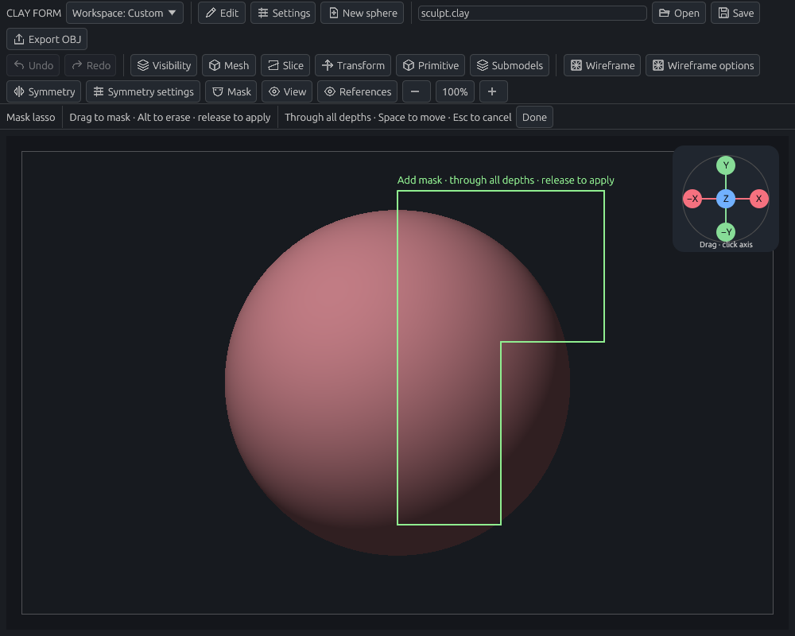
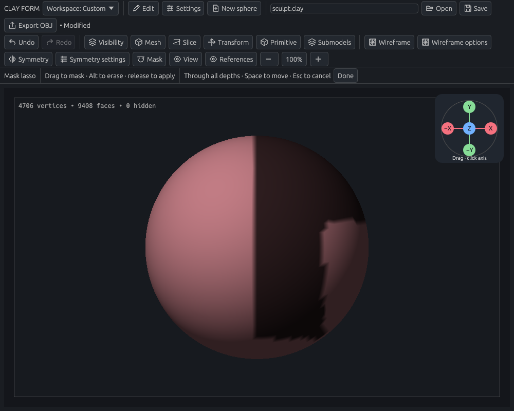

# Masks, vertex groups, and selection

[Documentation home](../../README.md#documentation)

**Mask** a region to protect it from brushes. **Hide** it to work without seeing or picking it. **Group** it to recall a selection later.

- [Protect a region with a lasso](#example-protect-a-region-with-a-lasso)
- [Protect one side through the model](#protect-one-side-through-the-model)
- [Edit a mask](#mask-operations)
- [Save a region as a group](#vertex-groups)
- [Hide or isolate faces](#selection-and-visibility)
- [Split off hidden faces](#split-hidden-faces)

## Hold to mask

1. Press **X** and choose **Mask** or **Visibility**. That tab determines what **Ctrl+Shift** does. The mode and each tab’s shape/operation are remembered between holds and restarts.
2. For Mask, choose **Surface brush**, **Through-depth lasso**, or **Through-depth line**, then **Add** or **Erase**. Line also offers **Flip side**. Visibility offers Rectangle, Lasso, Line and Closed path with Hide/Isolate.
3. Hold **Ctrl+Shift** over the model. All brush highlights clear while the hold is active, and brush names stay unchanged. Mask painting still uses the remembered Mask brush preset. The viewport shows the active mode and shape.
4. Paint or draw, release the pen to commit, then release Ctrl+Shift to restore the original brush highlight and sculpt or Modeling tool. **Alt** reverses the operation while held.

Change **Hold for selection (X menu)** in **Settings → Key settings** to rebind the shared hold. The optional **Dedicated mask hold** remains available for existing custom bindings.
The **Mask → Hold to mask** section exposes the same choices and a Mask brush preset selector. Surface brushing uses that preset’s pressure, strength, alpha, spacing and stroke settings independently of the ordinary sculpt brush. Surface brushing respects brush symmetry; all three shapes protect hidden geometry. Through-depth lasso and line do not repeat with brush symmetry. Lasso and line select through every depth on the active model; they also work when the gesture begins in empty space.

If you release the hold midway through a freehand stroke, already-painted mask dabs remain as one Undo step. Unfinished lasso, line and stamp previews are discarded. Escape or focus loss restores the prior tool; a still-down pen cannot leak into a new sculpt or Modeling gesture. Merely holding, changing the mask mode or opening/dismissing the menu makes no edit.

The shared selection hold follows the X menu and wins when it overlaps the optional dedicated mask hold. Masking takes priority over Smooth, Reverse, primary-drag zoom/pan and Modeling selection subtraction; hold **Alt** to temporarily reverse Add/Erase; releasing Alt restores the saved operation. Right-drag orbit, middle-drag pan and wheel zoom remain available between gestures. Other action shortcuts pause while masking. Key settings reports overlapping assignments; use different keys for the hold and menu invocation. The mode is unavailable during path editing, projection, Slice, transforms, reference arrangement, modal editors or on an unconverted primitive.

## Mask operations

### Example: protect a region with a lasso

1. Choose **Mask → Mask lasso**.
2. Drag an L-shaped outline over the sphere. The green outline closes back to the starting point.
3. Release to apply, then choose **Done**. The dark region is protected.
4. Try a Standard stroke across its boundary. Clay should change on the unmasked side while the dark area stays protected. Undo the trial stroke when finished.

If you protected the wrong side, choose **Invert mask**. To start over, use **Clear mask**; see the controls below.

| While drawing | After release |
| --- | --- |
|  |  |

*Mask lasso selects through the model, including its back. Hold Alt to erase masking inside the outline.*

### Protect one side through the model

1. Choose **Mask → Mask through → Line** (also available from **Slice → Mask through · Line**).
2. Choose **Add mask** or **Erase mask** in the tool strip. **Flip side** selects the opposite side of the line.
3. Press in empty viewport space above the model, draw a dividing line across it, and release below it. The tinted side and arrow show the affected half-plane; the line extends beyond both endpoints.
4. Orbit to inspect the back. The same projected side is masked at every depth, in both orthographic and perspective views.

During a drag, **Space** moves the whole line. **Escape** cancels without an edit; **Done** returns to normal sculpting. The existing navigation border and axis gizmo remain reserved for navigation. Away from those controls, an ordinary primary drag belongs to masking even when it starts off the model. Secondary-button orbit, middle-button pan, and your configured zoom/pan holds remain available between gestures. Configured zoom/pan holds take precedence when starting a primary drag, except **Alt**, which reverses Add/Erase.

Line masking changes only mask weights on the active model and all stored subdivision levels. It preserves other masks outside the affected side. Rear-facing surfaces are included; explicitly hidden faces and their boundary vertices stay protected. It never cuts geometry or resets levels. One completed gesture is one Undo step; empty or unchanged selections create no history entry.

**Mask through: Line** and **Flip mask line side** are available in custom menus and **Settings → Key settings**, with no assigned shortcut by default. Assign, remap, or clear them there. The tool strip displays the assigned flip shortcut; it can flip the preview while you hold the drag. Add/Erase and the side checkbox are also available before starting a gesture. **Mask lasso** remains alongside Line for freeform outlines.

### Adjust protection

Use the **Mask** menu:

| Control | Result |
| --- | --- |
| Clear mask | Remove all protection |
| Invert mask | Swap protected and editable regions, including soft values |
| Expand / Contract mask | Grow or shrink by one mesh-edge ring |
| Blur mask | Soften the boundary; repeat for a wider transition |
| Sharpen mask | Increase contrast around 50% |
| Mask intensity | Scale the soft mask's strength |
| Selection threshold | Minimum mask value for grouping, deletion, and extraction; default 50% |

Blur/sharpen affect every stored subdivision level, including hidden faces. They leave geometry and saved group weights unchanged. Each changed operation is undoable.

Setting intensity to zero clears the mask when the drag ends. Undo or recall a group to restore it. Zero-valued vertices remain excluded even at a zero selection threshold.

### Delete masked geometry

Choose **Delete masked** to remove faces whose vertices all meet the threshold. Other submodels stay intact.

**Deletion can leave open boundaries and resets the active subdivision stack and adaptive/voxel settings.** Undo restores the previous state. Deleting the entire surface leaves an empty model; undo, initialize a primitive, or create a new sphere.

## Vertex groups

### Save and recall a region

1. Paint or lasso a mask.
2. Open **Submodels → Vertex groups** and enter a name.
3. Choose **Group masked**.
4. Later, select that group and choose **Mask group** to recall it.

| Group action | Result |
| --- | --- |
| Group all | Replace the active model's groups with one whole-model group |
| Add masked / Remove masked | Move masked membership into the chosen group / remove it from that group |
| Rename / Delete | Manage a saved group |
| Eye icon | Hide/show complete faces assigned to the group |
| Flip visibility | Swap visible and hidden faces |

Blank names become Group 1, Group 2, and so on. New spheres start in a **Base** group. Group changes are undoable.

### Colors and saved weights

Use **View → Show vertex group colors** to check group boundaries, or turn it off to see the clay without group colors.

- Assigning a region to a group replaces its previous membership. Any unassigned remainder stays in its old group; empty groups are removed across stored subdivision levels.
- Neighboring face groups can share boundary vertices. Each face shows one color; a partial face selection can retain weights without coloring the whole face.
- Made the wrong assignment? **Undo** restores the previous groups.

Groups survive saving, duplication, subdivision, extraction, and deletion. Adaptive topology interpolates weights; voxel remeshing approximates boundaries. OBJ exports face groups; `.clay` preserves soft weights.

Thickness can generate front/back/rim groups and masks. These become editable after applying thickness.

## Selection and visibility

### Hide or isolate a region

Choose **Visibility → Select rectangle** or **Select lasso**. Draw the region and release; choose **Done** to return to sculpting.

| During a selection | Effect |
| --- | --- |
| Normal drag | Isolate enclosed faces; green preview |
| Hold Alt | Hide enclosed faces; red preview |
| Hold Space and drag | Move the outline |
| Esc | Cancel the current outline |
| Right drag between selections | Orbit |

Both tools select through all depths on the **active submodel only**. Visibility selects face centers and keeps quads whole. Masks select vertices. Neither repeats with brush symmetry or varies with pressure.

### Hide with a lasso

Use **Select lasso**, hold **Alt**, draw the outline, and release:

| Before release | Hidden region |
| --- | --- |
|  |  |

*Hiding changes visibility, not geometry. Use Show all to restore the view.*

### Line and editable closed path

Choose **Visibility → Hide/Isolate: Line** or **Hide/Isolate: Closed path**. In the tool strip, select **Hide** or **Isolate** and optionally **Flip side / region**. These choices are remembered independently of the sculpt brush. Hold **Alt** to temporarily reverse Hide/Isolate; releasing Alt restores the saved operation.

- **Line:** drag a dividing line, including from empty space. The line extends beyond its endpoints. Release to apply; Space moves the line while dragging.
- **Closed path:** click at least three points around a region. The last point connects visibly to the first. Drag a point to move it, click an edge to insert a point, or use **Delete point**. Up to 64 points are supported. **Apply visibility** commits; **Clear path** discards the outline.
- **Flip side / region:** switches the line half-plane or selects outside the closed region. Crossing paths use alternating inside/outside regions, like the lasso.

Red faces preview exactly the faces that will become hidden. **Isolate** hides currently visible faces outside the selected region; already-hidden faces stay hidden. The classifier uses projected polygon centers at each depth, including perspective projection. Whole quads stay together even when the dividing line crosses them. A center on the boundary belongs to the unflipped region. Hiding never cuts, caps, splits, or moves geometry.

The new shape, operation, flip, Apply, Clear, and Delete point actions are available in **Settings → Key settings** and custom controls. They start unbound; assign, remap, clear, or reset them there. The editor buttons also work without shortcuts.

### Temporary Hide/Isolate

Press **X**, choose **Visibility**, then choose Rectangle, Lasso, Line, or Closed path and Hide/Isolate. Hold **Ctrl+Shift** to use it. This is the same shared hold used for Mask; change it under **Hold for selection (X menu)** in Key settings. The chosen shape, operation, and flip state are remembered for the next hold and after restarting.

Release the hold to return to the prior sculpt or Modeling tool without losing its component selection. Keep the hold active until releasing a rectangle, lasso, or line, or applying a multi-click closed path. Releasing the hold first discards the unfinished gesture; it never commits an edit. Escape, focus loss, camera changes, and a change of model discard drafts without a geometry edit. Opening a menu never paints or applies visibility.

For the rectangle shape, the established click behavior remains available:

| Gesture | Result |
| --- | --- |
| Click a group's face | Hide that group; if it was the last visible group, flip visibility |
| Click background | Show all faces |
| Drag entirely in empty background | Invert visibility |

The navigation border, right-button orbit, middle-button pan, and wheel remain available. An unfinished view-space path is discarded when the camera changes.

### Restore visibility and avoid surprises

Use **Visibility → Show all / Invert visibility**. Hidden faces and their shared boundary vertices are protected from brush edits and excluded from picking and wireframe.

Visibility saves with the project and supports undo across stored subdivision levels. Remeshing pauses while faces are hidden; show all before remeshing or slicing.

An unfinished outline is cancelled by tool/view/model changes or loss of focus. Taps and line-only outlines do nothing. Concave lassos work; crossing outlines alternate inside/outside regions. Overlong outlines are cancelled with a message.

### Split hidden faces

Choose **Visibility → Split hidden** to move hidden faces into a new visible submodel. Both pieces stay in place with masks, groups, and quads intact.

You need both visible and hidden faces. Apply/remove thickness modifier first. Boundaries remain open, and both pieces get fresh subdivision stacks and adaptive/voxel settings. One Undo restores the original model.

## Related guides

[Model tools](modeling.md) · [Undo and redo](sculpting.md#undo-and-redo) · [Thickness modifier](modeling.md#thickness-modifier)

### Quick menus

**Q** always opens Modeling. **X** opens mask/visibility choices; the selected tab decides whether the shared Ctrl+Shift hold masks or changes visibility. **E** opens transform options for selected components in Modeling or the active object otherwise. All three bindings can be changed or cleared in Key settings.

X changes remembered choices without starting a gesture. Use the shared Ctrl+Shift hold to apply the selected tab’s choices. Surface brush, line and lasso masking support Add/Erase; visibility offers Rectangle, Lasso, Line and Closed path with Hide/Isolate. **Alt reverses the current operation**, including during a drag and when applying a closed path, without changing the shape, flipped side or saved preset. If Alt is itself part of a configured hold, it also reverses the operation; use a different hold to reserve Alt solely for reversal.
