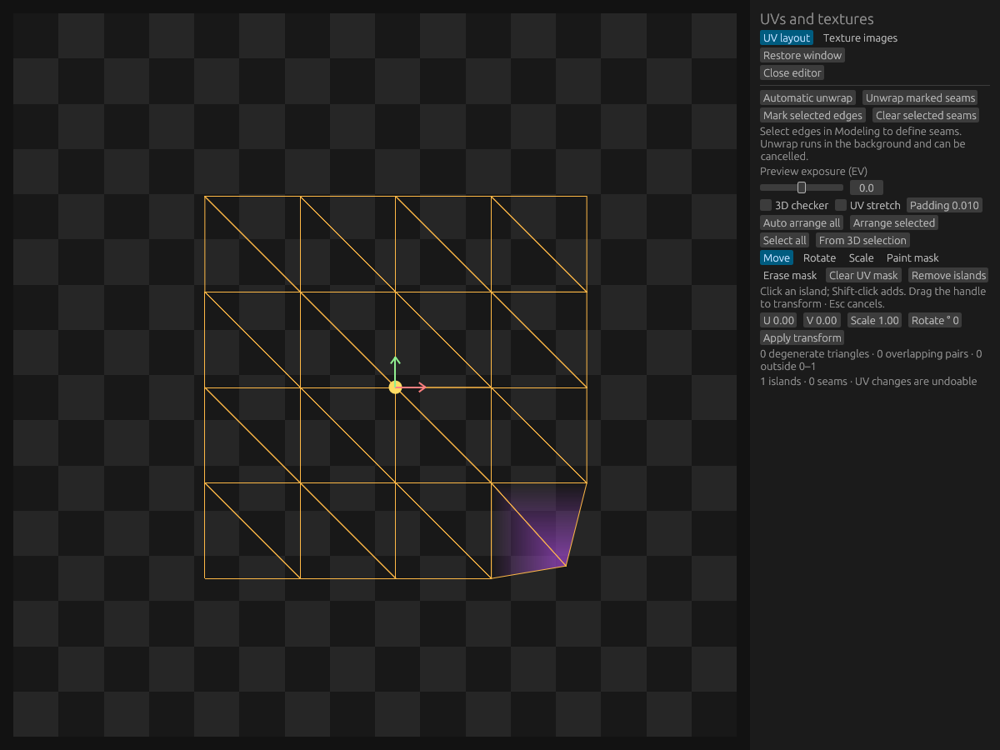
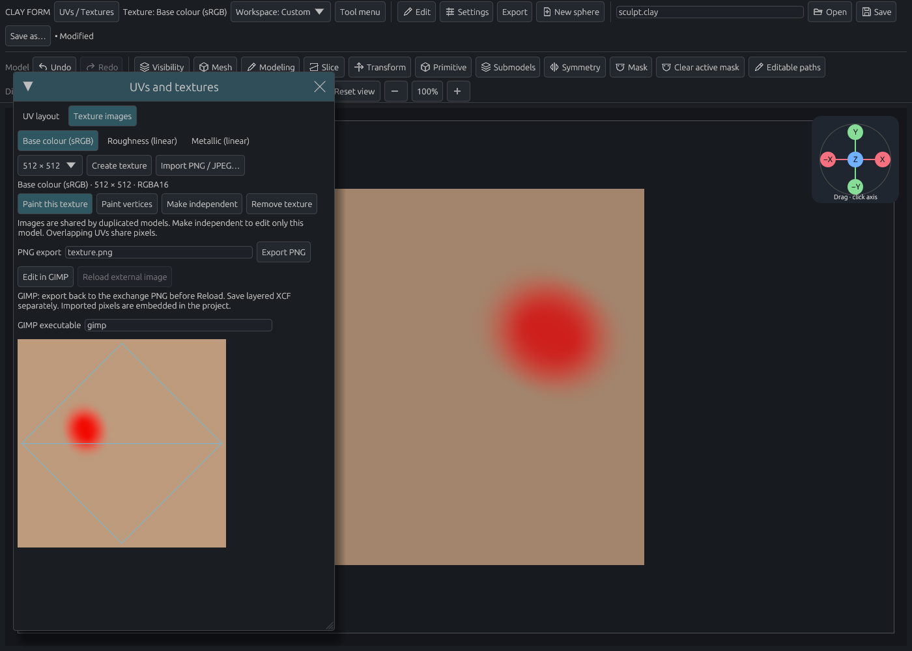

# UVs, texture painting and GIMP

[Documentation home](../../README.md#documentation) · [Vertex materials](materials.md)

Open **UVs / Textures** in the toolbar. Convert a parametric primitive to a sculpt mesh before editing UVs. The window has **UV layout** and **Texture images** tabs and scrolls in small windows. **Expand editor** opens a full-window UV workspace: the canvas uses the space on the left, and all controls sit in a scrollable sidebar on the right. The image keeps its square UV proportions and fits the available width and height. **Restore window** returns to the floating editor; **Close editor** returns to modeling. Switching tools or scrolling the sidebar does not shrink the canvas.

## Unwrap and edit UVs

**Automatic unwrap** cuts the surface into charts using its face directions, unfolds them and packs them into the image. It keeps sculpt vertices welded. For deliberate seams, select edges in Modeling, choose **Mark UV seams** in the Modeling toolset (or **Mark selected edges** in the UV editor), then **Unwrap marked seams**. **Clear UV seams** in Modeling removes seams from selected edges. Marked seams appear violet in wireframe. Modeling’s Select tool also offers **Paint away selection** with an adjustable brush radius. It removes visible selected faces, edges or points under the brush; Escape cancels the stroke. On a cylinder, mark both cap rims and one vertical side edge: the result has a side island and two cap islands. Closed charts need a seam; failed or cancelled unwraps keep the original surface and UVs. Cancel a running unwrap with the toolbar's mesh-operation Cancel control.

Turn on **3D checker** to judge the result on the model. **UV stretch** colours the 2D edges from green towards red as distortion increases. The editor reports degenerate triangles, overlapping triangle pairs and coordinates outside the image. On very dense layouts the overlap check reports when it reaches its work limit; this is not a guarantee of no overlaps.

Click an island to select it in 2D and 3D; Shift-click adds islands. **From 3D selection** selects the islands containing the selected Modeling faces. Choose **Move**, **Rotate**, or **Scale** and drag the centre handle, rotation ring, or square scale handle on the selected islands. The UV view previews the drag; release applies one Undo step and updates the 3D view. Escape cancels. For precise values, enter U/V movement, rotation in degrees or a positive scale, then **Apply transform**. **Auto arrange all** straightens angled islands and packs them into 0–1 using the chosen padding, expressed as a fraction of image width. **Arrange selected** does the same for selected islands while leaving other islands exactly where they are and fitting around them. Arrangement tries tighter island bounds, quarter-turn rotations and two packing orders, then applies one uniform scale to the movable islands to preserve their relative texel density. Masked islands stay fixed in either mode. This is a rectangle-based packing heuristic, so irregular island shapes can still leave unused space. UV operations support Undo/Redo. Packing or moving UVs also moves where existing image pixels appear; it does not repaint or reproject the image.

**Paint mask** brushes protection onto UV points; **Erase mask** removes it and Alt reverses either brush. Purple shows the protected area. The inner brush radius fully pins points; the outer falloff reduces their movement. Masks are stored per UV corner, so a coarse mesh offers fewer points to paint. Fully masked points stay fixed during transforms; packing keeps an entire island fixed if any of its points are masked, placing other islands around it. **Clear UV mask** removes the protection. Unwrapping asks you to clear masks first so it cannot silently move pinned points.

**Remove islands** removes the selected UV mappings while retaining the 3D mesh and images. Unmapped faces display their vertex material and do not paint into the texture. Masked islands must be unmasked first. Undo restores removed mappings, or unwrap again to generate a fresh layout. Masks and removed mappings are saved in `.clay` projects.

Position-only sculpting and transforms retain UVs. Extraction/deletion preserve retained face corners. Topology edits that cannot transfer UVs leave the old mapping inactive; Undo restores it, or unwrap the new surface. Subdivision levels can have different mappings: finish topology and choose the level you intend to paint before unwrapping. Do not enable adaptive topology or remesh after texturing unless you intend to unwrap again. Old seam indices are discarded when unwrapping changed topology.

OBJ import/export retains face-corner UVs without splitting sculpt vertices. Consistent quads stay quads on export. Faces with missing UV corners are treated as unmapped and stay unmapped when exported. UV masks are a native `.clay` feature; OBJ carries mapping and seams through its face corners. OBJ does not import material libraries or image assignments. Save the editable project as `.clay` and export images separately as PNG or EXR.

## Paint an image

In **Texture images**, choose **Base colour**, **Roughness** or **Metallic**. Choose a resolution from 256 to **4096 × 4096 (4K)** and **16-bit integer / PNG** or **32-bit float / EXR** precision. Create an image using the current brush material as its initial value, or import PNG/JPEG/EXR. Click **Paint this texture**, select a colour/material in the Paint brush settings, and paint on the model. The toolbar displays the active texture channel. **Paint vertices** returns to vertex painting.

Texture channels replace the corresponding surface property across the active model's material layers. Image detail is independent of vertex density. Pressure, strength, masks, hidden faces, alpha, stencil and symmetry affect strokes. Projection checks visible mesh surfaces for occlusion, including nearby thin sheets and other submodels. Overlapping UV islands deliberately share pixels; a change appears everywhere those coordinates are used. Coordinates must fit inside 0–1 for painting; tiled/UDIM painting is not supported.

Subtract/reverse erases image coverage, revealing the underlying material. Transparent pixels retain straight alpha, and the renderer filters premultiplied colours to avoid dark fringes. Stroke completion extends edge pixels four pixels into unused UV gutters. Choose enough atlas padding for the image resolution. Release records one Undo step; Escape cancels. The existing **Fill all** and **Fill unmasked vertices** controls continue to operate on vertex materials.

The 2D view shows a bounded preview of the image beneath its UV edges. **Preview exposure (EV)** adjusts the view for HDR inspection while the editor is open; it does not change saved or exported pixels. Integer images use RGBA16 storage. Base colour is interpreted as sRGB; roughness and metallic are linear data and bypass colour-profile conversion. Embedded RGB ICC profiles are converted to sRGB internally and retained for conversion back during colour PNG export. Data-map exports preserve numeric values and omit colour profiles. Alpha controls texture coverage, not mesh transparency.

Float images use RGBA32 storage. RGB colour EXRs use linear Rec.709/sRGB primaries, preserve finite negative and above-one values, and use premultiplied colour alpha on disk. Data EXRs bypass colour conversion; RGB(A) uses the same associated-alpha convention, which is undone on import to recover the original data values. Import accepts single-layer non-deep RGB/RGBA EXRs with half- or full-float samples and retains them as 32-bit float; export writes 32-bit float EXR. Extra AOVs, deep/multilayer files, and colour files declaring other primaries require conversion before import. EXR without chromaticities assumes Rec.709. ICC profiles belong to the PNG workflow. Exporting a float image to PNG is refused rather than silently clipping its range. Alpha remains coverage inside 0–1; additive transparent-emission rendering is not supported.

Images are limited to 4096 × 4096, with three 4K images or an equivalent mix of smaller images per project. A 4K RGBA16 image occupies 128 MiB, and RGBA32 float occupies 256 MiB before compression. Native pixels use lossless compression; project files are capped at 2 GiB. History defaults to a 1024 MiB ceiling, with shared pixel allocations counted once. Existing saved retention preferences remain in effect; if the scene cannot fit one Undo snapshot, **Paint this texture** asks you to increase the budget through diagnostic settings. This ceiling does not preallocate memory. Large image edits retain fewer Undo steps. Duplicated models share their texture identity; editing or reloading updates linked uses. **Make independent** gives the active model a separate image. Texture pixels are embedded in `.clay`, so moving the project does not depend on an exchange directory. New saves use project version 3; versions 1 and 2 remain readable.

## Edit in GIMP

Select a texture, then **Edit in GIMP**. If GIMP is not on PATH, enter the executable path in the same panel. The image opens as a 16-bit PNG or a 32-bit float EXR according to its precision, in a unique exchange location shown in the panel. This setting is saved with your preferences.

Edit the image in GIMP and **export back to that PNG or EXR**. Save a layered working document separately as XCF; Clay Form consumes the flattened exchange image. Return to Clay Form and choose **Reload external image**. The image retains its identity and channel, updates linked uses, and can be undone. Resolution changes are accepted within the image budget.

If you painted locally after sending the image out, Reload asks whether to keep local paint or replace it explicitly. A missing, moved, incomplete or unsupported image leaves the last valid texture intact. Import a replacement file through **Import PNG / JPEG / EXR…** if the exchange file moved. Sending to GIMP again creates a new exchange file without overwriting the previous external work. The temporary exchange file is not your durable XCF working copy; save that in your own project folder.

GIMP 3.2 EXR exchange has a dedicated alpha adaptation: its native loader reads straight RGB, while its GEGL exporter writes associated RGB. **Edit in GIMP** therefore sends straight RGB and Reload reads the standard associated result. Ordinary **Export image** writes standard associated EXR. The reproducible GIMP fixture checks negative/HDR values and nonopaque alpha across this path.
