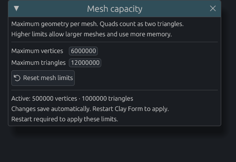
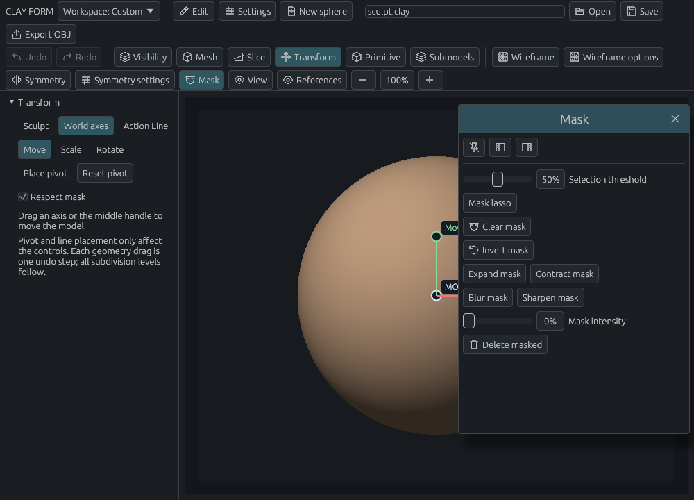

# Workspace and shortcuts

[Documentation home](../../README.md#documentation)

Keep the controls you reach for visible and give the rest of the screen to your sculpt. Start by pinning one menu; build a custom shelf when you know which tools you use most.

- [Pin or dock a menu](#key-settings-and-workspace)
- [Create a custom shelf](#create-a-custom-menu-or-shelf)
- [Save a workspace](#save-and-switch-workspaces)
- [Change mesh capacity](#change-mesh-capacity)
- [Change shortcuts](#shortcuts)
- [Find default keys](#default-shortcuts)

## Finding controls

The toolbar separates project actions from **Model** tools and **Display** controls.
Clear active mask and Editable paths are available directly in the Model row; Reset view
is in Display. Show wireframe toggles the overlay, while Wire settings opens its
options. Symmetry has one menu with its enabled state and settings together.

Checkbox settings use larger indicators and 32-pixel click targets. In vertical
panels you can click anywhere in the checkbox row, including beside its label.
Menus scroll when their contents exceed the available window height.

Built-in menus share the same controls whether opened from the toolbar, floated,
or docked in a sidebar. The **Panel** strip offers pin, dock left and dock right
controls in each location. Hover an icon for its name. Existing saved workspace
placements and shortcuts continue to apply.

### Tool controls

The default **Tool controls** custom menu opens at the top of the left sidebar. It contains the selected material preview, editable **Primary** and **Secondary** colours, and **Swap colours** (**Z**), followed by the active brush icon, draggable **Size** (radius in pixels), **Inner radius** (percent of
the outer radius), and **Strength** (percent),
**Surface footprint and normal**, **Stroke mode**, and **Stroke stabilisation**
with its trailing distance. You can move it to a top shelf, where it wraps to fit narrower windows.

Press **S** to open the same menu near the pointer. Drag a size or strength value
left/right, or double-click it to type. Adjusting **Size** or **Inner radius** keeps
the brush outline visible at its last viewport position (or the model centre if you
have not hovered it yet), with both the outer and inner boundaries updating live.
Adjustments keep the popup open; press
**S** again, **Escape**, or click outside to dismiss it. Brush settings follow the active
brush; material and colour controls use the Paint input preset selected in Materials or Colours. Unsupported stroke options are disabled.

This is an ordinary custom menu: right-click its header or an item to edit it,
or use **Settings → Customize workspace** to rename, reorder, remove, or move its
controls. The menu remains visible with the compact toolbar. Existing preferences
gain the appearance controls once. The stock Brush controls name becomes Tool controls; custom names, placements, collapsed state and the S shortcut are preserved. Later customisations are respected. An existing custom **S**
binding is retained rather than overwritten.

## Change mesh capacity

Raise the mesh budget before importing or building a model that exceeds the default limits.

1. Open **Settings → Mesh capacity**.
2. Drag **Maximum vertices** and **Maximum triangles**, or click a number to type an exact value.
3. Save your project, close Clay Form, and start it again. The settings save automatically.
4. Reopen **Mesh capacity** and check the **Active** values before continuing.

| Limit per mesh | Default | Largest allowed setting |
| --- | ---: | ---: |
| Vertices | 500,000 | 16,000,000 |
| Triangles | 1,000,000 | 32,000,000 |

Quads count as two triangles. Both limits apply independently, so raise both when increasing mesh density. **Reset mesh limits** restores the defaults for the next restart. Lowering a limit does not simplify a model; raise it again if an existing project exceeds the active budget.

The **Active** line shows this session's budget. The edited values in this example take effect after restarting.

Higher limits allow more geometry; they do not reserve RAM or guarantee smooth editing at that size. File-size, texture, subdivision-level and operation work limits still apply. These are application preferences, independent of saved workspace layouts.

## Key settings and workspace

### Pin a menu open

1. Open a menu, such as **Mask**.
2. Click its pushpin icon, **Pin menu open**.
3. Drag the floating window's title bar to place it.

The crossed-pin icon returns it to a drop-down. Closing a built-in window also returns it to the toolbar; closing a custom window hides it.

### Dock a menu in a sidebar

Click **Make collapsible on left/right** in an open or pinned menu. Click the resulting section header to collapse or expand it.

Right-click a header to move it up/down, switch sides, or return the menu to the toolbar. Drag the sidebar edge to resize it. Placement and expanded state save automatically.

### Example: keep frequently used controls open

1. Dock **Transform** on the left.
2. Pin **Mask** and move it to the upper right.
3. Collapse Transform when you need more room; expand it to resume adjusting the model.

*Docking keeps controls at the edge; pinning makes a movable window. Several menus can stay open together.*

## Create a custom menu or shelf

1. Right-click an action or brush tile and choose **Add to custom menu / shelf…**.
2. Create a menu, name it, and add actions from the searchable catalog.
3. Choose a location in **Settings → Customize workspace**.

| Location | Best for |
| --- | --- |
| Left/right sidebar | Collapsible groups of controls |
| Top/bottom/left/right shelf | Frequently used buttons |
| Menu bar | Commands used occasionally |
| Floating | A movable tool group |
| Hidden | Keeping a menu for later |

Right-click an empty sidebar area and choose **New collapsible menu here…** to start directly in that sidebar.

### Edit the contents

Rename buttons, add separators, and reorder with the `::` grip or **Up / Down**. Set the shelf's column count; narrow shelves wrap automatically. **Remove item from this menu** removes the copy, not the underlying command.

Actions use the current model or brush and retain normal undo/availability rules. A brush button is disabled if its brush is missing. Dialog decisions and per-object numeric editors remain in their original panels.

## Save and switch workspaces

Open **Settings → Customize workspace**.

| Control | Use |
| --- | --- |
| Built-in panels and toolbar | Move, hide, or reorder tool panels |
| Compact toolbar | Leave more room for custom shelves |
| Save as workspace | Name the current arrangement |
| Workspace selector in the toolbar | Switch saved arrangements |
| Workspace colours and style | Choose Dark/Light/Warm or customize colors, spacing, and rounding |
| Manage saved workspaces | Delete arrangements or start from defaults |

Create a named workspace once, then arrange panels as you work: later layout and style edits save automatically. Try a compact sculpting layout and a second layout with modeling controls open. Starting from defaults preserves your saved workspaces.

Keyboard bindings are shared across workspaces, so switching layouts keeps your shortcuts.

### Where preferences are stored

Preferences save separately from projects, after a short delay and on exit:

- `$XDG_CONFIG_HOME/clay-form/preferences.json`, if set.
- Otherwise `~/.config/clay-form/preferences.json`.

Invalid preferences fall back to defaults with a status message. Key and layout reset controls are independent.

## Shortcuts

1. Open **Settings → Key settings**, or right-click a button and choose **Assign shortcut…**.
2. Select a binding and press its replacement. Press **Escape** to cancel.
3. Clear a binding if you want to leave that action unassigned.

Conflicting shortcuts are rejected. Shortcuts pause during text entry and settings editing. Smooth, reverse, pan, and zoom hold modifiers can also be changed.

### Use number keys for favorites

**1–0** and **Shift+1–0** give 20 initially unbound combinations. For example, bind `1` to Detail, `Shift+1` to Invert mask, and `0` to **Open [your menu]**.

Shifted numbers use the physical number-row key, so `!` can bind as Shift+1. Other keys follow your keyboard layout.

**Toggle perspective view**, **Reset brush settings**, **Rotate**, and pivot actions are available without default keys. New actions that conflict with your existing bindings start unbound.

### Default shortcuts

| Action | Key |
| --- | --- |
| Save / Open / New sphere | Ctrl+S / Ctrl+O / Ctrl+N |
| Undo / Redo | Ctrl+Z / Ctrl+Shift+Z |
| Reset view | F |
| Toggle symmetry / guides | Shift+X / G |
| Toggle wireframe | W |
| Modeling quick menu | Q |
| Mask / visibility quick menu | X |
| Transform quick menu | E |
| Universal transform / return to sculpting | T |
| Smaller / larger brush | [ / ] |
| Tool controls popup | S |
| Swap Primary / Secondary colours | Z |
| Previous / next brush | , / . |
| Subdivide | Ctrl+D |
| Lower / higher subdivision level | Shift+D / D |
| Remesh in dynamic mode | Ctrl+R |

The mask/visibility menu now defaults to X; its previous stock W binding upgrades to X and stock symmetry moves to Shift+X. Wireframe returns to W when that key is free. Custom assignments and explicit unbindings are preserved. If a custom action already uses X, E or T, a newly introduced action for that key starts unbound; an existing menu binding is kept. All bindings can be changed in Key settings.

## Toolbar and brush previews

The toolbar wraps as the window narrows. Brush tiles show the selected brush with a teal outline; hover for its full name. Restore hidden panels in **Customize workspace**.

## Related guides

[Navigation](navigation.md) · [Brush settings](sculpting.md) · [Recovery saves](files.md#recovery-saves)
