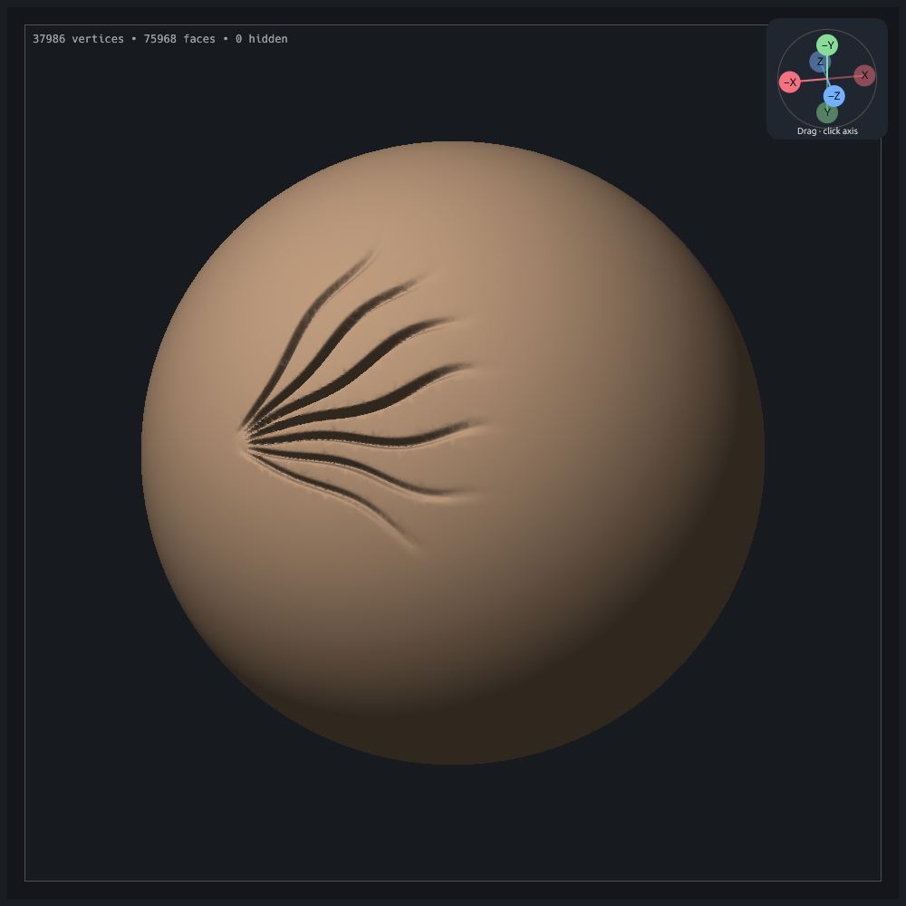
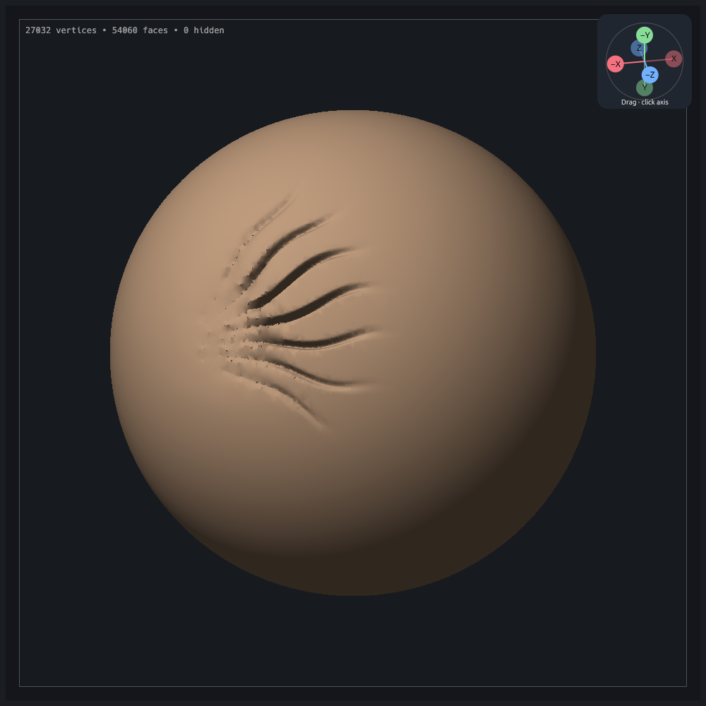

# Adaptive sculpt: smoothing, quality and speed review

Research and local inspection, 23 October 2026. Code reviewed at `8dcce67` (#40); diagnostic input: `clay-session-smoothing`.

This describes the original implementation. The subsequent Smooth/Decimate changes, the failed normal-only implementation, and its correction against `clay-session-smoothing-no-work` are recorded in the [implementation validation](../validation/adaptive-sculpt-2026-10-23/README.md).

**Recommendation:** separate surface smoothing from aggressive simplification, then make topology maintenance respect surface error and local sampling density. Optimize repeated whole-mesh work after establishing a visual regression. Keep the successful alpha stamp preparation from #40.

This is a research review, not an implemented fix. The evidence identifies several credible mechanisms; the export does not contain enough input data to attribute every artifact to an individual operation.

## What the export establishes

The bundle records `c076a1f1c08a-dirty (release)`, not an exact #40 commit. It predates the clean #40 commit and may contain its working changes; the dirty build cannot be reconstructed from its identifier. Do not describe this as a confirmed regression introduced by #40. Stage 003 follows two alpha stamps; stages 004–015 follow twelve Smooth strokes. Adaptive settings are 8 px detail, refine and simplify enabled, collapse ratio 0.4. Smooth uses strength 0.25 and a 60 px radius.

| Measurement | Before smoothing, stage 003 | After smoothing, stage 015 |
| --- | ---: | ---: |
| Vertices | 37,986 | 27,032 |
| Triangles | 75,968 | 54,060 |
| Triangle quality below 0.2 | 839 | 146 |
| First percentile triangle quality | 0.1952 | 0.2581 |
| Minimum triangle angle | 2.335° | 1.406° |
| Edges with other than two incident faces | 0 | 0 |
| Adjacent face pairs differing by more than 90° | 536 | 696 |
| Signed enclosed volume | 4.192528 | 4.189612 |

Smoothing removes 28.84% of the vertices and improves much of the triangle-quality distribution, but the worst angle deteriorates. Strongly opposed adjacent normals become more numerous despite fewer faces. These counts flag folds or sharp features for inspection; they do not by themselves prove new self-intersections. Overall volume changes by only −0.070%, so global shrinkage is a weak explanation for the conspicuous local damage.

All sixteen stages have two faces per edge and no triangles below the analysis's `1e-15` double-area threshold. These checks do not establish vertex-manifoldness, absence of intersections, or visual quality. Triangle quality is `4√3 A / (a²+b²+c²)`, where an equilateral triangle has quality 1. Calculations use the exported coordinates in double precision. Full stage measurements are in [the CSV](../validation/adaptive-sculpt-2026-10-23/mesh-metrics.csv).

The following captures use the actual current renderer, software Vulkan, and the same camera from the manifest. The project review harness restores the camera, not every recorded viewport setting; these are solid views, although the export recorded wireframe enabled.

| Before smoothing | After smoothing |
| --- | --- |
|  |  |

The after image shows irregular ridges and dents around the converging roots, while some grooves remain steep. The before image already has sharp relief and small irregularities. This is visual evidence of the reported outcome, not a controlled replay. Pointer positions, complete pressure samples, timestamps and intermediate dabs are unavailable.

## Findings in the implementation

**1. Smooth is also an aggressive decimator.** In [adaptive.rs](../../src/sculpt/adaptive.rs), `collapse_fraction` doubles the ratio for Smooth, making the default cutoff 0.8 of the detail target (6.4 px at this setting). `adapt_stenciled` allows up to 256 collapses per input frame for Smooth, versus 32 for ordinary deformation, and disables splits when Smooth and simplify are enabled. Collapses run before smoothing in [document/stroke.rs](../../src/document/stroke.rs). The user therefore smooths a neighborhood whose connectivity and sampling are simultaneously changing.

Collapse positions are edge midpoints. Link, visibility, mask, group, triangle-quality and normal checks are valuable protections, but there is no measured surface-approximation error limit. Short edges can still encode important relief. The code does not taper the amount of topology work continuously with positive brush strength or pressure: those primarily gate eligibility, while deformation scales with them. A light touch can consequently simplify disproportionately to its smoothing effect. This is a code-supported risk, not a pressure diagnosis for this export, whose recorded first-dab pressure is 1.

**2. Smooth depends on tessellation.** [mesh.rs](../../src/sculpt/mesh.rs), `stamp_many_stenciled`, computes a neighbor-position average and moves toward it. On a closed manifold, the twice-counted neighbors reduce to the uniform umbrella Laplacian. There is no area/length normalization or physical smoothing scale. Small triangles and large triangles therefore receive different effective spatial smoothing, and an asymmetric neighborhood can cause sideways vertex drift. The export contains large density differences around the relief.

**3. Topology quality and surface quality are only partially coupled.** Flips improve a triangle-shape score but do not explicitly optimize valence or bound surface deviation. Tangential redistribution exists for Snake and Detail, but not Smooth. The Smooth collapse quality floor cannot prevent later smoothing from producing much thinner triangles: the shared deformation guard permits qualities far below that collapse floor. These protections prevent some failures without guaranteeing an evenly sampled, visually smooth result.

**4. Steep relief may be hard to smooth uniformly.** Brush deformation rejects vertices whose normal has a dot product below 0.1 with the dab normal. Adaptive face selection has a similar face-normal test. The deformation limiter can further reduce motion locally. Instrument these rejection paths before altering them; steep walls or folds may stay pinned while nearby surface moves. Separately, [shading.rs](../../src/sculpt/shading.rs) splits normal fans at 60°, potentially making geometric irregularities more visible. Changing shading alone would not repair the geometry.

**5. Local edits still perform global work.** Split/collapse/flip selection scans all faces; adjacency is reconstructed; collapse compacts the entire vertex and triangle arrays; each brush pass clones positions and computes full normals. [Renderer geometry caching](../../src/viewport/gpu.rs) rebuilds display geometry on a changed display revision, including [normal-fan construction](../../src/viewport/gpu/display.rs). Operation-count budgets bound accepted edits, not the time spent scanning or rejecting candidates. These are optimization opportunities identified from code, not measured bottleneck rankings.

## Research and its relevance

| Primary source | What to take from it | Application and limits here |
| --- | --- | --- |
| [Desbrun et al., *Implicit Fairing of Irregular Meshes using Diffusion and Curvature Flow*, 1999](https://www.cs.jhu.edu/~misha/Fall09/Desbrun99.pdf) | Geometry-aware operators address distortions from irregular sampling; implicit integration supports larger stable steps. | Benchmark a geometry-aware Smooth against the current umbrella operator. A local implicit solve is an option for strong smoothing, with frozen boundaries and solver cost measured. |
| [Dunyach et al., *Adaptive Remeshing for Real-Time Mesh Deformation*, 2013](https://cg.cs.tu-dortmund.de/publications/2013-remeshing.pdf) | Curvature/error-based sizing combined with split, collapse, flip and tangential redistribution. | Best overall match. Smooth the sizing field and constrain density transitions. Preserve #40's alpha sampling: curvature of the old surface cannot anticipate an incoming image stamp. |
| [Botsch and Kobbelt, *A Remeshing Approach to Multiresolution Modeling*, 2004](https://cg.cs.tu-dortmund.de/publications/2004-remeshing.pdf) | Regularize edge lengths, connectivity and vertex distribution together. | Inform a complete maintenance pass. Its smooth base-surface setting is not proof that unconstrained relaxation preserves sharp alpha relief. |
| [Garland and Heckbert, *Surface Simplification Using Quadric Error Metrics*, 1997](https://www.mgarland.org/research/quadrics.html) | Rank contractions by an inexpensive approximation of surface error. | Candidate cost and placement for collapse; retain manifold/protection checks and add sampled error checks where needed. QEM alone is not a strict distance bound. |
| [Taubin, *A Signal Processing Approach to Fair Surface Design*, 1995](https://www.cs.jhu.edu/~misha/ReadingSeminar/Papers/Taubin95.pdf) | Alternating filtering steps reduce shrinkage. | Useful comparison for volume retention, but not a complete remedy for uneven sampling, unsafe coarsening or steep-wall eligibility. |
| [Fleishman et al., *Bilateral Mesh Denoising*, 2003](https://evasion.imag.fr/Membres/Franck.Hetroy/Teaching/Geo3D/Articles/fleishman2003.pdf) | Normal-direction filtering can remove noise while retaining features. | Consider a separate detail-preserving smoothing option. Ordinary Smooth must still be able to erase an intentional ridge. |
| [Sharp and Crane, *A Laplacian for Nonmanifold Triangle Meshes*, 2020](https://www.cs.cmu.edu/~kmcrane/Projects/NonmanifoldLaplace/index.html) | Robust nonnegative Laplacian weights on poor meshes via intrinsic triangulation. | Warns against blindly replacing uniform weights with raw cotangents on slivers. Evaluate robust weights; a full tufted-cover implementation is a larger investment. |
| [CGAL isotropic remeshing documentation](https://doc.cgal.org/6.2/PMP_Remeshing/index.html) | Production reference for patch remeshing, sizing fields, protected features and reprojection. | Useful implementation checklist; no recommendation to add a C++ dependency. |
| [Stanculescu et al., *Freestyle: Sculpting Meshes with Self-Adaptive Topology*, 2011](https://liris.cnrs.fr/Documents/Liris-5391.pdf) | Dynamic sculpting also encompasses collision handling and changes of surface genus. | Relevant longer-term scope. Edge split/collapse safety alone does not provide those guarantees; a topology-changing rewrite is not the first smoothing fix. Only the indexed abstract was accessible during this review. |

## Recommended implementation order

1. **Establish a controlled visual regression.** Start from exported stage 003, add a deterministic path across the damaged roots and run the identical dabs through: current behavior; frozen topology; collapse disabled with quality maintenance; and a geometry-aware smoother. Disabling only “Simplify dense areas” is not a frozen-topology comparison: it re-enables Smooth refinement. Record which faces are blocked by eligibility and deformation guards. Include a synthetic unevenly tessellated plane and sphere to isolate density-induced drift.
2. **Give Smooth independent shape control.** Prototype area/geometry-aware smoothing with brush-distance or elapsed-input normalization. Keep safe simultaneous updates and local constraints. Compare explicit bounded steps with a local implicit solve before selecting the operator. Default smoothing should not require removing vertices; expose intentional decimation separately or make it conservatively error-limited. Existing tests explicitly require density reduction and no splits, so changing this behavior also requires revising that contract and its UI text.
3. **Make remeshing preserve the edited surface.** Use a graded local sizing field, conservative collapse error and placement, valence/shape-aware flips, and bounded tangential redistribution. Apply projection against a frozen reference of the *just-smoothed* local patch so maintenance preserves the user's new shape. Projecting against the stroke-start surface would undo intended smoothing. Restrict correspondence to the same local surface sheet so nearby grooves cannot attract the wrong vertices. Allow sparse repair splits when necessary; a monotonic vertex-count rule is not a sufficient quality objective.
4. **Make per-dab cost depend on the affected patch.** Add cached vertex/face adjacency and spatial patch queries with a safety halo; reuse scratch buffers. Introduce stable runtime indices or delayed compaction so local collapses do not rewrite the entire mesh every pass. Update dirty normals and display buffers incrementally, while preserving the shared display/picking snapshot. Add time budgets alongside operation budgets, with deterministic operation limits for regression tests. These changes are likely more broadly useful than parallelizing today's full scans, but require profiling to establish benefit.
5. **Retain and extend #40's successful stamp path.** Keep pre-deformation alpha-error sampling, steep directional relief guards and cancellable previews. Apply the same error-awareness to maintenance of existing detail. Treat Taubin or bilateral filtering as measured options, not a replacement for sound topology maintenance.

For sizing, use separated split/collapse thresholds to avoid churn. The remeshing literature's `4/3 L` split and `4/5 L` collapse thresholds refer to a particular target-length definition; do not copy them directly onto Clay Form's current “split above target” UI semantics. Start with an explicit geometric error budget and validate screen-space appearance at several zoom levels.

## Acceptance and performance measurements

Quality acceptance needs same-camera solid and wire views, closeups of the roots, a second oblique view and the existing alpha-stamp visual regression. Measure local surface deviation after maintenance, angle/quality distributions, normal discontinuities, intended relief attenuation, volume drift, masks, hidden faces, groups, symmetry and undo. Include thin nearby sheets and check self-intersections separately from edge incidence. No quality threshold alone establishes an artifact fix.

Profile release builds with CPU and GPU work separated: patch query, topology selection/mutation, smoothing, constraints, normal rebuild, display preparation, upload and frame latency. Compare fixed brush footprints on roughly 40k, 150k and 600k vertex meshes; vary affected-patch size independently of total size. Record warm p50/p95, first-dab undo cost, allocations, accepted/rejected operations and backlog. Test on the recorded Intel HD 620 hardware before making interactive speed claims; software Vulkan timings are not substitutes.

This review ran the existing `project_file_offscreen_review` test twice in release mode, once per endpoint, and inspected both images. Both passed. No runtime code changed, no full test suite was needed, and no sculpt speedup or completed artifact fix is claimed.

Capture command, substituting `003` or `015` for `NNN`:

```sh
CLAY_GPU_SOFTWARE=1 LP_NUM_THREADS=2 \
CLAY_REVIEW_PROJECT=clay-session-smoothing/stage-NNN.clay \
CLAY_REVIEW_MANIFEST=clay-session-smoothing/manifest.json \
CLAY_GUIDE_PREVIEW=/tmp/clay-smoothing-review/stage-NNN \
cargo test --release --locked --lib project_file_offscreen_review -- --ignored --test-threads=1
```

## Comparison with Blender's sculpt Smooth

Blender documents its default Laplacian Smooth as changing both the surface and volume; its separate Surface mode aims to preserve volume. It also notes that ordinary smoothing strength depends on mesh density. [Blender Smooth manual](https://docs.blender.org/manual/id/5.0/sculpt_paint/sculpting/brushes/smooth.html).

The corrected Clay Form smoother belongs to the Laplacian fairing family, with an implicit, area-weighted solve and a brush-radius timestep. It is not an exact Blender implementation or a volume-preserving Surface Smooth mode. The abandoned normal-only constraint and strict aspect-ratio preservation made the exported grooves stall; solving full vertex displacement restores effective relief removal. Separate Decimate still handles intentional density reduction.
