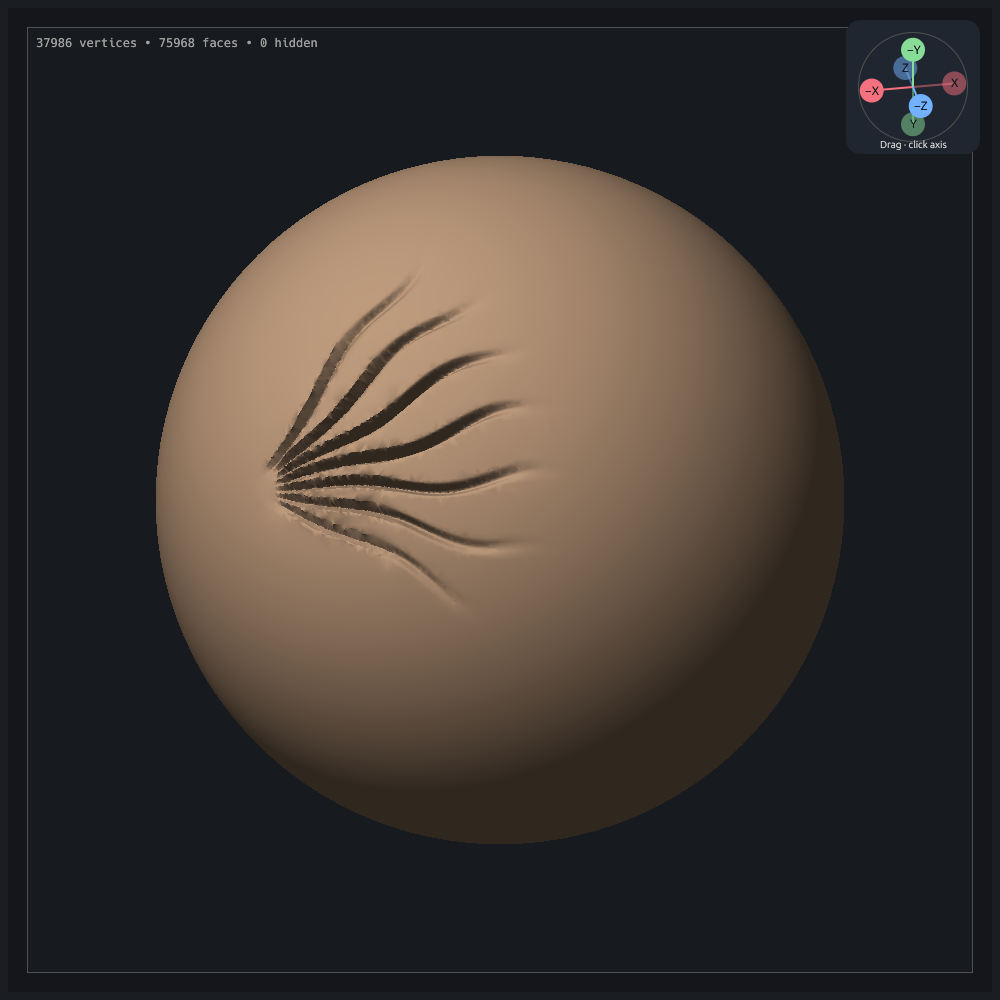
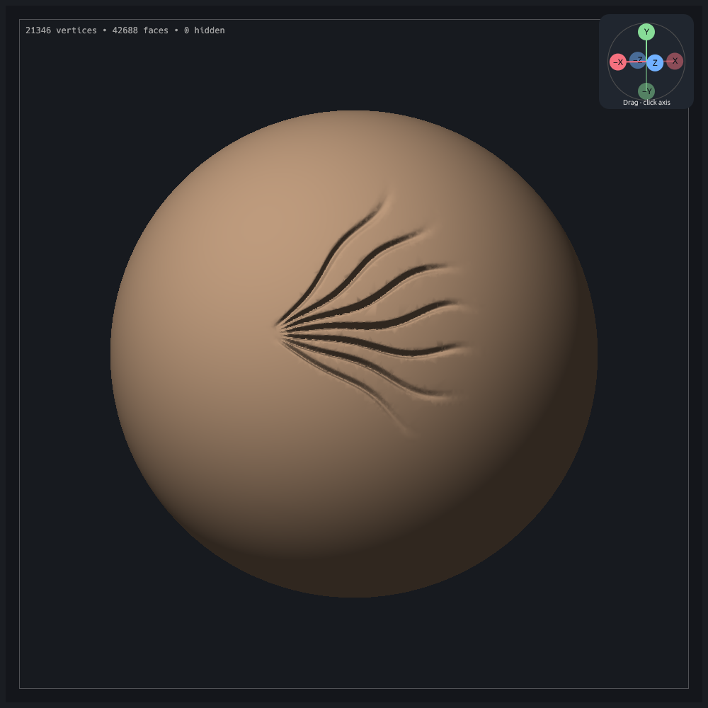
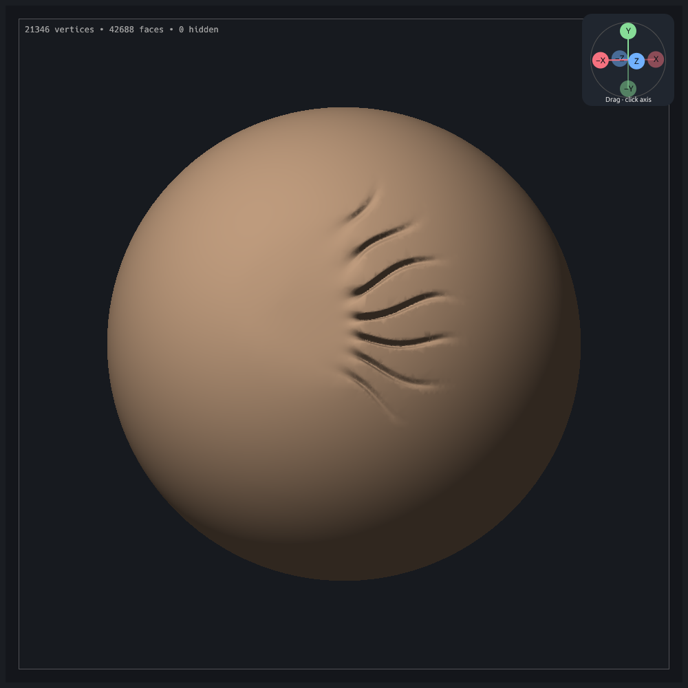

# Smooth and Decimate validation

**The first implementation below was rejected in hands-on use.** The new `clay-session-smoothing-no-work` export showed that preserving triangle metrics did not establish effective smoothing. See the correction and controlled comparison below.

## Initial implementation (superseded)

The [research review](../../research/adaptive-sculpt-review.md) describes the original behavior at `8dcce67`. This follow-up checks the implementation that separates surface smoothing from local decimation.

`smooth_decimate_offscreen_review` uses the actual egui/wgpu renderer. Its synthetic scene pulls a short bump from a subdivided sphere, smooths it, decimates the result, and checks two independent Undo steps. It also clicks the Decimate control and captures the controls. The synthetic result has no opposing face pairs before or after either operation. Smoothing keeps 18,818 vertices; decimation leaves 18,421.

With `CLAY_REVIEW_PROJECT=clay-session-smoothing/stage-003.clay`, the test instead applies 36 specified dabs to the exported relief roots, followed by the same dabs with Decimate. These are controlled new strokes, not a replay of the user's missing input samples. Automatic simplification is disabled to verify that the dedicated tool works independently.

| Stage | Vertices | Opposing neighboring face pairs |
| --- | ---: | ---: |
| Exported stage 003 | 37,986 | 536 |
| After Smooth | 37,986 | 360 |
| After Decimate | 34,074 | 346 |

The test counts pairs with a dot product below `−1e-5`, using the application's single-precision face normals. This diagnostic is not a self-intersection test. That implementation preserved connectivity and reduced the opposing-face count; it did not repair every steep or previously folded groove. Decimation removes 10.30% of vertices in this run without increasing the fold count. The local plane-error check is not a global surface-error bound. The worst triangle quality remains 0.06824 through both steps; This initial Smooth implementation prevented quality dropping below 0.2 or worsening an existing sliver. The capture test checks this per triangle, with a small tolerance for accumulated floating-point error.

| After Smooth | After Decimate |
| --- | --- |
|  |  |

That initial implementation attempt exposed a whole-dab rejection in the deformation limiter: a small failed region could cancel all motion. It pinned failed proposals locally and rechecks their neighbors. A regression verifies that an unsatisfiable fold cannot cancel an independent safe patch. Decimation additionally checks the resulting adjacent faces, distinguishes newly connected face pairs from existing folds, and separates simultaneous collapses by two rings.

Focused regressions cover uneven sampling, noise reduction at two densities, flat-patch drift, masks, hidden faces, creases, zero influence, overlapping symmetry dabs, removal of a short Snake pull, independent decimation, removal feedback and undo. Neither the alpha refinement algorithm nor its directional displacement guard was replaced.

Checks for that initial implementation: `cargo fmt --check`, Clippy with all targets and warnings denied, and `cargo test --release --locked` (590 passed, 55 opt-in tests ignored). All 12 GPU correctness tests passed under software Vulkan, as did the two cleanup captures and `reactor_ring_stamp_offscreen_review`, which checks the existing alpha stamp previews and commits.

Release-mode CPU timings on the local Intel Core i7-7500U, for 36 dabs per operation:

| Scene | Smooth total / average | Decimate total / average |
| --- | ---: | ---: |
| Exported relief, 37,986 vertices | 1,338 ms / 37.2 ms | 884 ms / 24.5 ms |
| Synthetic Snake pull, 18,818 vertices | 540 ms / 15.0 ms | 277 ms / 7.7 ms |

These include document edits and the first-dab undo snapshot, but exclude rendering, picking and presentation. They are single-run averages, not p95 frame measurements or a before/after speed comparison. Dense-patch latency remains a reason to pursue the cached adjacency and incremental display work in the research review.

To reproduce the synthetic capture:

```sh
CLAY_GPU_SOFTWARE=1 LP_NUM_THREADS=2 \
CLAY_GUIDE_PREVIEW=/tmp/clay-cleanup-snake \
cargo test --locked --lib smooth_decimate_offscreen_review -- --ignored --nocapture --test-threads=1
```

For the exported case, also set `CLAY_REVIEW_PROJECT` as above. The export-specific camera and sweep are encoded in the test; arbitrary project files need their own camera and dab positions. Captures and result projects are written to the supplied temporary output directory. The input bundle is unchanged. Software Vulkan validates rendering; it does not establish interactive latency on the user's Intel HD 620.


## Correction after the “smoothing-no-work” export

The new bundle records a subtractive alpha stamp followed by one retained Smooth stroke at strength 0.5. Stages 002 and 003 both have 21,346 vertices and 42,688 triangles. The user's stroke moved 8,498 vertices by more than `1e-6`, with maximum displacement 0.01026 on the unit-radius sphere. Full pointer samples are unavailable, so this is not a replayable performance test.

The normal-only solve was the wrong restriction for these steep grooves. The full vector solve lets their walls relax together instead of pushing individual vertices sideways until the aspect-ratio guard pins them. The correction also restores the existing 0.02 collapse-quality floor instead of demanding a 0.2 floor, and uses a topological one-ring normal average for front-facing eligibility. This avoids pinning isolated turned normals while leaving a disconnected opposing sheet untouched. Triangle inversion and collapse checks, masks, hidden vertices and creases remain protected. Smooth no longer restricts adjacent normal angles: a valid V-shaped groove can cross 90 degrees while relaxing without a triangle inversion. The intermediate vector implementation still stalled on the already-smoothed stage 003 while this angle restriction was present. Projection and Decimate retain their adjacent-face checks. Smooth changes no connectivity; Decimate remains a separate operation.

### Controlled comparison on the complete exported mesh

Both implementations start from stage 002 and receive the same 36 dabs (three vertical sweeps, radius 0.24, strength 0.5). The exported current camera is restored. The sweeps cross the roots of the grooves; their far ends are intentionally outside the brush. Automatic simplification is disabled. This is a controlled new stroke, not the user's recorded stroke.

| Before | Previous normal-only Smooth | Corrected Smooth |
| --- | --- | --- |
|  |  |  |

| Implementation | Vertices after Smooth | Opposing pairs after Smooth | Vertices after Decimate | Opposing pairs after Decimate |
| --- | ---: | ---: | ---: | ---: |
| Before either operation | 21,346 | 534 | — | — |
| Previous normal-only | 21,346 | 403 | 16,944 | 384 |
| Corrected vector fairing | 21,346 | 61 | 13,791 | 61 |

Visual inspection, rather than the opposing-pair count alone, establishes the improvement in relief removal. These checks do not prove absence of all self-intersections or repair every pre-existing fold. Smoothing intentionally changes shape and can shrink it.

### Permanent reproduction

`tests/fixtures/smoothing-groove.json` contains only a local mesh patch from `clay-session-smoothing-no-work/stage-002.clay`: 2,782 vertices and 5,429 triangles. Extraction keeps every triangle with at least one vertex within 0.12 of `(-0.5204021, 0.07797206, 0.84631824)`, then reindexes its referenced vertices without changing coordinates. Brush radius is 0.065, leaving a fixed halo around the affected patch. The companion `smoothing-groove-after-stroke.json` contains the same vertex/triangle selection with stage 003 positions, testing recovery after the unsuccessful smoothing stroke. No brush presets, images or session metadata are included.

`exported_groove_loses_relief_instead_of_only_improving_triangle_metrics` applies 32 identical strength-0.5 dabs and measures the standard deviation of radius on a fixed central vertex set (within 0.025 of the center). Initial variation is 0.00782037. The previous implementation retains 90.71% of it and **fails** the regression; the corrected implementation retains 17.95% and passes. Thus it removes about 82% rather than 9% of local relief variation, without changing topology or the fixed halo. The already-smoothed patch retains 15.56% of its initial variation (0.00720143), so it also passes the same threshold. This measures local variation, not restoration of the exact original sphere or volume preservation.

The simpler analytic groove test passes with both implementations and would not have caught this bug. It remains useful as a basic behavior check, alongside density, protection, zero-input, flat-patch, thin opposing-sheet and short Snake-pull tests.

Reproduce the complete exported comparison with the corrected code:

```sh
CLAY_GPU_SOFTWARE=1 LP_NUM_THREADS=2 \
CLAY_REVIEW_PROJECT=clay-session-smoothing-no-work/stage-002.clay \
CLAY_REVIEW_MANIFEST=clay-session-smoothing-no-work/manifest.json \
CLAY_REVIEW_SWEEP=-0.15,-0.05,0.45 CLAY_REVIEW_STRENGTH=0.5 \
CLAY_GUIDE_PREVIEW=/tmp/clay-smoothing-corrected \
cargo test --release --locked --lib smooth_decimate_offscreen_review -- --ignored --nocapture --test-threads=1
```

`CLAY_REVIEW_SWEEP` specifies camera-space x, starting y and ending y. Without these optional parameters, the capture retains the earlier export's camera/sweep defaults or uses the synthetic Snake scene when no project is supplied.


### Recovery and final checks

The final release capture also starts from the already-smoothed stage 003, rather than asking the user to return to the untouched stamp. Under the same 36-dab sweep, local radial variation in the fixture's central region falls by about 85%. Smooth keeps 21,346 vertices and reduces the recorded opposing-pair count from 284 to 61; Decimate leaves 13,790 vertices with 61 pairs. Counts use the capture test's `−1e-5` threshold and are diagnostic, not an intersection proof.

| Current exported state | After corrected Smooth | After separate Decimate |
| --- | --- | --- |
|  |  |  |

Final correction checks: formatting, `git diff --check`, Clippy with all targets and warnings denied, full release tests (**593 passed, 55 opt-in tests ignored**), all **12 GPU correctness tests**, the alpha stamp preview/commit visual regression, and four Smooth/Decimate captures (new export stages 002 and 003, the original export, and the synthetic Snake pull). The release application was rebuilt. Every cleanup capture checks valid closed connectivity, unchanged topology during Smooth, the per-triangle collapse-quality floor, separate decimation and exact two-step undo. Aggregate opposing-pair counts did not increase in these fixtures; Smooth does not impose a per-edge angle constraint.

Final single-run release CPU timings for 36 dabs on the same Intel Core i7-7500U:

| Scene | Smooth total / average | Decimate total / average |
| --- | ---: | ---: |
| New export, untouched stamp | 750 ms / 20.8 ms | 556 ms / 15.4 ms |
| New export, already-smoothed state | 861 ms / 23.9 ms | 595 ms / 16.5 ms |
| Original export, 37,986 vertices | 875 ms / 24.3 ms | 675 ms / 18.7 ms |
| Synthetic Snake pull, 18,818 vertices | 205 ms / 5.7 ms | 298 ms / 8.3 ms |

These include document edits and the first undo snapshot, but exclude rendering, picking and presentation. They are not p95 latency measurements. The final Snake capture leaves 18,818 vertices after Smooth and 18,399 after Decimate, with no opposing pairs. Guide screenshots were refreshed from that final capture.
