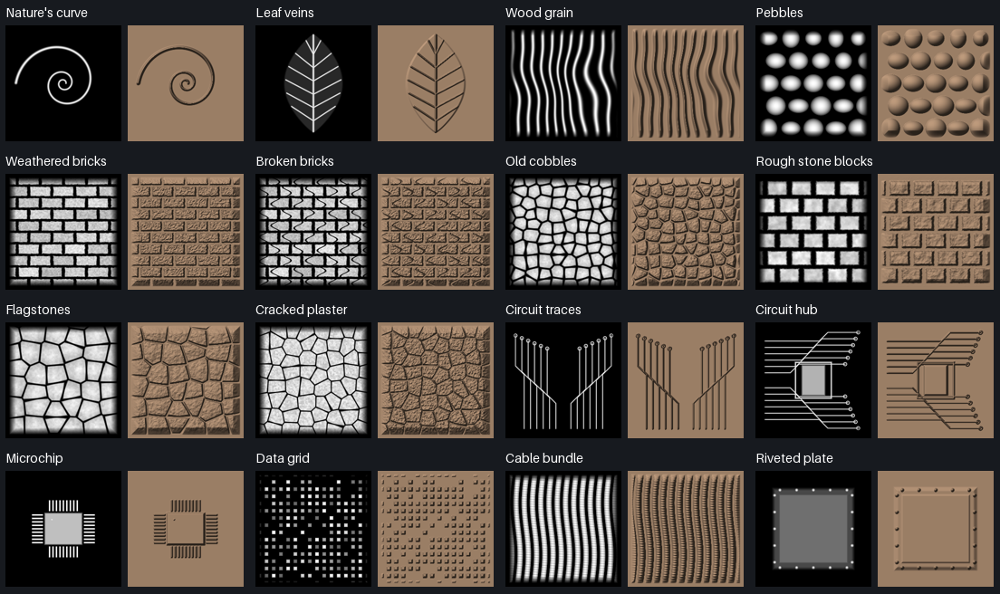
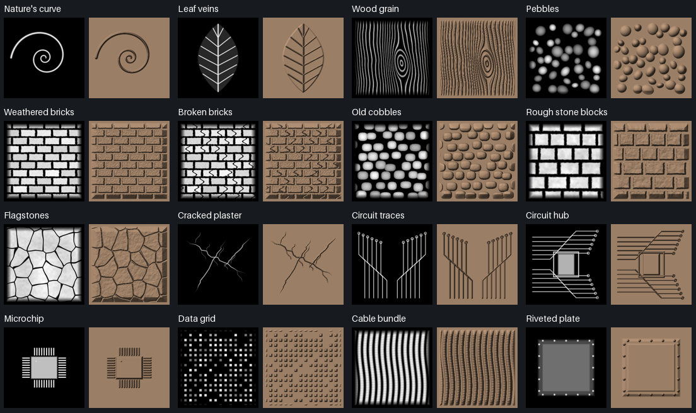
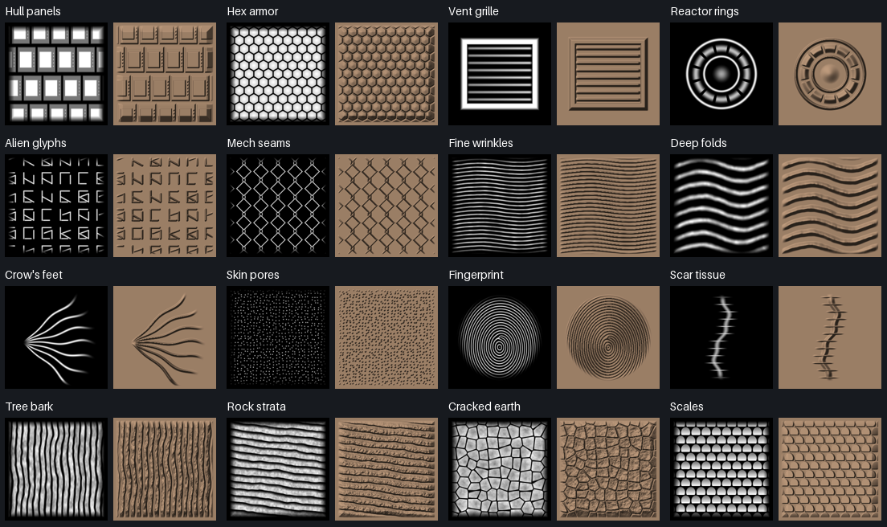
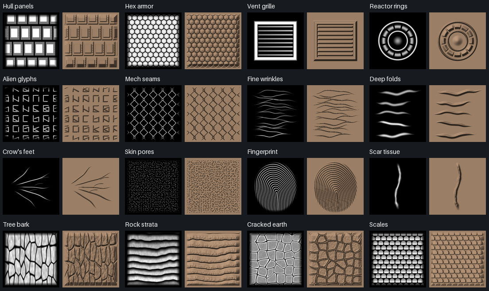
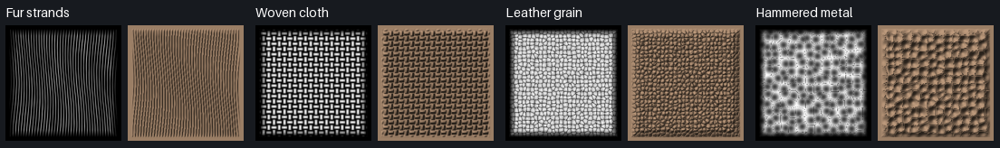
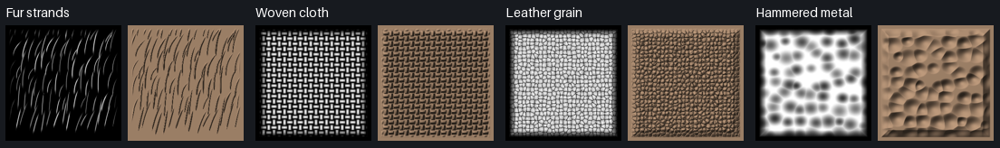

# Alpha library visual audit

Audited all 39 built-ins: three basic masks and 36 generated height images. Eighteen image patterns were revised. The comparison sheets show each actual 256 × 256 height field beside a shaded height-field preview. These previews expose repeated structure and abrupt relief; they are not photographs or a guarantee of the result at every mesh density and brush strength.

## Findings and decisions

| Assets | Finding | Result |
| --- | --- | --- |
| Soft, Hard, Square | Basic coverage masks have distinct purposes. | Retained. |
| Nature’s curve, Leaf veins | Recognizable stylized motifs, rather than material textures. | Retained. |
| Wood grain | Uniform sinusoidal stripes; the old “knot” only deflected the stripes. | Grain bends around an elliptical knot, with varying spacing, finer fibers and restrained variation along its length. |
| Pebbles | Identical-looking stones in a conspicuous grid. | Irregular positions, sizes, elongation and orientation; spacing prevents major overlaps. |
| Weathered bricks, Broken bricks | Strong fine noise dominated both; repeated breaks made damaged bricks too regular. | Quieter wear; cracks occur in selected bricks with varied placement and curvature. |
| Old cobbles | Shared the polygon-cell recipe used for slab and fracture textures. | Rounded, worn stones in staggered courses, with varied dimensions, placement and height. |
| Rough stone blocks | Resembled enlarged bricks. | Larger courses with differing block widths and irregular worn edges. |
| Flagstones | Essentially the cobble generator at a different scale. | Broad, flatter irregular slabs, narrow joints and restrained face texture. |
| Cracked plaster | A full cellular tile surface, visually close to pavement and cracked earth. | Sparse branching fissures with tapered ends; use Subtract for recessed cracks. |
| Circuit traces, Circuit hub, Microchip, Data grid, Cable bundle, Riveted plate | Repetition is appropriate for manufactured features. Silhouettes and structures distinguish their uses; the two circuit patterns deliberately share a visual language. | Retained. |
| Hull panels, Hex armor, Vent grille, Reactor rings, Alien glyphs, Mech seams | Distinct engineered motifs; mechanical regularity is intentional here. | Retained, including the Reactor rings stamp used in the existing regression. |
| Fine wrinkles, Deep folds | Continuous, evenly spaced waves looked like corrugated material. | Separate creases with varied lengths, curvature, strength and tapered endpoints. Deep folds remain a broader member of the same family. |
| Crow’s feet | Seven nearly equal spokes converged at one point and widened outward. | Five unequal main creases with staggered origins and weaker secondary creases. Both width and depth fade at both ends, independently of the image border. |
| Skin pores | Fine isolated marks already differ from wrinkles and larger cellular textures. | Retained. |
| Fingerprint | Uniform closed oval rings. | An oval footprint containing arching loops and flowing lower ridges. Still a stylized procedural fingerprint. |
| Scar tissue | An evenly spaced stitch ladder rather than scar tissue. | A tapered, uneven raised scar with restrained surface variation. |
| Tree bark | Closely repeated vertical bands. | Elongated irregular bark plates, broken fissures and finer longitudinal detail. |
| Rock strata | Regular corrugated bands. | Unequal ledges, uneven layer boundaries and varied erosion. |
| Cracked earth | Another close relative of the cobble/slab texture. | Irregular shards with raised, curled fracture margins and lower centers. |
| Scales | Ordered overlapping shapes give a readable directional pattern. | Retained. |
| Fur strands | Long parallel sinusoidal lines resembled fine wood grain. | Individual curved, tapered strands with varied lengths, offsets and weights. |
| Woven cloth, Leather grain | Repeating weave and fine cellular grain have distinct material purposes. | Retained. |
| Hammered metal | Cell boundaries produced pointed ridges rather than rounded hammer marks. | Overlapping rounded dimples of varying size and depth. |

The revised surfaces remain deterministic procedural height maps. Their images contain no baked lighting. The generated previews use one consistent light solely to compare their relief. Existing saved brushes and project library copies retain their embedded images; selecting a built-in again picks up its revision.

## Contact sheets

Each pair within a tile is height / shaded relief, under the same preview settings before and after.

### Nature, masonry and circuits

Before:

After:

### Sci-fi, skin and organic surfaces

Before:

After:

### Fur and materials

Before:

After:

## Alpha Drag

New documents append **Alpha Drag** to the default library, preserving existing preset indices. It has its own stable identity and copies Standard's behavior, changing only its name, image alpha (Wood grain), and stroke mode (Drag Rect). Existing projects can add it through the Brushes menu or a customized New Brush action. Adding another copy gives it a distinct identity. Saved project schemas are unchanged.

## Focused validation

Visual inspection covered every generated image before and after the revisions. The preset check exercises new-document defaults, adding the preset to an older project through the action/command route, duplicate identities, preservation of Standard, and project serialization. The existing alpha validation checks finite, bounded, distinct images, useful relief amplitude and protected borders.

Full checks were deferred during iteration and completed before opening the PR: formatting, Clippy with all targets and warnings denied, all 594 ordinary tests (55 opt-in tests ignored), and all 12 GPU correctness tests passed. The navigation/Smooth, alpha-library/stencil and Smooth/Decimate rendered checks also passed; the library and Decimate controls screenshots were refreshed and inspected. The release application was rebuilt successfully.
