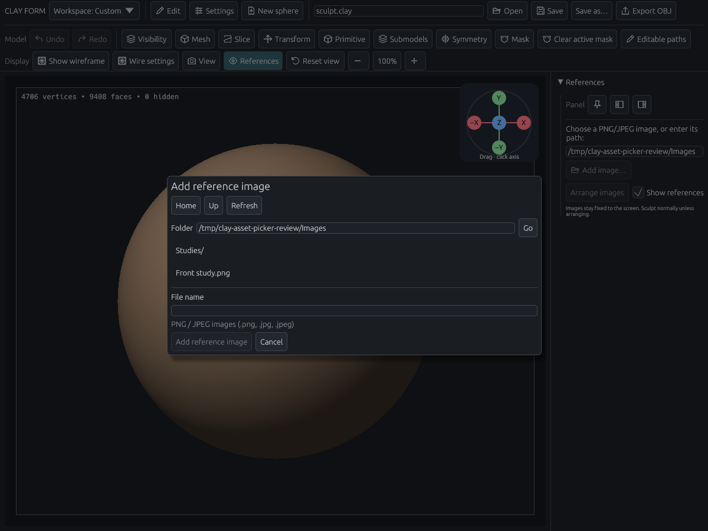
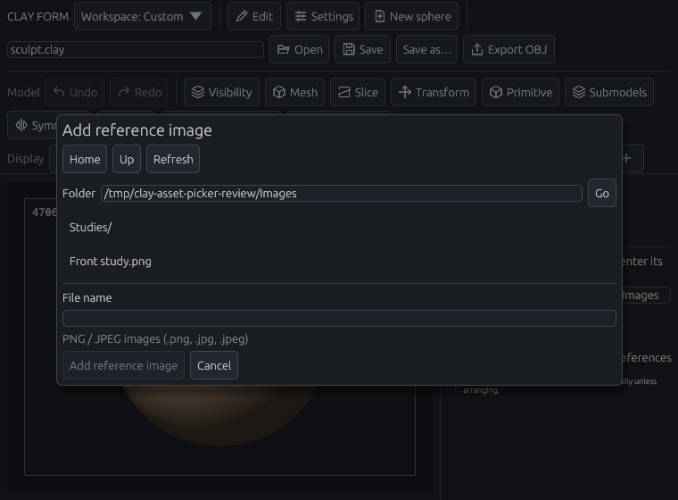
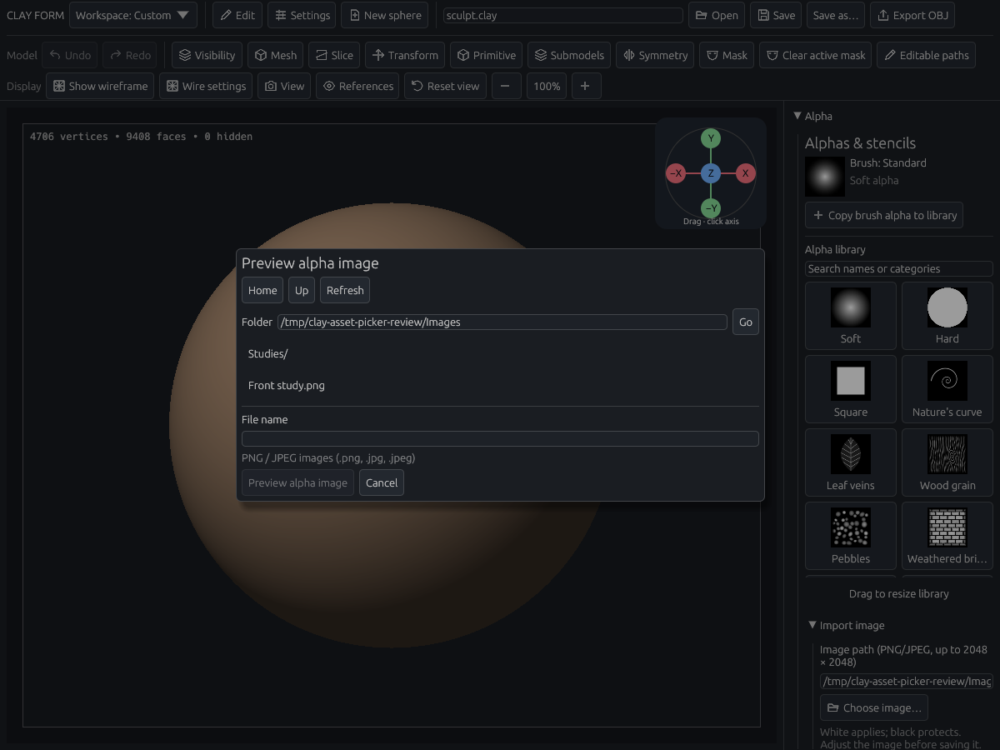
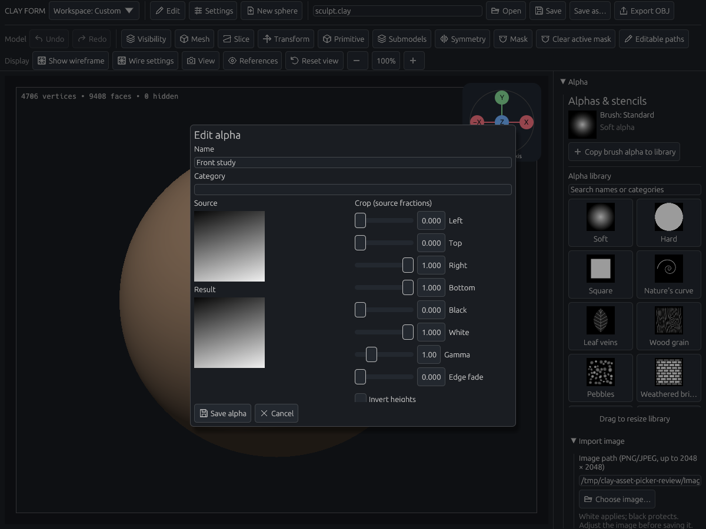

# Asset file pickers

The application-rendered review uses the real References and Alpha controls, file chooser, and pointer events. It checks filtering, selection and import at 1200×900 and 760×560; alpha import opens a private draft and leaves the project unchanged. All captures were visually inspected.









## Reproduce

```sh
CLAY_GPU_SOFTWARE=1 WGPU_BACKEND=vulkan LP_NUM_THREADS=2 \
CLAY_GUIDE_PREVIEW=/tmp/clay-asset-picker-review \
cargo test --locked --lib asset_file_dialog_offscreen_review -- --ignored --nocapture --test-threads=1
```

Focused local checks: six project/asset file-dialog tests, three OBJ import tests, the alpha private-preview regression, and the rendered asset-picker review passed. Existing project save/overwrite and unsaved-change behavior remains covered. The visual review is included in GPU CI. Inputs were simulated through egui; physical mouse/tablet hardware was not exercised.

The picker is part of the application and does not depend on native desktop file-drop delivery. Export destinations are outside this import-only change.
