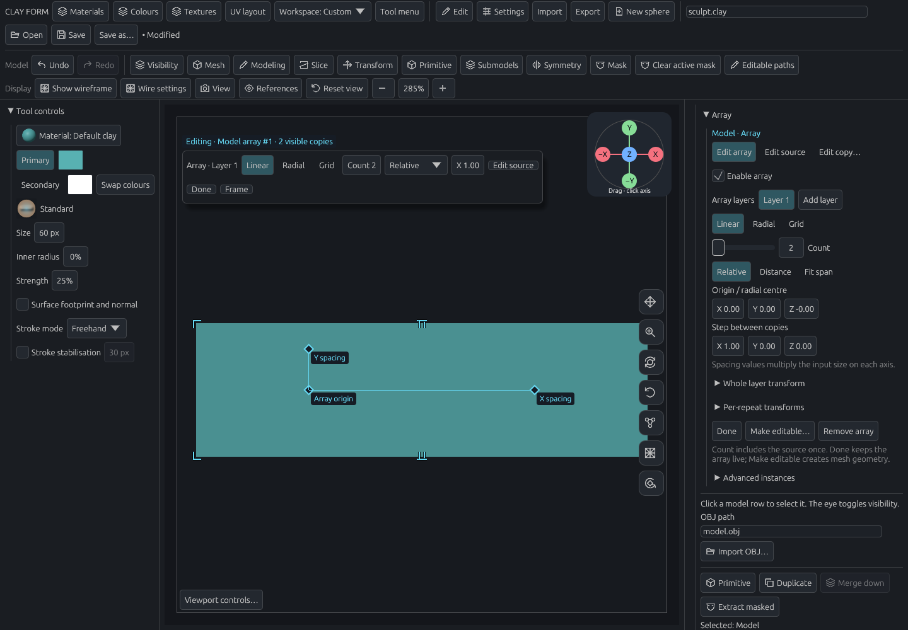
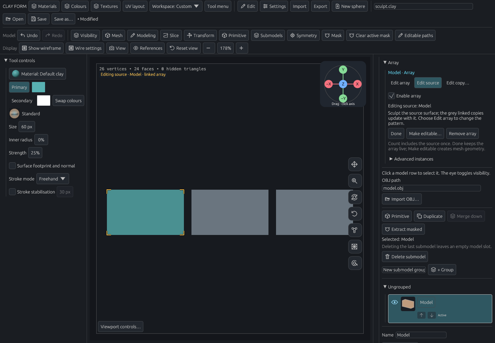
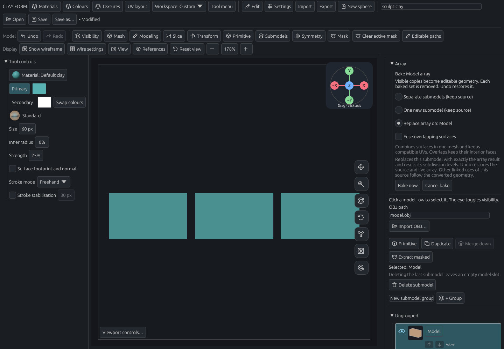

# Attached arrays: first batch

New arrays belong to the selected submodel. Count includes the source once. The inline bar, sidebar and Active array controls custom-menu item edit the same recipe. Linear, Radial and Grid support numeric editing and direct handles; Relative, Distance and Fit span define spacing. Done retains the live array. Source and copy editing have separate highlights; normal transforms affect the whole result.

Ownership survives save/load, reordering and duplication. Removing the owner removes its recipe, while external dependencies remain protected. Existing standalone arrays retain their semantics. Project format 5 adds optional ownership, spacing and output-transform fields and reads versions 1–4. Mesh export continues to require making the result editable first.

## Focused verification

- CPU checks cover source counted once, disabling, save/load, Undo/Redo, live relative spacing, fixed span, output transforms, owner duplication/reorder/delete, hidden-array baking, legacy compatibility and atomic count-limit rejection.
- Pointer checks cover one Undo per handle drag, Escape, orbit navigation and release followed by hover in the same input batch for both array and copy handles.
- The Vulkan workflow clicks the real controls, checks changed surface pixels, drags spacing/radius/arc, changes layouts and edit modes, converts the owner's result, checks Undo, and verifies the inline bar at 1100 × 800. Buttons used to leave source editing and convert geometry must be inside the visible workspace. Radial grips avoid the navigation buttons; switching modes immediately reveals the Array panel header.
- A separate level-3 probe uses 75,266 source vertices and two placements. Ninety hover frames retain the same display and placement allocations with unchanged history. Changing spacing retains the source vertex allocation and shared normals (5,451,408 bytes in the source shading cache). The cache is capped at 64 MiB and a source edit invalidates it. This checks reuse; it is not a whole-process RSS measurement.

Run the relevant checks sequentially with the shared build lock and one compiler job on mark-laptop:

```sh
flock -n /home/mark/.cache/codex-build.lock env CARGO_PROFILE_TEST_DEBUG=0 cargo test --locked -j 1 --lib -- attached_array layered_array app::tests::instances:: --test-threads=1
flock -n /home/mark/.cache/codex-build.lock env CARGO_PROFILE_TEST_DEBUG=0 cargo test --locked -j 1 --lib -- attached_array_controls_offscreen_review attached_array_level_three_hover --ignored --test-threads=1
```

Full formatting, tests, lint and configured GPU checks run in PR CI. The attached-array interaction capture is included in GPU CI; the level-3 probe is a focused manual check.

## Captures






