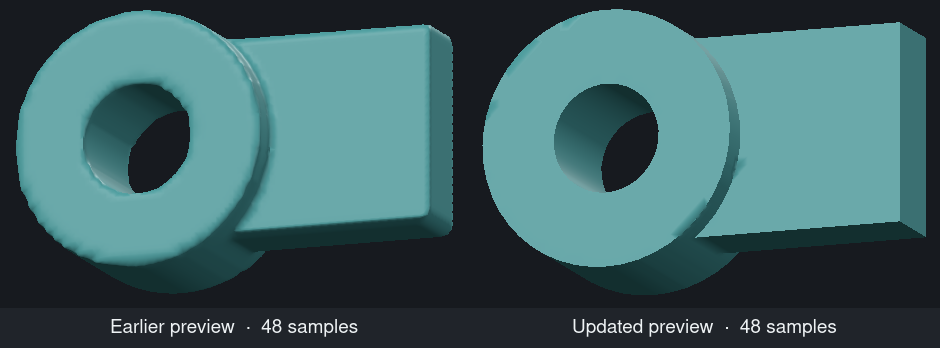
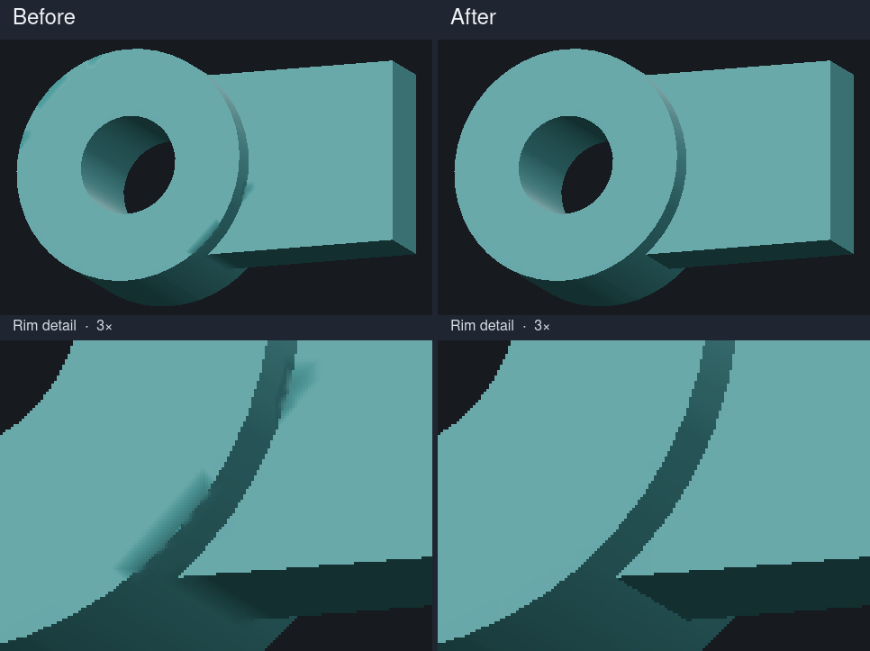
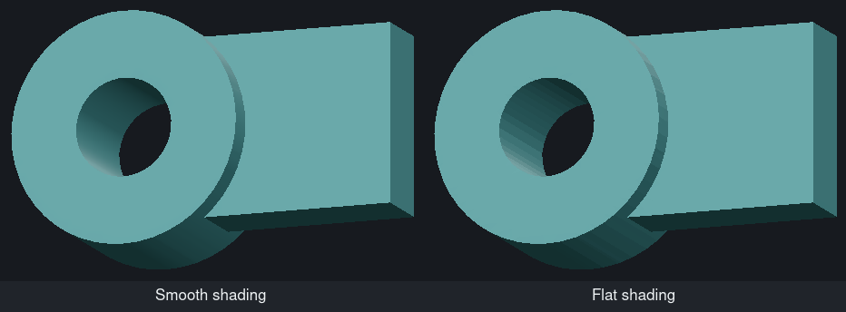

# Deformation frame and Boolean stack

The Linux Vulkan walkthrough drove the application controls with pointer events and captured the viewport at 1280 × 900. The test is `deformation_stack_offscreen_review`. Set `CLAY_GUIDE_PREVIEW` to choose its output directory.

## Circular cut

The fixture has a rectangular body, a round boss and a through-bore. Both crops use the same three source meshes, camera, lighting and 48-sample grid setting. The earlier reconstruction produced 35,648 triangles. Fitting the surface to the input faces produced 9,824 and kept the planar cap and the bore wall distinct around the circumference.

The walkthrough also captures the same fixture at 24 and 96 samples. The geometric regression checks for a shared cap and wall vertex near the source rim in every 15-degree sector at 48 samples. Coarse grids can lose thin features. A faceted cutter can still produce a faceted opening.

## Smooth shading at the rim

Both views below use smooth shading, the same lights and camera, a 48-sample grid, and 9,824 triangles. The close-ups magnify the original viewport pixels three times. The old cap picked up a dark streak from the curved wall. The updated fit chooses the flatter triangulation and separates the lighting normals at source-surface joins, including the shallow join underneath the block.

On the near-planar triangles of the front cap, the worst corner normal moved from 46.2° off the cap normal to 1.2° or less. On the underside it moved from 30.8° to less than 0.3°. The regression also checks that the lighting normals follow the outer cylinder and the bore as they turn.

## Flat shading

The **View → Flat shading** switch shows the triangles along the bore and rim. The two crops use the same cached Boolean result, camera and lights. The viewport toggle test switches on flat shading and then restores the original smooth pixels.

## Controls exercised

- Pulled a frame corner, cancelled with Escape, repeated the drag and committed it. Bent and twisted the same starting shape and undid each adjustment. The pointer tests cover orthographic and perspective projections. [Corner pull](01-pull.png) · [Bend](02-bend.png) · [Twist](03-twist.png)
- Toggled the main view between editable sources and the result, keeping the camera and edit history. Switched the inactive cutter between Subtract and Intersect while keeping the body selected. [Source operands](06-boolean-operands.png) · [Subtract](04-boolean-preview.png) · [Intersect](07-boolean-intersect.png)
- Baked the preview into a sculptable submodel and undid it. Undo restores the source geometry, roles and visibility. [Baked result](05-boolean-bake.png)

The cache regressions check that orbiting retains the Boolean display allocation, and that a dense cage drag reuses triangle indices, shading fans, materials and face mappings while updating positions and normals.
