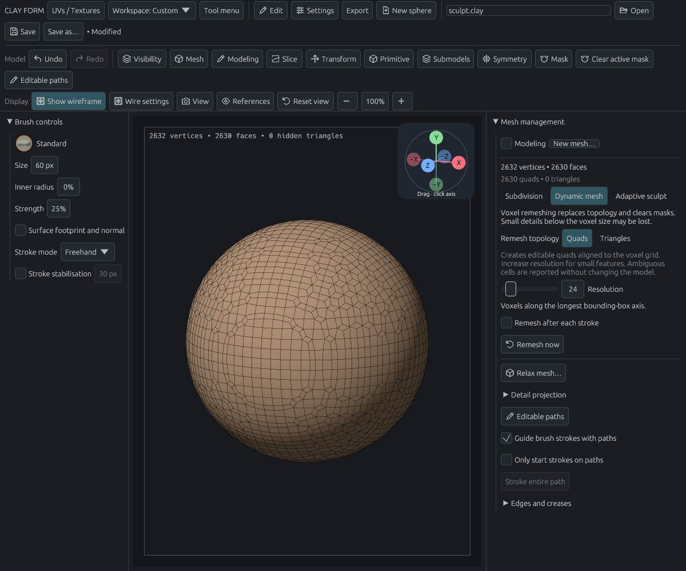
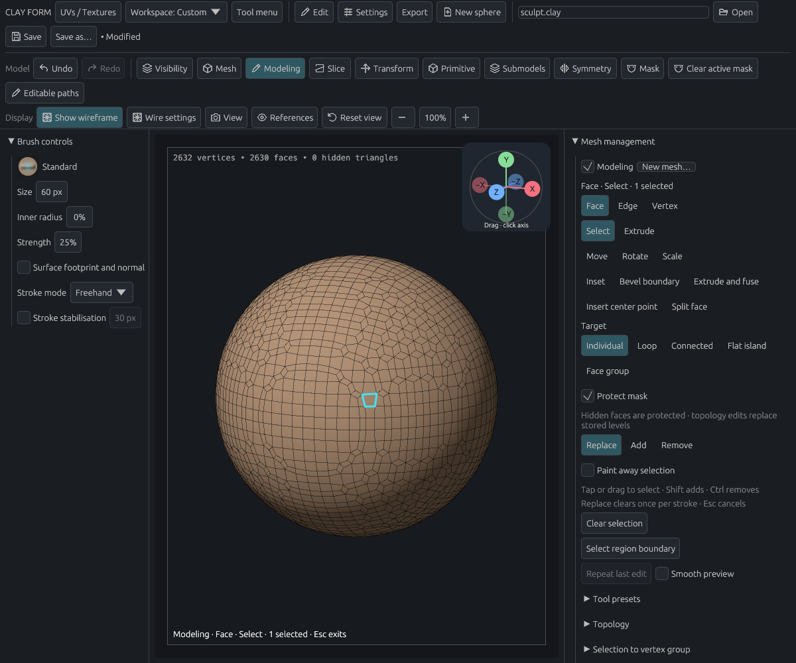
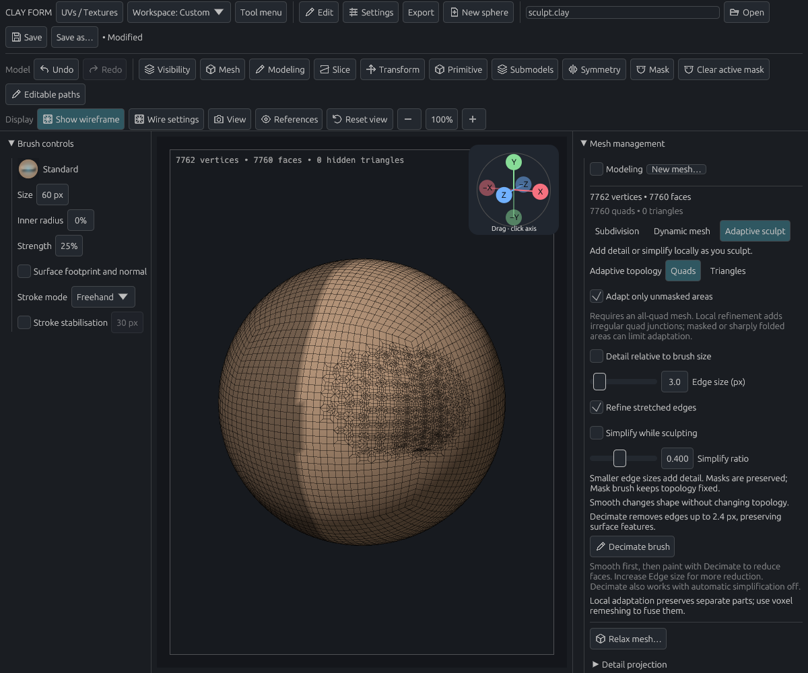
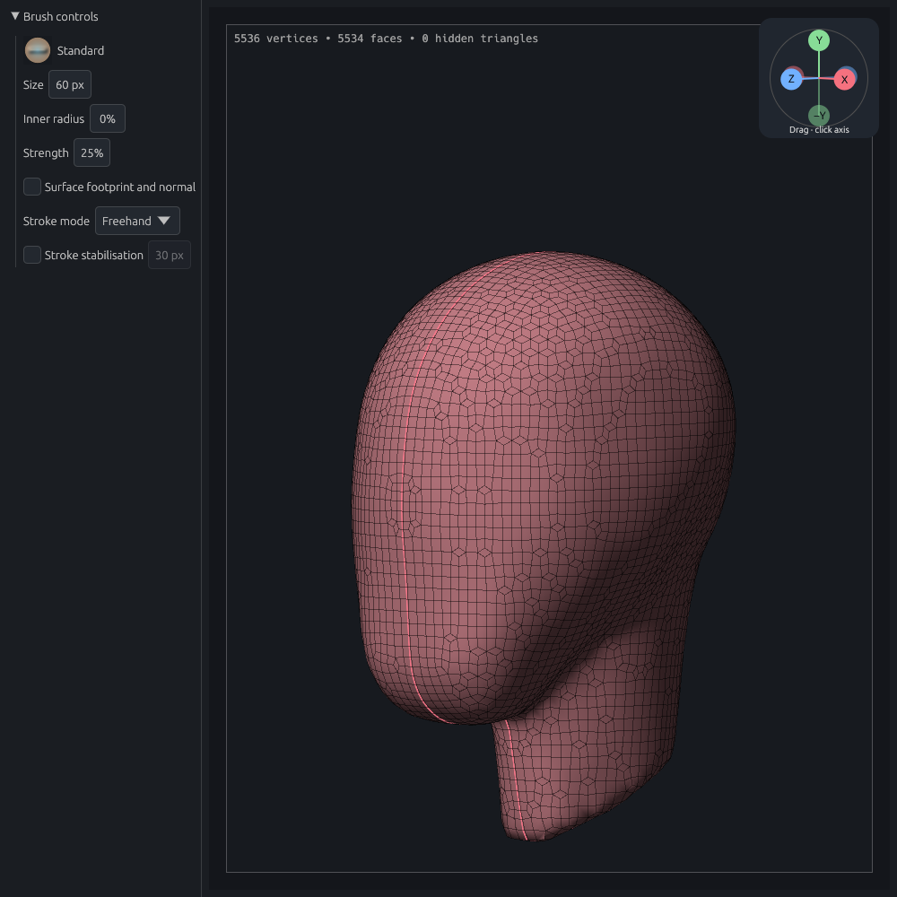
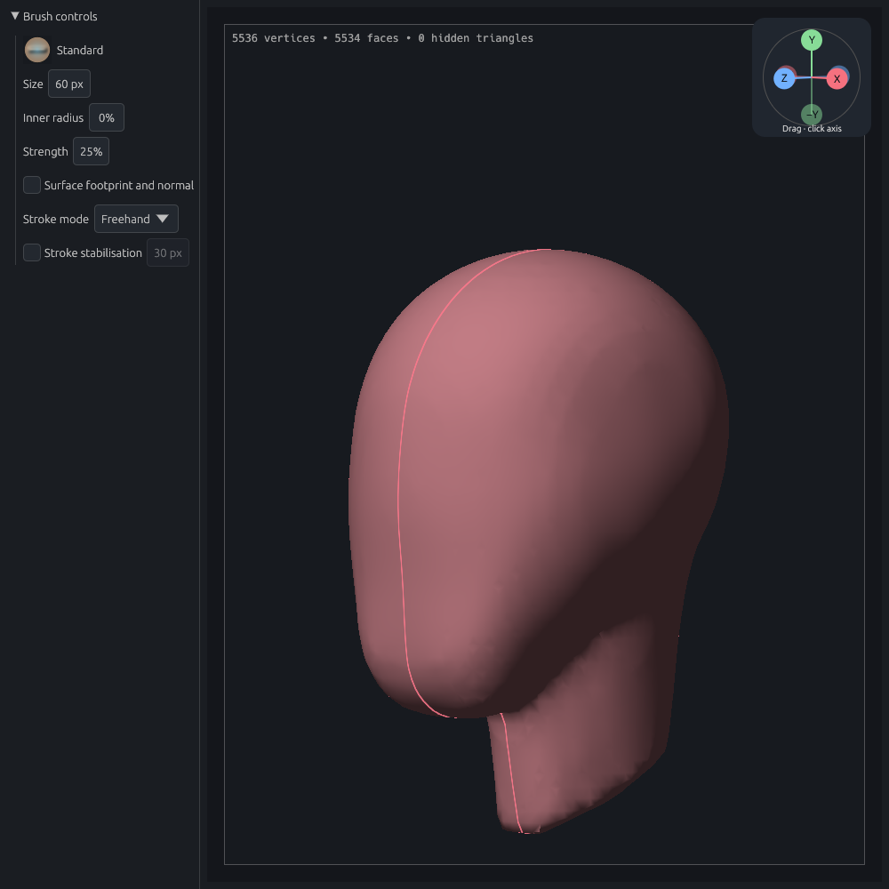
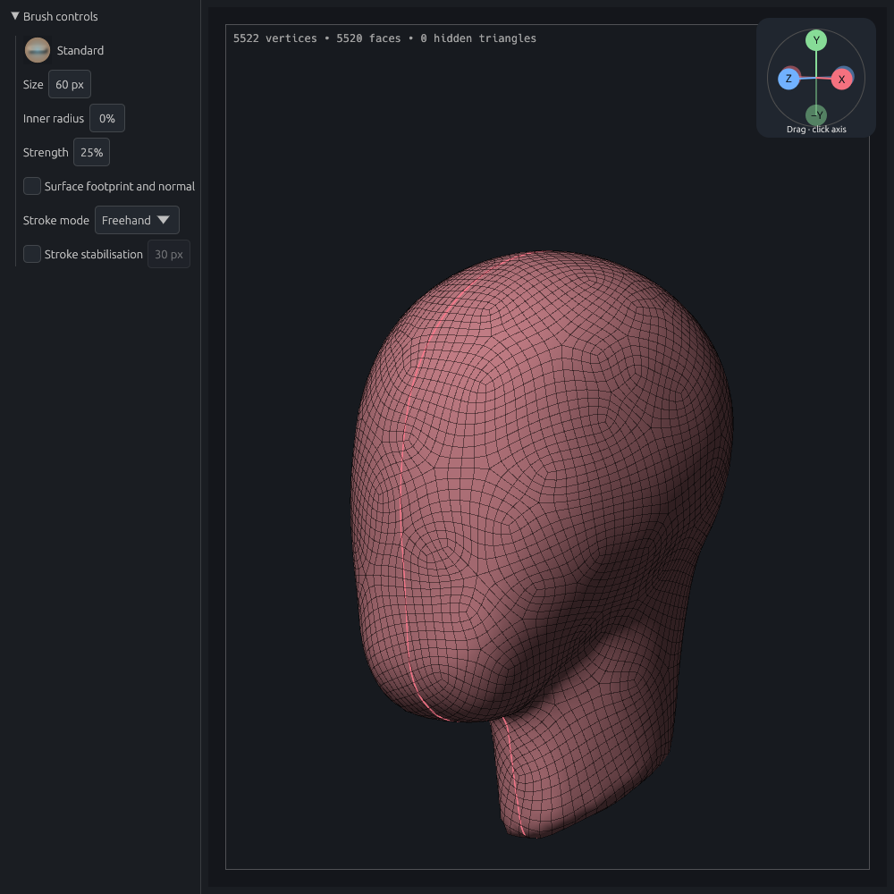
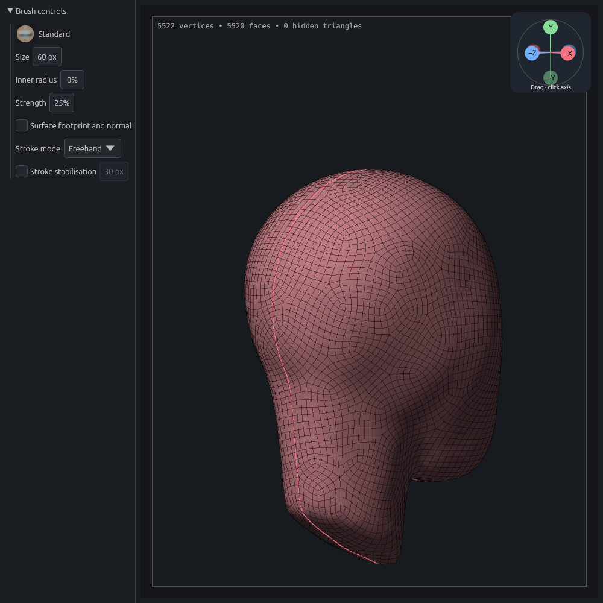
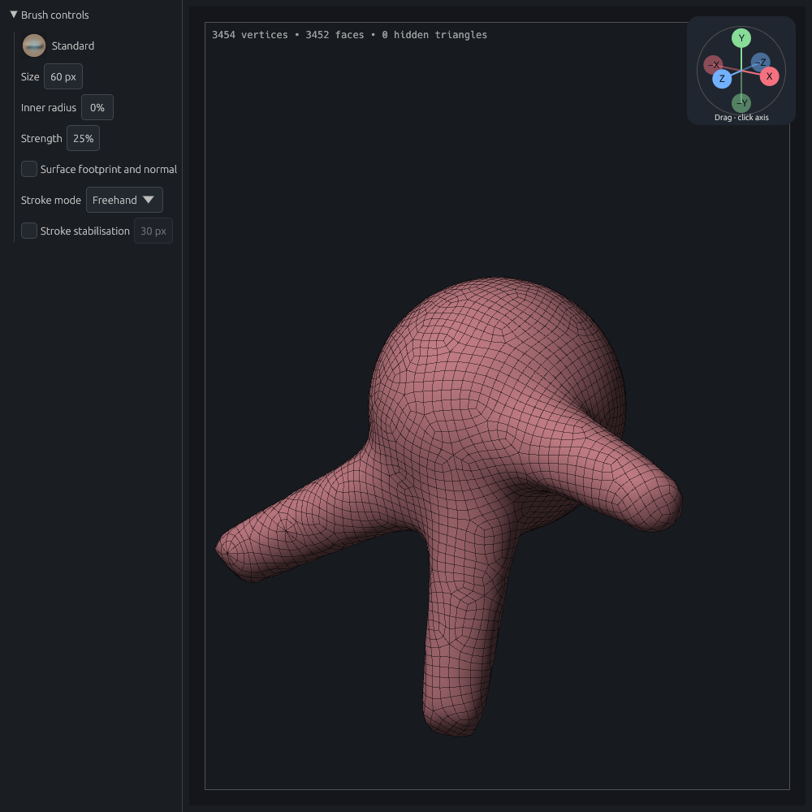

# Dynamic Mesh quads and protected adaptive topology

**Current UI:** Fast quads and Optimized quads are the two choices. Fast quads replaces the Surface nets, Relaxed quads and Voxel skin presets; see [the current implementation and migration notes](../voxel-skin-2026-10-28/README.md). The following sections retain historical implementation evidence.

Issue #36, 26 October 2026. The primary workflow is Dynamic Mesh remeshing; Adaptive sculpt has its own topology choice and an independent unmasked-only option.

## Implementation and limits

Quad voxel reconstruction uses surface nets over the existing signed-distance/union field: one vertex per unambiguous crossed cell, one editable quad around each crossed grid edge. The existing marching-tetrahedra extraction remains the explicit Triangles mode. The grid determines quad direction; this is not guided retopology or animation topology.

Surface nets and other dual methods can produce nonmanifold connections when a cell contains multiple sheets. See the primary descriptions in [Frisken, SurfaceNets for Multi-Label Segmentations](https://pmc.ncbi.nlm.nih.gov/articles/PMC9623606/) and [Zint et al., Resolving Non-Manifoldness on Meshes from Dual Marching Cubes](https://diglib.eg.org/bitstream/handle/10.2312/egs20221029/045-048.pdf?sequence=1). This implementation conservatively rejects ambiguous cells and folded/degenerate output instead of silently emitting triangles. It does not implement the papers' multi-label or manifold-repair algorithms. A 0.02-voxel cell-interior margin prevents coincident dual vertices at exact grid tangencies.

Local quad refinement splits a vertex's incident edges, replacing each adjacent quad with three quads. The complete star is accepted atomically; no split propagates beyond it. This introduces irregular junctions. Simplification contracts a quad diagonal after checking its local link, visibility, masks, groups, stencil coverage, orientation, triangle quality and sampled surface error. Refinement allows at most 0.15 target-edge lengths of sampled deviation per operation; contraction allows 0.08 collapse thresholds. These are local sampled bounds, not global Hausdorff or cumulative error guarantees. Protected boundaries and sharp folds can prevent further adaptation. Existing all-quad geometry is required; mixed input gives an actionable error.

Unmasked-only adaptation treats every nonzero mask value as protected, and freezes faces touching that region. Brush deformation still uses the original mask strength. Tests compare protected face connectivity by vertex coordinates across compaction, rather than assuming vertex indices remain stable. Triangle operations now retain untouched quad polygons and reject splits that would modify hidden or protected incident faces.

New models default to quad remeshing. Missing topology fields in old saved settings load as Triangles. Adaptive sculpt defaults to its existing triangle behaviour. Settings, real polygon data and undo snapshots persist independently for the two workflows. Voxel remeshing continues to clear masks, require visible closed surfaces, transfer supported vertex materials/groups, and invalidate stale UV correspondence through the existing topology contract.

## Validation

- Focused adaptive checks: repeated refinement/coarsening, manifold vertex links, duplicate/degenerate faces, both topology modes at partial-mask boundaries, masked/hidden stamp exclusion, symmetry/stencil copies and interpolated attributes.
- Focused remesh checks: cube, cylinder and torus; repeated output remeshing; overlapping-volume fusion and disconnected components; ambiguous-cell rejection and cancellation; material/group transfer.
- Persistence and document checks: absent legacy fields, current round trips, rejected mixed input, strokes and mode changes through Undo/Redo, and existing subdivision-history behaviour.
- The real egui/wgpu control test clicks Dynamic mesh, Quads/Triangles, Remesh now, Modeling face selection, Adaptive sculpt and unmasked-only adaptation. It checks failure atomicity, Undo/Redo and project reopening, and captures shaded/wireframe output. App-level coverage checks explicit remeshing and Undo with the new quad default, and verifies that stroke release does not launch a remesh.

For a unit-radius sphere at resolution 24, three successive quad remeshes produced:

| Pass | Quads | Mean absolute radial error | Mean `1 − radial normal · mesh normal` |
| --- | ---: | ---: | ---: |
| 1 | 2,630 | 0.002036 | 0.000188 |
| 2 | 2,622 | 0.004336 | 0.000231 |
| 3 | 2,622 | 0.006512 | 0.000292 |

These are fixture measurements, not bounds on arbitrary input. They show the small cumulative shrinkage of repeated reconstruction; retain a projection reference when preserving fine sculpt detail matters. No interactive speed claim is based on these debug-build checks.

The captures use software Vulkan/llvmpipe at 1200 × 1000. Solid and wire views were inspected for gaps, folded regions and protected-region changes. Adaptive junctions are visibly irregular; the shaded Clay stroke remains continuous at the refined patch.








Reproduce the control test and captures:

```sh
CLAY_GPU_SOFTWARE=1 LP_NUM_THREADS=2 CLAY_GUIDE_PREVIEW=/tmp/clay-quad-review \
cargo test --locked --lib quad_topology_controls_offscreen_review -- --ignored --nocapture
```

The interaction regression is included in GPU CI. Image inspection remains manual; the test does not claim automated visual comparison. Full test/lint/GPU checks run in PR CI.

## Follow-up: relaxed quad distribution

Dynamic Mesh now keeps the original **Surface nets** algorithm and offers **Relaxed quads** separately. Missing algorithm settings and new models retain Surface nets. The choice is saved per model, captured in diagnostics, restored by Undo/Redo and used by explicit remeshing. Adaptive sculpt settings remain independent.

Relaxed quads applies the existing surface-constrained relaxation engine to the freshly reconstructed surface before transferring materials and vertex groups. It uses polygon edges (not hidden render diagonals), 30 iterations at strength 0.5 and a maximum sampled deviation of 0.15 voxels. Coordinates are normalized to voxel units so this tolerance scales with the model. Connected reference-face tracking prevents projection from jumping directly to nearby sheets. Existing sharp-feature protection, orientation checks, sampled face-centre/edge-midpoint checks and backtracking limit unsafe moves. The shared work limit reports an actionable error; a failed or cancelled job keeps the original document.

This follows the general approach of [tangential mesh relaxation](https://doc.cgal.org/6.2/PMP_Remeshing/index.html); it uses the app's own existing engine, with no new dependencies. Projection constrains the reconstructed surface, not the pre-voxel sculpt: the voxel detail limits still apply. The sampled deviation is not a global Hausdorff bound. Connectivity and quad count stay fixed, so valence junctions remain; this is more even spacing, not a new guided quad layout.

The supplied head session was compared from stage 23 (before remeshing), at resolution 48 and the original camera. Both outputs contain **5,534 quads** with identical connectivity. Edge-length coefficient of variation falls from **0.224313 to 0.140089**, a **37.5% reduction**. Maximum sampled deviation from the unrelaxed reconstruction is **0.005871 model units / 0.093274 voxels**. Wireframe review shows more even spacing across the forehead and cheek; shaded review shows the head/neck shape and silhouette retained. Junctions remain visible. Debug runs took about 4 seconds for Surface nets and 27 seconds for Relaxed quads; these are local review timings, not release performance claims.

| Surface nets | Relaxed quads |
| --- | --- |
|  |  |
|  |  |


Focused checks cover spacing and valid faces on sphere/cube/torus, projection onto the reconstructed surface, thin nearby components, cancellation, legacy persistence, algorithm Undo/Redo, and both algorithms through explicit remeshing. The GPU control check passes with a bounded 60-second wait for the heavier relaxed operation; simpler mesh jobs retain their existing 10-second test wait.

The local comparison helper accepts a pre-remesh project and writes separate output projects without modifying the diagnostic bundle:

```sh
CLAY_REVIEW_PROJECT=/path/to/stage-023.clay CLAY_GUIDE_PREVIEW=/tmp/clay-relaxed-review \
  cargo test --locked --lib relaxed_quads_project_comparison -- --ignored --nocapture
```

Render either output with `project_file_offscreen_review`, using `CLAY_REVIEW_PROJECT`, `CLAY_GUIDE_PREVIEW` and optional `CLAY_REVIEW_MANIFEST` for the original camera. This manual review stays outside routine GPU CI; the existing quad control regression covers both algorithm buttons, saved settings and Undo/Redo. Explicit-remesh coverage checks both algorithms against their expected geometry.


## Follow-up: native topology optimisation

**Optimized quads** is a third, optional Dynamic Mesh algorithm. Surface nets remains the default and Relaxed quads is unchanged. This implements native Rust local operations informed by Tarini, Pietroni, Cignoni, Panozzo and Puppo, [Practical Quad Mesh Simplification (2010)](https://vcg.isti.cnr.it/publication/2010/TPCPP10/). No Blender, QuadriFlow or other mesh-library code or dependencies were added.

The optimiser alternates diagonal/edge contractions and edge/vertex rotations with tangent redistribution. Its geometric objective equalises edges and diagonals (the paper's “homeometry”), rather than blindly removing every irregular vertex. Edge collapse combines a vertex rotation and diagonal contraction atomically; requiring the intermediate rotation to be profitable prevented useful simplification in the prototype. A coarse layout is subdivided and reprojected to recover approximately the requested density. Thin shapes that cannot reach the coarsest layout retry with one subdivision level instead of two. Already regular closed layouts are retained. This is an adaptation of the paper, not a complete reproduction or a guided retopology solver.

Projection walks connected reference patches. Each disconnected component is optimised and validated separately. The final gate checks closed oriented quad fans, Euler characteristic, nonfolded/convex faces, mesh limits and sampled surface error in **both directions**. Vertices, triangle-edge midpoints and triangle centres must be within **0.4 voxel** of the Surface nets reconstruction. Coarse intermediate layouts have a looser 0.75-voxel allowance; they are never applied directly. These samples do not prove a global Hausdorff bound or absence of all self-intersections. Work is bounded and cancellable, and a failed job leaves the document unchanged. Global remeshing still clears masks and transfers attributes afterwards.

On the supplied head, resolution 48:

| Measurement | Surface nets | Relaxed quads | Optimized quads |
| --- | ---: | ---: | ---: |
| Editable quads | 5,534 | 5,534 | 5,520 |
| Vertices with degree other than four | 2,401 | 2,401 | 125 |
| Edge-length coefficient of variation | 0.22431 | 0.14009 | 0.14268 |
| Worst longest/shortest edge ratio within a face | 6.82 | 7.15 | 2.82 |
| Corners outside 45–135 degrees | 302 | 10 | 2 |
| Minimum / maximum corner angle | 43.64 / 159.20° | 42.99 / 145.74° | 44.79 / 133.77° |

The optimised head retains a closed sphere topology, has no duplicate faces or invalid vertex links, and contains only four-sided polygons. Independent bidirectional sampling measured 0.259 voxel output-to-reference and 0.333 voxel reference-to-output. Matching-camera front and back wireframes show a large reduction in crowded junctions. Small sharp details may soften; this option trades more shape freedom for better connections than Relaxed quads.

| Optimized front | Optimized back |
| --- | --- |
|  |  |


Release profiling confirmed the earlier slowdown was real: median of three runs was 0.844 seconds for Surface nets and 7.030 seconds for Relaxed quads, excluding UI time. In Relaxed quads, sampled surface checks dominated (about 5.24 seconds and 19.2 million reference-triangle evaluations). The final optimisation core took approximately 12.4 seconds in the small release harness, **excluding voxel reconstruction, attribute transfer and the final validation gate**, so this is not an end-to-end comparison. A 22-second variant reduced junctions further but offered a smaller practical benefit for its extra cost. Optimized quads prioritises layout quality; it is not a performance fix for Relaxed quads.

Focused regressions cover sphere (552 → 139 irregular vertices with the quality retry described below), cube (its existing eight corner junctions and regular connections are retained), torus (200 → 62, with the same 544 faces), scale-normalised optimisation, disconnected nearby components, rejected shape changes, and cancellation without replacing the input. The app-level test exercises Optimized quads through explicit remeshing, blocked mid-stroke replacement and Undo/Redo. Persistence coverage includes all three algorithms; the GPU control regression clicks the new option and verifies its Undo/Redo behaviour.

The manual project comparison uses the real application pipeline and writes a separate project:

```sh
CLAY_REVIEW_PROJECT=/path/to/stage-023.clay CLAY_GUIDE_PREVIEW=/tmp/clay-optimized-review \
  cargo test --locked --lib optimized_quads_project_comparison -- --ignored --nocapture
```

Use the existing `project_file_offscreen_review` helper to capture the resulting project with the original camera. The diagnostic export itself is never modified.


## Follow-up: resolvable voxel crossings in a branched sculpt (27 October)

A recovered three-armed sculpt reproduced “Quad remesh cannot resolve nearby sheets at this resolution” at resolution 48, before any distribution algorithm ran. Exactly one shared grid face had alternating signs. Its bilinear saddle was not singular: the diagonal products differed by approximately -4.94e-5, so the separate branches could be resolved instead of rejecting the whole operation.

The native extractor now connects crossed cube edges through face-contour arcs, uses an asymptotic decision consistently on shared faces, and gives each disconnected contour loop its own vertex. It retains the original vertex positions/order for unambiguous cells. This follows the contour-loop construction in [Grosso and Zint, A parallel dual marching cubes approach to quad only surface reconstruction, §3.1.1](https://doi.org/10.1007/s00371-021-02139-w); no third-party source was added. Sparse per-cell branch mappings avoid allocating twelve indices for every grid cell. All three quad algorithms use this extraction stage.

Singular saddle ties remain errors. Non-manifold two-cell tunnels, invalid vertex fans and folded faces remain errors as well: this does not claim to solve every under-resolved trilinear topology. A regression verifies that two regions sharing a checkerboard face remain separate closed components, across scalar scales 1e-6 to 1e6. Another regression ensures the opposite saddle configuration cannot return a four-face non-manifold edge. Existing primitive, repeat-remesh, attribute and cancellation checks pass.

The recovered model now extracts as 3,454 closed quads. Its most aggressive optimised layout crowded a narrow crease, so Optimized quads now tries a less aggressive layout when the valid initial result has faces with an edge ratio above 8. It adopts the alternative only if it reduces that quality score and passes the same manifold and 0.4-voxel bidirectional shape checks. Already regular layouts retain their original connections. The final application output has **3,452 quads and 281 irregular junctions**. Independent sampling measured maximum deviations of **0.311 and 0.395 voxel** in the two directions. Its minimum/maximum corner angles are approximately **43.8° / 149.7°**.

A narrow crease still contains very small edges (16 faces with an edge ratio above 8, versus 33 before the less aggressive retry). This fix makes the reported remesh succeed and improves distribution; it does not guarantee uniform quads at every sharp or near-touching feature. The extra attempt increases runtime on affected shapes. Unchanged regular thin-box components are explicitly covered by a regression, so they do not trigger unnecessary optimisation.

| Recovered sculpt | Successful Optimized quads result |
| --- | --- |
|  |  |

The recovery snapshot and diagnostic export were not modified. The real application remesh pipeline and matching-camera wireframe/shaded capture were exercised locally; full checks run in PR CI.


## Follow-up: Optimized quads CPU savings (27 October)

Profiling the real release pipeline put most of the cost in projection during smoothing and simplification. On the branched sculpt, the two layout attempts took about 5.45 and 5.52 seconds; their final validation checks together took about 0.51 seconds. Those figures are for **Optimized quads**, independent of the earlier Relaxed quads profile.

The native optimiser now avoids evaluating a reference triangle twice within the same projection query, with a fast path for queries that settle in their starting patch. Per-face samples reuse a distance only when the sample's coordinate bits are unchanged and the previous projection retained its input anchor. That anchor restriction preserves strict distance-tie behaviour. Changed points are reprojected; the reference surface remains immutable. Local smoothing visits the sorted affected vertices directly, reuses scratch buffers, and keeps the original neighbour/face order and arithmetic. Eight face sample points use a fixed array instead of a temporary allocation.

The simplification objective, smoothing passes, quality retry, component separation and final bidirectional shape checks remain unchanged. Cancellation and projection work limits remain enforced; the projection budget now counts actual triangle evaluations rather than repeated or cached work. No GPU work, parallel topology updates, third-party libraries or dependencies were added.

Three alternating before/after release runs on the Intel Core i7-7500U laptop, resolution 48:

| Model | Median before | Median after | Time saved | Median peak process memory before → after |
| --- | ---: | ---: | ---: | ---: |
| Head | 10.639 s | 7.323 s | 31.2% | 22.8 → 27.8 MiB |
| Branched sculpt, including both quality attempts | 12.040 s | 7.862 s | 34.7% | 19.2 → 21.5 MiB |

These timings include voxel reconstruction, optimisation, attribute transfer and final validation, and exclude project loading/saving and UI work. Builds and renders were not running concurrently. The baseline was commit `6671c73` with lightweight phase timers; the delivered code contains no profiling probes. These same-session comparisons supersede the earlier head runtime as evidence for this performance change; timings vary with CPU load and temperature. Peak memory is for the manual test process, not the GUI's total memory. The caches add a few MiB on these fixtures and scale with mesh size.

All six output projects for each fixture were **byte-for-byte identical**, including coordinates, face order and transferred attributes. The previously inspected head and branched wireframe/shaded results therefore also describe the faster output; existing narrow-crease limitations still apply. [Raw runs, fixture/output hashes and method](optimized-quads-performance.json) are retained here.

Focused release regressions cover sphere/cube/torus, scaling, nearby components, rejected shape changes and cancellation. New tests compare cached projection coordinates, anchors and distances against the original uncached walk, including shared-edge ties, changed sample points, signed zero, query-counter wrap and exhausted work budgets. Explicit remeshing, stroke-release behaviour and Undo/Redo are checked separately. Full tests, lint and GPU controls run in PR CI.


## Follow-up: manual remeshing only (27 October)

Dynamic Mesh now remeshes only when explicitly requested through **Remesh now** or its command/shortcut. The **Remesh after each stroke** checkbox, runtime trigger and saved setting have been removed. Ending a sculpt stroke retains the sculpted surface without starting a whole-mesh rebuild. Adaptive Sculpt remains the separate option for local topology adaptation.

Old projects containing `auto_remesh: true` still load; the obsolete field is ignored and omitted from new saves and diagnostic settings. The app regressions load such a project for each quad algorithm, finish a real sculpt stroke without launching a job, then request a manual remesh and verify its result and Undo. Existing pointer-release protection during explicit mesh jobs remains covered. The GPU control regression verifies that the removed checkbox is absent and clicks **Remesh now**; the control capture was visually reviewed.
