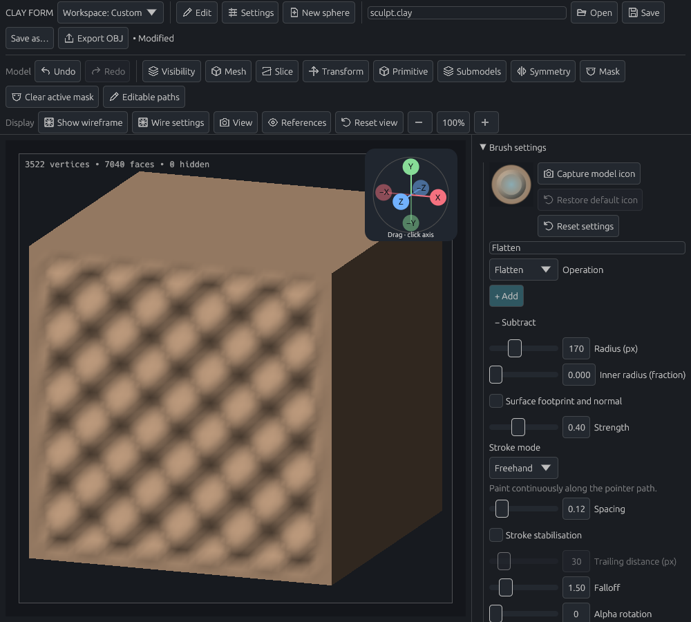
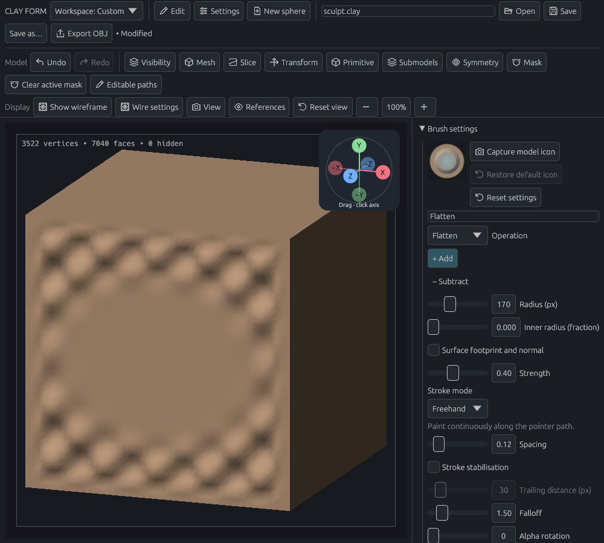

# Stable Flatten stroke review

Issue [#30](https://github.com/dustyghost/clay-form/issues/30): Flatten previously targeted each new surface hit's height and normal. A focused regression reproduced the resulting change in output when those hits changed within one stroke.

Flatten now samples an area-weighted surface plane at the beginning of the stroke, separately for each symmetry copy. The footprint follows the pointer while the target stays fixed. Projection is bounded to avoid overshooting; Subtract retains relief exaggeration. The plane is sampled again on the next stroke.

The images below are real application egui/wgpu frames rendered with Mesa llvmpipe. The fixture sends a primary press, 72 back-and-forth pointer moves, and a release over a bumpy cube face. Both images use the same angled camera and lighting. The worked center becomes a clear flat patch, with a gradual transition to the untouched relief.

| Before | After one continuous stroke |
| --- | --- |
|  |  |

Focused validation passed:

- Fixed target despite changing/reversed surface hits; convergence on an inclined patch without overshoot.
- Masked and hidden boundary protection, pressure, inversion, symmetry, new-stroke resampling, undo/redo, and project serialization.
- Drag Rect/Drag Dot previews match committed Flatten results with adaptive topology enabled and disabled.
- Real app pointer-event replay creates one history entry; undo restores the original geometry and redo restores the result.

This is automated offscreen input and visual validation, not a physical mouse or pen test. The new visual regression runs in GPU CI. Reproduce its captures with:

```sh
CLAY_GPU_SOFTWARE=1 CLAY_GUIDE_PREVIEW=/tmp/clay-flatten-review cargo test --locked --lib flatten_stroke_offscreen_review -- --ignored --nocapture
```
