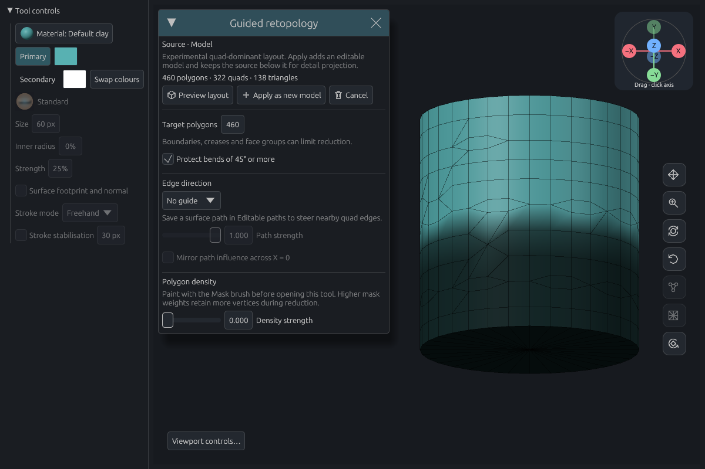
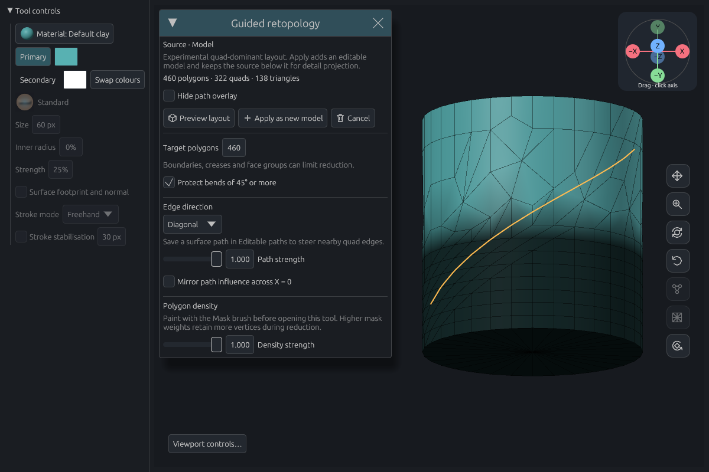
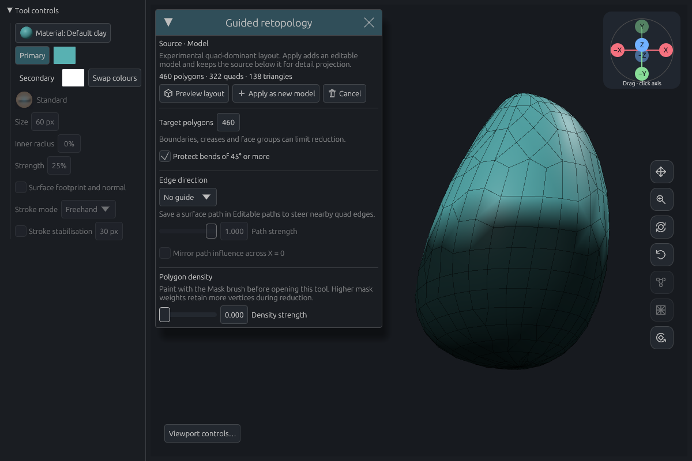
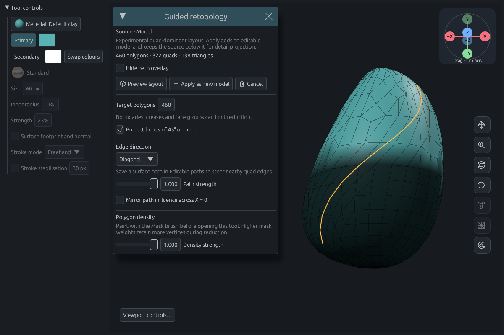

# Guided retopology feasibility

**Decision for issue #10.** Keep the native triangle-collapse and pairing method as an experimental Mesh tool for small sculpts. It retained more samples under paint and followed a diagonal path at the same polygon budget on both test shapes. Defer a production solver for arbitrary all-quad loops. Pairing can only choose among edges left by simplification, so a path crossing an unfavourable triangulation can still end at a triangle or a pole. [User workflow](../../guide/modeling.md#guide-a-retopology-preview)

## What the two fields change

Paint is a scalar importance field read from the source mask. During simplification, high weights increase an edge's collapse cost. Non-overlapping batches favour cooler regions before spending the budget in warmer ones. The solver interpolates masks, vertex-group weights and vertex materials at contracted endpoints. It retains face-group assignments and explicit crease lines. The source keeps its original attributes and path attachment.

A saved surface path supplies tangent directions. At each possible quad, the nearest compatible guide sample increases the score for retaining an opposite pair of edges running along the path. Influence falls to zero at 12% of the source bounding-box diagonal. Reversing the tangent has the same meaning. Open paths and closed loops use the shared surface sampler. One selected path and its optional reflection across world X = 0 can influence a layout. The mirror control reflects the direction field. Its output connections can differ on either side.

## Same-source measurements

The procedural cylinder and asymmetric bulb each start with 1,216 oriented triangles and 610 vertices. Each has a diagonal surface path and the same height-based paint rule. All four runs per shape use the same source, target of 460 polygons and sharp-feature protection. Both strengths are either zero or one. Each resulting model has **322 editable quads, 138 triangles and 393 vertices**.

| Source | Fields enabled | Path coverage | Vertices inside painted region | Maximum error, source → result / result → source | Worker time |
| --- | --- | ---: | ---: | ---: | ---: |
| Cylinder | Neither | 25.8% | 149 | <0.00001 / <0.00001 | 85 ms |
| Cylinder | Path | 58.7% | 149 | <0.00001 / <0.00001 | 100 ms |
| Cylinder | Paint | 5.2% | 257 | 0.01280 / 0.00956 | 156 ms |
| Cylinder | Path and paint | 40.6% | 257 | 0.01280 / 0.00956 | 174 ms |
| Bulb | Neither | 13.3% | 207 | 0.01880 / 0.01509 | 124 ms |
| Bulb | Path | 86.2% | 207 | 0.01880 / 0.01509 | 139 ms |
| Bulb | Paint | 19.9% | 241 | 0.02856 / 0.02659 | 233 ms |
| Bulb | Path and paint | 83.4% | 241 | 0.02856 / 0.02659 | 250 ms |

**Coverage** counts equally spaced source-path samples within 0.065 model units of an editable polygon edge directed within 15° of the tangent. **Density** counts surviving vertices in the same physical region, below Y = −0.2. Increasing density there leaves fewer samples elsewhere, which raised the worst surface error on both fixtures. Paint alone also changed which edges were available along the path.

**Error** is the greatest nearest-surface distance over triangle vertices, edge midpoints and centroids in both directions, in model units. The cylinder is 2.16 units high and the bulb is 2.6. These finite samples can miss detail between them. Each result passed mesh validation, including polygon correspondence, positive triangle area, oriented two-face incidence on closed edges and a connected fan at every vertex. Runtime covers path sampling, simplification, pairing and validation in the unoptimised Rust test profile on an i7-7500U. It excludes rendering, project I/O and the independent measurements. These are individual runs on small meshes.

| Same source and camera | Unguided | Path and painted density |
| --- | --- | --- |
| Cylinder |  |  |
| Bulb |  |  |

The amber curve shows the selected surface path. The dark region is the source mask, also transferred to the result. Fewer horizontal edges cross the curve on the guided bulb. Narrow triangles still appear near its tip.

## Existing and external approaches

- **Fast quads** rebuilds from voxel occupancy and projects to the sculpt. At resolution 16 it produced 1,232 cylinder quads in 0.15 s and 802 bulb quads in 0.09 s. Their path coverage was 0% and 27%. Voxel resolution determines density and global remeshing clears the mask. Both voxel methods require closed input.
- **Optimized quads** also reconstructs in voxel space, then changes connectivity and fits the result to that reconstruction. On the same bulb at resolution 16 it returned 800 quads in about 3 s, with 36% coverage. On the cylinder it rejected the result after about 5 s at the 0.4-voxel shape gate. The comparison uses each method's minimum voxel resolution. Their polygon counts differ from the prototype's budget. Both use existing cancellable Rust code. [Prior head and branched-sculpt measurements](../dynamic-quads-2026-10-26/README.md)
- **Instant Meshes** solves orientation and position fields, with interactive brushes and feature alignment. Its authors report sub-second processing on some meshes with hundreds of thousands of faces, and support triangle surfaces and point clouds. An integration would need to map Clay Form paint to local spacing, transfer attributes and provide interruption points or isolate the solver in a cancellable process. The upstream licence includes redistribution conditions and an additional enhancements clause. Bundled dependencies would need a separate review. [Paper and timings](https://igl.ethz.ch/projects/instant-meshes/) · [Upstream licence](https://github.com/wjakob/instant-meshes/blob/master/LICENSE.txt)
- **QuadriFlow** accepts manifold triangle input, a target face count and optional sharp preservation. Its authors report under ten seconds per model in their evaluation. Its global flow solver targets fewer poles. The documented CLI provides no path or painted-spacing inputs. Integration would need constraint plumbing, cancellation and build testing across platforms. The core is MIT licensed and upstream lists separate terms for Boost, Lemon, Eigen and solver dependencies. Neither external solver was bundled or timed locally. [Paper and timings](https://stanford.edu/~jingweih/papers/quadriflow/) · [Upstream controls and dependencies](https://github.com/hjwdzh/QuadriFlow#licenses)

## Limits of the prototype

- The worker accepts up to 24,000 input triangles and valence up to 64. It spends at most 24 simplification sweeps and 16 million guide-sample comparisons. Cancellation, validation errors and stale previews leave the document intact. Dense production sculpts remain outside these measurements.
- The target is approximate. Open rims, crease endpoints and face-group boundaries stay fixed. Optional protection also locks bends of 45° or more. Conservative fold and quality checks still apply when that option is off. Sharp features and poles can leave extra polygons. Triangles remaining after pairing stay editable.
- Separate components stay separate, including open parts. Thin walls keep their connectivity. Nearby same-facing sheets can still pick up guide influence, and the checks do not certify absence of self-intersection. Where a path and its reflection conflict, the nearest compatible sample wins.
- Hidden faces, loose vertices, inconsistent winding, zero-area faces, nonmanifold edges or pinched vertex fans require cleanup. UVs and texture images require a transfer method before this tool can accept those models. Result models start with one subdivision level. The hidden source keeps its full stack.
- Detail projection can recover position changes on the new model using the saved source below it. Its mask and distance protections still apply. Inspect silhouette and wireframe before saving.

## Reproduction

Run the focused CPU comparisons and transaction regressions with `cargo test --locked -j 1 --lib guided_retopology -- --nocapture --test-threads=1`. The ignored `guided_retopology_voxel_comparison` test measures Fast and Optimized quads on the same sources. For the UI captures, set `CLAY_GUIDE_PREVIEW` to a temporary directory and run `guided_retopology_offscreen_review` with `-- --ignored --test-threads=1` in the [software Vulkan environment](../../gpu-rendering.md#validation).
