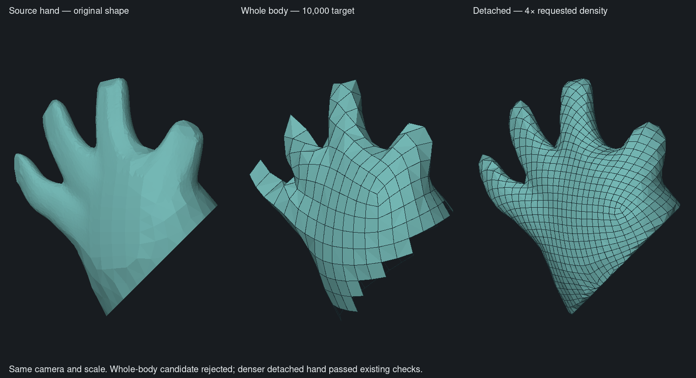
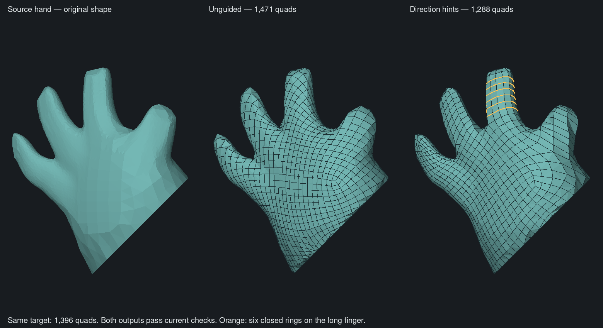
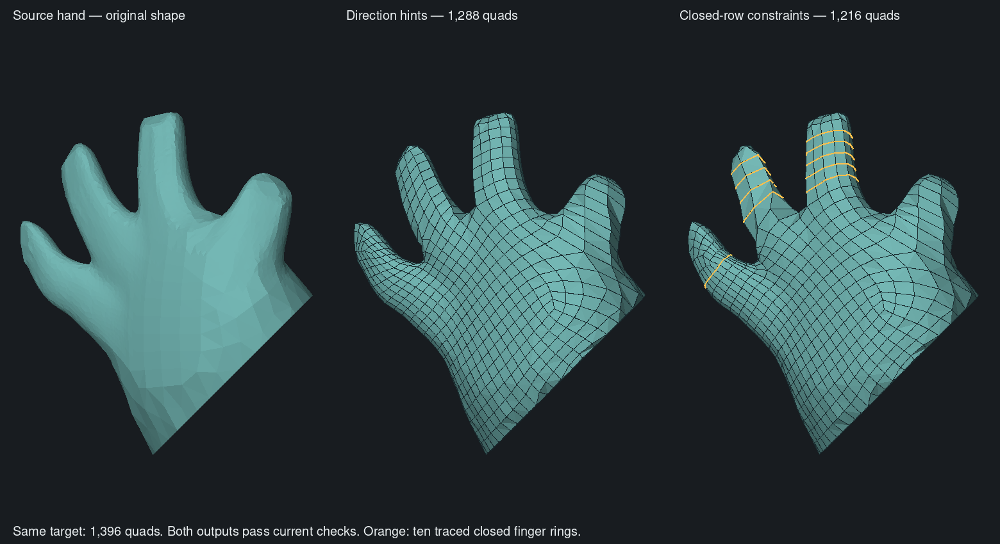
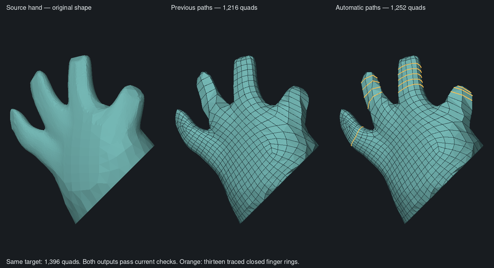
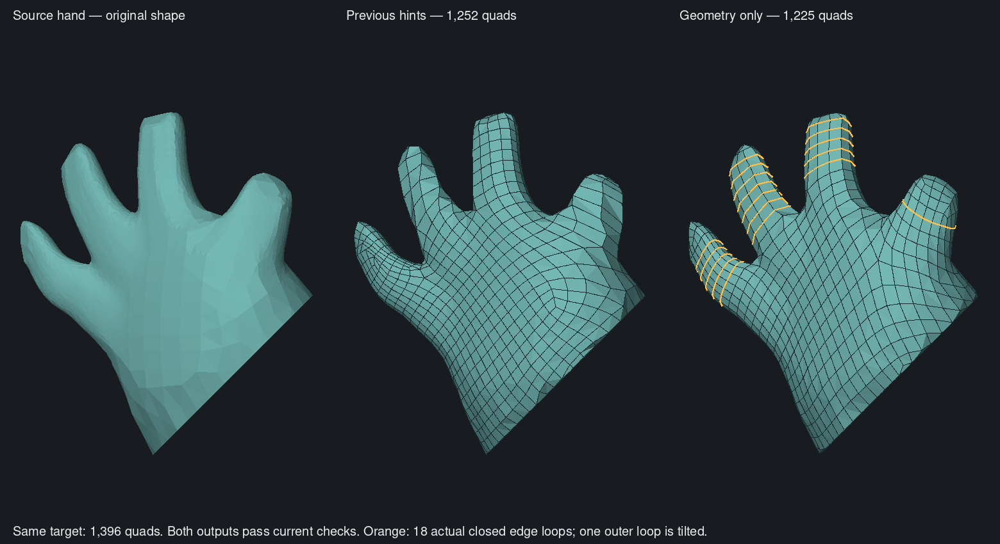
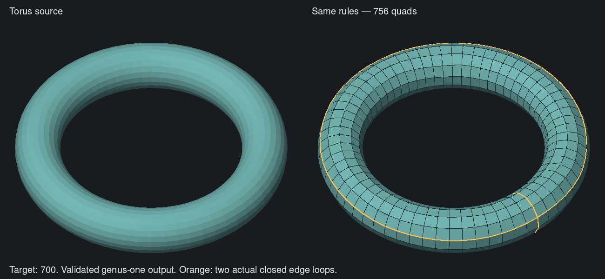
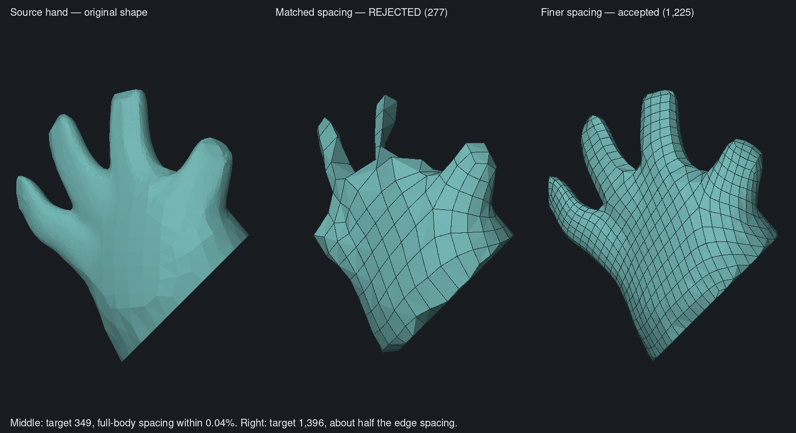
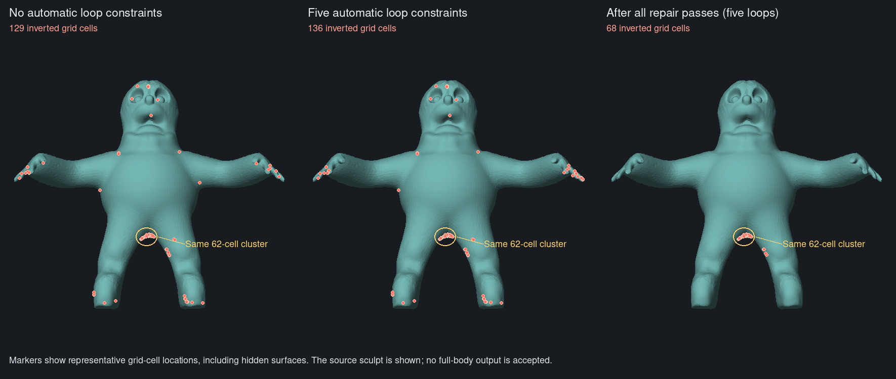
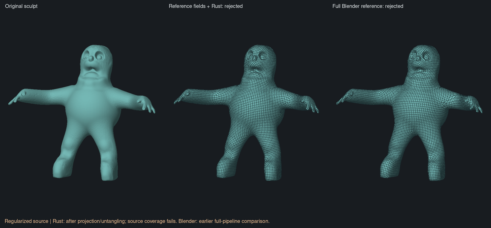
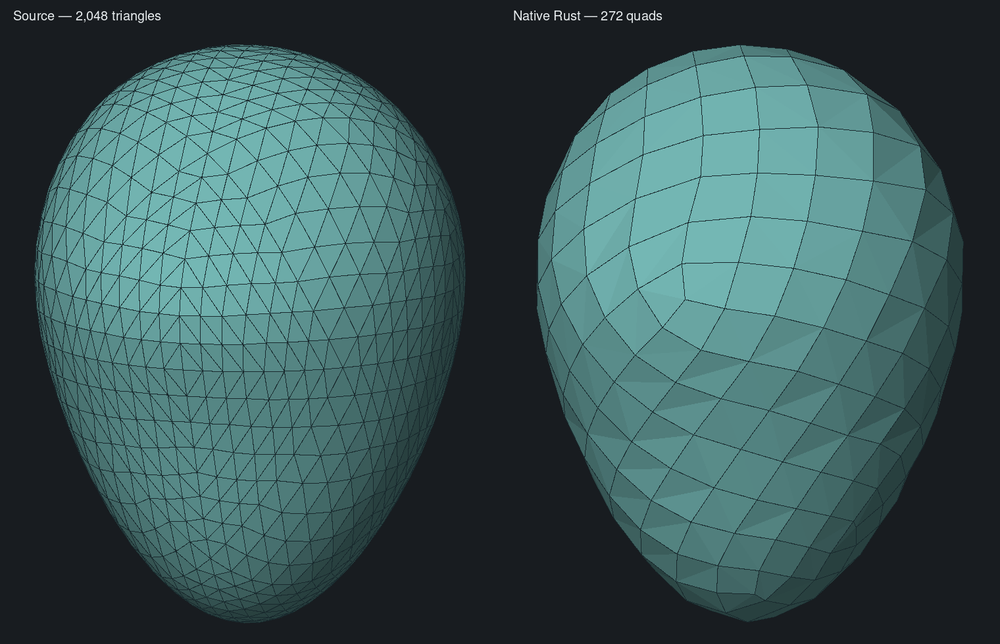

# Automatic retopology feasibility

**Revised decision for issue #10 — 4 November 2026.** The triangle-collapse and pairing prototype does **not** meet the automatic retopology goal. The user's character was deliberately made with poor topology: its surface is the reference, and a new layout must be generated. The small cylinder/bulb tests below establish that the prototype's controls change the result, but do not establish useful automatic character retopology. Retain those measurements as experimental evidence; replace the solver foundation before accepting this feature. The existing preview/apply implementation remains unchanged. [Current prototype workflow](../../guide/modeling.md#guide-a-retopology-preview)

## Product target and acceptance

The user's reference is [Exoside Quad Remesher](https://exoside.com/). Its [user documentation](https://www.exoside.com/quadremesherdata/QuadRemesher_1.3_UserDoc.pdf) describes automatic generation of a fresh quad mesh, a target count, curvature-adaptive sizing, and painted control over smaller or larger elements. This is a behaviour and quality reference; no claim of algorithm equivalence or performance parity is established here.

For Clay Form, acceptance requires:

- Useful automatic output with no paths or paint. Generate new vertex placement and connectivity using the source surface, its shape features, and the requested budget. Poor input edge flow must not dictate the output layout.
- Multiple optional surface guides that steer layout generation, including nearby and intersecting guides. Distinguish preferred direction from an explicitly supported edge-loop constraint; do not imply that an orientation preference guarantees a closed loop.
- Density paint independent of the sculpt mask: **more detail**, **less detail**, and **automatic/unpainted**. Paint modifies desired local spacing around the automatic allocation; unpainted regions do not ask to retain the original vertex density. Erasing paint restores automatic behaviour.
- A visible choice between uniform spacing and shape-adaptive allocation, with clear behaviour when detail preservation conflicts with the requested polygon count.
- Same-shape tests with deliberately different input sampling densities and triangulations. At a fixed budget and with no guidance, compare spatial density, flow, and surface error; identical vertex coordinates are not required.
- Visual inspection of the biped's face, fingers, shoulders, belly, and crotch, plus geometry checks for degeneracy, manifoldness, component preservation, surface error, and budget. Also measure runtime, peak memory, cancellation, and failure behaviour on the supported laptop class.

Automatic reconstruction is the first gate. Paths and paint refine a useful automatic result; they must not be necessary to rescue an inherited triangulation. Preserve the existing undoable preview/apply transaction and hidden source. Detail projection can restore geometric detail but cannot fix edge flow.

## App integration — 6 November 2026

The native Rust pipeline is now the app's guided-retopology backend. The
[integration report](native-app-integration.md) covers multiple saved guides,
independent more/less/automatic density painting, shape adaptation, progress,
cancellation, saving and Undo/Redo. The original biped completes through the real
app controls with **10,122 quads** at a 10,000 target. Its connectivity and f32
vertex positions match the accepted standalone result exactly. The app preview
took **30.574 s** in the test harness, including preparation, attribute transfer
and final validation after coordinate conversion; this is not a release-app
benchmark. The earlier standalone timings below remain separate measurements.

The feature is still experimental. A nearby 10,519 target fails the unchanged
shape check, and coarse fingers/uneven poles remain visible. Large models start
at a 10,000 target; failed solves never become applicable drafts. See the
[current workflow](../../guide/modeling.md#guide-a-retopology-preview).

## Native Rust implementation in progress

The independent [`clay-retopology` crate](../../../crates/clay-retopology/README.md) reconstructs a surface-field lattice in Rust. It now ports QuadriFlow's triangle-fan separation **before** quad pairing, angle-based hole filling without invented centre vertices, and deterministic valence cleanup, in addition to the previously ported fitting and integer-graph stages. No C++ or Blender runtime dependency is added.

**The complete extraction and cleanup now match pinned upstream C++ exactly on identical repaired biped inputs.** At both 5,000 and 10,000 targets, every output position, source membership and quad index is identical before and after cleanup. The [upstream audit](upstream-audit.md) describes the harness and remaining differences. This is stage parity, not complete-pipeline or visual-quality parity.

**Latest, 6 November: the original sculpt now completes entirely in Rust.**
The [native integer port and complete pipeline](native-integer-port.md) produce
**10,122 quads**, passing the unchanged orientation, topology and sampled shape
checks against the untouched original. Every integer edge and face frame matches
the pinned C++ mapper on three saved character inputs. The accepted output is
byte-identical to the earlier passing C++ stage control; C++ is no longer used
to produce it. The new public entry point includes five-pass native preparation
and final original-source validation. That standalone milestone is now integrated into the app as described above;
coarse fingers and uneven poles remain visual limitations.

**Updated release timing:** reconstruction on the prepared character fell from
17.83 s to **8.32 s**; integer mapping fell from 10.19 s to **0.92 s**. A complete
run from the original sculpt, including preparation and validation, took
**25.35 s**. The earlier C++ operator measured 8.51 s on the same prepared input,
with different validation work and output quality. See the
[new report](native-integer-port.md#release-timings) and
[historical matched-input baseline](native-retopology-performance.md).

The earlier [native preparation experiment](native-input-preparation.md) records
how the C++ mapping transplant isolated this port boundary. Its rejected native
mapper results are historical, not the current default closed-surface solver.

**6 November: the regularized whole character now passes the existing checks in
Rust.** The geometry-agnostic [fine-neighbour-order fix](native-fan-order.md)
produces 9,157 quads and reduces maximum sampled coverage error against the
original sculpt from 2.653h to 0.900h. All native fields match the pinned C++
reference exactly. That passing run uses offline MeshLab regularization; the
native replacement is evaluated above. App integration remains outstanding. Eighteen focused tests
and warnings-denied Clippy pass. This is a measured solver milestone, not full
feature acceptance.

The historical frozen-input comparison below isolates extraction from the earlier field/integer solve:

| Target | Extracted quads before / after cleanup | Result after dynamic optimization and fitting |
| ---: | ---: | --- |
| 5,000 | 4,588 / 4,583 | Rejected: fingertip coverage; first failing distance 0.09024 versus spacing 0.08149 |
| 10,000 | 10,620 / 10,618 | Rejected: no outward render diagonal on a crotch-region quad |

Running the original C++ extraction/cleanup on those same inputs reaches the same final failures. Those two stages are therefore not sufficient to explain or cure the remaining problems. The source-field/integer stages and continuous fitting remain under investigation.

The original **Blender** QuadriFlow output was also tested without changing its positions. Our strict normal check rejects 3 of its 4,368 quads, and the worst sampled source-coverage error is 1.749 grid spacings. Consequently, passing these gates is a stricter requirement than reproducing that reference mesh. They remain unchanged; a nearest-source-normal disagreement is not by itself a proof of self-intersection.

The current [extraction measurements](native-extraction-progress.json) retain input hashes, exact comparisons, whole-mesh diagnostics and timings. The [earlier fitting measurements](native-upstream-progress.json) belong to the preceding code digest and are historical. Frozen repaired snapshots are necessary because bounded SAT timeouts can change which integer repairs complete between runs. All heavy local work ran sequentially with one compiler job, the shared build lock and a 500 MiB process cap.

**5 November positioning control:** the unmodified upstream dynamic optimizer,
fed the frozen 10,000-target Rust intermediate, has 57 quads failing the
orientation check versus Rust's 56; 54 failing quad indices are shared. All ten
upstream linear solves converge. The fixed-position solve agrees with upstream
within 2.73e-10, and the documented axis-normalized dynamic variant agrees within
2.01e-10. Changing only the initial positions to source-membership centres does
not cure the fold. This moves the investigation to the earlier field/integer
mapping and its geometric constraints; it does not identify a particular bug
there yet. [Positioning experiment and controls](native-positioning-progress.json).
These comparisons precede final surface projection/untangling and are not a
complete upstream remeshing run.

**5 November detached-hand control:** cutting across the bent wrist at
`x + z = 3.2`, preserving the original scale and capping the cut, does not by
itself fix the result. At the whole-body run's nominal spacing (349 target
quads, including the cap), extraction is rejected for a disconnected vertex
fan. At four times that target (1,396), the same hand produces **1,471 quads
and passes the existing acceptance checks**. Its worst sampled two-way error
is 0.01434 model units, about half its local spacing. The whole-body candidate's
worst sampled source-coverage error is 0.10633, on this hand.

This supports testing greater local resolution on the attached hand. It does
not prove that global coupling is irrelevant, or that density painting will
reproduce the isolated result: cutting changes the hierarchy and introduces
a cap. The open-wrist control was interrupted before a final result and is
inconclusive. Guides were not exercised. An initial axis-aligned cut was
discarded after visual inspection showed it clipped the side of the bent hand.
No solver or acceptance threshold changed for this experiment.
[Inputs, controls and results](native-hand-isolation-progress.json).



**5 November direction-priority experiment:** estimate the least-curved tangent
direction in connected surface neighborhoods, restricted to the finger region,
and use 492 sparse hints to steer the existing orientation solve. An audit-only
control discards those hints before the position solve, separating direction
guidance from the existing guides' placement influence. Default solver behavior
is unchanged. This is an offline experiment, not automatic tube segmentation or
an explicit requirement that edge rows close into rings.

| Same capped hand | Target | Output | Strict closed finger rings | Acceptance |
| --- | ---: | ---: | ---: | --- |
| Unguided | 349 | No final candidate | — | Disconnected vertex fan |
| Existing direction + placement guides | 349 | No final candidate | — | Disconnected vertex fan |
| Direction-only hints | 349 | 294 quads | 2 | Rejected: finger shape loss |
| Unguided | 1,396 | 1,471 quads | 0 | Passes current checks |
| Direction-only hints | 1,396 | 1,288 quads | 6 | Passes current checks |

The six higher-budget rings are **all on the long central finger**. Other
fingers still have diagonal flow. The loop measurement follows opposite edges
through valence-four vertices and requires a complete closed path; its geometric
finger-ring filter is documented in the [experiment record](native-hand-directions-progress.json).
The tracer finds the expected ten rings on an analytic cylinder, and the
highlighted rings were checked against the accepted OBJ's actual edges.

At the higher target, measured finger-edge alignment error falls from 21.19°
to 12.68° (weighted by edge length). Maximum sampled two-way surface error
increases from 0.01434 to 0.02229; both pass the existing gates. The low-budget
candidate remains unacceptable: its worst sampled source-coverage error is
0.20653. This supports direction guidance as a useful priority, while showing
that it does not ensure adequate resolution or clean loops throughout the hand.



The [offline hint generator](../../../scripts/retopology/make-hand-direction-guides.py)
uses NumPy and takes `source.clay output-directory`; its region and scales are
specific to this fixture. The audit example's `capture-direction-guided source.clay
raw.json target guides.json` command creates an unrepaired direction-only
snapshot; use the existing `repair`, `diagnose-candidate` and `resume` commands
to complete and validate it. Hard boundary/sharp constraints are deliberately
excluded from this control. The focused direction-only and existing multi-guide
tests pass, as does Clippy for the audit example with warnings denied. No app
controls or whole-body results changed in this pass.

**5 November closed-row constraint experiment:** tracing the accepted hand
finds rows winding around the adjacent and opposite outer fingers without
closing. The selected source cycles have transported integer periods of
`(-9, 3)` on the adjacent finger and `(12, 0)` on the central finger: the former
changes axial row after one circuit, whereas the latter does not. This matches
the distinction discussed in sections 2.4–2.5 of
[Global Structure Optimization of Quadrilateral Meshes](https://cgg.unibe.ch/media/papers/bommes_2011_eg1.pdf)
(Bommes, Lempfer and Kobbelt, 2011).

Soft guides sampled from closed geodesic contours were tested first. With and
without their placement influence, both meshes passed the existing checks but
neither produced strict closed finger rings. The subsequent audit control uses
the frozen curvature-direction field and locks perpendicular integer offsets
to zero along three selected source-edge cycles. It then runs the existing
regularity correction, repair, extraction and fitting stages. This uses native
lattice constraints; it is not an implementation of the paper's GP-operators.

At the **same 1,396 target**, the constrained result has **1,216 quads and ten
closed finger rings**: five on the central finger, four on the adjacent finger,
and one at the short outer finger's base. The preceding direction-only result
has 1,288 quads and six rings, all on the central finger. Both pass the unchanged
acceptance checks. Maximum sampled two-way error increases from 0.02229 to
0.02400. The opposite outer finger still has no closed rings, and stretched
quads remain near the newly aligned finger base.



All 149 perpendicular edge locks survive repair, and every highlighted cycle
closes on the accepted OBJ's actual edges. A focused synthetic-cylinder test
checks coordinate-axis transport and atomic rejection of invalid cycles;
audit-example Clippy passes with warnings denied. The
[measurement record](native-hand-cycles-progress.json) includes the negative
soft-guide controls, timings, hashes and limitations. The
[cycle selector](../../../scripts/retopology/make-hand-cycle-paths.py) takes an
unrepaired snapshot and an output directory; the audit command
`constrain-cycles raw.json lattice-cycles.json constrained-raw.json` adds the
constraints before the existing `repair` and `resume` steps. This remains a
hand-specific offline experiment. Automatic region selection, scale/rotation
robustness, whole-body validation and app integration are still outstanding.

**5 November automatic closed-row selection:** the audit-only Rust selector now
finds four paths on the frozen hand field without wrist coordinates, finger
labels or world-axis tests. Sixteen geodesic farthest-point seeds produce
source-edge contours at intervals of the requested edge spacing. Planarity and
radial normal alignment identify tubular sections. Nearby sections are grouped
before checking whether their integer transport and distance from field poles
allow a closed row. This separation matters on the opposite outer finger:
four sections support its tubular shape, but only one is sufficiently clear of
poles to select.

This is a small geometric search, not an implementation of
[Plumber](https://faculty.cc.gatech.edu/~jarek/papers/Plumber.pdf) (Mortara et al.,
2004). That paper's use of cross-sections and regions to distinguish tubes from
surface patches informed the investigation. The native search additionally
ranks each usable section by how closely its integer circumference matches its
geometric circumference at the requested spacing. Penalizing both oversized
and undersized periods replaces an initial score that only penalized the latter.

| Same 1,396 target and frozen direction field | Output quads | Strict closed finger rings | Maximum sampled two-way error |
| --- | ---: | ---: | ---: |
| Previous hand-specific three paths | 1,216 | 10 | 0.02400 |
| Initial automatic three paths | 1,264 | 10 | 0.02870 |
| Final automatic four paths, native Rust | 1,252 | 13 | 0.02871 |

The final result has five rings on the central finger, four on the adjacent
finger, three on the opposite outer finger and one at the short outer finger's
base. It passes the unchanged acceptance checks. All 163 perpendicular edge
locks survive repair. The diagnostic geometry exactly matches the accepted
OBJ, and every highlighted ring follows that OBJ's quad edges. Native path
selection took 0.81 s; repair took 90.82 s on this run. These are individual
measurements, not a performance guarantee.



**This is progress in loop placement, not an overall mesh-quality acceptance.**
The stretched finger-base transition remains. Shape error increases, and two
quads near the short finger now have very short edges: the worst longest/shortest
edge ratio rises from 6.29 to 18.14, while the 95th percentile stays near 2.79.
The existing gates do not reject this edge-ratio defect. No gate was relaxed.
The next quality investigation should control circumferential allocation and
transitions around poles, rather than treating closed rings alone as success.

An earlier four-path choice failed repair with five inverted grid cells. A
controlled comparison kept the three passing paths and added only the new
opposite-finger path; that passed and produced the three additional rings.
Saving the failed repair state located all five inversions on the short finger.
The final circumference score selects the passing short-finger path without a
finger-specific exception. This is evidence from one fixture, not a guarantee
against bad automatic choices on other models.

The native selector chooses identical vertex sets after a 0.713-radian rotation
around an arbitrary axis, and after that rotation combined with 7× scaling and
translation. Two focused Rust tests cover tube wrapping, the same similarity
invariance on a synthetic tube, rejection of planar disk contours/open fields,
and cancellation. Audit library/example Clippy passes with warnings denied.
These checks cover **selection**, not invariance of the full remeshing pipeline.
The earlier curvature-direction hints remain hand-specific; the selector is
audit-only, uses median spacing, and has not been validated on whole characters,
different triangulations, painted spacing fields or app interaction.

The [record](native-hand-auto-cycles-progress.json) includes successful and
rejected controls, quality metrics, resource limits, hashes and remaining work.
Reproduce from the existing unrepaired direction-guided snapshot:

```sh
audit select-cycles direction-1396.raw.json selection.json cycles.json
audit constrain-cycles direction-1396.raw.json cycles.json constrained.raw.json
audit repair constrained.raw.json repaired.json
audit diagnose-candidate repaired.json candidate.audit.json
audit resume repaired.json accepted.obj
```

The commands refuse to overwrite output files. `repair-diagnostic raw.json
attempted.json` preserves a failed attempt with `repaired: false` and a nonzero
exit status; it does not produce an accepted mesh. The
[similarity check](../../../scripts/retopology/check-cycle-selection.py) takes
`audit-executable raw-snapshot.json output-directory` and requires NumPy only
for generating transformed diagnostic inputs. The selector and solver run in
Rust. Use the shared build lock and memory limits described in the records.

**5 November geometry-only direction hints:** the next audit experiment removes
the remaining hand-coordinate filters, fixed world-unit radii and axis-aligned
voxel thinning from direction-hint generation. The new Rust estimator fits a
symmetric normal derivative in connected surface neighbourhoods of radius
`3h`, where `h = sqrt(surface area / target quads)`. It uses area weights,
dimensionless confidence/fit thresholds and geodesic thinning at spacing `h`.
Flat, isotropic or unreliable estimates contribute no preferred direction.
There are no anatomical labels or region masks in either hint generation or
path selection. This is an audit-only uniform-spacing control; it does not yet
incorporate painted/adaptive spacing in hint generation.

[Rusinkiewicz's curvature-estimation paper](https://pixl.cs.princeton.edu/gfx/pubs/Rusinkiewicz_2004_ECA/index.php)
provides relevant context for normal derivatives and neighbourhood scale. This
implementation extends the earlier local least-squares experiment; it is not a
port of that paper's per-face tensor-averaging method.

Cycle sampling now uses `h/2` intervals, with the same pole-clearance requirement
and physical search extent. This finds a usable section between two poles on a
short region that the coarser sampling missed. The 512-spacing extent limit
bounds the search to at most 1,024 section levels per seed. The final native run
uses the original hand source, unchanged 1,396 target and no manual guides:

| Hand result | Quads | All strict closed edge loops | Max sampled two-way error | Worst edge-length ratio | 95th-percentile ratio |
| --- | ---: | ---: | ---: | ---: | ---: |
| Previous hand-specific hints, automatic paths | 1,252 | 16 | 0.02871 | 18.14 | 2.79 |
| Geometry-only hints and paths | 1,225 | 18 | 0.01881 | 5.44 | 1.95 |

The unchanged earlier finger-ring classifier counts 15 aligned rings in the
new result. Three other real closed loops are excluded by that classifier:
two extend below its coordinate cutoff and one is oblique to its reference
direction. The new [layout metrics](../../../scripts/retopology/measure-layout.py)
trace opposite-edge cycles without anatomical or directional filters. The image
highlights all 18 actual closed edge loops, not 18 anatomically aligned rings.
Pole placement and distorted junction quads still need improvement.



The identical rules also pass end-to-end on a procedural **torus**, producing
756 quads at a target of 700, 75 closed edge loops, a worst edge-length ratio of
1.38 and maximum sampled error of 0.03384 (0.106 of its requested spacing).
The accepted mesh retains one component and genus one. This is a non-anatomical
control, not evidence that arbitrary organic or mechanical models are solved.



The hand's 349 selected hint vertices and their directions are preserved under
rotation and 7× scaling plus translation; its four selected source cycles are
also preserved. The focused torus test independently checks hint alignment and
similarity invariance. Other focused checks cover flat/isotropic regions,
cancellation, the work-budget guard, tube-cycle selection and generic loop
tracing on cylindrical/toroidal grids. Audit-library/example Clippy passes with
warnings denied. These tests do not establish full-pipeline invariance to mesh
triangulation or rigid motion. All 144 hand and 38 torus perpendicular locks
survive repair, and the rendered geometry matches the accepted OBJs exactly.

The estimator's total traversal budget scales with input vertex count, from
40 million to a ceiling of 400 million visited edges, while neighbourhood sizes
remain unchanged. An initial full-character attempt stopped at the original
40-million cap before meshing; it is not an output-quality failure. Run details,
hashes and limitations are recorded in
[the geometry-only progress record](native-geometry-directions-progress.json).
The 10,000-target full-character retry completed hint generation (2,901 hints),
field capture and selection of five cycles, but its repair process hit the
external 180-second timeout. Its final coarse-repair log still reported 112
inverted cells. That count is an intermediate coarse-grid diagnostic, not a
final-mesh count. No repaired snapshot or accepted full-character mesh was
produced; this run is incomplete, not a completed solver rejection. The
estimator and solver remain outside the app UI.

To replace the former manually restricted direction-hint generation:

```sh
audit curvature-guides source.clay target-quads directions.json guides.json
audit capture-direction-guided source.clay direction.raw.json target-quads guides.json
```

Continue with `select-cycles`, `constrain-cycles`, `repair` and `resume` as above.
The [hint-similarity check](../../../scripts/retopology/check-geometry-hints.py)
takes `audit-executable source.clay target-quads output-directory`.

**5 November repair diagnostics and matched-spacing control:** the new audit
trace separates local infeasibility from SAT time/work limits, records patch
sizes and locations, and saves resumable coarse-pass checkpoints. Solver
objectives, guide locks and acceptance gates are unchanged. The
[diagnostic record](native-repair-diagnostics-progress.json) contains input and
code hashes, per-run outcomes, resource bounds and final locations.

The hand comparison now matches **physical requested spacing**, rather than
giving the isolated part a disproportionately large polygon budget:

| Case | Target quads | Requested spacing `h` | Candidate quads | Outcome |
| --- | ---: | ---: | ---: | --- |
| Full character | 10,000 | 0.05762160 | — | Repair finished with 68 unresolved inverted grid cells |
| Same capped hand, matched spacing | 349 | 0.05764158 | 277 | Grid repair passed; final mesh rejected |
| Same capped hand, earlier finer control | 1,396 | 0.02882079 | 1,225 | Existing mesh gates passed |

The matched hand's spacing differs from the body's by only **0.035%**. Its
integer repair completes in 32.0 seconds, but eight candidate quads have no
outward-facing render diagonal. The sampled source-to-result error reaches
0.19493 model units (3.38 requested spacings), compared with 0.01881 in the finer
control. There is no accepted OBJ for the matched-spacing candidate.



The successful isolated result used half the edge spacing and four times the
nominal polygon density. **Isolation alone therefore does not explain its
success.** This demonstrates resolution sensitivity in the current pipeline;
it does not prove that this shape cannot be represented well at 349 quads.
Both hand runs use the same capped cut and geometry-only rules. Changing `h`
also changes field neighbourhoods and automatic selections (133 hints/one
cycle versus 349 hints/four cycles), so this is an end-to-end spacing control,
not a fixed-field comparison. The artificial cap and removal of the rest of
the surface remain differences from the full-body input.

For the body, greedy repair leaves 136 inverted grid cells with the five
automatic cycles and 129 without them. **Both contain the same 62-cell spatial
cluster at the leg junction.** The coarse patch containing that cluster has
64 inversions, no locked guide coordinates, and repeatedly exhausts its search
budget. It grows from 356 faces at depth 5/radius 1 to 7,539 faces at depth
0/radius 4. This patch is not rejected by a size limit. Other patches do reach
size limits; the trace distinguishes those cases.

In the first 90-second constrained run, completed coarse SAT attempts comprise
37 time limits, one callback-work limit, 86 local infeasibility results and nine
solutions. Time-limited attempts account for 74.5 of the 87.6 recorded SAT
seconds. These totals exclude the interrupted attempt and surrounding repair
work. Local infeasibility means the patch cannot satisfy its current fixed
boundary/domain constraints; it does not prove the whole remeshing problem
impossible. The without-cycle control is bounded at 45 seconds and compares
the initial locations and common coarse passes, not final mesh quality.

The constrained run resumes from its depth-3 checkpoint, finishes coarse repair
with 112 inversions, then reaches fine repair. A second continuation from the
completed coarse checkpoint lets fine repair finish in 106.5 seconds. It rejects
the result with **68 remaining inversions and zero regularity defects**. The
same 62-cell junction cluster survives; four remaining cells are on the nearby
upper leg and two are behind the junction. This is now a completed solver
rejection, not just an external timeout. No full-character mesh is accepted.



Markers are representative field-triangle centres, including hidden surfaces,
not output vertices or exact coarse-cell footprints. Spatial grouping uses a
generic Euclidean distance of `2h` only for reporting; these anatomical labels
are human descriptions of the image and are not solver rules. The next bounded
investigation is the frozen junction patch: compare its search/boundary
behaviour directly before changing the global solver. The coarse hand's
geometric allocation/fitting failure remains a separate quality problem.

Reproduce with new output directories and the original frozen input each time:

```sh
audit repair-trace constrained.raw.json trace-1 90
audit repair-trace constrained.raw.json trace-2 180 trace-1/checkpoint.json
audit repair-trace constrained.raw.json trace-3 120 trace-2/checkpoint.json
python3 scripts/retopology/summarize-repair.py trace-1 summary.json --spacing 0.05762159740626388
```

`events.jsonl` is flushed after every event. `checkpoint.json` is atomically
replaced after completed coarse passes; a resumed interrupted pass is repeated.
`completion.json` records rejection/deadline status, and `attempted.json` saves
the current fine lattice. During coarse cancellation that fine lattice does
not contain partial coarse changes: **resume from the original input plus the
checkpoint**, not from `attempted.json`. Fine repair itself restarts from the
completed coarse checkpoint. A checkpoint is a same-build offline fixture;
its input fingerprint rejects accidentally mixing inputs, not hostile data.
Even a successful repair still requires extraction and final mesh validation.

Five focused Rust tests pass across SAT reporting, cancellation, checkpoint
round-trip/resume equivalence and failed-trace persistence. Audit-library/example
and non-audit-library Clippy pass with warnings denied. A real mismatched-input
resume is rejected before creating its trace directory. Runs use the shared
lock, one compiler job, a 500 MiB solver cap and no swap; peak solver RSS is
236.8 MiB. App integration, painting and multiple-path UI remain outstanding.

**5 November frozen junction replay:** the [next comparison](native-junction-repair.md)
isolates the 64-inversion coarse patch, distinguishes boundary infeasibility
from search timeouts using pinned upstream code, and introduces scalar-coordinate
SAT in native coarse repair. The finer hand still passes final validation, with
repair reduced from about 33 seconds to 1.6 seconds in these single runs. The
whole character remains unaccepted; this does not resolve its junction or the
coarse hand's geometry failure.

**5 November surrounding-grid follow-up:** [audit experiments](native-junction-repair.md#surrounding-grid-follow-up--5-november)
now grow repair boundaries from solver conflicts and compare a rebuilt hierarchy
with global flow propagation. The completed body still has 64 inversions.
Global closure repair can move or multiply them, so the worsening trial was
rejected with verified rollback. A smaller orientation-preserving expansion
provides a 715-cell boundary conflict for the next investigation; it is not an
accepted full-model repair.

**5 November orientation follow-up:** the [original-code replay and strict repair experiments](native-junction-repair.md#orientation-preservation-and-original-code-replay--5-november)
still leave 64 cells. Original QuadriFlow's full SAT-repair schedule also stalls
on this frozen grid. Longer contractions preserve neighbours but do not reduce
negative integer area. Read-only pole diagnostics and a pinned initialization
comparison narrow the next investigation to the surrounding map/seam constraints;
no whole-character output is accepted.

**5 November quad-fill follow-up:** the [cut-and-rebuild experiment](native-patch-rebuild.md)
excludes the 64 failed coarse cells and closes three clean boundary loops with
15 new quads. The result preserves closed source topology, but the 7,759-quad
candidate still fails source fitting and has 27 quads without an outward
diagonal before projection. The finer-hand and torus controls are exactly
unchanged. This is an audit-only fallback experiment, not an accepted character
or an app Fill Holes feature; no triangle fallback is used.

**5 November fresh-input comparison:** [four matched cases](native-fresh-input-comparison.md)
test original versus more evenly triangulated inputs from the start, without
guides or hole-filling bypasses. Blender's full QuadriFlow reference improves
from nine outward-failing quads to one and reduces maximum sampled source
coverage error from 0.09182 to 0.04314. The native original-input candidate still
fails geometry, while the regularized-input native run stops at one unresolved
grid cell. No result is accepted. Input regularization is a useful lead;
matching early field/layout construction is the next investigation.

**5 November controlled field swap:** with identical sampled geometry, normals,
areas, adjacency and spacing, [replacing only the early fields](native-field-comparison.md)
with the pinned original QuadriFlow solve lets the unchanged Rust grid repair
finish with zero inversions in 0.75 seconds. Native fields leave one inversion
after 44.74 seconds. The resulting 9,369-quad character still fails source
coverage: projection/untangling removes two outward-failing quads but shortens
a finger further. This isolates an early-field contribution to the repair
failure without establishing complete-pipeline parity or identifying a single
faulty field operation. Audit JSON now preserves every floating-point bit;
three focused regression tests pass. The app backend is unchanged.



**5 November Rust field-stage port:** the default native field solver now
[matches the pinned serial C++ fields exactly](native-field-port.md) on both
the original character (81,636 samples) and regularized character (52,857).
Fourteen focused regressions pass, including guides, painted density, source
resampling and boundaries. Full Rust reconstruction reaches zero unresolved
grid cells on both inputs, producing 9,296 and 9,369 quads respectively. Both
still fail final geometry checks; regularized-input projection shortens a
finger despite removing outward failures. The earlier transplant's mesh is now
reproduced entirely in Rust. App integration remains outstanding.

**6 November follow-up:** the common-input field match above held adjacency
ordering fixed. Porting the original surface-fan ordering now gives a passing
regularized character. See the [current report and visuals](native-fan-order.md)
for controlled integer-stage comparisons, native proof and remaining failures.

Earlier native-solver validation passed thirty focused Rust tests, including a C++-generated curved-surface extraction fixture, triangle-fan separation, hole filling, cancellation, guide influence, signed density and source-resampling tests. All-feature/all-target Clippy passed at that stage with warnings denied. CI, platform builds, interactive app review, painting/persistence and multiple-path UI integration are still outstanding.

Before the upstream-port pass, a small asymmetric curved fixture produced 272 quads from 2,048 triangles at a target of 300. Its recorded maximum sampled two-way error was 0.03602 model units over a 2.8-unit height. The earlier character runs failed with 16 unresolved folds at 5,000 quads and excessive initial fitting drift at 10,000. These historical figures and timings belong to the older code digest in [the baseline record](native-rust-progress.json), not the current implementation.



## Character feedback: `clay-session-retopo2`

The local export contains the applied result from release `018fb5824e2d`. Its source has 52,601 vertices and 105,198 render triangles. Every source and result mask weight is zero, and no guide was selected. Settings were target 35,066 polygons, input limit 110,000, density strength 1, and sharp protection enabled. With zero mask weights, the density multiplier has no effect on collapse costs.

The result contains 29,808 vertices, 24,546 editable quads, and 10,520 remaining triangles: exactly 35,066 editable polygons, of which 30% are triangles. The hidden source mesh matches the exported original exactly. The user rejected its topology. Reaching a count and producing valid faces is insufficient evidence of useful retopology.

Inspection of `src/sculpt/retopology.rs` confirms that reduction collapses existing edges, then paths rank convex pairings of surviving triangles. There is no orientation/position-field solve generating a fresh layout. This explains the structural limitation. The replacement comparison below includes a local resampling check; a broader test of the current and candidate solvers remains required.

Source export SHA-256: `f4c3c753a19a1f867f133d2d7794d8c28489c82143d79233d80a7d592b9b581f` (`stage-000.clay`). The user export is retained locally and is not bundled with the repository.

## Replacement solver evaluation

**Prior implementation decision, recovered from chat history.** In “Implement adaptive sculpt quads” on 26 October 2026, the user liked the QuadriFlow comparison but asked to remove the proposed bundled C++ integration, preferring an implementation in Rust from the papers. They raised mixed-language maintenance and mask support as concerns, while also saying that keeping things in Rust should not outweigh results at any cost. The earlier integration prototype was removed from the working tree and was not committed. That preference remains relevant: the new Blender runs are comparisons only, not acceptance of a C++ backend. Evaluate practical Rust options first and explicitly revisit this trade-off before adopting another implementation language. The earlier discussion concerned sculpting remesh; the current request explicitly targets automatic retopology.

Evaluate a surface-based orientation/position-field solver before extending the current controls. [Instant Field-Aligned Meshes, section 3.7](https://igl.ethz.ch/projects/instant-meshes/) distinguishes orientation strokes from position constraints that create an edge chain. [Frame Fields](https://igl.ethz.ch/projects/frame-fields/) provides relevant work on independently controlling local scale and direction. These are candidate foundations, not implemented capabilities.

Use [QuadriFlow](https://stanford.edu/~jingweih/papers/quadriflow/) as an automatic comparison. Its stock interface does not establish support for our multiple-path and signed-density requirements. Its paper also reports loss of small geometric features at coarse output resolutions; all-quad output alone is not acceptance. Do not select a production backend until character quality, constraints, cancellation, memory, dependency terms, and all supported platform builds have been evaluated.

An initial local comparison used Blender 5.2.3 LTS (`e13b728c6880`) with the untouched 105,198-triangle source, target 35,066, seed 0, symmetry/sharp protection disabled, and boundary preservation enabled. It ran with one requested thread inside the shared build lock and a 600 MiB memory cgroup with swapping disabled. The kernel stopped that process at the memory cap before it produced output. This is a failed bounded experiment, **not** an output-quality result, a runtime measurement, or proof that QuadriFlow cannot process this mesh. No Blender dependency or solver change has been added to Clay Form.

Reducing the target to 5,000 completed within the same limits. A second run replaced each of 515 belly triangles with nine coplanar children, using two centroid-insertion passes without moving the original surface. The selected original triangles have centroids satisfying `abs(x) < 0.4`, `abs(y) < 0.4`, and `z > 0`. All other settings were identical. [Recorded results](biped-quadriflow-comparison.json):

| QuadriFlow input | Input triangles | Output quads | Output vertices in belly | Solver time | Peak process RSS through statistics |
| --- | ---: | ---: | ---: | ---: | ---: |
| Original sculpt | 105,198 | 4,368 | 70 | 6.66 s | 556.2 MiB |
| Belly triangles subdivided ninefold | 109,318 | 4,525 | 74 | 4.86 s | 561.3 MiB |

The output belly count uses the same coordinate predicate on vertices. Both results have one connected component, Euler characteristic 2, and exactly two oppositely directed incident faces on every edge. All output faces are quads. These checks do not certify absence of self-intersections or bounded surface error. These are single runs, and their timings are not a performance comparison between input types.

A local wireframe inspection at the same camera shows a fresh grid over the body and face, instead of the prototype's dense face/feet and inherited belly layout. This compares different output budgets (the native prototype has 35,066 polygons); it is exploratory evidence, not a matched-budget quality ranking. The ninefold local change in input triangles caused a small change in output belly samples, which supports further evaluation. Neither run exercises guides, density paint, symmetry, attribute transfer, or cancellation. Face-loop quality and quantitative surface fit remain acceptance work.

The manual [Blender comparison script](../../../scripts/compare-retopology-blender.py) accepts a source `.clay` file, a separate output directory, a target, and optionally `refine-belly`. It writes diagnostic JSON, OBJ, and a standalone `.clay` result with cleared painted attributes; it does not modify the source. This script is a local validation tool, not a runtime dependency or the product's attribute-transfer implementation. For example, with the shared build lock held and suitable memory limits:

```sh
blender --background --factory-startup --threads 1 --python-exit-code 1 \
  --python scripts/compare-retopology-blender.py -- source.clay review-output 5000
blender --background --factory-startup --threads 1 --python-exit-code 1 \
  --python scripts/compare-retopology-blender.py -- source.clay review-output 5000 refine-belly
```

## What the earlier prototype's fields change

Paint is a scalar importance field read from the source mask. During simplification, high weights increase an edge's collapse cost. Non-overlapping batches favour cooler regions before spending the budget in warmer ones. The solver interpolates masks, vertex-group weights and vertex materials at contracted endpoints. It retains face-group assignments and explicit crease lines. The source keeps its original attributes and path attachment.

A saved surface path supplies tangent directions. At each possible quad, the nearest compatible guide sample increases the score for retaining an opposite pair of edges running along the path. Influence falls to zero at 12% of the source bounding-box diagonal. Reversing the tangent has the same meaning. Open paths and closed loops use the shared surface sampler. One selected path and its optional reflection across world X = 0 can influence a layout. The mirror control reflects the direction field. Its output connections can differ on either side.

## Same-source measurements

The procedural cylinder and asymmetric bulb each start with 1,216 oriented triangles and 610 vertices. Each has a diagonal surface path and the same height-based paint rule. All four runs per shape use the same source, target of 460 polygons and sharp-feature protection. Both strengths are either zero or one. Each resulting model has **322 editable quads, 138 triangles and 393 vertices**.

| Source | Fields enabled | Path coverage | Vertices inside painted region | Maximum error, source → result / result → source | Worker time |
| --- | --- | ---: | ---: | ---: | ---: |
| Cylinder | Neither | 25.8% | 149 | <0.00001 / <0.00001 | 85 ms |
| Cylinder | Path | 58.7% | 149 | <0.00001 / <0.00001 | 100 ms |
| Cylinder | Paint | 5.2% | 257 | 0.01280 / 0.00956 | 156 ms |
| Cylinder | Path and paint | 40.6% | 257 | 0.01280 / 0.00956 | 174 ms |
| Bulb | Neither | 13.3% | 207 | 0.01880 / 0.01509 | 124 ms |
| Bulb | Path | 86.2% | 207 | 0.01880 / 0.01509 | 139 ms |
| Bulb | Paint | 19.9% | 241 | 0.02856 / 0.02659 | 233 ms |
| Bulb | Path and paint | 83.4% | 241 | 0.02856 / 0.02659 | 250 ms |

**Coverage** counts equally spaced source-path samples within 0.065 model units of an editable polygon edge directed within 15° of the tangent. **Density** counts surviving vertices in the same physical region, below Y = −0.2. Increasing density there leaves fewer samples elsewhere, which raised the worst surface error on both fixtures. Paint alone also changed which edges were available along the path.

**Error** is the greatest nearest-surface distance over triangle vertices, edge midpoints and centroids in both directions, in model units. The cylinder is 2.16 units high and the bulb is 2.6. These finite samples can miss detail between them. Each result passed mesh validation, including polygon correspondence, positive triangle area, oriented two-face incidence on closed edges and a connected fan at every vertex. Runtime covers path sampling, simplification, pairing and validation in the unoptimised Rust test profile on an i7-7500U. It excludes rendering, project I/O and the independent measurements. These are individual runs on small meshes.

| Same source and camera | Unguided | Path and painted density |
| --- | --- | --- |
| Cylinder |  |  |
| Bulb |  |  |

The amber curve shows the selected surface path. The dark region is the source mask, also transferred to the result. Fewer horizontal edges cross the curve on the guided bulb. Narrow triangles still appear near its tip.

## Existing and external approaches

- **Fast quads** rebuilds from voxel occupancy and projects to the sculpt. At resolution 16 it produced 1,232 cylinder quads in 0.15 s and 802 bulb quads in 0.09 s. Their path coverage was 0% and 27%. Voxel resolution determines density and global remeshing clears the mask. Both voxel methods require closed input.
- **Optimized quads** also reconstructs in voxel space, then changes connectivity and fits the result to that reconstruction. On the same bulb at resolution 16 it returned 800 quads in about 3 s, with 36% coverage. On the cylinder it rejected the result after about 5 s at the 0.4-voxel shape gate. The comparison uses each method's minimum voxel resolution. Their polygon counts differ from the prototype's budget. Both use existing cancellable Rust code. [Prior head and branched-sculpt measurements](../dynamic-quads-2026-10-26/README.md)
- **Instant Meshes** solves orientation and position fields, with interactive brushes and feature alignment. Its authors report sub-second processing on some meshes with hundreds of thousands of faces, and support triangle surfaces and point clouds. An integration would need to map Clay Form paint to local spacing, transfer attributes and provide interruption points or isolate the solver in a cancellable process. The upstream licence includes redistribution conditions and an additional enhancements clause. Bundled dependencies would need a separate review. [Paper and timings](https://igl.ethz.ch/projects/instant-meshes/) · [Upstream licence](https://github.com/wjakob/instant-meshes/blob/master/LICENSE.txt)
- **QuadriFlow** accepts manifold triangle input, a target face count and optional sharp preservation. Its authors report under ten seconds per model in their evaluation. Its global flow solver targets fewer poles. The documented CLI provides no path or painted-spacing inputs. Integration would need constraint plumbing, cancellation and build testing across platforms. Upstream’s README calls the core MIT, but the inspected `LICENSE.txt` contains three-clause BSD-style terms and an additional enhancements grant; dependency terms are listed separately. Review the actual license files before any code reuse or distribution. Neither external solver was bundled or timed in the original cylinder/bulb study; the later bounded character experiment is described above. [Paper and timings](https://stanford.edu/~jingweih/papers/quadriflow/) · [Upstream controls and dependencies](https://github.com/hjwdzh/QuadriFlow#licenses)

## Limits of the prototype

- The input triangle limit defaults to 24,000 and can be raised in the dialog for testing, up to the active mesh capacity. It is session-only and captured in edit diagnostics. Oversized sources can open the dialog, but preview requires a sufficient limit before copying the source or starting a worker; the worker checks the limit too. Valence stays capped at 64, with at most 24 simplification sweeps and 16 million guide-sample comparisons. Raising the input limit does not raise those work limits. Cancellation, validation errors and stale previews leave the document intact. Dense production sculpts remain outside these measurements.
- The target is approximate. Open rims, crease endpoints and face-group boundaries stay fixed. Optional protection also locks bends of 45° or more. Conservative fold and quality checks still apply when that option is off. Sharp features and poles can leave extra polygons. Triangles remaining after pairing stay editable.
- Separate components stay separate, including open parts. Thin walls keep their connectivity. Nearby same-facing sheets can still pick up guide influence, and the checks do not certify absence of self-intersection. Where a path and its reflection conflict, the nearest compatible sample wins.
- Hidden faces, loose vertices, inconsistent winding, zero-area faces, nonmanifold edges or pinched vertex fans require cleanup. UVs and texture images require a transfer method before this tool can accept those models. Result models start with one subdivision level. The hidden source keeps its full stack.
- Detail projection can recover position changes on the new model using the saved source below it. Its mask and distance protections still apply. Inspect silhouette and wireframe before saving.

## Reproduction

The prototype measurements above are historical; its reduction backend and old
voxel-comparison test have been replaced. Use the [native app integration
commands](native-app-integration.md#reproduction-and-checks) for current CPU and
interactive checks. The older `guided_retopology_offscreen_review` remains an
optional cylinder/bulb capture; it now invokes the native backend and cannot
reproduce the historical reduction timings or mask-driven density tables.
