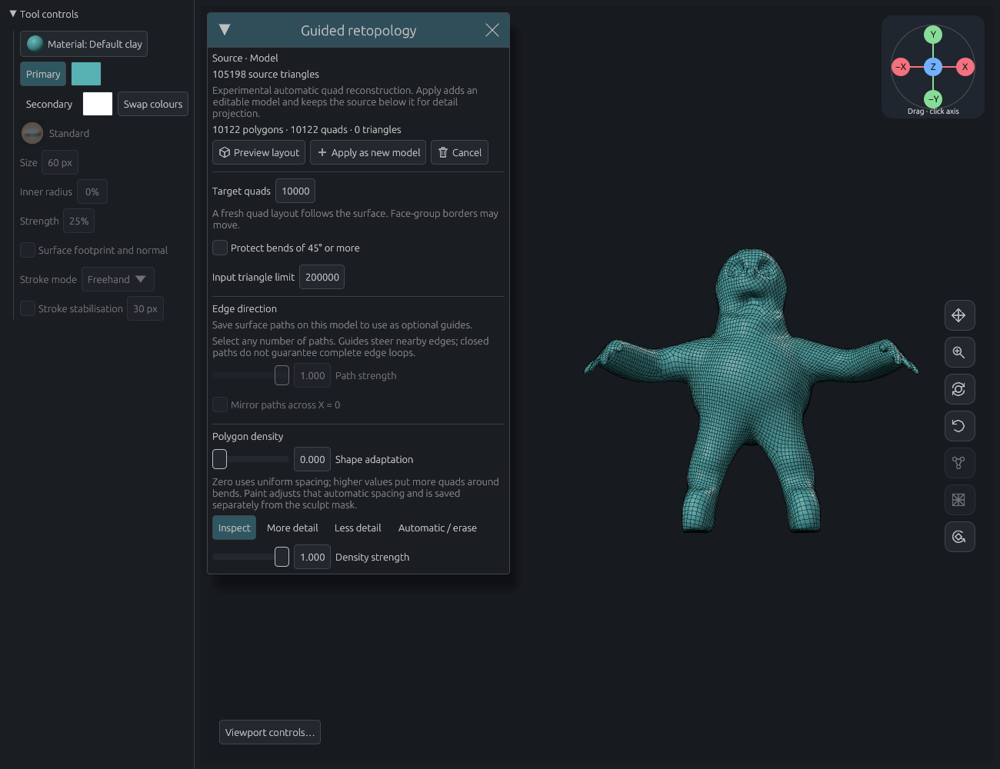
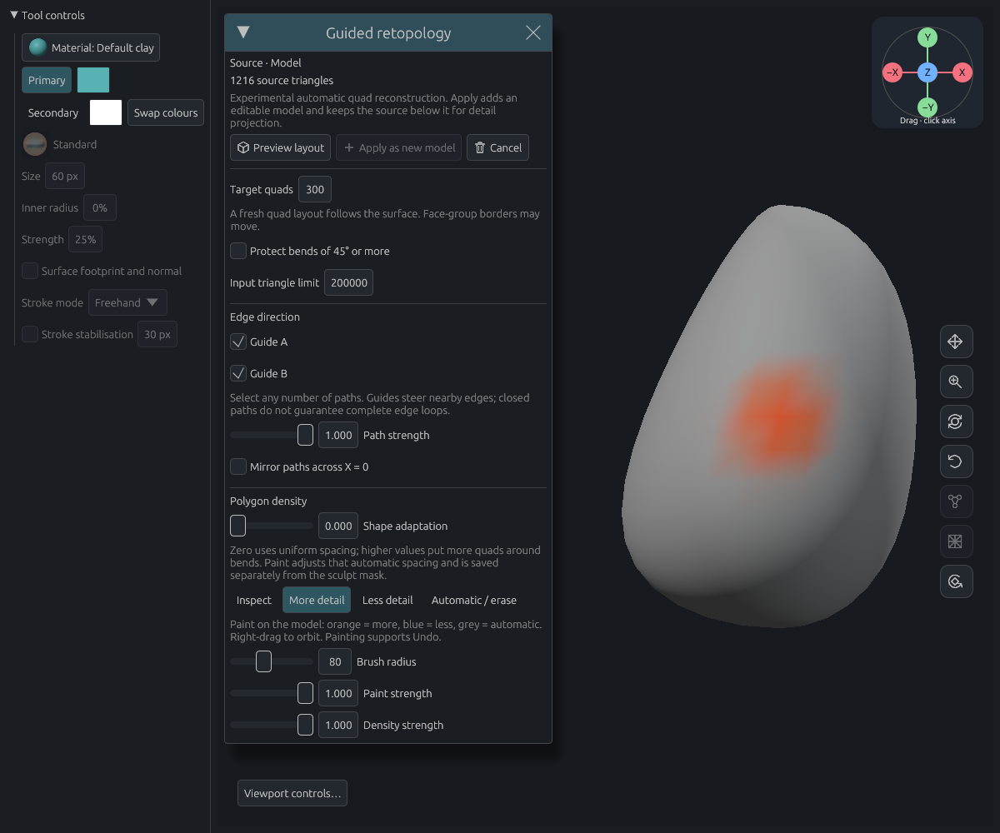
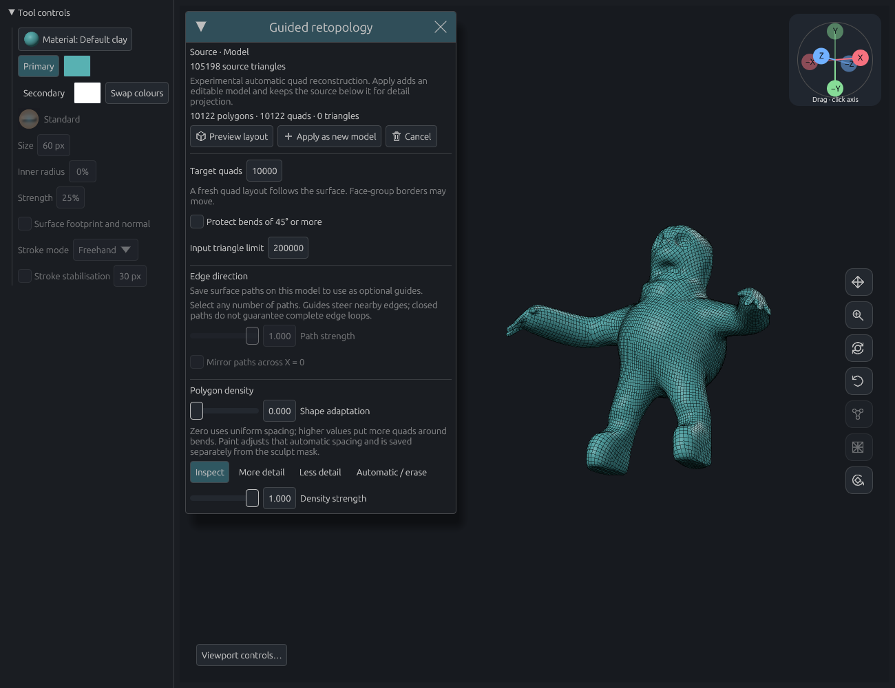

# Native retopology in the app

6 November 2026. The Rust pipeline replaces the old triangle-collapse/pairing
adapter in Guided retopology. It prepares the source, solves new directions and
connectivity, validates the result, and transfers attributes. No external solver
or body-part classification is used.



## Controls and document behavior

- Any number of saved surface paths can steer the field, with optional X mirroring.
  These are direction preferences, not guaranteed edge-loop constraints.
- More detail, Less detail and Automatic/erase paint directly on the source.
  Orange/blue/grey distinguish the three states. Radius, stroke strength and
  solver density strength are separate controls. The sculpt mask is unchanged.
- Shape adaptation exposes the solver's uniform-to-curvature allocation control.
- Progress and cancellation run through the existing private-preview worker.
  Applying adds one editable model and retains the unchanged hidden source,
  including its paths and stored subdivision levels. Application is one Undo.
- Density strokes have independent Undo/Redo, including while the dialog is open.
  Other scene edits remain blocked. Undo during a held stroke waits for release.
- Signed density uses tagged scalar weight channels. Normal group commands and
  group selectors exclude those channels; existing subdivision, merge, sampling,
  project persistence and history transport their values. Two registry slots are
  needed when the first density stroke is painted.
- The initial target is source triangles / 10, capped at 10,000; users can request
  up to 50,000. The input limit starts at 200,000 triangles.



## Whole-character result

The unchanged 52,601-vertex / 105,198-triangle `clay-session-retopo2` source was
loaded through project persistence, previewed and applied using real app controls.
The target was 10,000, with no guides, no density paint, zero shape adaptation
and sharp-bend protection disabled.

The result has **10,124 vertices and 10,122 quads**, with no remaining triangles
as editable polygons. Render triangles use the solver's validated diagonals.
Every quad index and every vertex coordinate, rounded to f32, matches the
accepted [standalone native output](native-integer-port.md). Source preservation,
closed topology, Apply, Undo and Redo assertions pass. A saved `.clay` artifact
contains the applied result and original source.

Preview took **30.574 seconds** in the application test harness. The app itself
was unoptimized; the solver, BatSat, bit-vec and glam were optimized. This includes
preparation, an extra check of the actual f32 output and attribute transfer, so
it is not comparable to an 8.32-second solve on an already prepared source.
It is also not a release-application benchmark. No new release executable was
built or launched in this integration step.



## Numerical and timing boundaries

The adapter uses the same shortest-roundtrip decimal coordinates as a project
export, decoded with correctly rounded JSON parsing. They convert back to the
same f32 source values. Direct binary widening follows a different preparation
and repair trajectory on this model. This representation policy makes live and
exported input reproducible; it is not a general numerical-stability fix.

After reconstruction, vertices are rounded to their actual app precision and
validated again against the exact in-memory source. No vertex moves during that
last check. Both source coverage and face orientation remain mandatory.

Optimizing only the main solver crate was insufficient for development tests:
unoptimized SAT helpers exhausted repair time budgets differently. That build
produced 10,129 accepted quads in 46.406 seconds through the app. Optimizing the
helper packages restored the accepted 10,122-quad layout and reduced the complete
preview to 30.574 seconds. Tests retain debug assertions. The release profile
already optimizes these dependencies.

## Remaining failures and limits

A **10,519 target still fails**, including with optimized helpers: a sampled
source point near `(-2.75880, 0.20817, 1.32856)` has coverage error `0.05800`
against local spacing `0.05616`. The adapter keeps this rejected result private;
it does not relax the tolerance, alter the user's target or fill in a draft.
The 10,000 initial budget is not evidence that nearby budgets are all robust.

Coarse fingers and irregular poles remain visible. The automated checks and
these captures establish the integrated workflow on the documented cases, not
Quad Remesher quality equivalence or acceptance on arbitrary sculpts. Whole-biped
combinations of intersecting guides, strong signed paint and shape adaptation
still need broader quality evaluation; the combined guide/paint regressions use
smaller controlled surfaces.

## Reproduction and checks

Twelve focused app/document/adapter and existing group tests pass. They cover private previews, stale and failed
results, input limits, cancellation, multiple guides, mirroring, source attributes,
mask independence, density persistence, subdivision, group-all, and history.
The software Vulkan interaction case clicks both guide checkboxes, paints all
three density modes, checks Undo/Redo, cancels a worker, previews and applies.
The whole-character capture separately tests the actual project loader and app
worker. The core combined signed-density/multiple-guide regression also passes.
Production-library Clippy passes with warnings denied; the focused test harness
passes Clippy with only unused helpers/imports from excluded tests allowed. Third-party
notices were regenerated and checked; the upstream port notices and BatSat's
original copyright notice are bundled.

The full application test harness exceeded a 1,400 MiB compiler cap on the 8 GB
laptop. [`stage-app-tests.py`](../../../scripts/retopology/stage-app-tests.py)
creates a disposable source copy that adds `cfg(any())` only to unrelated test
cases. Production modules and selected test bodies are unchanged; ordinary CI
still compiles the complete harness. This is a local memory workaround, not a
replacement for full CI. All heavy commands ran sequentially under the shared
build lock, with one Cargo job and tests on one thread.

On a machine able to compile the normal harness:

```sh
cargo test --locked -j 1 --lib retopology -- --test-threads=1
cargo test --locked -j 1 --lib density_paint -- --test-threads=1
CLAY_GPU_SOFTWARE=1 LP_NUM_THREADS=1 CLAY_GUIDE_PREVIEW=/tmp/clay-retopo-ui \
  cargo test --locked -j 1 --lib native_retopology_controls_offscreen_review -- --ignored --test-threads=1
# Set CLAY_RETOPO_SOURCE to the unchanged stage-000.clay and CLAY_GUIDE_PREVIEW
# to a separate review directory. CLAY_RETOPO_TARGET optionally overrides 10000.
cargo test --locked -j 1 --lib native_retopology_whole_sculpt_offscreen_review -- --ignored --nocapture --test-threads=1
```

Local artifacts are under the sibling directory
`../retopology-review/app-integration-20261106/`.
The final whole-model project is `whole-ui-optimized/integrated-retopology.clay`.
The [machine-readable report](native-app-integration.json) retains counts,
timing, source/project hashes and the rejected nearby-target measurement.
