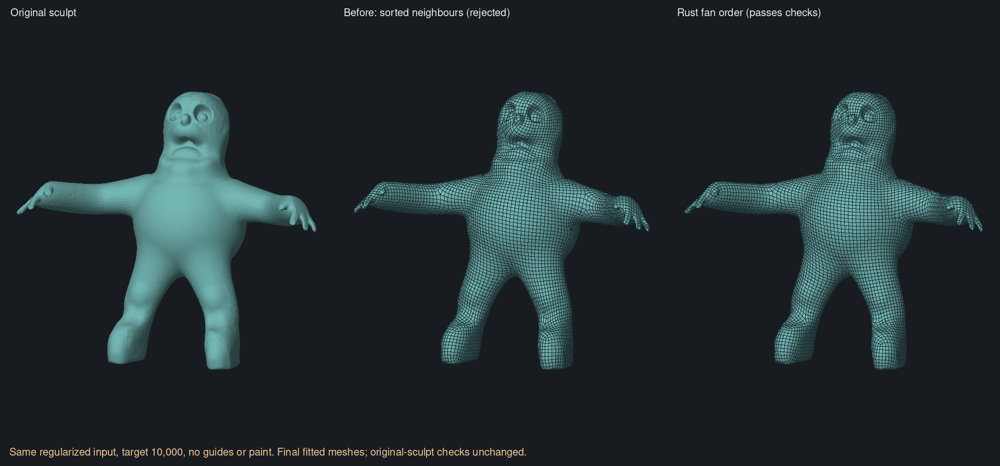
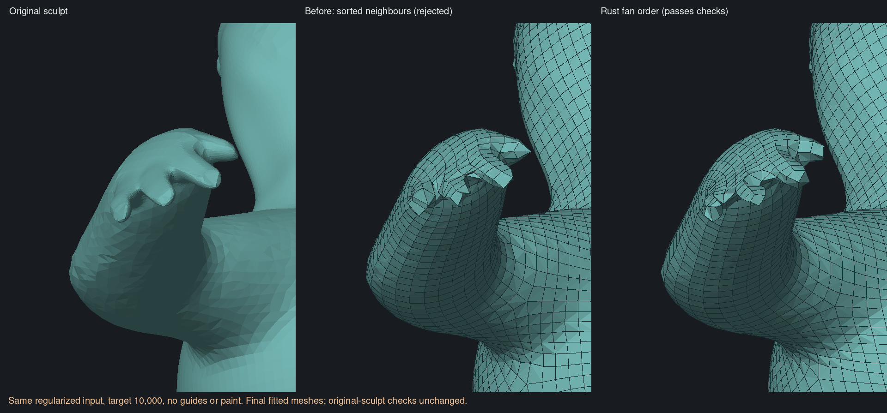
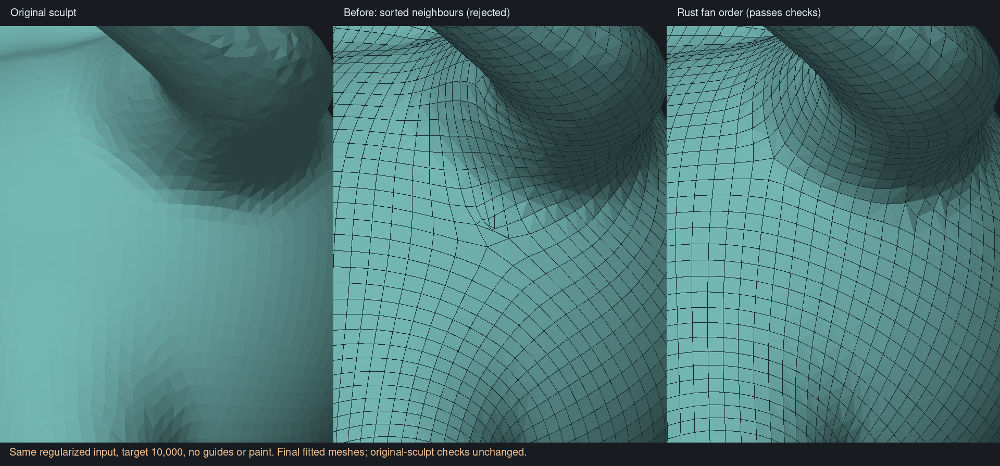

# Fine-neighbour ordering and integer-stage comparison — 6 November 2026

**The Rust solver now passes the existing whole-character checks on the
regularized input: 9,157 quads, one closed manifold component, and no outward
failures.** It also passes shape checks against the original, unregularized
sculpt. The original irregular input still fails source coverage. The app still
uses the earlier prototype; the offline regularization is not yet a Rust/app
feature.

## The change that helped

The earlier field comparison held fine adjacency fixed, supplying the same
vertex-number-sorted neighbour lists to both solvers. It correctly established
parity on that common input, but did not reproduce upstream's adjacency builder.
The pinned original `dedge.cpp::compute_direct_graph` and
`adjacent-matrix.cpp::generate_adjacency_matrix_uniform` walk neighbours around
each vertex's triangle fan. Closed fans start at the lowest directed-edge index;
open fans start at a boundary and retain both end neighbours.

That order matters twice: stable hierarchy matching chooses among equal-score
edges in encounter order, and each field update forms a compatible running
average. Sorting neighbours is therefore an algorithm change, not just a storage
choice. Replacing only this order changed the regularized input's orientation
field by a median 1.95 degrees, 24.01 degrees at the 95th percentile, and up to
44.98 degrees modulo fourfold symmetry.

The controlled C++ experiment kept every fine position, triangle, normal, area,
spacing and neighbour membership unchanged. Its original fan traversal changed
52,361 of the regularized input's 52,857 neighbour rows. Only the resulting
directions and origins were transplanted into the existing Rust downstream
pipeline. This passed the unchanged geometry gates. No guide, density paint,
cut-and-fill repair, increased repair deadline or relaxed threshold was used.

The traversal is now implemented in `src/field/adjacency.rs`. It bounds fan
walks, rejects disconnected/nonmanifold fans, and checks cancellation. Both
native field construction and the common-input audit exporter use it. It has
no anatomical classification or preferred world axis.

## Native proof and geometry

After the Rust change, fresh native runs on both complete sources reproduce the
original C++ direction and origin arrays **bit for bit**. Complete field snapshots
and the pre-repair integer snapshots also match the earlier controlled
transplants byte for byte. The native reconstruction uses its own fields.

| Regularized input, final fitted mesh | Before: sorted neighbours | After: surface-fan order |
| --- | ---: | ---: |
| Quads | 9,369 | 9,157 |
| Outward-failing quads | 0 | 0 |
| Maximum sampled original-source → result distance | 0.152893 | 0.051875 |
| Same distance / reference grid spacing | 2.653h | 0.900h |
| Original-source validation | Rejected: missing shape | Pass |

Both measurements use the same retained original-sculpt reference,
`h = 0.05762159740626388`. The new result also passes against the regularized
source, with maximum sampled coverage error 0.893h. Repair takes 1.93 seconds;
the existing 60-second repair deadline is unchanged.

The result is a useful automatic reconstruction milestone, not finished
production retopology. Crowded poles and uneven cells remain visible. Passing
these sampled shape/orientation checks does not establish deformation quality.

The original irregular input reaches 9,483 quads and repairs every integer
inversion in 8.08 seconds, versus 53.93 seconds with sorted neighbours. Its
complete pre-fit mesh has two outward failures; fitting removes those, but
maximum sampled source coverage remains 0.142974, or 2.481h. It is still rejected.
Input regularization remains a material factor, not a solved implementation
detail. The successful preparation is the existing offline isotropic resampling
experiment: it changes the intermediate triangle sampling, not the requested
output connectivity, and is checked against the original sculpt.

## Integer mapping was tested first

The [QuadriFlow paper](https://web.stanford.edu/~jingweih/papers/quadriflow/)
separates regularity correction from inversion repair. We compared the
[pinned original code](https://github.com/hjwdzh/QuadriFlow/tree/810b7a0967c35b0dc85b4464e3835e26a756c967/src)
on the same saved, **pre-subdivision** fields before changing the input order.
The new harness runs its original orientation/position singularity detection,
triangle-wise integer seeding, seam construction, component balancing and
single-level flow correction. Original direction sign changes are converted
back to the native vertex frames before import.

The initial offsets differ on only seven edges of the original sculpt and on
none of the regularized input. Replacing the complete integer stage gave mixed
results:

| Input | Original solver | Native downstream result |
| --- | --- | --- |
| Regularized | Minimum-cost flow (`-m`) | 8,936 quads; no pre-fit outward failures, but coverage worsens to 3.256h; rejected |
| Regularized | Default maximum flow | 8,836 quads; two pre-fit outward failures, coverage 3.505h; rejected |
| Original | Minimum-cost flow (`-m`) | Four inversions remain at the 60-second repair deadline |
| Original | Default maximum flow | 9,882 quads; three pre-fit outward failures, coverage 1.382h; final fitting still rejected |

These distances describe complete pre-fit candidates, unlike the fitted-mesh
before/after table above. The tests do not establish that one flow solver is
uniformly superior. Neither reference integer implementation replaces native
flow in this change. They supplied a controlled comparison, then the measurable
fine-adjacency difference supplied the successful next experiment.

## Reproduction and validation

Artifacts and complete command logs are retained under
`retopology-review/integer-comparison-20261106/` beside the checkout. The compact
[measurement record](native-fan-order-progress.json) records inputs, hashes,
timings, all integer controls, C++ transplants and native runs.

- `make-integer-reference.py` extracts verified original function bodies. Its
  standalone C++ build uses Eigen, Boost headers and upstream's vendored LEMON;
  these add no app/runtime dependency.
- `export-field-grid`, `export-corrected-grid`, `import-integer-grid` and
  `compare-integers.py` preserve the exact stage boundary. Imports check complete
  input fingerprints, endpoints, face order, relative transports, offset bounds,
  boundary locks and zero regularity defects before native subdivision.
- `make-field-reference.py ... --upstream-adjacency` independently builds the
  fan-order control. `compare-fields.py --reference-only` avoids rerunning an
  unchanged baseline; `--native-only` requires byte-identical field snapshots
  before testing native reconstruction.
- Eighteen focused Rust regressions pass, including an independently generated
  C++ fan-order field fixture, boundaries, invalid fans, cancellation, integer
  imports, closed/asymmetric reconstruction, source resampling, multiple guides
  and signed density. Audit and ordinary-library Clippy pass with warnings denied.

Local heavy commands ran serially under the shared lock, with one compiler job
and 500–700 MiB cgroup limits, without swap inside those scopes. Full CI,
platform tests, app integration and broader visual acceptance remain outstanding.
