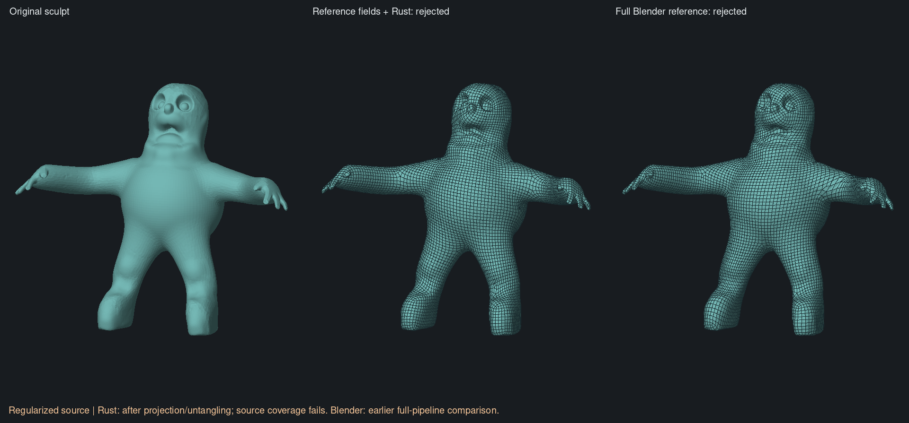
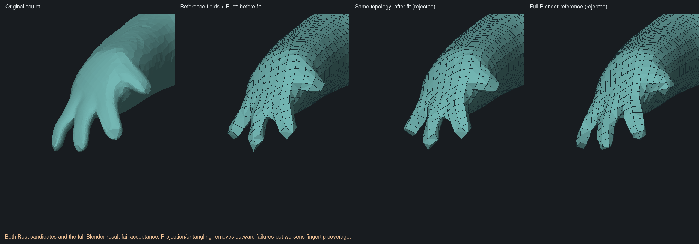

# Controlled early-field comparison — 5 November 2026

Historical field-swap experiment. The subsequent [Rust field-stage port](native-field-port.md)
now reproduces these reference fields and the regularized-input candidate
without importing fields at runtime. The native-field differences described
below refer to the implementation before that port.

Replacing only the orientation and position fields with those from pinned
QuadriFlow lets the unchanged Rust downstream pipeline resolve the grid that
stalls with native fields. The character still fails shape preservation. This
establishes an early-field contribution on this input; it does not isolate one
hierarchy/smoothing operation or certify the resulting topology.

## Controlled inputs

Use the retained regularized sculpt from the
[fresh-input comparison](native-fresh-input-comparison.md), target 10,000,
uniform spacing, no guides, paint, symmetry or sharp constraints. Rust samples
the source once and saves fields **before** integer initialization/correction.
Both cases use the same 52,857 sample positions, 105,710 triangles, normals,
areas, fine adjacency and spacing `0.057602258738327757`.

The reference harness uses original function bodies from QuadriFlow commit
`810b7a0967c35b0dc85b4464e3835e26a756c967`: hierarchy initialization, deterministic
graph coloring, graph downsampling, orientation optimization and position
optimization. Headers, function sources and the bundled PCG header are verified
against that commit before generation. Seed is zero; no parallel build flags or
variable scale solve are used. Fine adjacency comes from Rust's sorted graph.
This is the original field solver on **common input**, not Blender's complete
preprocessing or remeshing pipeline. In particular, fine normals and adjacency
ordering are held to the native choices instead of switching to upstream's
angle-weighted normals and face-fan ordering.

The C++ harness checks that fine positions/normals/areas/triangles stay unchanged.
Rust validates an input fingerprint, sample count, finite unit tangent directions
and finite origins in the corresponding tangent planes. Imports are atomic.
The runner additionally checks exact equality of source and every field array
except directions/origins before running the shared Rust integer/repair path.
All checks pass in `field-transplant-20261105/even-v2`.

The reference hierarchy has 19 levels versus the native hierarchy's 15. The
fourfold-equivalent fine direction difference has median 11.60 degrees and 95th
percentile 40.62 degrees. These measure disagreement, not quality.

## Results

| Common-input field producer | Position defects before correction | Inverted cells after subdivision | Repair result | Repair time |
| --- | ---: | ---: | --- | ---: |
| Native Rust | 645 | 1,894 | Rejected: 1 inversion remains | 44.74 s |
| Pinned QuadriFlow | 434 | 1,596 | Complete: 0 inversions | 0.75 s |

Both have the same 60-second repair deadline and existing bounded local search.
Neither reaches the deadline. Times describe these runs on a shared laptop,
not a general speed comparison. No repair thresholds or output gates changed.
There is no cut-and-fill bypass.

The reference-field case produces 9,369 quads and 9,371 vertices. The native
case produces no candidate because repair fails. Measurements below use the
same frozen original-sculpt reference as the previous comparison, with nominal
spacing `h = 0.05762159740626388`:

| Reference fields through Rust | Outward-failing quads | Maximum sampled source → result | Maximum sampled result → source |
| --- | ---: | ---: | ---: |
| Complete candidate before final fitting | 2 | 0.111826 (1.941h) | 0.036267 (0.629h) |
| After projection and untangling | 0 | 0.152893 (2.653h) | 0.040137 (0.697h) |

Both candidates retain one closed manifold component, Euler characteristic 2.
Both are rejected. The final fit completes projection and untangling, then
fails source coverage; it is not a partially projected candidate. The first
reported coverage failure against the regularized source is 0.06023 versus
spacing 0.05760. That is an early-exit value, not the maximum error in the table.
The worst sampled missing coverage is near `[-2.743913, 0.171354, 1.320048]`.





Visual inspection confirms a shortened outer finger before fitting, worsened
by fitting. The complete character is recognizable, but all-quad connectivity
and zero outward failures do not establish adequate shape preservation. The
earlier full Blender comparison remains useful context: on the regularized
source it had one outward-failing quad and maximum source-coverage error
0.04314. It does not share this experiment's fine sampling and is not another
controlled field-only case.

## Audit precision fix

The initial `even` trial is marked invalid as a controlled comparison: ordinary
JSON parsing moved some saved floating-point values by one ULP. For example,
spacing changed from `0.057602258738327757` to `0.05760225873832776`.
`serde_json`'s `float_roundtrip` feature now preserves the audit values exactly.
The character was recaptured and both cases rerun for the results above.
Do not compare the native discrete cell counts directly with historical runs
using the earlier parser; small numeric changes can alter hierarchy choices.
This fixes the audit transport, not the app's meshing algorithm.

Three focused tests cover exact snapshot round trips, equivalence of an identity
field swap to the native integer pipeline, and rejection of mismatched,
truncated, trailing or nonfinite reference data without mutation. All pass.
The library with and without `audit`, and the audit example, pass Clippy with
warnings denied.

## Research and next implementation target

[Instant Field-Aligned Meshes](https://rgl.epfl.ch/publications/Jakob2015Instant),
sections 3.2 and 3.5, describes per-edge symmetry updates and hierarchical solves
to improve convergence. The locally retained paper text was read alongside
the pinned [hierarchy.cpp](https://github.com/hjwdzh/QuadriFlow/blob/810b7a0967c35b0dc85b4464e3835e26a756c967/src/hierarchy.cpp)
and [optimizer.cpp](https://github.com/hjwdzh/QuadriFlow/blob/810b7a0967c35b0dc85b4464e3835e26a756c967/src/optimizer.cpp).
Relevant differences from the current Rust implementation include:

- Upstream preserves aggregate edge weights while coarsening. Rust deduplicates
  coarse neighbours and treats each as one equally weighted connection.
- Upstream retains unmatched singleton nodes and caps hierarchy depth. Rust
  attaches unmatched neighbours to existing groups and stops insufficient
  reduction, an earlier protection against oversized hierarchies.
- The paper's pair score uses the smaller area ratio, as Rust does. The pinned
  QuadriFlow code uses the larger ratio. This is a documented discrepancy, not
  evidence by itself that Rust's score is a bug.
- Upstream uses colored sweeps, running compatible averages with per-edge
  updates, six iterations per level, and restricts the converged fine
  orientations back to the coarse levels before solving positions. Rust uses
  different traversal, averaging, iteration counts and propagation.

Port and validate this early field construction as a coherent Rust stage,
retaining cancellation and memory bounds. Compare intermediate fields against
the pinned harness before revisiting local repair. The residual finger loss
also needs downstream integer/positioning comparison on the same transplanted
fields; the swap does not establish that early fields explain every defect.
All rules remain geometry based. No anatomical classifier, app C++ dependency,
UI change or acceptance relaxation was introduced.

## Reproduction and retained evidence

`scripts/retopology/make-field-reference.py` generates the pinned harness.
Compile it with the pinned `src`, `3rd/pcg32` and Eigen include paths. Build the
audit example with `--features audit -j 1`, then run:

```sh
python3 scripts/retopology/compare-fields.py \
  REGULARIZED.clay FIELD_REFERENCE_EXECUTABLE \
  ORIGINAL_FROZEN_SNAPSHOT.json NEW_OUTPUT_DIRECTORY
```

Use the repository's host memory checks and shared build lock. This run used one
compiler job, serial child processes and no-swap memory caps: 600 MiB for the
C++ build, up to 700 MiB for Rust builds/tests, 600 MiB for the corrected
comparison and 500 MiB for supplemental measurement/rendering. The largest
recorded child peak in the corrected comparison is about 295 MiB; this excludes
the Python parent's memory, so it is not a total-process-tree peak.

Local snapshots, meshes, logs and generated reference source remain under
`retopology-review/field-transplant-20261105/`. The
[machine-readable record](native-field-comparison-progress.json) includes
commands, hashes, timings, identity checks and outcomes. No broad/GPU suite or
app launch was performed; app integration and CI remain outstanding.
