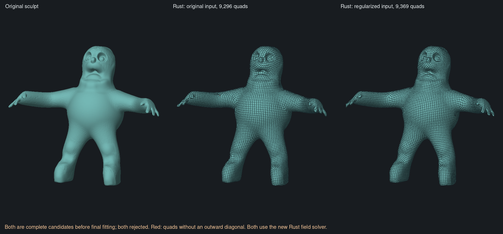
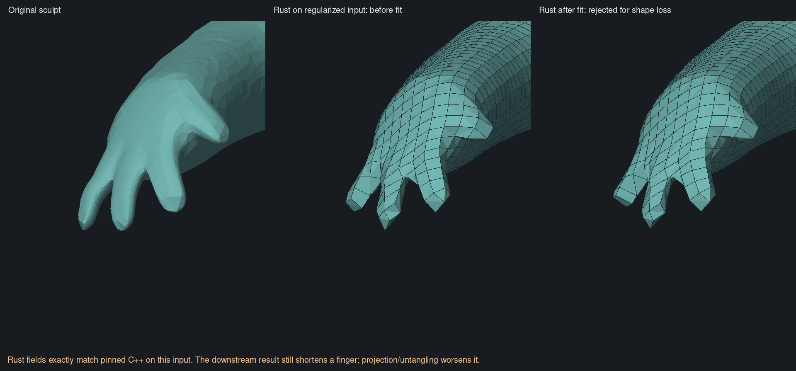
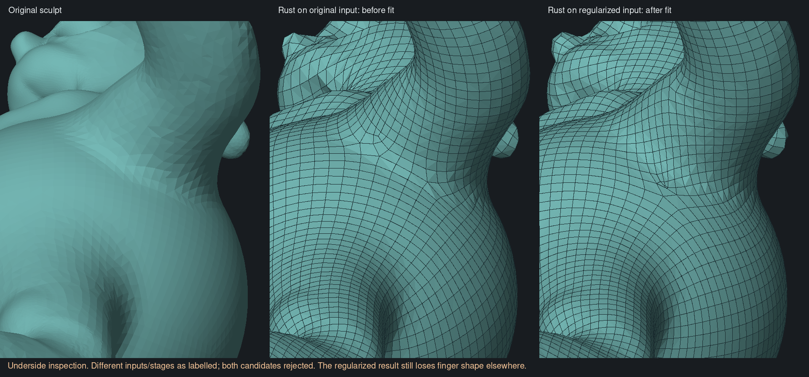

# Rust field-stage port — 5 November 2026

Historical common-input result. The [6 November fan-order comparison](native-fan-order.md)
identifies and fixes an upstream fine-adjacency difference that this comparison
held fixed. The regularized-input native reconstruction now passes the existing
geometry gates; the original irregular input still fails source coverage.

The default Rust field stage now reproduces the pinned original QuadriFlow
serial CPU implementation on common uniform, unconstrained input. On both
whole-character inputs, **every direction and origin is bit-identical** to
the C++ result. The complete field snapshots are byte-identical, including the
unchanged source and sampled geometry. No imported C++ fields are used by the
Rust reconstruction run.

This completes the early-field parity milestone. It does not complete automatic
character retopology: both whole-model candidates still fail geometry checks.

## Implementation

`crates/clay-retopology/src/field/reference.rs` ports hierarchy construction and
field optimization from QuadriFlow commit
`810b7a0967c35b0dc85b4464e3835e26a756c967`. The normal Rust `field::solve` path
now uses it; the previous hierarchy and field sweeps have been removed.

- Stable directed-edge pairing, the code's area-ratio score, unmatched
  singletons and summed aggregate edge weights match the pinned hierarchy.
- The serial reference's coloring order is retained. Its bundled
  `pcg32::shuffle` returns immediately for a valid iterator range, so this
  version actually colors vertices in their existing order.
- Initialization uses a local Rust implementation of the Linux reference's
  seed-zero random sequence. It has no process-global random state or libc call.
- Orientation matching includes the reference's `1e-6` tie margin. Both fields
  use running compatible averages and six sweeps per hierarchy level.
- Orientation prolongation and fine-to-coarse restriction match the reference,
  followed by coarse-to-fine position optimization and tangent-plane projection.
- Individual sample spacing is supported for density paint. Exactly uniform
  spacing remains constant throughout coarsening; this is the parity case.
- Cancellation checks remain in hierarchy construction and solver sweeps.
  Hierarchy depth is capped at 25 coarsening steps, with an additional aggregate
  sample limit of four times the fine sample count. Exceeding it returns an error.

The reference's hard-boundary propagator does not define our soft-guide behavior.
Soft guides retain area-weighted strength; hard boundary/crease constraints now
remain hard at coarse levels. Constraint propagation uses actual normals and
projects the position constraint itself, correcting the pinned code's CQ-for-N
and CQ-for-CO variable mix-ups. Those extensions are regression-tested, but are
not claimed to be literal constrained-field parity with upstream.

The earlier sampling, normals, guide collection and signed-density allocation
remain in `field.rs`. In particular, this is not a port of Blender's complete
preprocessing. Geometry-specific hand or body rules are not used.

## Reference verification

The retained [field-only C++ harness](native-field-comparison.md) receives the
same fine positions, triangles, normals, areas, adjacency and spacing. It checks
that shared geometry remains unchanged. Rust's import and the comparison runner
also verify input identity before comparing fields.

| Input | Fine samples | Fine triangles | Hierarchy levels | Direction/origin comparison |
| --- | ---: | ---: | ---: | --- |
| Small asymmetric reference fixture | 66 | 128 | 8 | Regression passes within `1e-9` tolerance |
| Original character | 81,636 | 163,268 | 20 | Exactly equal; complete snapshot bytes equal |
| Regularized character | 52,857 | 105,710 | 19 | Exactly equal; complete snapshot bytes equal |

The regularized run also exactly reproduces the previous C++-field transplant's
raw integer snapshot, pre-fit candidate mesh, and complete fitting diagnostic.
The matching snapshot SHA-256 is
`0d66399084d7936b442fb37c469ebbc85507fdd7d90f9a5aa6e33594d9cf077d`.
This establishes the match on these Linux cases; it is not a promise of
bit-identical transcendental arithmetic across every platform.

The small fixture is bundled as `tests/data/field-asymmetric.input` and
`.expected`, with source/binary hashes in `.provenance.json`. Expected vectors
were generated by the pinned C++ executable, independently of the Rust solver.
The `resolve-field` audit command can recompute fields on retained sampled input
without resampling it.

## Whole-model results

Both runs start afresh from their `.clay` source, target 10,000 quads, uniform
sizing and no guides/sharp constraints. The comparison first proves exact
field equality, then runs the shared downstream pipeline once using **Rust's
own fields**. Neither run uses cut-and-fill or relaxes acceptance thresholds.

| Rust input | Repair | Repair time | Extracted quads | Pre-fit outward-failing quads | Maximum sampled source → result |
| --- | --- | ---: | ---: | ---: | ---: |
| Original irregular sculpt | 0 unresolved cells | 53.93 s | 9,296 | 27 | 0.122527 (2.126h) |
| Regularized sculpt | 0 unresolved cells | 0.62 s | 9,369 | 2 | 0.111826 (1.941h) |

Distances above are measured against the retained original-sculpt reference;
`h = 0.05762159740626388`. Each complete candidate preserves one closed
manifold component with Euler characteristic 2. Times are local run measurements,
not a general performance claim; the same 60-second repair deadline applies.
The original input uses most of that budget.

The original-input final fit fails on quad 4163 near
`[-0.604607, -0.990199, 0.102105]`, where neither render diagonal points outward.
The displayed original-input candidate is the complete pre-fit mesh, not a
partially modified fitting result.

On the regularized input, projection and untangling remove the two outward
failures, but maximum sampled source coverage error worsens to **0.152893
(2.653h)**. A finger becomes shorter. The fit is rejected for missing source
shape. Its complete projected mesh is byte-identical to the earlier transplant
result; that result's original-sculpt measurements are reused only after
verifying both mesh bytes and the measurement-reference hash.

The underside view also shows pinching and uneven quads under the arm. Zero
unresolved grid cells and closed connectivity do not remove these visual defects.
The two candidate panels below intentionally show different inputs/stages as
labelled; they are an inspection view, not a controlled projection comparison.

The field port gives us a verified starting point for the remaining work.
It does not show that more local inversion repair will recover missing shape.
The next comparison should hold these fields fixed and inspect the downstream
integer mapping and continuous fitting against upstream. Input regularization
also remains a material factor; it is still an offline experiment, not part of
the app backend.

## Validation and scope

Fourteen focused regressions pass: C++ field fixture, seed initialization,
snapshot round trips and atomic imports, direct integer-path equivalence,
closed/open and asymmetric reconstruction, source-tessellation independence,
multiple guide influence, signed-density allocation and resulting polygon
sizes, direction-only guidance, and cancellation. Existing thresholds are
unchanged. Hard-boundary propagation was corrected to retain the coplanar
resampling regression rather than weakening its acceptance threshold.

The library with and without `audit`, and the audit example, pass Clippy with
warnings denied. Work runs serially
under the shared build lock with one compiler job. Builds/tests use at most
700 MiB, comparisons 600 MiB, and rendering 500 MiB, with swapping disabled.
The largest recorded child high-water mark is approximately 441 MiB for the
original-input comparison; it excludes the Python parent's memory. No OOM
occurred in this batch.

The app still uses the earlier prototype. No C++ dependency, app UI change,
release build, commit, push or app launch is part of this batch. Broader CI and
supported-platform checks remain outstanding.

Local evidence is retained under `retopology-review/rust-field-port-20261105/`.
The [machine-readable record](native-field-port-progress.json) includes input
and implementation hashes, exact parity checks, commands, results and timings.
For reproduction, build the audit example and use `compare-fields.py` as in the
previous field comparison; `--native-only` skips duplicate downstream work only
after proving byte-identical field snapshots.

Primary implementation references:
[QuadriFlow hierarchy](https://github.com/hjwdzh/QuadriFlow/blob/810b7a0967c35b0dc85b4464e3835e26a756c967/src/hierarchy.cpp),
[optimizer](https://github.com/hjwdzh/QuadriFlow/blob/810b7a0967c35b0dc85b4464e3835e26a756c967/src/optimizer.cpp),
[field math](https://github.com/hjwdzh/QuadriFlow/blob/810b7a0967c35b0dc85b4464e3835e26a756c967/src/field-math.hpp),
and [Instant Field-Aligned Meshes](https://rgl.epfl.ch/publications/Jakob2015Instant).
