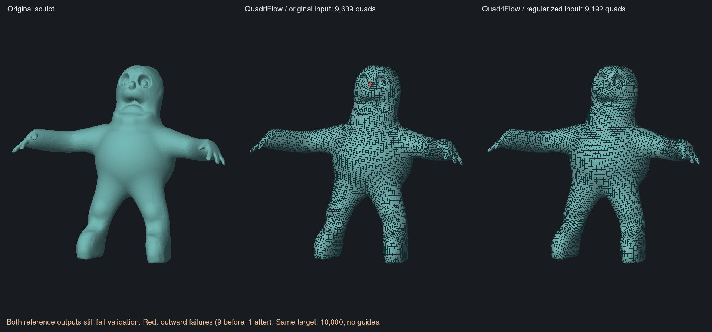
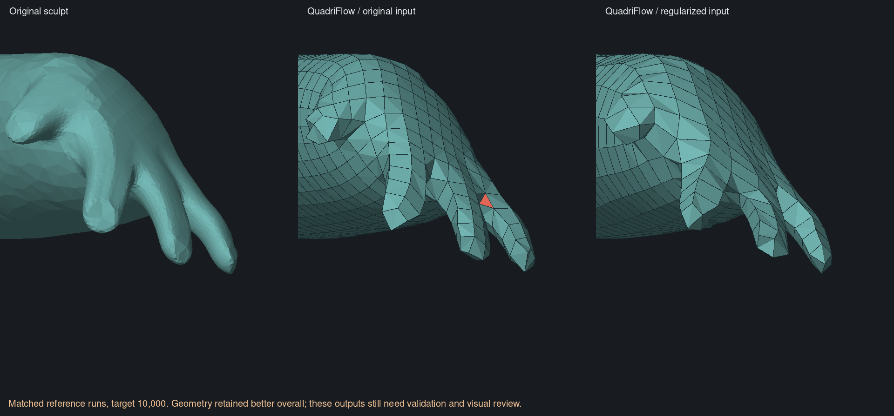

# Fresh-input comparison — 5 November 2026

**Outcome: regularizing the input materially improves the full QuadriFlow
reference on this character, but does not make the Rust pipeline succeed.**
The best reference result still fails one orientation check. No app backend,
acceptance threshold, guide or density UI changed.

This replaces further repair experiments on the frozen 64-cell grid with fresh
full-pipeline runs. All four cases request 10,000 quads, uniform sizing, no
guides, no painted density, no sharp protection and no symmetry. The Blender
reference uses seed 0 and boundary preservation. Actual output counts differ.
All output measurements use the **untouched original sculpt** and its common
spacing `h = 0.05762159740626388`.

## Working input

The native sampling stage currently splits long edges without redistributing
existing vertex clusters. We tested a separate working mesh using MeshLab's
[isotropic explicit remeshing](https://pymeshlab.readthedocs.io/en/latest/filter_list.html):
splits, collapses, swaps, relaxation and projection, with adaptive sizing off.
PyMeshLab 2025.7.post1 is isolated outside the repository as a benchmark tool.
It is not an application dependency or a decision to ship a C++ backend.

The retained run uses five iterations, edge target `0.5h`, crease angle 180°,
surface-distance checking on, and maximum local operation deviation `0.01h`.
The independently measured maximum sampled two-way error must remain below
`0.15h`. Sampling includes every original/working vertex and triangle centroid
in both directions. This is not a continuous bound or self-intersection test.

| Input measure | Original | Regularized working mesh |
| --- | ---: | ---: |
| Vertices | 52,601 | 52,141 |
| Triangles | 105,198 | 104,278 |
| Triangle quality, fifth percentile (1 = equilateral) | 0.599 | 0.760 |
| Triangle quality, median | 0.902 | 0.935 |
| Edge lengths, fifth–95th percentiles | 0.00772–0.06671 | 0.01606–0.03631 |
| Worst triangle longest/shortest edge ratio | 46.74 | 7.90 |

The working mesh retains one closed manifold component and genus zero. Its
maximum sampled original-to-working error is `0.00785` (`0.136h`); maximum
sampled working-to-original error is `0.00150`. Working vertices lie on the
original surface to numerical precision; errors between vertices still exist.
Original-to-working vertex RMS error is `0.000302`. The source file's SHA-256
remains unchanged.

Two preparatory trials were rejected before running retopology: edge targets
`0.5h` and `0.4h` with allowed local deviation `0.05h` reached maximum sampled
errors `0.00883` and `0.00903`, exceeding the unchanged `0.15h` comparison bound.
Tightening local deviation produced the retained copy. Thus the retained input
is more regular, not perfectly uniform, and is only approximately the same
surface. The test does not isolate sampling from every small geometric change.

[Source/working surface visual check](native-fresh-input-shape.png)

## Four completed comparison cases

| Pipeline / input | Output quads | Quads failing outward check | Maximum sampled source→result error | Outcome |
| --- | ---: | ---: | ---: | --- |
| Rust / original | 10,594 | 56 | 0.12297 (`2.13h`) | Geometry rejected |
| Rust / regularized | — | — | — | Repair stopped with one inverted grid cell |
| Blender QuadriFlow / original | 9,639 | 9 | 0.09182 (`1.59h`) | Geometry rejected |
| Blender QuadriFlow / regularized | 9,192 | 1 | 0.04314 (`0.75h`) | Geometry rejected |

The Rust original-input image/metrics use its complete candidate **before
surface projection**, because its final fit fails. No partially fitted output
is presented as complete. The regularized Rust case finishes its existing
repair schedule with one unresolved grid cell in 33.43 seconds, before its
60-second deadline; it is not a timeout. No hole-fill bypass, extra repair
budget or accepted mesh was produced for that case.

The reference is Blender 5.2.3 LTS, build `e13b728c6880`, executing its complete
QuadriFlow remesher. It is **not** replay of pinned upstream repair functions on
a Rust-generated lattice, nor a claim that Blender's code exactly matches our
separately pinned C++ stage harnesses.

The regularized reference reduces the maximum sampled result→source error
from `0.07366` (`1.28h`) to `0.03107` (`0.54h`). Both sampled distance directions
are below one spacing, but quad 5,408 near the negative-X foot fails the outward
test with either diagonal. Validation remains a rejection.

Worst quad longest/shortest edge ratio improves from 5.74 to 3.73; its 95th
percentile worsens from 1.48 to 1.65. Strict closed edge loops increase from 6
to 14. These diagnostics do not prove attractive or animation-ready edge flow.
The cleaned reference also has 4.6% fewer output quads despite the same request.
This is one model and one reference seed, not a general success rate.





Visual inspection confirms retained fingers and removal of the marked local
orientation failure in that hand view. Coarse facets and awkward transitions
remain. The source/working input views look very similar at whole-model scale.
[Underarm inspection](native-fresh-input-underarm.png) also shows that the fresh,
unguided native original-input candidate lacks the severe pinching of the prior
guided cut-and-fill candidate. That difference must not be attributed solely
to preconditioning: guides and the frozen layout differ from the older run.
All images use fixed render diagonals and flat face shading; camera coordinates
only control inspection, never solver selection.

## Interpretation and next bounded investigation

This supports automatic input regularization as a useful part of a prospective
pipeline on this fixture. It also establishes a better full-pipeline reference
for the Rust implementation. Regularization alone is insufficient for the
current Rust solver; the experiment does not locate the exact faulty stage.

Earlier extraction/fitting comparisons matched substantial upstream behaviour
on shared intermediate data, but did not establish end-to-end field-generation
parity. The next investigation should compare early sampling, normals,
orientation and position fields on matched inputs, then transplant a reference
field into the native integer/extraction stages where feasible. Any improvement
must show up in full-mesh geometry and visual quality. Do not resume an open-ended
repair campaign on the remaining cell or the old 64-cell snapshot.

The stronger reference result means there is not yet evidence that we must
replace the whole method with QuadWild. Patch-based reconstruction remains an
alternative if the earlier-stage comparison cannot yield useful native results.

## Reproduction and verification

Use fresh output directories, one thread, the shared build lock, and bounded
memory. The scripts refuse existing output directories. Install the pinned
PyMeshLab wheel into an isolated benchmark location and expose it using
`PYTHONPATH`; leave the app dependencies unchanged.

```text
python3 scripts/retopology/prepare-even-surface.py original.clay proxy-output --target 10000 --surface-factor .01
python3 scripts/retopology/compare-fresh-inputs.py original.clay proxy-output/even.clay comparison-output
```

`compare-fresh-inputs.py` expects the already built audit example and Blender.
It serializes all cases, bounds stages, saves errors and failed snapshots, and
measures all available quad outputs against the original. The final script also
explicitly validates each native diagnostic against the original; this check
was added after the batch and executed separately for the available candidate.
Native capture receives 150 seconds; repair 60 internally/75 externally;
reference runs 120. No case reached its external timeout.

Python compilation, execution of all comparison cases, source hash checks,
input topology/shape gates, output diagnostics and visual review completed.
There were no Rust algorithm changes and no broad Cargo/GPU suites were run.
The [machine record](native-fresh-input-progress.json) preserves settings,
results, resource data, tool versions and file digests.

Preconditioning/rendering used a 500 MiB/no-swap cap; the serial comparison
used 700 MiB/no-swap. Peak reference RSS was 649.4 MiB. A preliminary isolated
pip install was killed (exit 137) under its 350 MiB cgroup cap while unpacking
to tmpfs; streaming the
already downloaded wheel to disk completed, and only that install's temporary
files were removed. Host memory pressure was rechecked before continuing.
Reference remeshing took about 9.3/9.2 seconds; these are single runs, not a
performance benchmark.
