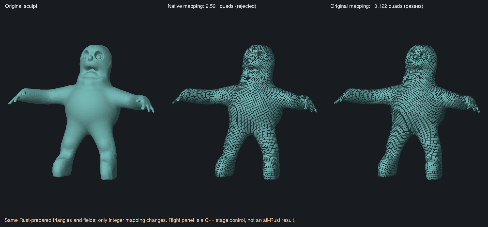
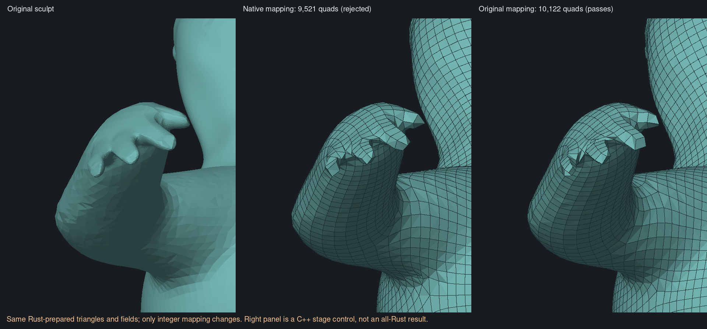
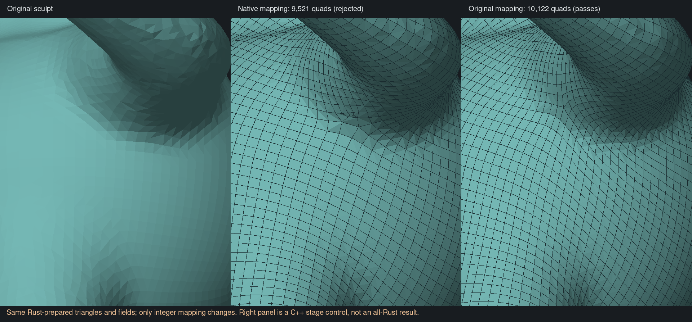

# Native input preparation and mapping control — 6 November 2026

**Superseded later the same day:** the [integer-stage Rust port](native-integer-port.md)
now reproduces the passing C++ control exactly and completes the original sculpt
through a public all-Rust pipeline. The experiment below records the earlier
state that identified the mapping gap.

**Rust now prepares a more evenly sampled working surface without MeshLab. On
that input, replacing only the integer-mapping stage with the pinned original
QuadriFlow code produces 10,122 quads that pass the existing checks against the
untouched sculpt.** This is a controlled C++ stage transplant, not an all-Rust
success. The native mapper on exactly the same saved fields produces 9,521
quads and still fails finger coverage. The app backend is unchanged.

## Preparation

The audit-only `resample.rs` stage uses edge splitting, link-condition edge
collapse, valence/quality swaps, tangential relaxation and projection to the
immutable original surface. Target working-triangle edges are `0.5h`, with the
standard split/collapse thresholds of `4/3` and `4/5`. Local normal, quality and
source-distance guards reject harmful edits. No anatomical regions, guides,
paint, curvature sizing or output repair settings were used in this comparison.

The algorithm follows the isotropic remeshing approach discussed by
[Botsch and Kobbelt, 2004](https://graphics.rwth-aachen.de/media/papers/remeshing1.pdf).
The actual implementation of MeshLab's preparation was also studied in
[VCGLib at 5cae2abc](https://github.com/cnr-isti-vclab/vcglib/blob/5cae2abc2f9056785b0537dcbe156c40da2aea20/vcg/complex/algorithms/isotropic_remeshing.h),
especially its local collapse quality, normal and source-distance checks.
Attribution is retained in the crate's `LICENSE-VCGLib`. This is not an exact
VCGLib port. The pinned QuadriFlow `Parametrizer::Initialize` only subdivides
long edges; it does not redistribute existing dense clusters. This preparation
is an additional stage, not a claim of original QuadriFlow preprocessing parity.

The first five-pass preparation failed reverse coverage: keeping new triangles
close to the source did not prevent a small source feature disappearing.
The measured maximum was 0.008660, exceeding the unchanged 0.008643 limit.
No prepared surface was published. Every original vertex and triangle centroid
now has a persistent witness assigned to a working triangle. A local edit must
reassign every affected witness within `0.15h`, or it is rejected. Independent
two-way measurements and topology validation still run at completion.

| Preparation measurement | Original | Rust, five passes | Rust, ten passes |
| --- | ---: | ---: | ---: |
| Vertices | 52,601 | 52,083 | 50,857 |
| Triangles | 105,198 | 104,162 | 101,710 |
| Edge length, 5th percentile | 0.007717 | 0.016909 | 0.017176 |
| Edge length, median | 0.017447 | 0.027842 | 0.028164 |
| Edge length, 95th percentile | 0.066709 | 0.035769 | 0.035696 |
| Triangle quality, 5th percentile | 0.599 | 0.831 | 0.845 |
| Triangle quality, median | 0.902 | 0.952 | 0.966 |
| Preparation time | — | 17.99 s | 30.80 s |
| Peak process RSS | — | 106.0 MiB | 105.8 MiB |

Those initial timings used the crate's **dev profile with `opt-level = 2` and
debug symbols disabled**, not a release build. A subsequent controlled
[dev/release comparison](native-preparation-performance.json), on the same
105,198-triangle source and five passes, measured:

| Build | Two elapsed timings | Median |
| --- | --- | ---: |
| Optimised dev | 17.685 s, 18.245 s | 17.965 s |
| Standard release (`opt-level = 3`) | 15.932 s, 15.983 s | 15.958 s |

Runs were serial and interleaved release/dev/dev/release, with identical memory
limits. All four prepared meshes and validation reports match the earlier
baseline byte for byte / value for value respectively. Compilation is excluded;
source loading, preparation checks and output writing are included. These
measurements cover preparation alone, not complete retopology. Release saves
about 11%, so performance remains an implementation concern. Under 0.8 seconds
elapses after the final iteration progress event, including final packing,
validation, measurement and serialization; individual edit/query costs have
not yet been profiled.

A subsequent [matched-input full-solver timing](native-retopology-performance.md)
measures Rust reconstruction at 17.83 seconds versus Blender's C++ operator at
8.51 seconds, excluding this preparation from both. Native integer correction
accounts for 10.19 seconds; no guides or paint were enabled. The report keeps
the different quality outcomes and validation workloads explicit.

The five-pass source-to-working maximum is 0.007493 (0.130h), and the reverse
maximum is 0.000576 (0.010h). Both preparations preserve one closed manifold
component and Euler characteristic two. These are sampled bounds, not a
continuous Hausdorff or self-intersection certificate.

## Same-input integer mapping comparison

All runs request 10,000 quads. The native and pinned C++ field snapshots for
both prepared surfaces match byte for byte. The mapping control imports only
corrected integer offsets and face transports, with identity and consistency
checks; native subdivision, repair, extraction, optimization and final fitting
remain in use. Repair keeps its existing 60-second deadline.

| Complete fitted output | Quads | Outward failures | Maximum original-source coverage / h | Acceptance |
| --- | ---: | ---: | ---: | --- |
| Previous MeshLab preparation + native solver | 9,157 | 0 | 0.900 | Pass |
| Rust five-pass preparation + native mapper | 9,521 | 0 | 1.117 | Shape rejected |
| Same Rust preparation + original default mapper | 10,122 | 0 | 0.753 | Pass |
| Same Rust preparation + Blender's full QuadriFlow | 9,868 | 1 | 0.619 | Orientation rejected |

Every row has one closed manifold component and Euler characteristic two.
The common measurement reference is the original sculpt, with
`h = 0.05762159740626388`. The successful mapping control's maximum sampled
source coverage is 0.0433723, versus 0.0643670 for the native mapper. Its repair
takes 1.92 seconds. Blender 5.2.3 LTS, build `e13b728c6880`, is an independent
implementation control; it does not share the pinned harness's exact fine input
construction or every downstream stage.

The ten-pass native run repairs all integer inversions but fails final fitting
with four outward-diagonal failures. Its modified positions are not treated as
a completed fitted result in the table or images. Better triangle quality and
more preparation iterations do not monotonically improve quadrangulation.

Visual review confirms separate finger tips and a closed underarm in the
passing control. The fingers remain angular and pole placement is still uneven;
passing the current geometric checks does not establish deformation-ready flow.

The original mapping control changes the whole integer stage: initial seeding,
orientation seams, component balancing and flow. The initial seed differs by
only two coordinate units, but that alone does not identify the cause. Reading
the original code confirms further material differences: it builds an oriented
face disjoint tree with nonsingular faces first, balances seam components, and
uses its default maximum-flow route. Native correction currently uses a face
BFS, different seam adjustment priorities and minimum-cost flow. The original
default chooses Boost's Boykov–Kolmogorov solver for this supply size, not LEMON's
minimum-cost branch.

This is the next port boundary to compare and reproduce in Rust. It is not
evidence to switch the default blindly: the preceding
[integer controls](native-fan-order.md#integer-mapping-was-tested-first) worsened
the MeshLab-prepared case with the original mapper. Preserve those controls
while testing the native preparation and mapper together. Do not increase
preparation iterations or relax geometric acceptance to force this fixture
through.

## Verification and reproducibility

Seven focused preparation tests pass: uneven sampling, immutable source,
boundary and sharp-fold protection, signed paint transfer, nearby disconnected
sheets, closed curved topology, reverse-coverage feature preservation, and
cancellation/budget failure. Several properties share a test. Whole-character
paint and guide behavior on prepared input has not been established.
Warnings-denied Clippy passes for both the default library and the audit
library/example; the new module also passes its focused formatting check.

`audit prepare-surface SOURCE.clay WORKING.clay REPORT.json 10000 5` creates
outputs only after the preparation gates pass and refuses to overwrite files.
`compare-fields.py --native-only` proves field parity before native downstream
evaluation. `export-field-grid`, the pinned `integer-reference max` harness and
`compare-integers.py` reproduce the successful stage transplant.

Artifacts and command records are under
`retopology-review/native-resampling-20261106/` beside the worktree. The compact
[measurement and provenance record](native-input-preparation-progress.json)
retains hashes, timings and results. All heavy commands were serialized with
the shared lock, one compiler job, and memory/no-swap cgroups.

Preparation remains behind the audit feature. Before integrating it into the
public solve path, final fitting must retain the original source and transfer
spacing by surface position: resampling changes vertex IDs, so indexing the
original source with the prepared field's spacing array would be invalid.
App controls, persistence, attribute transfer and a default backend change are
still outstanding.
