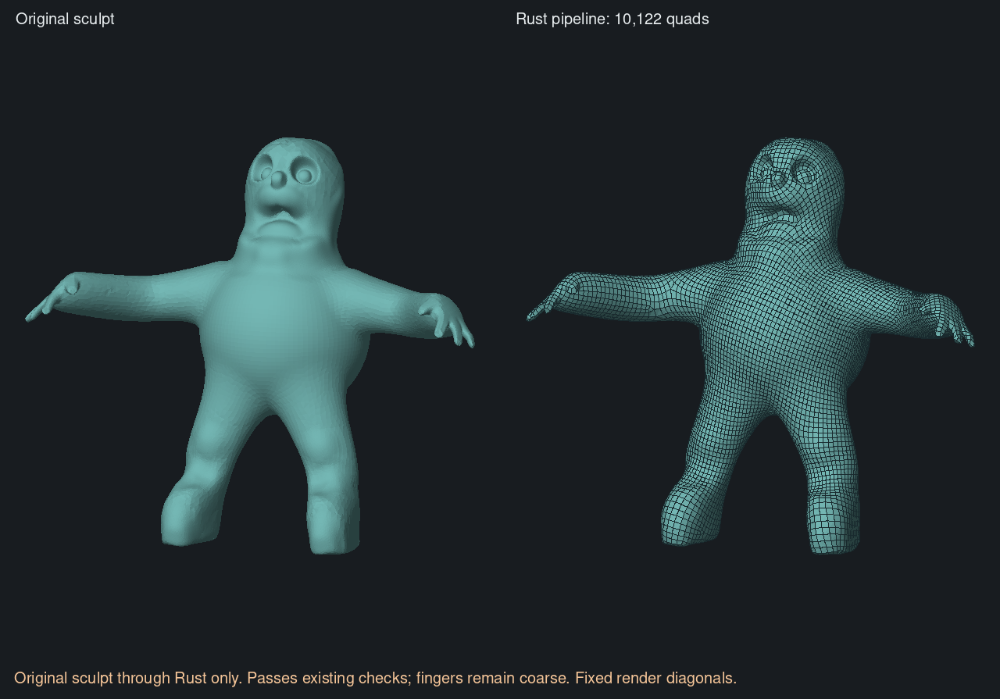
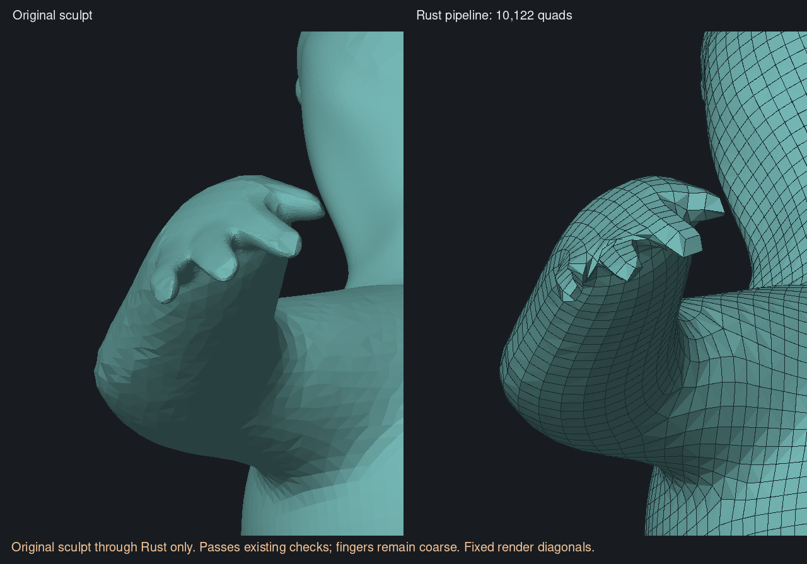
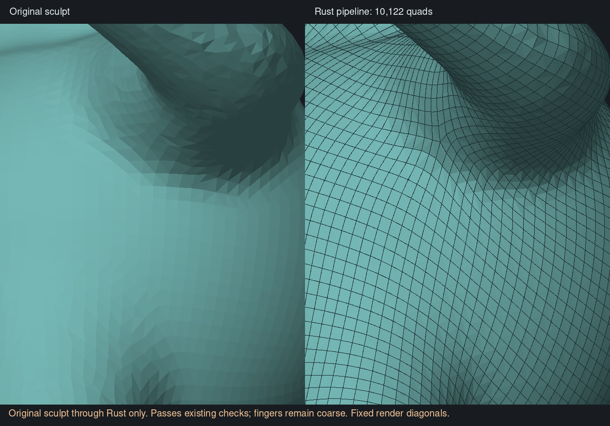

# Native integer mapping and complete Rust run — 6 November 2026

The original character now completes preparation, field construction, integer
mapping, repair, extraction and validation entirely in Rust. At a 10,000-quad
target it produces **10,122 quads / 10,124 vertices**, preserving one closed
manifold component and Euler characteristic two. There are no failed outward
quad checks. Maximum sampled source coverage error is **0.0433723 = 0.753h**,
below the unchanged one-spacing limit. No guides, paint or anatomy rules were
used in this character run; sharp preservation was disabled.

The complete public entry point is `reconstruct_regularized_with_progress`.
It makes a five-pass working surface, transfers signed detail, reconstructs
with the normal solver, then checks the result against the untouched original.
Original-source validation computes spacing from the original paint and vertex
indices; working-mesh reordering cannot misindex that check. It does not move
the completed vertices. Cancellation is propagated through preparation and
the final check. `reconstruct_with_progress` remains available for an already
prepared source without running preparation again.

This is a solver milestone. The application still uses the earlier prototype;
preview/apply integration, detail painting/persistence and multiple-path UI
are outstanding. The output has coarse fingers and uneven pole placement.
Passing finite shape and topology checks does not certify deformation quality,
absence of self-intersections or a continuous Hausdorff bound.



## What changed

The Rust mapper ports the pinned original's orientation-singularity handling,
integer seeding, ordered face-frame union, two seam-balancing passes, capacity
schedule and maximum-flow selection. For fewer than 20 supply units it uses
ordered unit-path BFS; otherwise it uses the Boykov–Kolmogorov two-tree method.
The active/orphan queue order and shuffle draw schedule are explicit: two
maximum flows can satisfy the same equations but produce different topology.
Caller field frames are restored before downstream subdivision and fitting.

This follows the original files `parametrizer-sing.cpp`, `parametrizer-int.cpp`,
`optimizer.cpp`, `flow.hpp` and `disajoint-tree.hpp` at
[QuadriFlow 810b7a0](https://github.com/hjwdzh/QuadriFlow/tree/810b7a0967c35b0dc85b4464e3835e26a756c967).
The flow implementation also studies the grow/augment/adopt method in
[Boykov and Kolmogorov, 2004](https://www.csd.uwo.ca/~yboykov/Papers/pami04.pdf)
and adapts Boost's implementation; attribution is retained in
[`LICENSE-Boost-MaxFlow`](../../../crates/clay-retopology/LICENSE-Boost-MaxFlow).
No C++, Blender, MeshLab or external solver is needed at runtime.

The normal solver selects this mapper for closed surfaces without hard field
constraints, including soft guides and scalar painted spacing. Open boundaries
and hard feature constraints retain the existing constraint-aware correction.
This is a scope-based selection, not a retry that conceals a failed new solve.
Acceptance tolerances, SAT budgets and geometry algorithms were not loosened.

## Exact comparisons and tests

On independently exported, identical fields, every integer edge offset and
face frame agrees with the pinned C++ default mapper:

| Saved character input | Edges | Faces | Differences |
| --- | ---: | ---: | ---: |
| Rust five-pass preparation | 156,384 | 104,256 | 0 |
| Original irregular sculpt, fine sampling | 244,902 | 163,268 | 0 |
| Earlier MeshLab preparation | 158,565 | 105,710 | 0 |

This establishes mapping-stage parity on these inputs; it does not establish
that every input will reconstruct successfully. In particular, prep-free
irregular inputs remain outside the demonstrated whole-character success.

Two small asymmetric fixtures at targets 19 and 83 were generated independently
by the pinned C++ harness. Regression tests compare every edge and face. Both
flow branches also match exhaustive minimum cuts on 200 small graphs with
reverse capacities. Existing closed/open reconstruction, guide influence,
signed-density polygon-size and audit import tests pass. New tests exercise the
composed pipeline with two guides and more/less/automatic paint on a closed
surface, source immutability, original-index spacing and cancellation during
final validation. Full application and platform suites remain for CI.
Warnings-denied Clippy passes for the audit library, tests and comparison tools,
and for the ordinary library without audit enabled. Two existing test-only lint
warnings were corrected without changing solver behavior.

Both release runs on the prepared mesh and the complete original-sculpt run
produce byte-identical OBJ output. It also matches the earlier passing C++
integer-stage transplant byte for byte. The saved quality diagnostics therefore
apply without substituting a different mesh. Output SHA-256:
`ae157e1cbd7be512dc3564176e1fdd7b3f48983f251579bbf9a4a08a2a7060e5`.

## Release timings

All native runs use standard Cargo release optimization, one serial solve and
the shared laptop build lock. They are capped at 700 MiB with no swap; measured
process peaks are about 176–178 MiB. Input loading and OBJ writing are outside
the solver timer. Compilation and audit snapshot import/export are excluded.

| Work | Measured time |
| --- | ---: |
| Previous Rust solve on prepared input, including shape rejection | 17.825 s median |
| New Rust solve on identical prepared input, accepted | 8.273 / 8.365 s; **8.319 s median** |
| Integer stage within those new solves | 0.896 / 0.939 s; **0.918 s median** |
| Earlier C++ Blender operator on the same prepared input | **8.507 s median** |
| Complete new Rust entry point from original sculpt, one run | **25.346 s** |

The prepared-input solve is about 53% shorter; integer mapping fell from 10.187 s
to 0.918 s. The earlier C++ timer is a useful scale comparison, not proof that
Rust is faster: it was not rerun interleaved with this port, it omits our final
checks, and its saved output has one outward-check failure. The full native run
spends about 16.3 s reaching field sampling, 8.1 s reconstructing and 0.9 s
validating against the original. Preparation is now the largest measured cost.

See [timings, hashes and commands](native-integer-port-progress.json). Large
artifacts and reproducible comparison/render runners are saved beside the
worktree in `retopology-review/native-integer-port-20261106/`.

```sh
cargo run --locked --release --manifest-path crates/clay-retopology/Cargo.toml \
  --example compare -j 1 -- source.clay result.obj 10000 --regularize
```

Use the shared lock and memory checks required by `AGENTS.md`. The executable
refuses to overwrite an output. Omit `--regularize` only when testing an already
prepared source. Neither command launches or changes the app.

## Visual limits

The torso, underarm and crotch surfaces are closed in the inspected views. The
fingers are still angular, and this is not hand-authored animation topology.
These views render the actual native OBJ at the previous comparison cameras;
they use fixed diagnostic diagonals. App rendering must use `Layout::triangles`.




