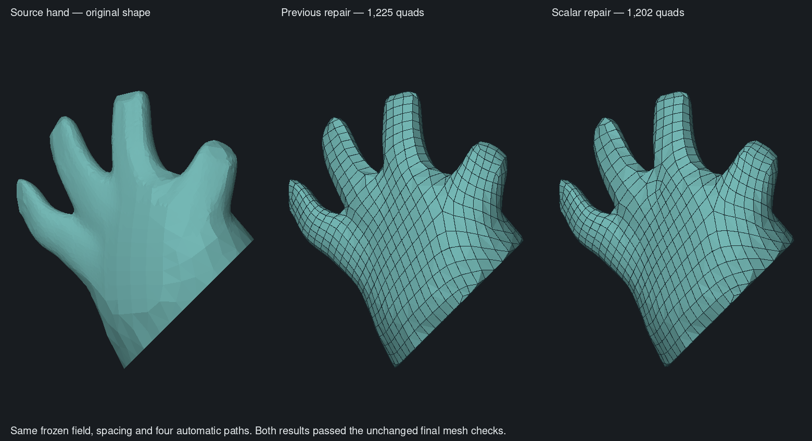

# Frozen junction repair comparison — 5 November 2026

Latest: the [orientation-preservation follow-up](#orientation-preservation-and-original-code-replay--5-november)
replays the original C++ SAT repair schedule on the final 64-cell failure.
It also leaves 64 unresolved cells. No whole-character result is accepted.

The fixed-boundary junction problem is locally infeasible, and the original
nine-state edge encoding spends time searching without finding that out.
Adapting QuadriFlow's scalar-coordinate formulation improves native coarse
repair. It does not make this fixed-boundary problem solvable or establish
accepted whole-character topology.

## Controlled replay

The saved problem has 356 coarse faces, 569 edges (496 flexible, 73 fixed),
64 inverted grid cells and no locked guide coordinates. It comes from the
unchanged 10,000-target character field, after greedy repair, at coarse depth 5
and radius 1. The same offsets, frames and fixed boundaries are used throughout.
No anatomical predicates select solver behaviour. The checked-in
[fixture](../../../crates/clay-retopology/tests/data/repair-junction-fixed.json)
contains integer constraints and source-index correspondence, not sculpt geometry.

| Formulation and engine | Outcome | Observed time |
| --- | --- | ---: |
| Original nine-state/table formulation, Rust Batsat, 2-second budget | Search timeout | 2.00 s search |
| Same formulation, 8-second budget | Search timeout | 8.00 s search |
| Pinned upstream scalar CNF, bundled MapleCOMSPS_LRB executable | UNSAT | 0.064 s process |
| **Exactly the same upstream CNF**, Rust Batsat | UNSAT | 0.223 s including parsing |
| Native scalar implementation, Rust Batsat | UNSAT | 1.416 s including encoding |

These are individual diagnostic runs, not a general performance benchmark.
The final native implementation preserves the scalar constraints but has a
different clause order and adds support for arbitrary correlated edge domains.
Its result is independently checked against the original domains, face closure
and nonnegative area. The old table encoder remains in the fine fallback and
is available for audit comparisons.

The reference generator extracts `SolveSatProblem` from
`src/localsat.cpp` at commit `810b7a0967c35b0dc85b4464e3835e26a756c967`, verifying
the pinned source and retaining its licence. Only its subprocess runner is
replaced, to emit CNF safely for separate bounded execution. The bundled
MapleCOMSPS_LRB solver is compiled unchanged for the offline comparison.
There is no C++ or external solver dependency in Clay Form's runtime.

## Boundary controls

The upstream formulation reports UNSAT at each original radius 1–4.
Growing only the junction patch outward by 1, 2, 4, 8 and 16 face rings also
reports UNSAT, up to 2,087 faces. These are diagnostic neighbourhood controls,
not changes to production patch selection. A radius-8 expansion of all problem
regions merges this patch with another and reaches its eight-second limit;
that result is unknown, not UNSAT. At radius 16 the junction component exceeds
the native export's size guard. A different exported 14-fold component was
solved in that run; it is **not** evidence about the junction.

Treating the original 146 fixed coordinate values as assumptions gives a
94-coordinate conflict subset spanning 65 boundary edges. Replaying that subset
alone in the independent upstream engine also gives UNSAT. The subset is
sufficient, not claimed minimal.

Removing the fixed boundary values gives SAT. Independent decoding verifies
zero inversions and zero closure defects, with 79 positive-area and 277
zero-area field faces. **17 originally fixed edges change.** This is an integer
feasibility control, not an accepted mesh: applying it alone would disagree with
the surrounding grid. The next structural question concerns how to alter the
surrounding field/constraints consistently, rather than how long to search the
same locally infeasible problem. It does not prove global infeasibility of the
shape, target count or orientation field.

Section 3.4 of the [QuadriFlow paper](https://stanford.edu/~jingweih/papers/quadriflow/quadriflow.pdf)
also describes scalar-coordinate encoding and progressively enlarging mutable
regions. It reports that stubborn inversions tend to occur near orientation
singularities and does not guarantee their removal. Mapping those field
singularities onto this particular conflict is a motivated next diagnostic,
not an established cause from the current measurements.

## Mesh controls

All source geometry, frozen field inputs, target spacings, automatic cycle locks
and final acceptance gates are unchanged. The retained implementation changes
only coarse SAT's formulation and adds offline diagnostics.

| Finer isolated hand | Previous repair | Scalar coarse repair |
| --- | ---: | ---: |
| Repair time | about 33.4 s | 1.61 s |
| Accepted quads | 1,225 | 1,202 |
| Strict closed edge loops | 18 | 17 |
| Maximum sampled two-way distance | 0.018813 | 0.019008 |
| Worst longest/shortest edge ratio | 5.44 | 4.58 |
| 95th-percentile edge ratio | 1.945 | 1.967 |

Both accepted results retain all 144 perpendicular guide locks; the rendered
positions and faces match their accepted OBJs exactly. The slight increase in
sampled error and 95th-percentile ratio should not be described as universal
quality improvement. Distorted junction quads remain.



The torus retains exactly the same 756-quad mesh, sampled error and 38 guide
locks. Its greedy pass already removes every inversion, so it does not exercise
the new SAT encoding.

The scalar-coarse body pass reduces 136 inversions to 82 in 66.3 seconds.
Its original fine fallback reaches 64 remaining inversions before the first
180-second diagnostic deadline. A continuation from the completed coarse
checkpoint finishes fine repair in 241.3 seconds and rejects with the same
64 unresolved inversions. No full-character mesh is accepted. This is four
fewer than the previous completed 68-inversion rejection, not a usable output.

A separate trial also switched **fine** repair to scalar constraints. It
completed with 80 unresolved body cells, worse than the retained fallback's
64-cell completed rejection, and was reverted. In that rejected trial the
matched-spacing hand still failed final geometry validation: 296 candidate
quads, ten without an outward render diagonal, and sampled error 0.19569.
Those figures belong to the rejected fine-scalar trial, not the retained code.
The final retained-code check also rejects the 349-target hand: repair takes
18.9 seconds, then the 264-quad candidate has nine invalid outward diagonals
and maximum sampled error 0.19487 (3.38 spacings). Thus the coarse-spacing
geometry failure persists even though integer repair is faster.

## Surrounding-grid follow-up — 5 November

**No whole-character repair is accepted.** The following experiments are audit
commands and offline controls. The normal repair schedule and final acceptance
checks remain in place. Selection uses inverted cells, graph adjacency, fixed
coordinates and solver conflicts; it has no anatomical predicates.

The earlier free-boundary control also released contracted self edges. Four of
its 17 changed boundary edges were of that kind, so it was too permissive as a
model of ordinary boundary expansion. A stricter control retains all contracted
self edges while releasing only genuine cut boundaries. It is still SAT:
independent decoding verifies closure, nonnegative area, 88 positive-area faces,
268 zero-area faces and **18 changed cut edges**. It remains a local feasibility
control, not a replacement that can be applied to the surrounding mesh.

| Surrounding-grid experiment | Result |
| --- | --- |
| Expand the frozen coarse patch only through boundary coordinates named by UNSAT cores | 356 to 670 faces; the reference engine still proves UNSAT. Native conflict extraction reaches its limit at 670 faces, including an eight-second control. |
| Rebuild the hierarchy between radius passes, following the upstream schedule | Body completes in 305.4 s with the same 64 inversions. The hand and torus pass final validation. |
| Full-resolution patch after greedy repair | 3,777 faces; both native and bounded reference searches return unknown. This is not an infeasibility result. |
| Start only from the final 64 inverted cells and add their incident faces | A 173-face seed grows through 76 conflict-directed expansions to 715 faces. Native conflict extraction then times out; the independent reference engine proves this fixed-boundary problem UNSAT. Reversing assumption order also times out. |
| Ask global flow to contract the inverted cells, without holding those requests fixed | Changes 73 edges, including 29 outside the requested edges; closure and real locks survive, but 64 inversions remain, including 26 newly inverted faces. |
| Hold cumulative contraction requests while resetting deficient orientation-seam components | One pass reaches 63 inversions; the next creates 8,607. Rejected and rolled back. |

The rebuilt schedule's hand result has 1,244 quads and 17 strict loops, with
maximum sampled error 0.018811. Its worst edge-length ratio increases from 4.58
to 6.80. The torus result is identical. These controls do not justify adopting
the schedule as a quality improvement.

The flow experiment exposed a relevant implementation difference:
[upstream component construction](https://github.com/hjwdzh/QuadriFlow/blob/810b7a0967c35b0dc85b4464e3835e26a756c967/src/parametrizer-int.cpp#L313)
excludes locked coordinates. The existing native seam-balancing setup joins
them when identifying components, although their later flow capacity is zero.
The audit variant constructs components using only movable coordinates and
resets adjustable seam values in deficient components. This restores feasibility
in small independently feasible tests, but the character regression shows that
this particular reset policy is unsuitable for preserving orientation.

The reflow command now rolls the entire attempt back immediately if the total
inversion count increases, as well as on flow failure or cancellation. Its saved
snapshot remains unaccepted. The final body replay separately verifies exact
integer-lattice and diagnostics restoration, unchanged source connectivity and
numerically identical source/field positions after JSON round-trip. A lower integer
inversion count would still require extraction and the unchanged geometry gates.

The next repair must enforce nonnegative area while coordinating surrounding
constraints. Restoring closure alone can move or multiply the folds. Neither
these bounded searches nor their local UNSAT results establish that the full
model, target spacing or orientation field is globally infeasible.

Six focused tests pass: the rebuilt schedule's locks/cancellation, checkpoint
resume, reflow rollback and source preservation, 48 zero-feasible locked-flow
cases, and the existing closed-curved and open-boundary reconstruction checks.
Audit and non-audit Clippy pass. Broad CI and app integration are not validated
by these experiments. All heavy commands are serialized with one compiler job,
500 MiB solver / 700 MiB build limits and no solver/build swapping.
The first full-document Python rollback verifier exited 137 in its 500 MiB
scope after both solver runs had finished. It was replaced by a successful
streaming JSON comparison in a 128 MiB scope.

Reproduction additions, using fresh output paths:

```sh
audit repair-trace-rebuild constrained.raw.json rebuilt-run 450
audit export-repair-patches failed-attempt.json final-graph 0 1
python3 scripts/retopology/make-inversion-seed.py final-graph/graph.json seed.json
python3 scripts/retopology/expand-repair-conflict.py \
  final-graph/graph.json seed.json reference-scalar audit growth-run
audit reflow-inversions failed-attempt.json soft.raw.json soft.report.json 90
audit reflow-inversions-pinned failed-attempt.json held.raw.json held.report.json 90
```

The rebuilt trace intentionally has no resumable checkpoint: the existing
checkpoint format describes the normal depth-outer schedule. The early rebuilt
run's completion metadata incorrectly suggested a checkpoint was available;
that metadata is corrected in the final tool. Conflict expansion supports
`--resume-expansion` with matching graph/seed hashes. Its generator and external
reference solver are offline tools, not runtime dependencies. The bounded
boundary-core deletion control did not shrink the 113-edge conflict before a
subquery timed out; it is not a minimal-core result. A separate wider integer
domain probe (`[-2,2]`) also timed out and supplies no feasibility conclusion.

The [surrounding-grid record](native-surrounding-grid-progress.json) preserves
inputs, outcomes, hashes, rejected trials and local artifact paths.

## Validation and reproduction

Focused tests cover scalar SAT against exhaustive search on 96 small problems
with varying domains, frame rotations and repeated edge variables; the frozen
UNSAT fixture; cancellation and size guards; checkpoint round-trip/resume; and
the fixed-unit conflict diagnostic. The curved closed-surface and open-boundary
reconstruction checks pass. Audit and non-audit Clippy pass with warnings denied.
Visual review and accepted-OBJ comparison cover the hand change. Broad CI,
platforms, app controls and painted adaptive spacing are not validated here.

With the repository's shared build lock and memory limits:

```sh
audit export-repair-patches constrained.raw.json patches 5 1
audit solve-repair-patch patches/patch-010-64-folds.json table.json 2000
audit solve-scalar-patch patches/patch-010-64-folds.json scalar.json 2000
python3 scripts/retopology/make-sat-reference.py upstream reference.cpp
audit solve-cnf upstream.cnf rust-same-cnf.json 8000
audit explain-cnf upstream.cnf fixed-value-core.json 8000
```

Patch filenames depend on the input; select the recorded fixture rather than
assuming index 10 on another model. Export captures initial problems without
solving them. It also writes the coarse graph for offline boundary controls;
normal patch-size guards still apply. The reference executable reads the
documented integer text format and writes DIMACS to stdout. `explain-cnf` treats
unit clauses as assumptions and returns a sufficient conflict subset, without
changing the production solver. A free-boundary assignment must not be treated
as a valid replacement in the original mesh.

The [machine-readable record](native-junction-repair-progress.json) contains
hashes, per-run results, rejected trials, limitations and local artifact paths.
All heavy runs are serialized under the shared lock, with one compiler job,
700 MiB build limits and 500 MiB solver limits, both with swapping disabled.

## Orientation preservation and original-code replay — 5 November

**The final body still has 64 inverted cells.** These experiments preserve the
sculpt and use the same saved 10,000-target field. The new commands are offline
audit tools; no solver change from this section is promoted into the app.
Research and original-source inspection are the default response to a stalled
retopology experiment, as recorded in the repository working agreements.

### Strict contractions and subdivision

The pinned `Hierarchy::FixFlip` contains an axial length-two contraction option,
but its queue has already been drained when that option is reached. The earlier
Rust code correctly matched its effective length-one behavior. The new audit
experiment explicitly retries length two, checks every face incident to a
changed edge, preserves all previously nonnegative faces and locked coordinates,
and verifies closure. Subdivision must preserve each parent's signed integer
area and the signs of both children. These extra restrictions are an experiment,
not a claim of verbatim upstream behavior.

| Trial on the saved 64-cell failure | Before subdivision | After subdivision | Negative integer area |
| --- | ---: | ---: | ---: |
| Strict length one | 64 | 64 | 64 |
| Strict axial length two | 44 | 64 | 64 throughout |

Length two accepts 19 contractions, changes 126 edges, and inserts 42 samples
when returning to unit offsets. It creates no new inversions in previously
valid faces and changes no guide locks, but merely redistributes the existing
negative area. **The temporary decrease in cell count is not a repair.**

### Original C++ repair on the same failing grid

[make-repair-reference.py](../../../scripts/retopology/make-repair-reference.py)
extracts the pinned `DownsampleEdgeGraph`, `FixFlipSat`, `PushDownwardFlip`,
`UpdateGraphValue` and `SolveSatProblem` functions, and runs the radius-outer,
depth-five-to-zero schedule from `Parametrizer::FixFlipSat`. The source is
verified against commit `810b7a0967c35b0dc85b4464e3835e26a756c967` and its licence
is retained. Executable discovery and the unsafe shell/file SAT runner are
replaced with bounded argument-based execution, complete model checking and
per-radius observations. The original eight-second SAT-call limit is retained.

The replay completes all four radii in **111.88 seconds**, peaking at about
109 MiB RSS. All 24 patch calls are unsuccessful: **11 UNSAT, 13 unknown at the
time limit**. Every radius ends at 64 inverted cells and 64 negative integer
area, with zero closure defects, zero changed guide locks and zero newly
inverted faces. Hierarchy propagation changes 62 other offsets; none of the
SAT calls returns a model. This compares the original repair stage on a
Rust-produced field, not the original end-to-end remesher on the sculpt. It
does not prove that a larger/global problem is unsatisfiable.

The original `FixFlipSat` reads `AllowChanges[i]` while classifying edge `i`,
although permissions contain two coordinates per edge. That indexing is left
unchanged in the reference, and the actual input coordinate locks are checked
independently after every radius. It is not copied into the Rust solver.

### Field and grid diagnostics

The read-only `orientation-diagnostic` command separately measures triangle
field indices (using the compatibility-index sum from original
`ComputeOrientationSingularities`) and closed vertex-fan transport (using the
walk underlying original `CheckShrink`). It reports modulo-four index two as
well; the original field classifier only labels one and three. These two
diagnostics need not have identical counts after interpolation and repair.

| Saved input | Field triangle defects | Grid vertex-fan defects | Inverted cells |
| --- | ---: | ---: | ---: |
| Failed body | 192 | 177 | 64 |
| Accepted finer hand | 34 | 34 | 0 |
| Accepted torus | 0 | 0 | 0 |

Only two failed body cells are within four face-adjacency steps of a grid
defect; the other 62 are nine to 29 steps away. The nearest field defects are
eight to 36 steps away. Two grid defects share zero-offset connected components
with inverted-cell vertices, each in a separate component. Thus neither the
presence of poles nor immediate pole proximity alone explains this failure.
Adjacency steps are diagnostic distances, not physical/geodesic lengths.

### Earlier initialization comparison

Original `ComputePositionSingularities` chooses the three compatible directions
jointly for each triangle, then `BuildEdgeInfo` selects shared offsets. Rust
initialization matches edge endpoints pairwise. The new
[initial-grid reference](../../../scripts/retopology/make-initial-grid-reference.py)
executes those original functions, including `ComputeOrientationSingularities`,
then converts its sign-adjusted vertex frames back before comparison.

On the same saved post-subdivision body field, **7 of 276,093 initial edges
differ**, with summed coordinate difference 16. Fresh Rust seeds have 7,189
closure defects and 121 negative faces; upstream seeds have 7,193 and 122.
The hand's 43,791 initial offsets and torus's 17,853 match exactly. These are
fresh seeds before flow and before reapplying cycle constraints, not repairs of
the saved 64-cell state. Small seed differences can propagate through flow, so
this does not rule out an initialization effect, but provides no evidence of
a large seed-construction error.

### Research, interpretation and next controlled comparison

The [original repair source](https://github.com/hjwdzh/QuadriFlow/blob/810b7a0967c35b0dc85b4464e3835e26a756c967/src/hierarchy.cpp)
and [scalar SAT source](https://github.com/hjwdzh/QuadriFlow/blob/810b7a0967c35b0dc85b4464e3835e26a756c967/src/localsat.cpp)
were inspected alongside section 3.4 of the
[QuadriFlow paper](https://stanford.edu/~jingweih/papers/quadriflow/quadriflow.pdf).
The repair enforces closure and nonnegative determinant together; preserving
closure by itself does not remove folds. The formulation is already present
in native scalar SAT and was exercised directly in the reference replay.

[Integer-Grid Maps for Reliable Quad Meshing, section 3.3](https://www.graphics.rwth-aachen.de/media/papers/IGM_preprint.pdf)
uses geometric separation conditions to improve integer feasibility searches
when singularities become too close in a continuous map. That motivates checking
the surrounding map's constraints, but this body diagnostic does not establish
that singularity crowding causes its failure or justify adding those conditions
blindly. The accepted hand also contains multiple poles in some zero-offset
components.

The next controlled comparison is the earlier **face-frame spanning tree and
seam balancing**, using original `BuildIntegerConstraints`: it postpones
singularity and sharp-edge merges, whereas the native flow currently constructs
its face frames by breadth-first traversal. Measure which seam coordinates are
held and adjusted on identical initial offsets before changing the policy.
Keep the existing geometry, guide locks, density and final acceptance gates.

Seven focused checks pass: strict contraction validity/rollback on an extracted
42-face failure fixture; axial subdivision with twelve sign/frame combinations;
gauge-invariant pole-pair detection; and four existing upstream parity tests.
Audit and non-audit Clippy pass with warnings denied. Broad app/CI/UI testing is
not duplicated for these offline experiments. The
[machine-readable record](native-orientation-repair-progress.json) records
artifacts, hashes, complete counts and limitations.
