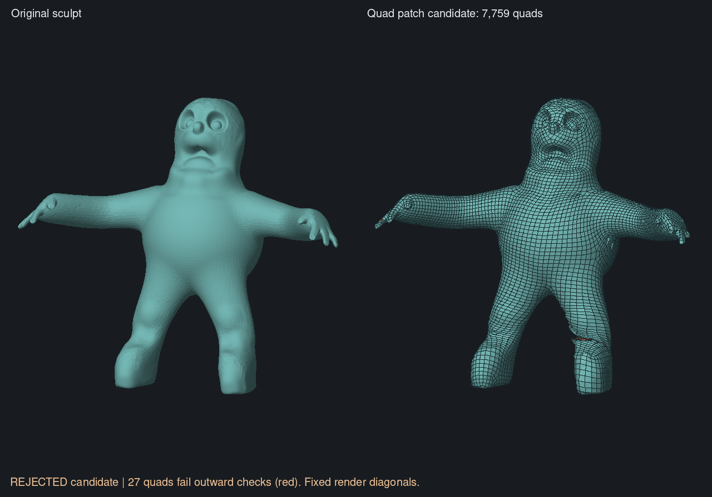
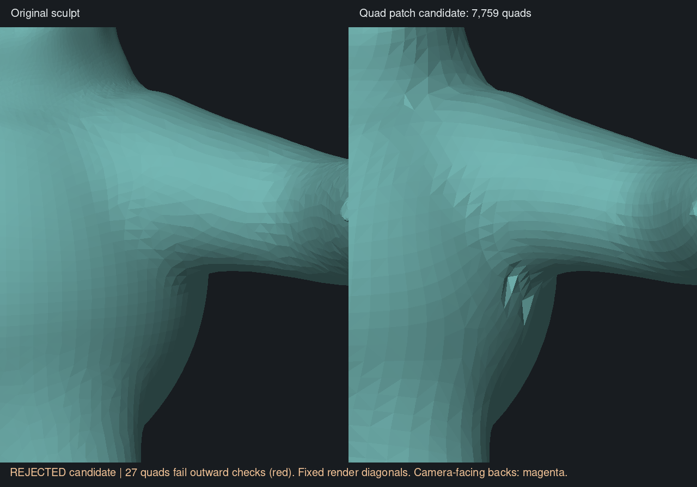

# Quad patch reconstruction — 5 November 2026

**Status: audit-only; the whole character is still rejected.** Removing the
failed grid cells leaves three clean boundary loops. A quad-only fill closes
them with 15 new quads and preserves the source's component count and Euler
characteristic. The resulting surface still fails geometric validation.

This tests the proposed cut-and-rebuild fallback after the
[orientation repair experiments](native-junction-repair.md#orientation-preservation-and-original-code-replay--5-november).
It does not repair the original integer grid: that saved grid still contains
64 inversions. The app backend and a standalone Fill Holes tool are unchanged.

## Construction and source references

The cut selects negative-area coarse faces and, optionally, neighbouring faces
by graph adjacency. There are no anatomical classifications or world-coordinate
predicates. Source geometry, guide constraints, density and integer offsets stay
fixed. The existing extraction now accepts an audit-only exclusion mask; normal
extraction passes an empty mask and retains its original hole-filling behaviour.

The fill reuses the Rust adaptation of pinned QuadriFlow
[`QuadEnergy` and `FixHoles`](https://github.com/hjwdzh/QuadriFlow/blob/810b7a0967c35b0dc85b4464e3835e26a756c967/src/parametrizer-flip.cpp).
That construction scores quad tilings using corner angles signed against
vertex normals. It connects existing boundary vertices and adds no interior
vertices. The audit extends its permitted even boundary length to 32; normal
extraction retains upstream's less-than-25 boundary guard.

Before filling, we require simple loops with one incoming and one outgoing
boundary edge at each vertex, and valid connected vertex fans. A fill must
close every boundary without conflicting directed edges. Odd boundaries,
pinches, excessive loop lengths, cancellation and incomplete fills are rejected
without committing partial patches. **There is no triangle fallback.**

Research distinguishes closing connectivity from constructing a good surface:
[Liepa's hole-filling paper](https://diglib.eg.org/items/bd5c3658-4de6-4336-a7bd-0baf4f5618ac)
separates filling, refinement and fairing, although its construction is
triangular rather than our quad requirement. [CGAL's mesh definition and
intersection checks](https://doc.cgal.org/latest/Polygon_mesh_processing/index.html)
also distinguish manifold connectivity from geometric validity. Our current
checks do not certify absence of self-intersections.

## Controlled results

The frozen body input is the same 10,000-target run used in the prior repair
comparisons, with uniform spacing `h = 0.05762159740626388`, five automatic
geometry-derived cycles, and no user mask or manual guide. Input digests, binary
digests, timings and local artifact paths are in the
[machine record](native-patch-rebuild-progress.json).

| Neighbour rings removed | Coarse faces excluded | Remaining quads | Boundary lengths |
| ---: | ---: | ---: | --- |
| 0 | 64 | 7,741 | 4, 4, 28 |
| 1 | 78 | 7,741 | 4, 4, 28 |
| 2 | 105 | 7,725 | 4, 4, 36 |
| 3 | 133 | 7,709 | 4, 4, 38 |
| 4 | 165 | 7,689 | 4, 4, 48 |
| 6 | 241 | 7,650 | 4, 4, 60 |
| 8 | 340 | 7,596 | 74, 4, 4 |

All seven cuts have simple manifold boundaries. The smallest cut excludes
64 of 15,644 coarse triangles (0.41% by count, not surface area). Larger cuts
are unnecessary to establish clean boundaries, and exceed the bounded fill's
loop limit from ring two onward.

For the smallest cut, fit the grid origins before extraction, fill the three
loops with `1 + 1 + 13` quads, run normal valence cleanup, then dynamic position
fitting and source-surface projection. Cleanup adds a net three quads, producing
7,759 quads and 7,761 vertices. Connectivity has one component, Euler
characteristic 2, and no boundary, matching the source.

The projection stage rejects vertex 2,964 at distance `0.07253` from the source,
above local spacing `0.05762`. Projection is transactional in this audit:
**failure restores the complete pre-projection positions**. Diagnostic
measurements of that rejected candidate show:

- 27 quads have no outward render diagonal.
- Maximum sampled result-to-source distance is `0.25173` (`4.37h`).
- Maximum sampled source-to-result distance is `0.20043` (`3.48h`).

These are measurements before successful projection, not a successfully fitted
output. They include problems away from the cut boundaries. Distances use
topology-only render diagonals and are sampled diagnostics, not exact Hausdorff
bounds or self-intersection tests.



The renderer uses fixed diagonals and back-face culling. Red marks quads that
fail the diagnostic outward check; some are hidden from this viewpoint. The
comparison shows useful large-surface layout but lost thin-feature detail and
remaining folds. Visual appearance does not override rejection.

A second placement trial starts extracted vertices at the mean of their
corresponding source samples and skips the grid/dynamic position solves. It
uses the same cut but can choose different fill connections. It is worse:
72 quads fail the outward check, geometry includes a degenerate render triangle,
and maximum sampled source-to-result error rises to `0.21980` (`3.81h`). It is
retained only as a rejected audit comparison.

The previously accepted finer-hand and torus controls both still pass. Their
positions and quad arrays are **exactly equal** to their prior accepted OBJ
outputs (1,202 and 756 quads respectively). This is a no-regression control;
neither requires cutting or filling.

An initial `fill-0` plumbing trial preceded the correct grid-fit ordering,
valence cleanup and projection rollback. Its partially projected output is
superseded and must not be compared as the current result. Its record remains
available for provenance.

## Underarm visual follow-up

The user's closer inspection identified apparent holes under the arms. An
independent edge-incidence count on the saved candidate finds zero boundary
edges and zero edges with more than two incident quads. Close-up renders with
wire lines disabled and both face sides visible nevertheless show substantial
pinching and distortion relative to the source. At the negative-X underarm,
quads 606, 1106 and 1107 fail the outward test with either diagonal; a small
camera-facing back surface is visible in magenta. The positive-X underarm also
has visibly distorted geometry, despite no quad in that area appearing in the
27-quad orientation-failure list. That list is **not a count of all poor faces**.

The three filled boundary loops lie at the fingers and crotch, away from these
underarm defects. This localizes another problem in the surrounding candidate;
it does not prove whether fitting or earlier layout construction caused it, or
exclude indirect effects of fitting the filled mesh. Self-intersections remain
untested. The candidate shown is still the rejected pre-projection geometry.



[Opposite underarm comparison](native-patch-underarm-negative.png) uses a
different camera angle to reveal the pinched point. These are renders of the
same saved mesh, not changed candidates. Camera coordinates affect diagnostic
views only. Use `--two-sided --no-wire --zoom 4 --center 1 .2 .3` with the
renderer for the positive-X view; the negative-X view uses
`--center -1 .2 .3 --yaw -.5`. Magenta marks camera-facing back sides; fixed
render diagonals and flat shading can accentuate facets.

## Reproduction and validation

Use a fresh output path for each command; the audit refuses to overwrite.
Build with the `audit` feature, the shared build lock, and the machine's compiler
job/memory limits. Then invoke the audit binary:

```text
audit rebuild-patches frozen.json cut.json 0 false 30
audit rebuild-patches frozen.json dynamic.json 0 true 30 dynamic
audit rebuild-patches frozen.json source.json 0 true 30 source
python3 scripts/retopology/render-patch-rebuild.py source.clay dynamic.json quality.json comparison.png
```

`quality.json` comes from `audit diagnose-obj frozen.json candidate.obj quality.json`,
where the diagnostic OBJ contains the report's positions and quad faces. This
export does not imply acceptance. The JSON records the candidate stage,
separate boundary/fill/fitting errors, and the scope of `accepted` checks.

Focused tests cover a 28-vertex quad fill preserving retained faces and vertices,
odd-loop rejection, cancellation without partial commit, and rejection of
pinched vertex fans. The existing pinned curved-surface extraction comparison
also passes. Audit-library/example and non-audit-library Clippy pass with
warnings denied. Rust formatting of changed implementation modules, Python
compilation and diff whitespace checks pass. Broad suites and app/GPU review
remain for CI and integration.

Runs were serialized with the shared lock. Cargo used one compiler job and a
700 MiB/no-swap cap; diagnostic processes used 500 MiB/no-swap. Peak reported
audit RSS stayed below 136 MiB. Timings are single runs, not benchmarks.

The next geometric comparison should preserve patch provenance through cleanup,
separate retained-face failures from new-patch failures, and test a fill with
interior vertices fitted to the source where boundary-only tilings are
insufficient. Nearest-point projection alone cannot establish that a quad spans
the correct part of a thin surface. The final source-distance, orientation and
topology checks must remain in place.
