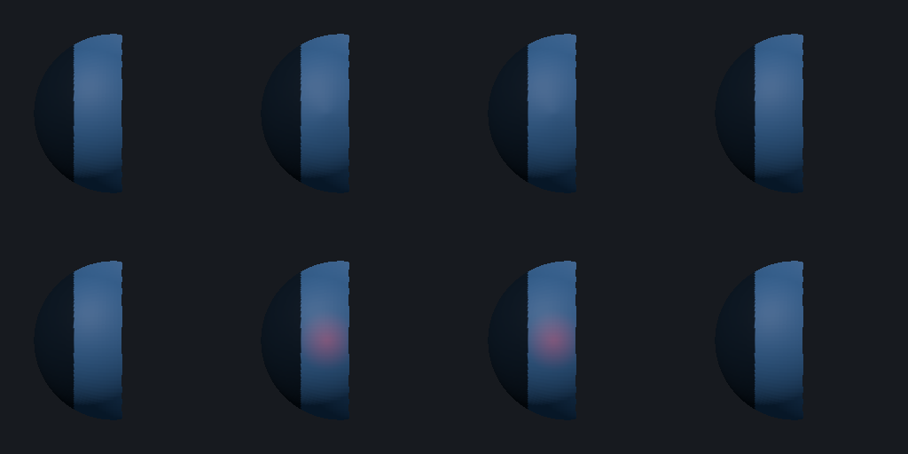

# Hidden-surface stroke display cache

Follow-up to the [capacity baseline](../capacity-2026-10-30/README.md), under #103. The baseline and harness were committed as `7add38c` before this optimization. The matched run's compiler, hardware, source SHA-256, samples and memory readings are retained in [CPU results](cpu/index.json) and [GPU results](gpu/index.json).

## Change and boundaries

Dense single-model strokes with hidden faces now retain the original topology, group visibility and smoothing-fan mapping in a shared cache. Each display update copies the current vertex positions, masks and materials while retaining the already filtered triangles, quads, face IDs and group colours. Hidden faces remain absent from drawing and picking, but still contribute to their original smoothing fans at visible boundaries.

The cache requires unchanged triangles, quads, hidden-face flags, polygroup assignments, group visibility and model identity. Changes to these reject it. Models with UV data, textures, explicit creases, primitive previews, temporary thickness or multiple submodels still take the existing full rebuild path. The optimization uses the existing 20,000-vertex threshold and does not raise geometry limits or change sculpting, history or project formats.

Deformation uses the same temporary area-weighted normals as the existing fully visible dense-stroke path. Release rebuilds canonical angle-weighted shading. Paint retains the cached normals during the stroke; the current renderer still performs a canonical rebuild on its release too.

## Matched CPU results

Same i7-7500U, 7.63 GiB usable RAM and release toolchain as the baseline. The browser remained closed; about 4.3 GiB RAM was available at the start. Three repetitions, 12 dabs per brush, unchanged generated fixtures, pressure sequence and attributes. Automatic comparison accepted every input and output checksum for all 12 CPU cases.

| Hidden fixture | Brush | Before display p50 / p95 | After display p50 / p95 |
| --- | --- | ---: | ---: |
| 75,266 vertices | Standard | 62.77 / 68.40 ms | 6.58 / 7.20 ms |
| 75,266 vertices | Clay | 62.24 / 66.31 ms | 6.48 / 6.97 ms |
| 75,266 vertices | Paint | 62.57 / 65.35 ms | 3.65 / 6.51 ms |
| 301,058 vertices | Standard | 271.98 / 283.76 ms | 25.83 / 32.05 ms |
| 301,058 vertices | Clay | 274.94 / 286.47 ms | 25.82 / 29.16 ms |
| 301,058 vertices | Paint | 275.94 / 293.44 ms | 14.48 / 15.84 ms |

These are sustained **display preparation** times, not complete dab/frame times. At the largest size, Standard display preparation is about 10.5 times faster. Standard brush evaluation itself remains about 17 ms.

The larger fully visible controls remain close to the baseline: Standard display p50 is 23.53 ms versus 23.56 ms for the plain sphere, and 28.52 ms versus 28.86 ms for the attributed organic form. The small hidden fixtures below the cache threshold continue using full display preparation.

### Release cost and total display work

Previously, every hidden-surface dab produced canonical shading, so release reused it. The cached path instead performs one full canonical rebuild on release: about 273–286 ms for the largest fixture, versus less than 0.01 ms previously. This is a real pen-up pause, and short taps may not benefit in total elapsed work.

To include that trade-off, sum each trial's first-display sample, its eleven sustained-display samples and its release-display sample, then take the median of the three trial sums:

| Hidden fixture | Brush | Before: display work per 12-dab stroke | After, including release |
| --- | --- | ---: | ---: |
| 75,266 vertices | Standard | 763.51 ms | 149.21 ms |
| 75,266 vertices | Paint | 753.33 ms | 117.17 ms |
| 301,058 vertices | Standard | 3313.39 ms | 584.76 ms |
| 301,058 vertices | Clay | 3321.23 ms | 595.18 ms |
| 301,058 vertices | Paint | 3334.77 ms | 462.62 ms |

These sums cover only measured display preparation, excluding initial viewport construction, brush evaluation, picking, upload, drawing and OS presentation. They are not sums of independently calculated percentiles or an advertised frame rate.

## Hardware GPU and memory results

The same 12 cases were repeated on Intel HD Graphics 620, Mesa 26.2.4/Vulkan, at 800×600. All input/output comparisons passed. For the largest hidden fixture:

| Standard phase | Before p50 / p95 | After p50 / p95 |
| --- | ---: | ---: |
| Sustained display preparation | 269.80 / 278.75 ms | 26.22 / 30.85 ms |
| Buffer preparation, upload and completion wait | 71.26 / 107.20 ms | 71.77 / 90.19 ms |
| Completed orbit draw | 29.61 / 33.36 ms | 29.45 / 33.68 ms |

The upload phase remains a separate bottleneck. At 75,266 vertices its median rose from 11.42 to 14.61 ms in this run; the display saving is much larger, but this is not an across-the-board latency improvement. No upload or shader changes are included.

The immutable topology cache stores about 42 MiB at 301,058 vertices. CPU-process peak RSS for that hidden workload rose from 685.9 to 691.8 MiB; GPU-process peak rose from 832.7 to 876.6 MiB. At 75,266 vertices those peaks rose from 326.7 to 336.6 MiB and from 400.9 to 429.0 MiB respectively. Peaks include benchmark reference snapshots and verification allocations, not just the application document. All 24 runs stayed within the 1536 MiB RSS and 600-second workload guards.

## Correctness and visual checks

Seven focused CPU tests passed: four new cache regressions and the three existing capacity-workload checks. They verify filtered faces and source-face IDs, shared cache reuse, full-surface normal contributions, masked/hidden vertex protection, unchanged topology, exact Undo/Redo, vertex Paint attributes and normals, same-count visibility changes, hidden-only topology changes, group visibility, model identity, UV seams, creases, multiple-model fallback and an entirely hidden display.

Both visibility GPU regressions passed on the hardware adapter. The new regression exercises three dense Standard/Paint dabs, solid and wireframe rendering, visible/hidden picking, group lookup, release, Undo/Redo, Show all and undoing Show all. Paint pixels match a fresh canonical render exactly. For the deformation fixture, temporary shading stays within 12/255 maximum and 0.5/255 mean channel difference; background pixels must match exactly. Release and history restoration match canonical pixels exactly.

The final capture was visually inspected. Rows are Standard and Paint; columns are before, live stroke, canonical release and Undo. The dark left band is the protected mask. The missing right side stays absent, the paint stroke remains visible on the unmasked surface, and Undo restores the initial view.



Formatting and diff whitespace checks passed. The new CPU tests join normal CI and the GPU regression joins the existing visibility/graphics selection. Full-suite CI remains pending; no PR was opened for this batch.

## Reproduce and compare

Run benchmarks sequentially on the same machine and power settings, with other intensive applications closed. The runner compiles once and isolates each case in a bounded process. Use new output directories on a local disk:

```sh
cargo test --release --locked --lib hidden_stroke_cache -- --test-threads=1
cargo test --release --locked --lib capacity_ -- --test-threads=1
CLAY_HIDDEN_STROKE_PREVIEW=/tmp/clay-hidden-stroke.png cargo test --release --locked --lib viewport::gpu::visibility_test:: -- --ignored --nocapture --test-threads=1

python3 scripts/benchmark-capacity.py run target/hidden-stroke-repeat/cpu
python3 scripts/benchmark-capacity.py run target/hidden-stroke-repeat/gpu --gpu
python3 scripts/benchmark-capacity.py compare docs/validation/capacity-2026-10-30/cpu target/hidden-stroke-repeat/cpu
python3 scripts/benchmark-capacity.py compare docs/validation/capacity-2026-10-30/gpu target/hidden-stroke-repeat/gpu
```

The retained [CPU comparison](cpu-comparison.csv) and [GPU comparison](gpu-comparison.csv) include every measured metric, including the slower release phase. The next experiments should address release refresh and incremental uploads while preserving these correctness checks. This change still copies vertex/display arrays and evaluates normals over the full source mesh; it is not region-based editing or evidence of multi-million-polygon capacity.
