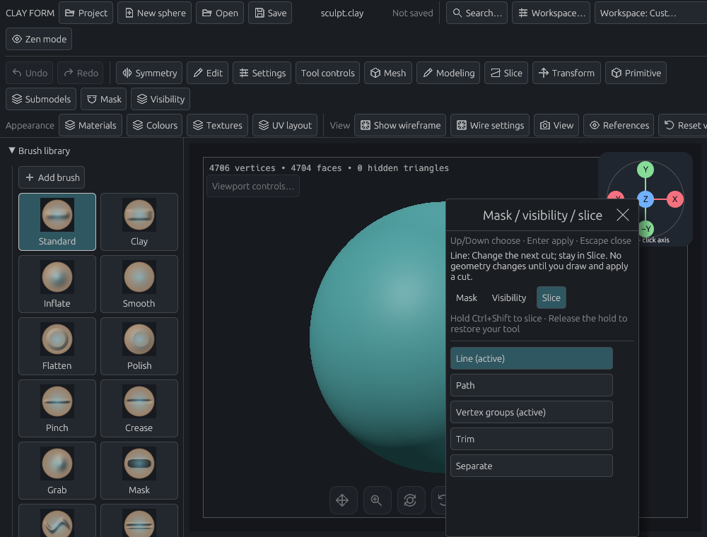
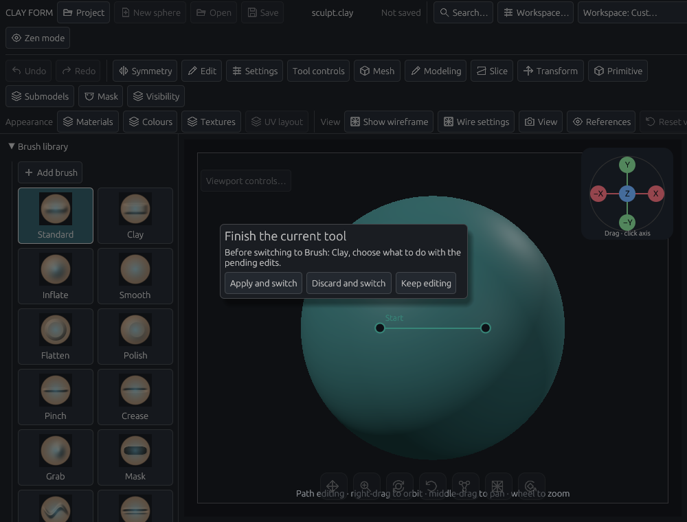

# Shared Slice chooser and brush transitions

Scope: #129, #143 and #144. The user clarified #129 on 14 November 2026: Slice belongs beside Mask and Visibility in the shared selection chooser. Ctrl+V is unchanged.

## Try the workflow

1. Press **Z**, choose **Slice**, then choose Line or Path and a cut mode. Hold **Ctrl+Shift** to slice. Releasing the hold cancels an unfinished cut and restores the previous tool. Releasing a line cut, or pressing Enter for a path, uses the existing undoable Slice operation.
2. Choose **Mask** or **Visibility** in the same menu to restore their existing selection workflows. The menu key and selection hold remain configurable. Open the chooser before holding Ctrl+Shift; the exact Ctrl+Shift+Z Redo binding takes priority.
3. **X** swaps paint colours once per press. Fresh preferences and Reset shortcuts use X/Z. An unchanged legacy pair migrates atomically; custom bindings and explicit unbindings remain intact. The migration runs once.
4. Open Editable paths or Path Brush and choose another brush. Untouched tools close immediately. A private draft or preview offers Apply and switch, Discard and switch, or Keep editing. The window close control, Done and Finish paths use the same decision. Object brushes follow the same transition.

## Dialog audit

- Path authoring and automatic strokes: preserve the draft until a decision; cancel workers on Discard; defer automatic whole-path commits while a decision is pending. A suspended second draft must be resolved in the path editor before Apply and switch becomes available.
- Projection, relaxation, guided retopology and local joins: untouched dialogs can be left; running or ready previews use the same decision and existing Apply validation. Invalid or unfinished previews retain a route back to editing.
- Instance previews: Apply and Discard reuse the existing preview transaction. Ordinary settings, workspace and capacity windows allow brush selection and compatible commands; pointer hit testing keeps clicks on the window out of the viewport.
- Text fields, shortcut capture, file selection, unsaved-project decisions, alpha drafts and icon capture retain their input ownership. Background mesh operations retain their edit locks and cancellation controls.
- Opening ordinary settings cancels an unfinished viewport gesture; fresh gestures work while the window stays open. Recovery, diagnostics and shortcut capture retain their edit guards. Selecting an object brush preserves its first stroke and opens the built-in brush controls when needed.

## Checks

All 50 focused tests passed. They cover shortcut migration and custom keys; real keyboard, chooser-tab and decision-button input; temporary Slice cancellation, a completed cut and Undo; brush and object-brush switching; pending/running path previews; suspended drafts; scene/history preservation; ordinary settings; and instance-preview decisions. The software-Vulkan walkthrough also passed: it clicks the Slice tab, Trim, Keep editing and Apply and switch, and renders the screenshots above. It is included in GPU CI. The dependency-notice check passed with no dependency changes.

Local builds use one compiler job, no debug symbols, disabled incremental output and the shared build lock. No release build or full local suite was run. Full tests, formatting, lint, packaging and the configured GPU checks run in PR CI. Physical pen hardware remains a separate hands-on check.

The follow-up regression checks include historical shortcut layouts predating the shared chooser, first-stroke object placement, settings-window gesture interruption, object stamping and built-in brush selection. The graphics fixture processes sidebar commands before viewport input, matching the desktop app.
