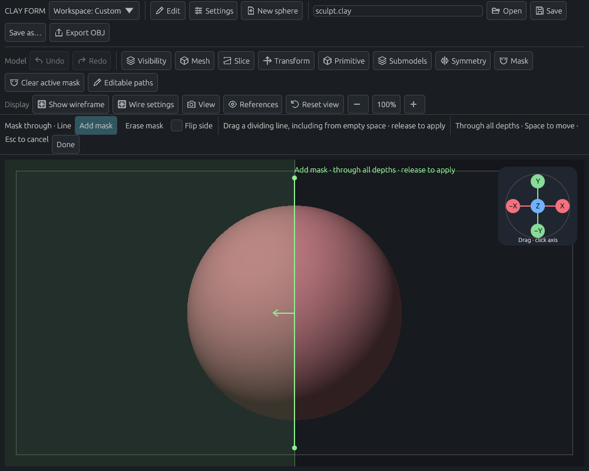
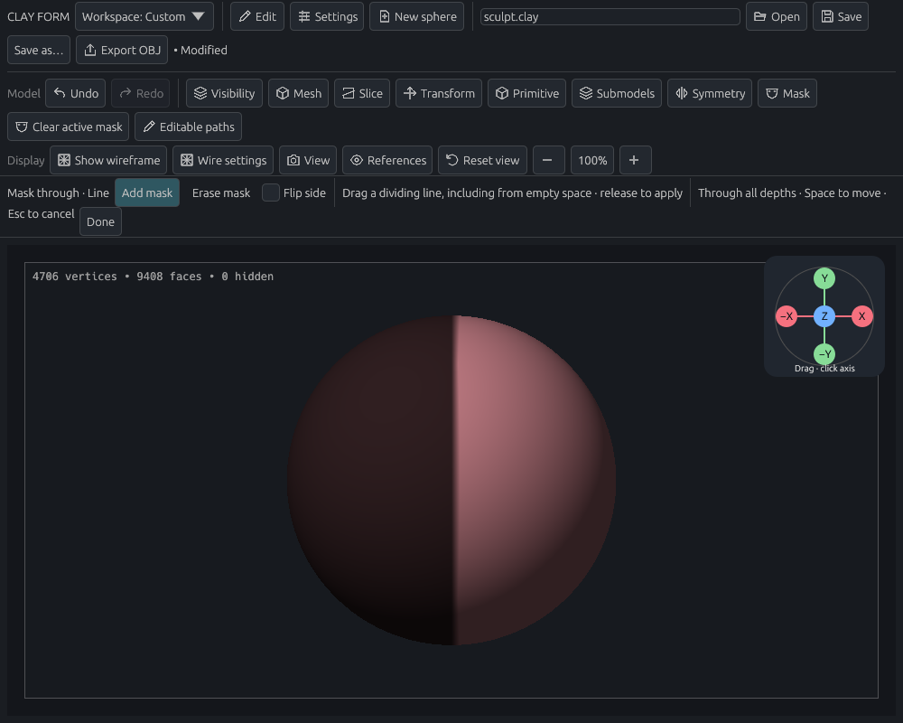
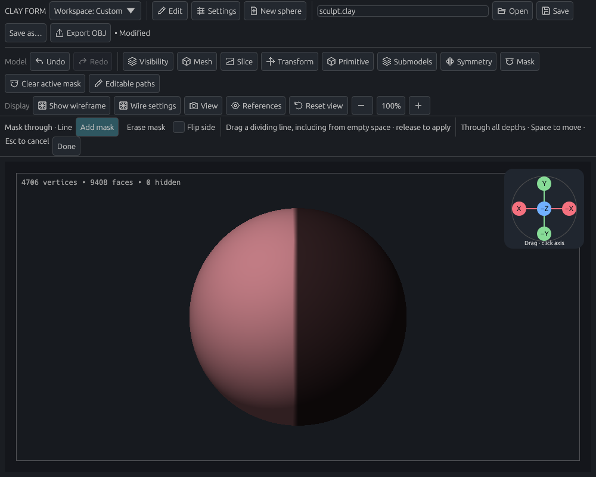
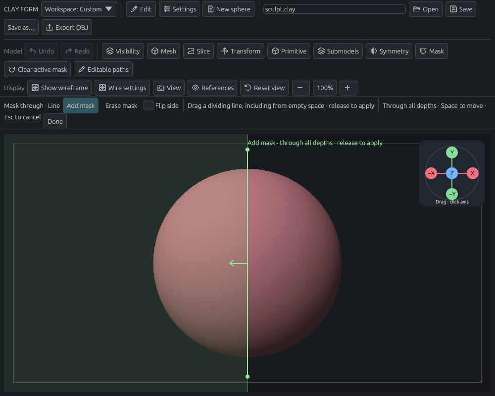
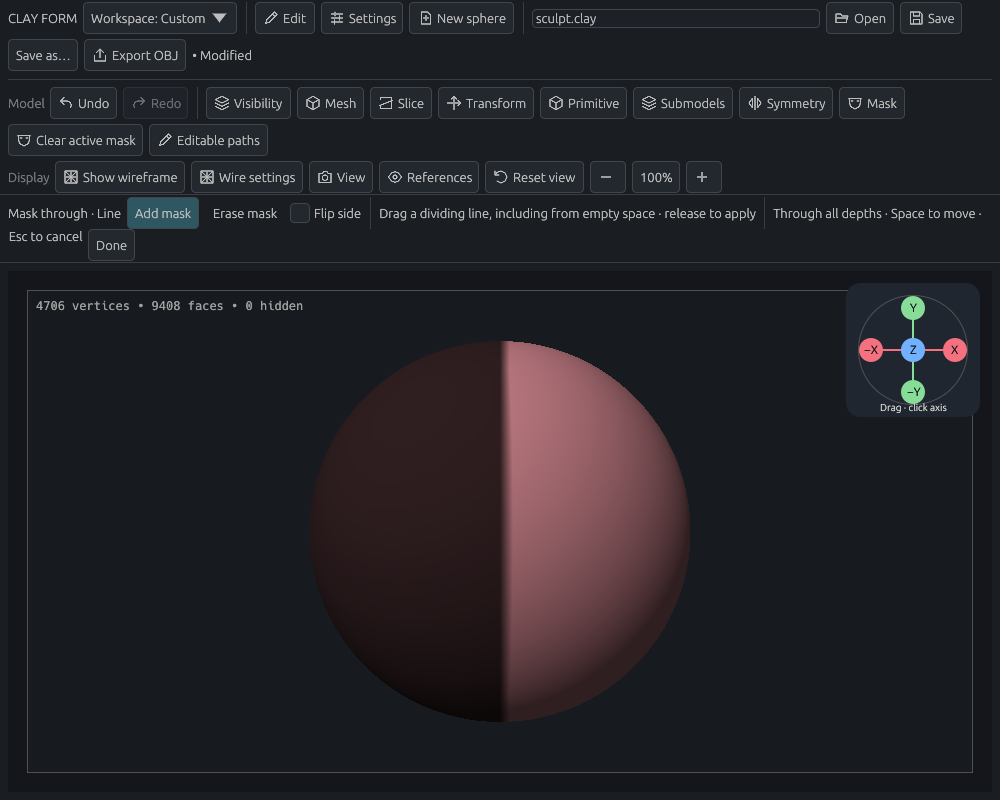
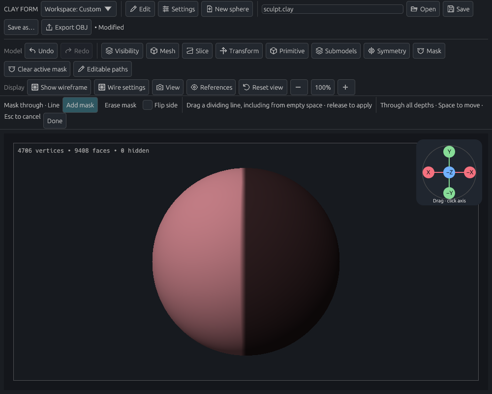

# Through-depth line masking

The viewport fixture uses the application's real egui controls, input routing, document operations, and wgpu renderer with Mesa software Vulkan. It starts and ends the primary drag outside the sphere, checks that the live preview leaves the document unchanged, commits once, turns the camera to inspect the back, and undoes the operation.

| View | During the gesture | Front after release | Back after orbit |
| --- | --- | --- | --- |
| Orthographic |  |  |  |
| Perspective |  |  |  |

The arrow and tinted half-plane agree with the committed mask. The protected half remains visible when the camera turns to the rear. These captures use offscreen application rendering; physical tablet hardware was not exercised.

Focused tests cover Add/Erase, both sides, both projections, an off-center perspective division that differs from an orthographic plane, batched pointer samples, an assigned flip shortcut during the drag, remapping/clearing preferences, configured camera navigation, Escape/tool/focus/popup interruption, empty/no-op gestures, hidden boundaries and every stored subdivision level, inactive models, save/reopen, and exact undo/redo. Existing lasso regressions are also run.

Reproduce the rendered check with:

```sh
CLAY_GPU_SOFTWARE=1 CLAY_LINE_MASK_PREVIEW=docs/validation/line-mask/line cargo test --locked --lib gpu_line_mask_preview_front_back_and_undo -- --ignored --nocapture --test-threads=1
```

CI runs this ignored GPU regression through its existing `viewport::gpu` correctness job, alongside full tests, formatting, and lint.
