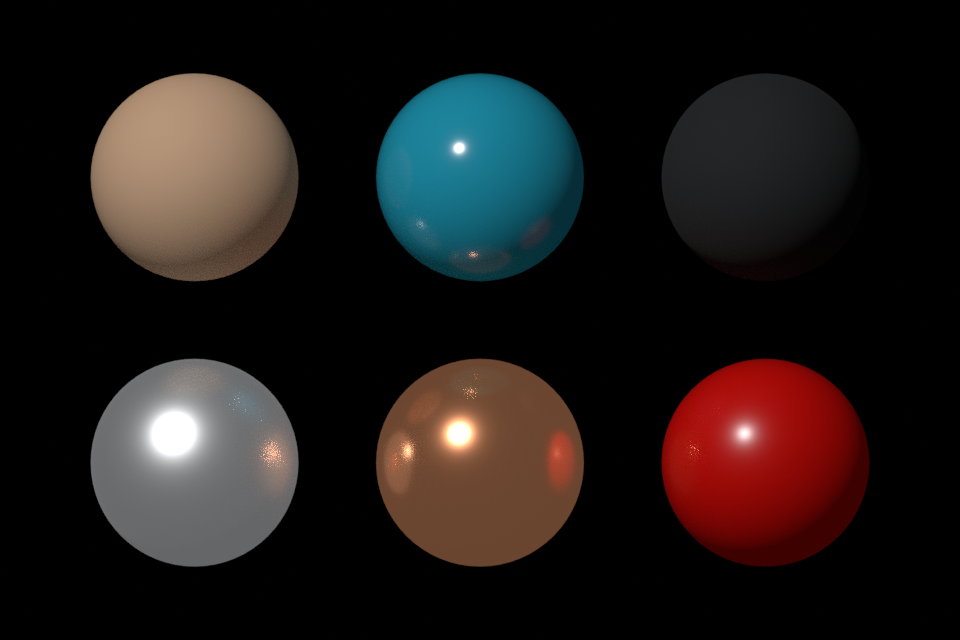

# Vertex material painting review — 24 October 2026

Feature: [#9](https://github.com/dustyghost/clay-form/issues/9). The CI cleanup selected for this batch had already shipped in #57; no duplicate screenshot jobs were added.

## Verified locally

Eleven focused checks passed, including the manual rendered walkthrough and the GPU pixel regression:

```sh
CLAY_GUIDE_PREVIEW=/tmp/clay-material-review cargo test --locked --lib material -- --include-ignored --nocapture --test-threads=1
```

Coverage includes pressure, alpha footprint, symmetry overlap, masks/hidden faces, group separation, individual paint channels, topology preservation, one-step history, cancellation preserving redo, old projects, save/reopen, fill, subdivision interpolation and level detail, extraction/thickness/merge, adaptive edits, slicing, mirroring, modeling splits, projection and barycentric voxel-remesh transfer. The app test creates Paint in an older brush library, sends pointer strokes, releases with temporary Smooth held, cancels with Escape, and confirms automatic remeshing stays idle.

The manual capture clicks the real **Fill unmasked vertices** control for all six examples, paints a local teal stroke over red plastic, and undoes it. Screenshots were inspected for reachable controls, material appearance and the stroke footprint. A colour picker round-trip initially changed values without user input; the control now commits colour only on an actual edit. A full-strength blend now stores the exact target values, so repeated fills remain no-ops.

- [Copper and controls](../../images/material-copper.png)
- [Local paint stroke](../../images/material-painted-stroke.png)
- [Example values](materials.json)

The 4,706-vertex sphere makes the vertex-resolution limit visible at the paint boundary. Subdivide for finer paint. Copper's uniform fill away from its highlight reflects the simple studio environment; the viewport does not render surrounding scene reflections.

## Blender fixture

```sh
blender -b --factory-startup --python scripts/validate-materials-blender.py -- /tmp/clay-material-review
```

Tested with **Blender 5.2.2 LTS**, Cycles CPU, 32 samples, Standard view transform, exposure 0, gamma 1, black world, orthographic front view, a 2.5-strength directional light along normalized (−0.5, 0.7, 1), and dielectric IOR 1.5. Explicit emission reproduces the viewport's constant neutral fill for this comparison; it is not an exported authored emission channel.

The script creates POINT attributes for linear RGB, roughness and metallic and connects them to Principled inputs. Stored attribute values must agree within **1e−6**. A flat-plate center pixel is checked against the viewport's published equations within **4/255 sRGB per channel**; the GPU test independently checks the shader against the Rust reference within **2/255**. The measured maximum Blender/reference error was **0.0045** (about 1.2/255).

| Example | Maximum absolute sRGB error |
| --- | --- |
| Matte clay | 0.0045 |
| Glazed ceramic | 0.0018 |
| Rubber | 0.0027 |
| Satin aluminium | 0.0034 |
| Copper | 0.0022 |
| Red plastic | 0.0022 |

[Numeric samples](blender-samples.json) record the actual values. The generated `.blend` remains a local review artifact; the committed script and JSON reproduce it.



Gallery order: clay, ceramic, rubber; aluminium, copper, red plastic. Blender adds reflection/bounce detail and uses its own normal interpolation/multiscattering, so the sphere images are appearance checks rather than a pixel-equality claim. The compact flat fixture isolates the channel mapping. This is a validation fixture, not the complete Blender exchange workflow from #21.

## Remaining review

Physical pen pressure/feel and artistic feedback remain for hands-on review; automated pressure samples pass. PR CI runs the full test suite, formatting, lint and configured GPU checks. The manual gallery and Blender renders stay outside routine CI.
