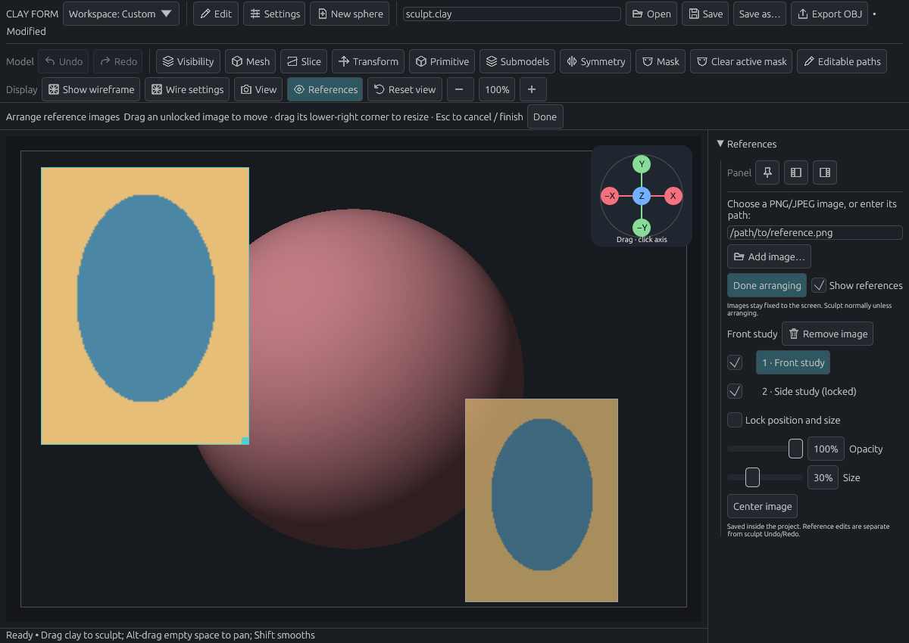
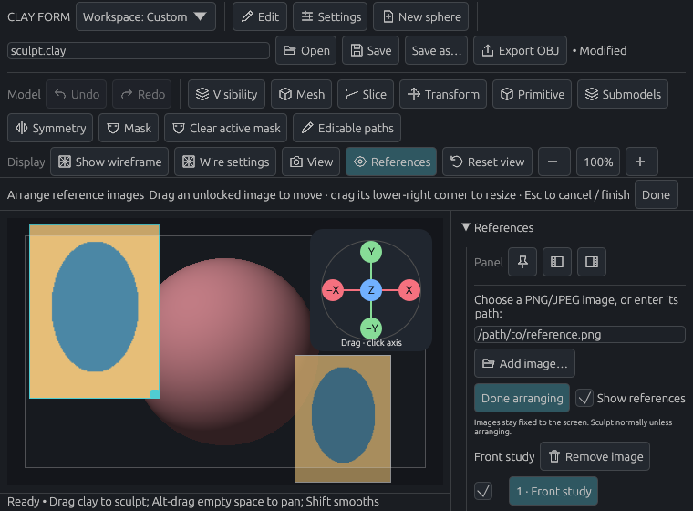

# Reference image controls and native-drop input

The application rejected a valid native-style PNG drop when no ordinary pointer position was available. A focused failing regression reproduced the rejection before removing the viewport hover gate. Window-targeted drops are now consumed once while document interactions are enabled; stale or absent pointer positions no longer discard them.

Validation:

- Nine focused reference tests passed, covering PNG/JPEG drop input, invalid files, modal guards, move/resize/cancel, locked images, removal, source-file preservation, saved-project removal, and released image capacity.
- After moving removal ahead of the image list, the 760×560 UI click regression passed with the full toolbar, a long image name, and a hidden, locked reference.
- The existing offscreen application preview passed using software Vulkan at 1200×850 and 760×560. Both final images were visually inspected. The selected image's **Remove image** control remains visible in the small layout.

These drop tests supply native-style egui input; they do not establish operating-system file-manager delivery. Native file-manager delivery was not validated. The pinned winit 0.30 Wayland backend does not implement file-drop delivery. No desktop/backend configuration was changed; native Wayland users can enter an image path and choose **Add image**. Native Wayland file-drop delivery remains outside this application-side correction.

