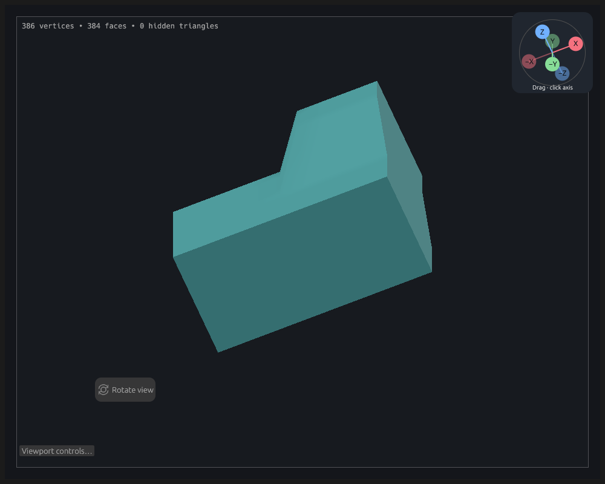
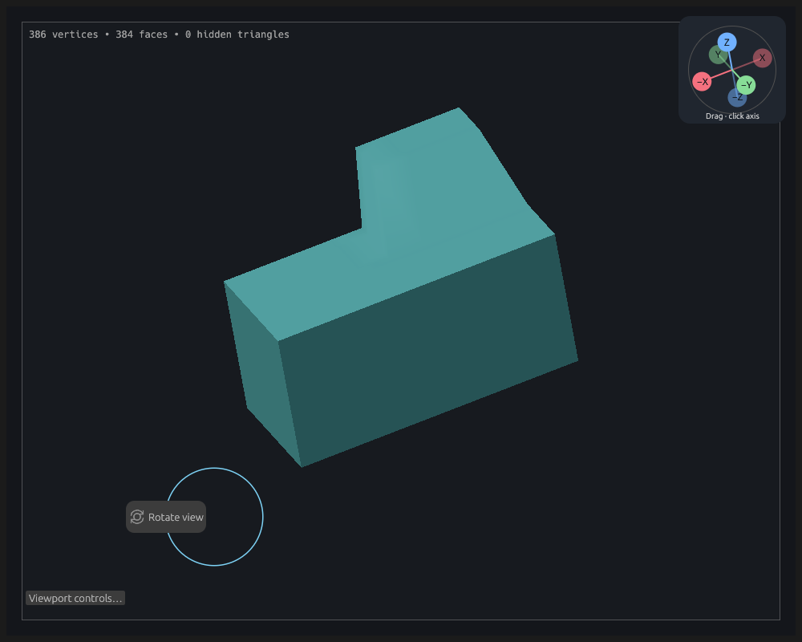
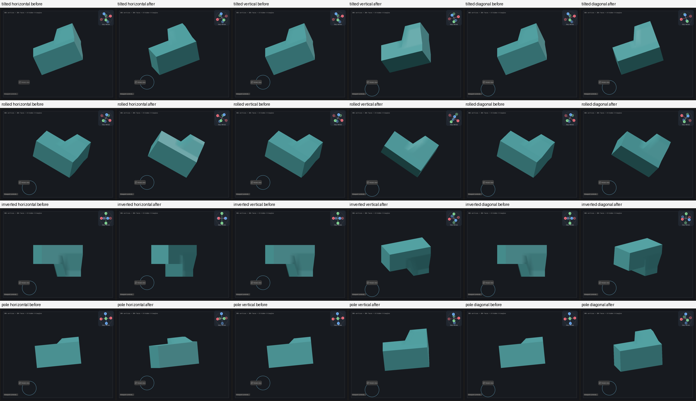

# Screen-relative viewport orbit

Issue #102 reproduces with an asymmetric cuboid pitched forward by 1.1 radians: a horizontal drag used to change screen-up and swing the shape around world Y. Near the pole it mostly spun the silhouette instead of revealing the side. `tilted_orbit_rotates_about_screen_up_not_world_y` failed on the original implementation before the fix; the original GPU capture also reproduced the spin.

Orbit now applies one finite rotation about an axis in the current screen plane. Horizontal motion rotates about screen-up, vertical motion about screen-right, and diagonal motion combines the two without choosing an axis order. Roll still turns the screen frame about the viewing direction.

Yaw/pitch/roll remain the stored encoding used by axis snaps and diagnostic captures. They no longer define the incremental orbit axes. The rotated right/view vectors determine the new encoding, with an explicit pole case and the nearest equivalent Euler branch. This preserves existing diagnostic files and avoids introducing a second orientation state. Regressions check the resulting frame, including exact poles, rather than relying on Euler-angle signs.

The pivot remains the common model-space origin. Pan moves its projection; Reset view fits visible geometry without redefining the pivot. Offset models travel around that origin and multiple visible submodels share it. Neither geometry nor model transforms are changed to implement camera navigation.

## Reproduction and review

```sh
cargo test --locked --lib orbit -- --nocapture
CLAY_GPU_SOFTWARE=1 LP_NUM_THREADS=2 CLAY_ORBIT_PREVIEW=/tmp/clay-orbit cargo test --locked --lib screen_orbit_offscreen_preview -- --ignored --nocapture
```

The manual capture drives the real Rotate view control through six pointer moves per drag. It writes before/after images for horizontal, vertical and diagonal drags in tilted, rolled, inverted and pole views. It remains outside routine screenshot CI. Inspect silhouette, newly revealed faces, orientation gizmo and unchanged screen pivot; a passing image export alone is not visual acceptance.

Automated interaction coverage includes empty-space/border drags, secondary-button orbit, the orientation gizmo, Rotate view, touch, path authoring and modeling in both projections. It compares the resulting camera frame and checks geometry snapshots, history counts, dirty state, pan, zoom and perspective distance. Camera tests cover screen axes and angle, inverse drags, diagonal event subdivision, full turns and 4,000 mixed orbit/roll updates. Projection tests check the common origin and picking of offset geometry.

Physical mouse/pen acceptance of the reported tilted-model case remains for the user before merge. This work does not change PR #91's Windows pen verification requirement.

## Observed results

The orbit-filtered checks passed (21 tests), followed by 59 focused camera/navigation/gizmo/control/projection checks. The software Vulkan capture passed and all 12 before/after pairs were visually inspected. Horizontal drags reveal the side while retaining the height of each feature; vertical drags reveal the top/bottom without a sideways spin. Rolled, inverted and pole views follow the same screen references. The gizmo turns with the model view and the lighting remains coherent.

| Tilted start | After horizontal drag |
| --- | --- |
|  |  |



Full unit, formatting, lint and configured GPU checks are left to PR CI. Acceptance is still pending; no merge is authorised by these automated results.
