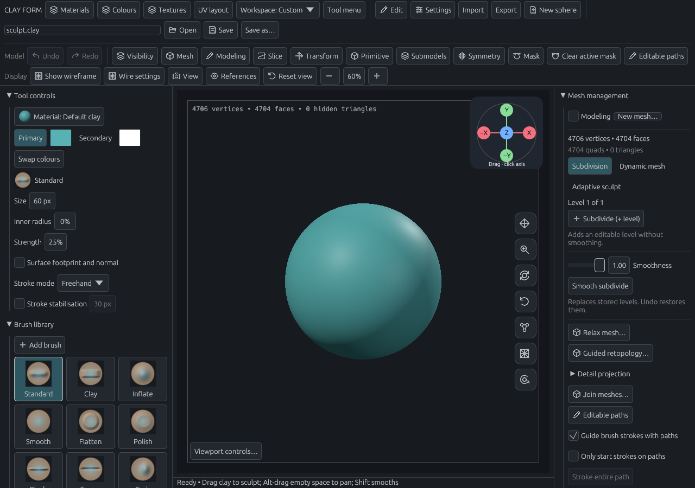
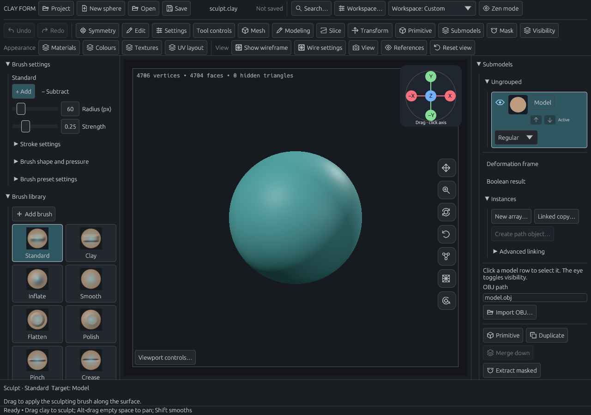
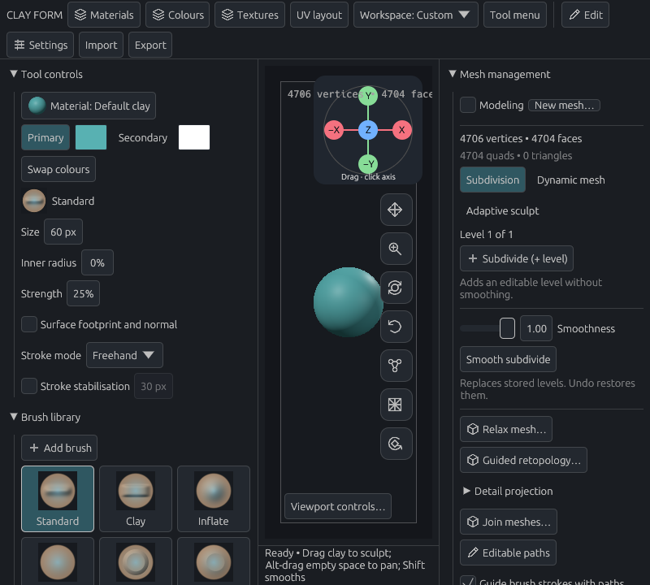
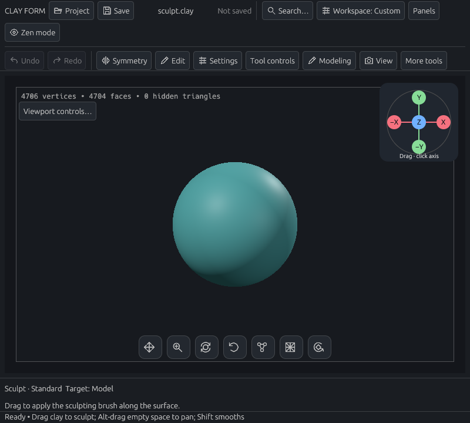
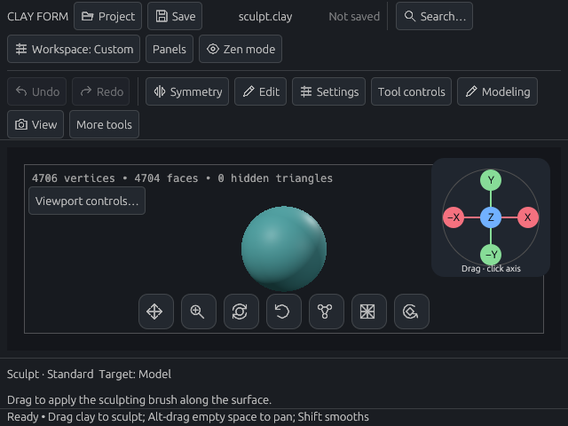
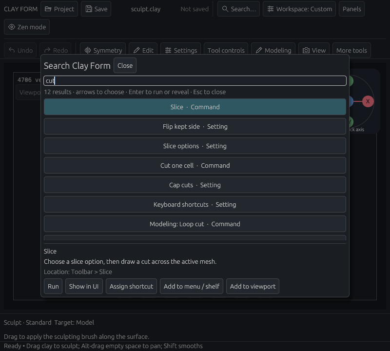
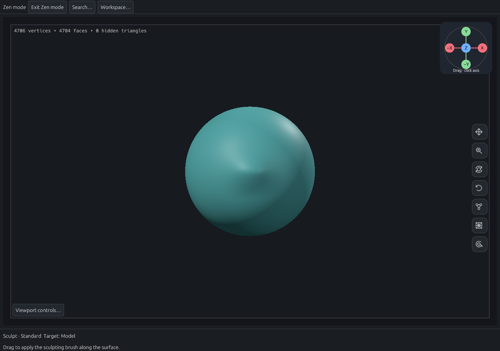
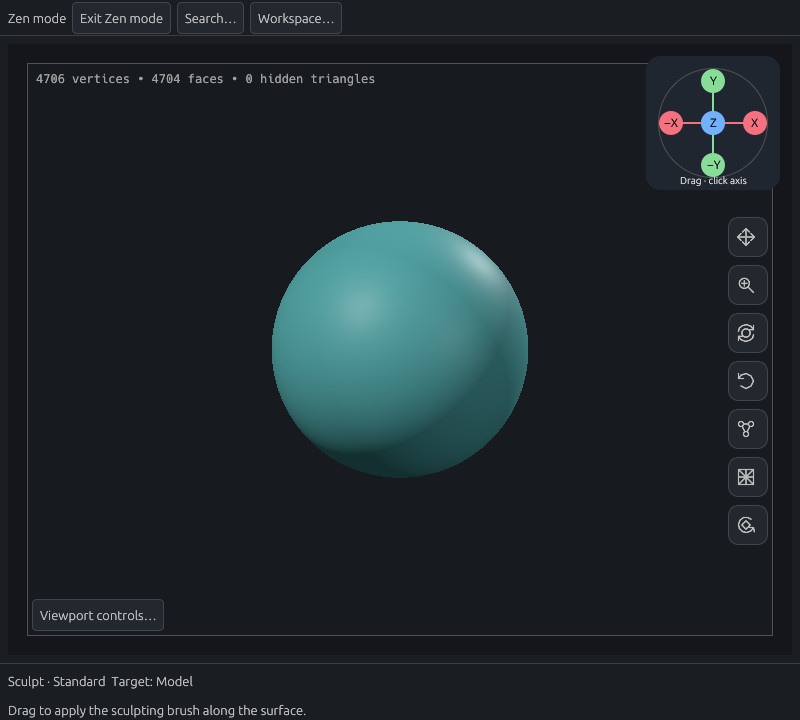

# Workspace discoverability review

This review covers stories #131 and #135–#138. The baseline is `c02f0b0e` on main.
Images are actual egui/wgpu renders using Mesa's software Vulkan adapter, with fresh
preferences and the same initial sphere. No image comparison threshold is claimed.

## Default workspace

Before, at 1280 × 900:



After, at 1280 × 900:



The project controls, Search and Workspace have stable labelled entry points.
Brush controls put the current operation first, with advanced editors collapsed.
The status strip identifies the tool, target and next gesture.

## Smaller windows

Before, at 800 × 720:



After, at 800 × 720 and 640 × 480:





Search can find the Slice tool using “cut”:



Zen hides the workspace and moves navigation out to the expanded viewport edges.
Leaving Zen restores the normal control positions and panel layout:





## Reproduce the interaction review

```sh
CLAY_GPU_SOFTWARE=1 WGPU_BACKEND=vulkan LP_NUM_THREADS=2 \
  CLAY_GUIDE_PREVIEW=/tmp/clay-workspace \
  cargo test --locked --lib discoverable_workspace_offscreen_review \
  -- --ignored --test-threads=1
```

This test opens Project, makes a real viewport stroke, clicks Undo, restores the
stroke, clicks Save, accepts the project path, opens a new scene and reopens the
saved sculpt. It also clicks Search in compact and small windows, and Zen at all
three window sizes.
The GPU CI job runs it alongside the existing interface regressions.

Focused interaction tests cover keyboard rebinding and text input, Run through
the shared dispatcher, search dismissal without a stray viewport gesture,
temporary reveal and workspace switching, and Tab entering and leaving Zen.
Preference tests cover layout recovery and shared binding preservation. UI tests
cover live search entries, prerequisite routes, exact nested controls and
deliberate edits during temporary reveals.

These checks exercise pointer and keyboard events, not physical pen pressure,
hover, palm rejection or touchscreen hardware. Those still need a device check.
The larger font-density cases are layout checks; they are not a substitute for
trying the interface on a tablet.
