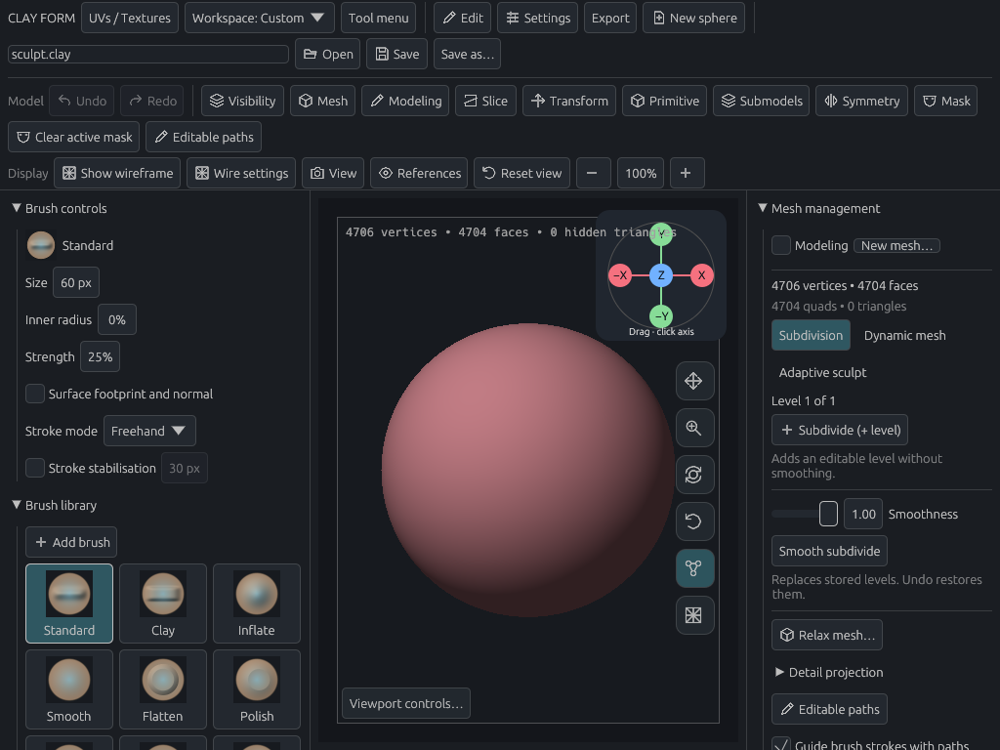
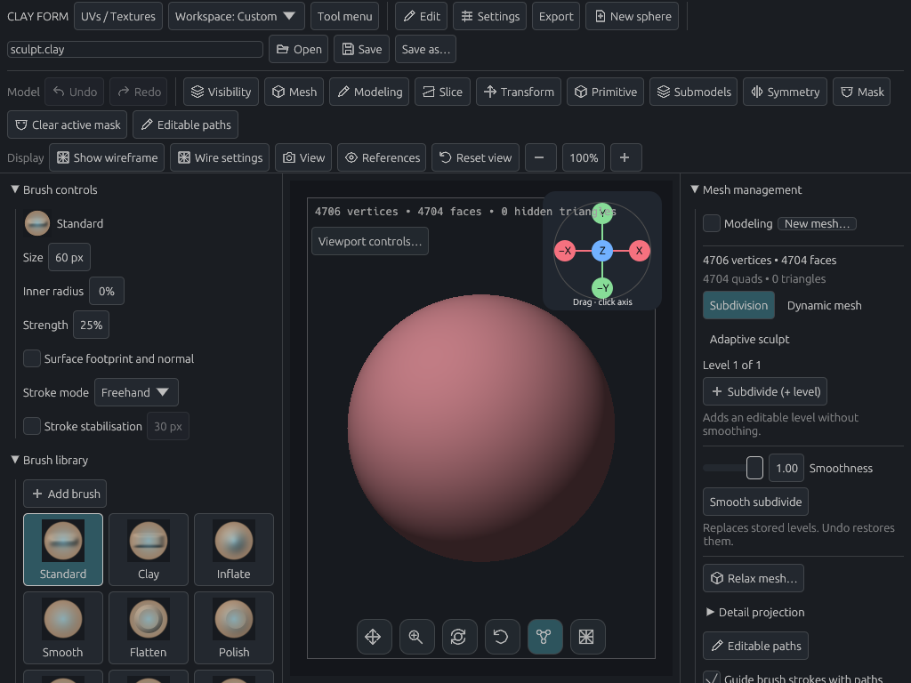
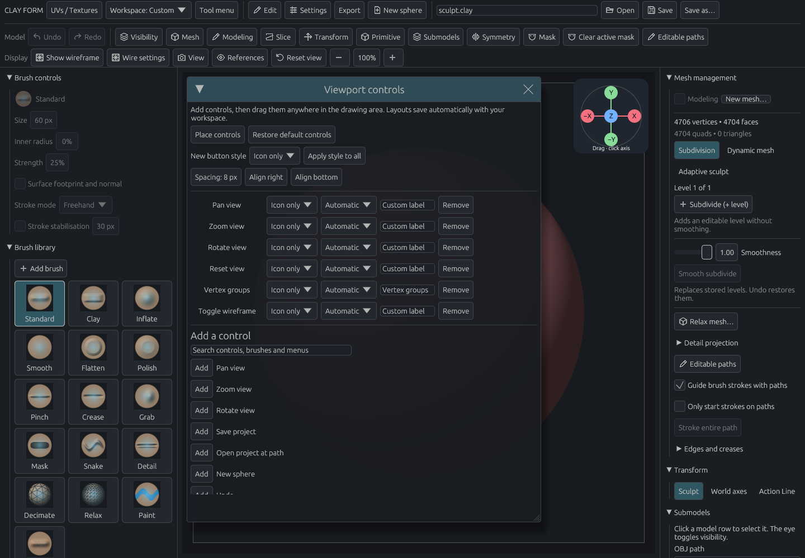

# Configurable viewport controls — 28 October 2026

The drawing area offers drag controls for pan, zoom and camera rotation, plus reset view, vertex-group colours and wireframe toggles. The shared action catalog supplies extra buttons and brush-value controls.

The default layout uses 40-pixel icon buttons with 8-pixel gaps. Each control supports icon-only, icon-and-text or text presentation, an icon override and a custom label. Align right and Align bottom use measured control dimensions and logical-pixel spacing. Placement mode allows individual positioning. Controls, styles and positions save with each workspace; existing records without style fields retain text presentation.

## Visual review

Captured with the actual egui/wgpu renderer on Mesa llvmpipe. Reviewed normal and small windows, the configuration editor, a horizontal row and labelled controls. These captures are manual review artifacts, excluded from routine CI.

## Validation

- `cargo test viewport_controls -- --nocapture`: 7 passed; the manual capture is ignored by default. Coverage includes camera dragging without sculpting, toggles/reset, placement and context-menu removal, adding controls through the editor, brush-value popups, modal blocking, migration, per-workspace persistence, and alignment after resizing or changing styles.
- `cargo test ui::customization::tests -- --nocapture`: 10 passed after extracting the shared action widget.
- `CLAY_GPU_SOFTWARE=1 CLAY_VIEWPORT_CONTROLS_PREVIEW=/tmp/clay-viewport-icons cargo test viewport_controls_offscreen_preview -- --ignored --nocapture`: passed; all five layouts visually inspected.
- `cargo fmt` and `git diff --check`: clean.

Full tests, lint and configured GPU regressions are left to PR CI. No release build was run.
