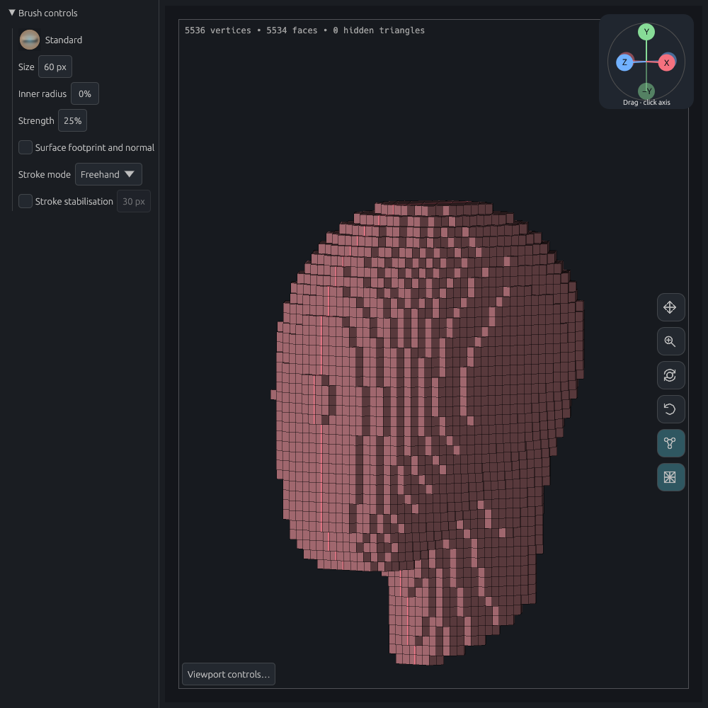
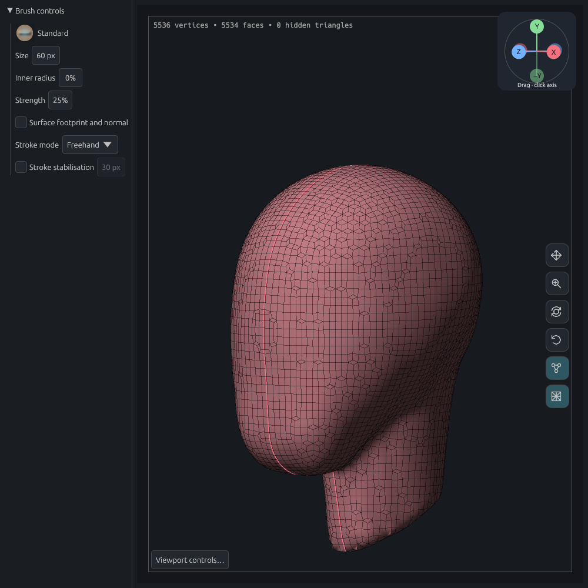
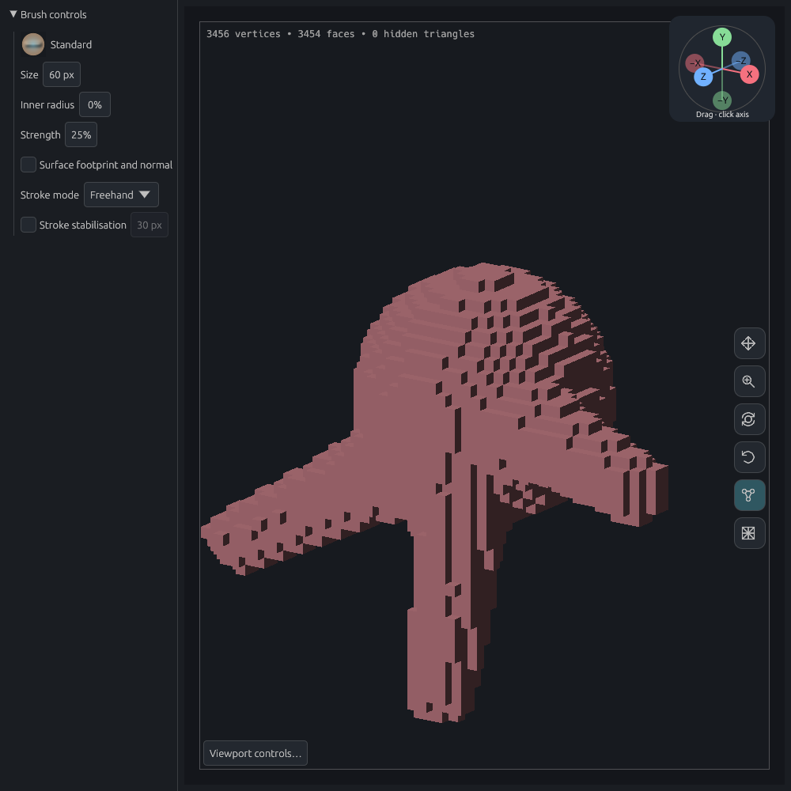
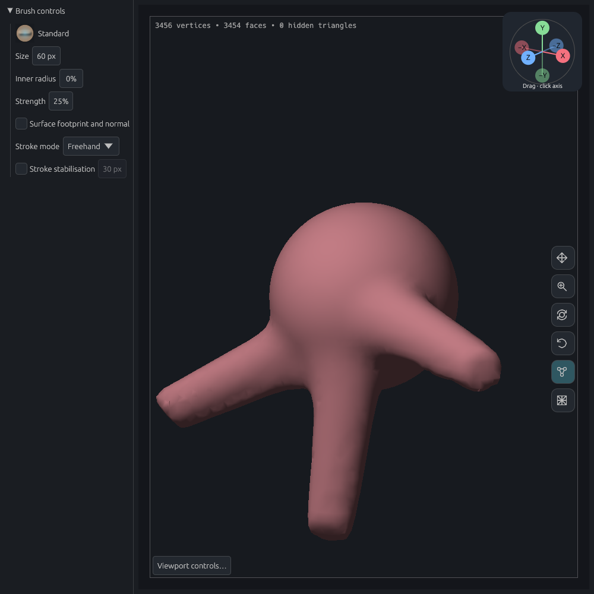
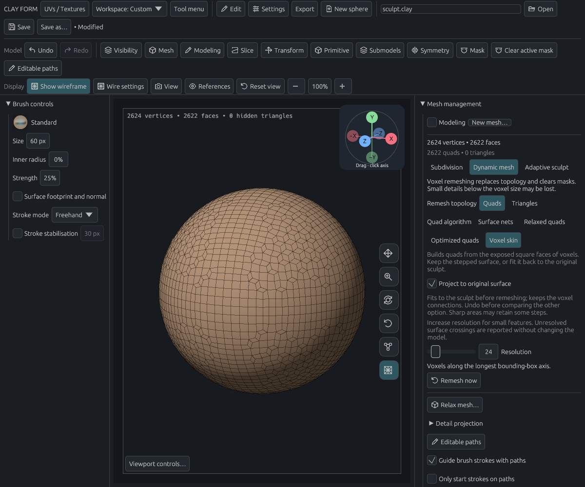

# Voxel skin with optional projection

Issue #73, 28 October 2026. **Dynamic mesh → Quads → Voxel skin** adds a separate algorithm. **Project to original surface** defaults on for this option, is saved per model, participates in Undo/Redo and is included in diagnostic settings. Existing projects keep their selected algorithm. Remeshing remains manual.

Projection off emits the exposed square faces of occupied voxels. The existing padded scanline occupancy supplies the solid union; this path skips the narrow-band distance field and Surface nets interpolation. Each square remains one editable quad. Boundary edges join face corners into individual polygon fans. Four-face checkerboard edges pair by occupied voxel, preserving separate sheets at edge/corner contacts instead of welding them. Such sheets can occupy the same geometric edge or point in the literal skin: valid polygon fans do not guarantee geometric separation at insufficient resolution.

Projection on keeps exactly those connections. Four small neighbour-averaging passes prepare stair risers to project without collapsing to lines; redistribution is limited to half a voxel. The shared coherent-normal projector then fits to the **pre-remesh sculpt**, not to a Surface nets reconstruction. Projection searches within 1.5 voxels of the prepared skin, rejects opposing/ambiguous nearby reference sheets and limits unsafe deformation. The voxel path pins difficult regions locally rather than abandoning the entire fit. Existing detail-projection behavior is unchanged. Coordinates are normalized to voxel units for scale consistency.

This is a surface-fitting option, not a global quad-layout optimiser. Grid junctions remain. Sharp, narrow or under-resolved regions can retain a partial fit. Samples do not establish a global Hausdorff bound or guarantee freedom from all self-intersections. As with other global remesh modes, masks are cleared and supported materials/groups transfer afterwards. Cancellation or failure preserves the document. No third-party library was added.

To compare the modes, remesh once, **Undo**, change the projection checkbox and remesh the same source again. Simply remeshing an already stepped result would use that stepped result as the next reference.

## Visual review

The initial direct fit left obvious stair ridges where deformation guards stopped collapsing faces. The bounded redistribution above removes those ridges in the reviewed head and branched fixtures. Their shaded silhouettes and wireframes were inspected. The final projected outputs retain 5,534 and 3,454 quads respectively, with 2,401 and 1,635 non-four-valence junctions. The worst within-face edge ratios are about 2.38 and 3.76. Both have Euler characteristic 2, no duplicate faces, and no nonmanifold edges or vertex fans. Unlike Optimized quads, this option does not reduce the number of irregular junctions.

| Stepped voxel squares | Projected skin, same connections |
| --- | --- |
|  |  |
|  |  |

## Release timings and original-surface samples

Three sequential release runs at resolution 48 on the Intel Core i7-7500U laptop:

| Model | Stepped median | Projected median | Projected maximum sampled distance, output → original / original → output |
| --- | ---: | ---: | ---: |
| Head | 0.039 s | 0.078 s | 0.490 / 0.841 voxel |
| Branched sculpt | 0.025 s | 0.059 s | 0.334 / 0.435 voxel |

These are remesh timings, excluding file I/O, UI and the final document commit. They include reconstruction, optional fitting, attribute transfer and mesh validation. The two modes use identical quad connections, and all saved debug/release meshes match exactly. [Raw timings and measurements](release-comparison.json).

The head's worst original-to-output sample increases from 0.675 voxel for the stepped skin to 0.841 voxel after fitting. A smoother fit does not guarantee a smaller worst-case error at every sharp or under-resolved detail. The fit improves the inspected broad surfaces; retain the original or Undo when evaluating fine details. These samples use the original sculpt as reference and are not directly comparable to Optimized quads' checks against its Surface nets reconstruction.

## Focused validation

- All 255 nonempty occupancy configurations around a lattice corner produce closed oriented quad fans; unit square edge lengths and occupied volume are checked independently. Adjacent voxels have no internal faces; edge/corner contacts retain separate vertices.
- Sphere, cube and torus retain the same faces with projection on/off and fit closer to the original. Powers-of-two scale tests preserve the fit; cancellation and attribute/mask handling are covered.
- Existing projection regressions cover folds, steep bowls, opposing sheets, ambiguous disconnected parts, masks and bounded searches.
- Settings tests cover older files, both checkbox states, algorithm persistence and Undo/Redo. App tests ensure no automatic remeshing after strokes and check the explicit worker result. The real GPU control test clicks Voxel skin, the checkbox in both directions, and Remesh now, checks Undo/project reopening, and captures the controls for visual review.

The ignored `voxel_skin_project_comparison` helper loads `CLAY_REVIEW_PROJECT` and writes `stepped.clay`, `projected.clay` and timing/deviation profiles under `CLAY_GUIDE_PREVIEW`. It uses the real remesh pipeline. Each profile's maximum sampled distances are output-to-original and original-to-output, using triangle vertices, edge midpoints and centres. Model loading, saving and this independent measurement are outside the remesh timer. Use `project_file_offscreen_review` with `CLAY_REVIEW_MANIFEST` to reproduce a matching camera. Full tests, lint and GPU checks run in PR CI.
